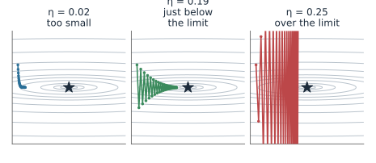
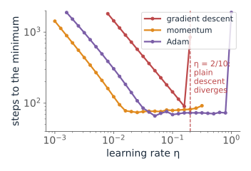
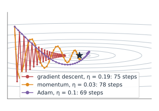
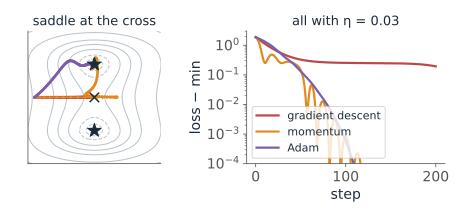
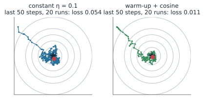
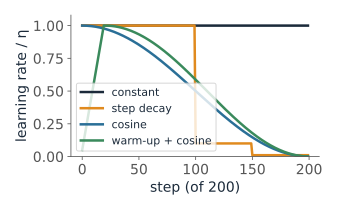

## About this lecture

The [backpropagation unit](../backprop/lec.qmd) gave every weight its gradient and took plain steps downhill, with momentum as a first look. Real networks are trained with better step rules. This unit:

- why **one learning rate** is awkward: steep and flat directions at once;
- **momentum** (a heavy ball) and **Adam** (a step size for every weight);
- **saddles**, flat regions and **noisy** mini-batch gradients;
- **learning-rate schedules**: warm-up, step decay, cosine decay.

*Slides titled **The math** give the formulas and proofs; the ideas are complete without them.*

::: notes
Demo tour: optrace, presets "long valley, each at its best η", "all η = 0.03", "plain descent over the edge", "the loss × 100", "saddle", "noisy gradients" (constant, then warm-up + cosine), "Adam without bias correction". All numbers on these slides come from the demo's code (optrace/model.ts) and agree with the coding exercise (training/src/optimisers/).
:::

## One learning rate, three outcomes

:::: {.columns}
::: {.column width="45%"}
A **long valley**: the loss $0.1a^2 + 5b^2$ over two weights. Across the valley it is 50 times steeper than along it.

- $\eta = 0.02$: safe, but it crawls along the floor.
- $\eta = 0.19$: zig-zags across, but gets there (75 steps).
- $\eta = 0.25$: every step across overshoots more: it **diverges**.

The steep direction sets the **limit**, the flat direction sets the **time**.
:::
::: {.column width="55%"}
{fig-alt="Three contour plots of the long valley with paths of plain gradient descent from the same start. Eta 0.02: the path drops to the valley floor and then creeps slowly towards the minimum. Eta 0.19: the path zig-zags across the valley with shrinking jumps and reaches the minimum. Eta 0.25: the jumps across the valley grow and the path leaves the plot." width="100%"}
:::
::::

## How many steps does each learning rate need?

:::: {.columns}
::: {.column width="45%"}
Steps until the loss stays within 0.001 of the minimum, on the long valley:

- **Plain descent**: best just below $\eta = 0.2$ (75 steps), then a cliff: it diverges.
- **Momentum** and **Adam**: under 100 steps over a wide range of $\eta$ (momentum from 0.015 to 0.3, Adam from 0.03 to 0.8).

A good optimiser is not only faster: it is **forgiving** about $\eta$, which we never know in advance.
:::
::: {.column width="55%"}
{fig-alt="Steps to the minimum against the learning rate, both on log scales, for the long valley. Gradient descent falls from 2000 steps at eta 0.008 to 90 at 0.16 and then shoots up: at eta 0.2 (dashed line) it diverges. Momentum falls to about 75 steps by eta 0.02 and stays flat up to 0.3. Adam falls to about 70 steps by eta 0.05 and stays flat up to 0.8, then diverges." width="100%"}
:::
::::

## The math: why the steep direction sets the limit {.math}

Near a minimum the loss is a bowl, $\mathcal L(\mathbf w) \approx \tfrac12(\mathbf w - \mathbf w^*)^\top H(\mathbf w - \mathbf w^*)$, with curvatures $\lambda_i$ (eigenvalues of the Hessian $H$). Plain descent acts on each eigendirection separately:

$$e_i \leftarrow (1 - \eta\lambda_i)\,e_i$$

- Stable only if $|1 - \eta\lambda_i| < 1$ for all $i$: $\eta < 2/\lambda_{\max}$. Valley: $\lambda = 0.2$ and $10$, so $\eta < 0.2$.
- For $\eta\lambda_i > 1$ the sign flips each step: the **zig-zag**.
- The flat direction shrinks by $1 - \eta\lambda_{\min}$ per step: about $1/(\eta\lambda_{\min})$ steps. At the limit $\eta \approx 2/\lambda_{\max}$ that is $\lambda_{\max}/2\lambda_{\min}$ = the **condition number** over 2 (here 25 steps per factor $e$).

## Momentum: a heavy ball

:::: {.columns}
::: {.column width="50%"}
Keep a **velocity**: each step adds the new gradient to 90 % of the old velocity, then moves along the velocity.

- Along the valley the gradients agree: the velocity builds up to **10 ×** one gradient.
- Across the valley they alternate: they **cancel**.
- So momentum speeds up the flat direction without making the steep one unstable.

The path overshoots and swings back (orange), like a ball rolling in a bowl.
:::
::: {.column width="50%"}
{fig-alt="Contour plot of the long valley with three paths from the same start: gradient descent at eta 0.19 zig-zags across the valley (75 steps); momentum at eta 0.03 sweeps in wide arcs that overshoot the minimum and swing back (78 steps); Adam at eta 0.1 runs diagonally and then along the valley floor (69 steps)." width="100%"}
:::
::::

## Adam: a step size for every weight

:::: {.columns}
::: {.column width="50%"}
Adam keeps two running averages for **each weight**: of its gradient ($m$) and of its gradient **squared** ($v$). The step is

$$\Delta w = -\eta\,\frac{m}{\sqrt v}$$

- A weight whose gradients are large and steady: $m/\sqrt v \approx \pm 1$, step $\approx \eta$.
- A weight with tiny gradients gets the **same** step size $\eta$: flat directions are not neglected.
- Gradients that flip sign: $m$ averages out, the step shrinks.

Adam is momentum plus a per-weight rescaling. It is the default for training networks.
:::
::: {.column width="50%"}
| | step of each weight |
|---|---|
| plain descent | $\eta \times$ gradient |
| momentum | $\eta \times$ velocity |
| Adam | $\eta \times$ (about $\pm 1$) |

On the long valley the gradient along $b$ starts 22 times larger than along $a$. Plain descent moves $b$ 22 times further; Adam moves both by $\eta$: its first step is exactly $(+0.1, -0.1)$ for $\eta = 0.1$, a diagonal (purple path on the last slide).
:::
::::

## The math: momentum and Adam {.math}

Gradient $\mathbf g_t$ at step $t$; all operations per weight.

- **Momentum**: $\mathbf v_t = \beta\mathbf v_{t-1} + \mathbf g_t$, $\ \mathbf w_t = \mathbf w_{t-1} - \eta\mathbf v_t$. For a constant gradient, $\mathbf v_t \to \mathbf g/(1 - \beta)$: with $\beta = 0.9$ the effective step is $10\eta$.
- **Adam** (Kingma and Ba, 2015), $\beta_1 = 0.9$, $\beta_2 = 0.999$, $\epsilon = 10^{-8}$:

$$\mathbf m_t = \beta_1\mathbf m_{t-1} + (1 - \beta_1)\mathbf g_t, \qquad \mathbf v_t = \beta_2\mathbf v_{t-1} + (1 - \beta_2)\mathbf g_t^2$$
$$\hat{\mathbf m}_t = \frac{\mathbf m_t}{1 - \beta_1^t}, \qquad \hat{\mathbf v}_t = \frac{\mathbf v_t}{1 - \beta_2^t}, \qquad \mathbf w_t = \mathbf w_{t-1} - \eta\,\frac{\hat{\mathbf m}_t}{\sqrt{\hat{\mathbf v}_t} + \epsilon}$$

- **AdamW**: weight decay applied directly, $\mathbf w \leftarrow \mathbf w - \eta\lambda\mathbf w$, not through $\mathbf g$ (otherwise Adam's rescaling weakens it for weights with large gradients).

## The math: why Adam's step is about scale-free, and bias correction {.math}

- Multiply the loss by $c > 0$: every gradient becomes $c\mathbf g$, so $\mathbf m \to c\mathbf m$, $\sqrt{\mathbf v} \to c\sqrt{\mathbf v}$, and $\hat{\mathbf m}/\sqrt{\hat{\mathbf v}}$ is **unchanged** (up to $\epsilon$). Plain descent's step is multiplied by $c$. Demo: the valley with the loss × 100: Adam still 69 steps, plain descent and momentum diverge.
- When a weight's gradient is steady, $\hat m \approx g$ and $\sqrt{\hat v} \approx |g|$: it moves by about $\eta$ per step, whatever the size of $g$. So $\eta$ is a **distance in weight space**, not a multiplier of the gradient.
- **Bias correction**: $\mathbf m$ and $\mathbf v$ start at 0, so early on they are too small: $m_1 = 0.1\,g_1$, $v_1 = 0.001\,g_1^2$, and $m_1/\sqrt{v_1} = 0.1/\sqrt{0.001} = 3.16$. Dividing by $1 - \beta^t$ makes $\hat m_1 = g_1$, $\hat v_1 = g_1^2$: the first step is exactly $\eta$. Without the correction the first steps are 3–5 times too long.

## Try it: the optimiser race

```{=html}
<link rel="stylesheet" href="../demos/dist/demo.css">
<div data-demo="optrace" data-preset="valley"></div>
<script src="../demos/dist/optrace.js"></script>
```

::: notes
Each optimiser has its own learning rate. "each at its best η": 75, 78, 69 steps. "all η = 0.03": plain descent 481 steps (still far after 200), momentum 78, Adam 89. "over the edge": η = 0.21 > 0.2, plain descent zig-zags outward. "the loss × 100": plain descent and momentum diverge at once; Adam's path is identical. "saddle": all at 0.03. "noisy gradients": compare the end of the paths and the loss plot, constant vs warm-up + cosine. "Adam without bias correction": the first steps are 0.32, then about 0.4 instead of 0.1.
:::

## Saddles and flat regions

:::: {.columns}
::: {.column width="45%"}
At a **saddle** the loss curves up in one direction and down in another; the gradient is almost zero there. In networks with millions of weights, most points with zero gradient are saddles, not minima.

- Started 0.001 off the saddle, plain descent ($\eta = 0.03$) needs 278 steps to roll off; within 200 steps it is still stuck (red).
- Momentum (92 steps) and Adam (97) leave much sooner: the velocity builds up; Adam does not care how small the gradient is.
- Mini-batch noise also kicks the weights off a saddle.
:::
::: {.column width="55%"}
{fig-alt="Left: contour plot of a saddle with two minima above and below it; three paths start at the left on the horizontal axis. All run to the saddle point (cross); momentum and Adam then turn upwards to the upper minimum, while plain descent stays near the saddle. Right: loss minus the minimum against the step on a log scale, all with eta 0.03: plain descent drops to a plateau around 0.25 and stays there until step 200; momentum and Adam leave the plateau and reach the minimum by about step 100." width="100%"}
:::
::::

## Noisy gradients from mini-batches

:::: {.columns}
::: {.column width="45%"}
The gradient of a **mini-batch** is a noisy estimate of the full one (the [backprop unit](../backprop/lec.qmd)). Here: a round bowl, with noise of size 1 added to every gradient.

- With a constant $\eta$ the weights reach the minimum fast but keep **jiggling** around it: the loss stays at about 0.054 (last 50 of 200 steps, mean of 20 runs).
- Lowering $\eta$ at the end (cosine decay) lets them **settle**: about 0.011, five times lower.

The same for momentum and Adam. Large steps early, small steps late: a **schedule**.
:::
::: {.column width="55%"}
{fig-alt="Two contour plots of a round bowl with one noisy path of plain gradient descent each. With a constant learning rate 0.1 the path reaches the minimum and then wanders in a cloud around it; mean loss of the last 50 steps 0.054. With warm-up and cosine decay the path ends in a tight cluster at the minimum; mean loss 0.011." width="100%"}
:::
::::

## Learning-rate schedules

:::: {.columns}
::: {.column width="45%"}
The learning rate as a function of the step, as a share of the largest $\eta$:

- **Step decay**: divide by 10 at fixed points (here at 50 % and 75 % of the training).
- **Cosine decay**: a smooth half cosine from $\eta$ to 0.
- **Warm-up**: start small and grow linearly over the first steps (here 10 %), then decay.

Why warm-up? At the start the weights are random and Adam's running averages are still poor estimates; large early steps can throw the network into a bad region (dead units, saturated layers) it never leaves.
:::
::: {.column width="55%"}
{fig-alt="Learning rate as a fraction of eta against the step, for 200 steps. Constant: 1 throughout. Step decay: 1 until step 100, 0.1 until step 150, then 0.01. Cosine: a smooth fall from 1 to 0. Warm-up + cosine: a linear rise from 0 to 1 over the first 20 steps, then the cosine fall to 0." width="100%"}
:::
::::

## Adam as pseudocode

```
m = 0, v = 0 for every weight;  t = 0
for each mini-batch:
    g = gradient of the batch loss (backpropagation)
    t = t + 1
    eta_t = schedule(t)                       # warm-up, then decay
    for every weight w (with its own m, v):
        m = 0.9 · m + 0.1 · g
        v = 0.999 · v + 0.001 · g²
        m_hat = m / (1 − 0.9^t),  v_hat = v / (1 − 0.999^t)
        w = w − eta_t · m_hat / (sqrt(v_hat) + 1e-8)
```

- Two numbers of memory per weight, a few operations per weight per step: cheap next to backpropagation.

::: notes
The coding exercise (training/src/optimisers/ in the course code download) writes gd_step, momentum_step, adam_step and the warm-up + cosine schedule, and runs the race of the demo on the same surfaces: the step counts agree with the demo's.
:::

## Which optimiser, in practice?

| | when |
|---|---|
| **Adam / AdamW**, $\eta \approx 10^{-3}$–$10^{-4}$ | the default: works for most networks with little tuning; transformers |
| **SGD + momentum** 0.9, $\eta \approx 0.01$–$0.1$ | convolutional networks for classification; often slightly better test results, needs a tuned schedule |
| **warm-up** for the first 1–5 % | large networks, large batches, Adam |
| **cosine** or **step decay** to the end | almost always |

- Larger mini-batches give less noisy gradients and allow a larger $\eta$ (roughly in proportion, up to a point).
- Try a few learning rates a factor 3–10 apart on a short run first; [reading the curves](../training-curves/lec.qmd) tells you which.

## Summary

| Idea | In one line |
|---|---|
| Learning rate | the steepest direction limits it ($\eta < 2/\lambda_{\max}$); the flattest sets the time |
| Momentum | a velocity that adds up agreeing gradients and cancels alternating ones |
| Adam | per-weight steps of about $\eta$: gradient average / root of squared-gradient average |
| Scale-free | Adam's step does not change when the loss is multiplied by a constant |
| Bias correction | divide the running averages by $1 - \beta^t$, so the first steps are not too long |
| Saddles | near-zero gradients; momentum, Adam and noise get away faster |
| Schedules | warm-up at the start, decay at the end: settle instead of jiggle |

Next: why deep stacks of layers are hard to train at all, and the normalisation layers and residual connections that fix it.
