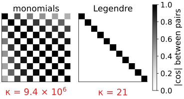
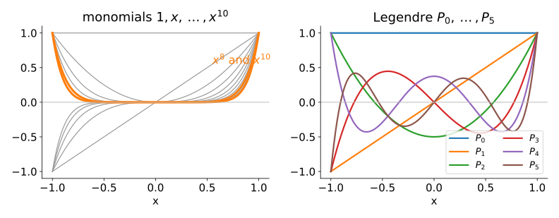
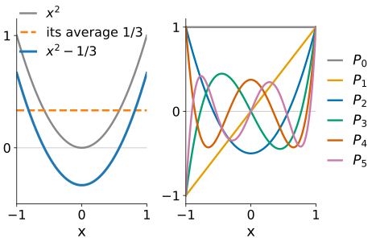
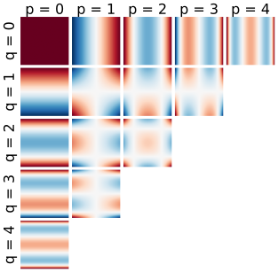
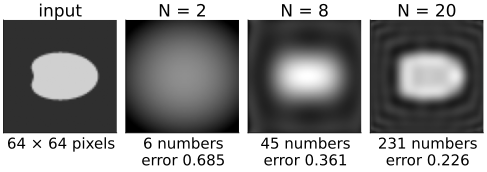
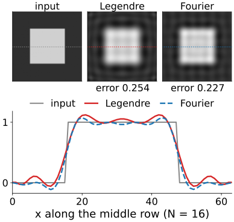
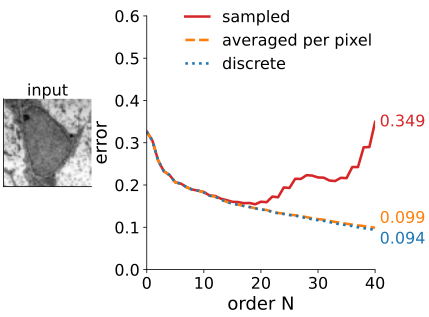
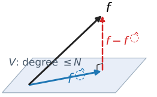

## About this lecture

All moments determine an image. Can we get the image **back** from the moments up to order $N$?

- With monomials it is a **linear system**, and a badly conditioned one: $x^8$ and $x^{10}$ look almost the same.
- **Gram–Schmidt** turns $1, x, x^2, \dots$ into orthogonal **Legendre polynomials**.
- **Legendre moments**: the same information, better coordinates. Reconstruction becomes a **projection**, like truncating a Fourier series.
- What pixels do to it: sampled polynomials are not quite orthogonal; integrate, or use **discrete** orthogonal polynomials.

*Slides titled **The math** give the formulas and proofs; the ideas are complete without them.*

::: notes
Third unit of the moments elective. Linear algebra assumed: inner product, orthogonal projection, Gram–Schmidt on vectors, condition number (one line of recall). From the Fourier unit (day 1): a coefficient is an inner product with a basis function, and low-pass filtering = truncating the expansion. Coordinates are mapped to [−1, 1] throughout.
:::

## Getting the image back

:::: {.columns}
::: {.column width="58%"}
The moments are inner products: $m_{pq} = \langle I, x^p y^q\rangle$. Suppose we look for the polynomial $\hat I = \sum_{p+q \le N} a_{pq}\, x^p y^q$ with **the same moments** as $I$ (the best polynomial approximation, see below).

- Each moment condition is one linear equation in the unknowns $a_{pq}$: a **linear system** $G\,a = m$.
- The matrix $G$ holds the inner products of the basis functions with each other: the **Gram matrix**, $G_{jk} = \langle x^j, x^k\rangle$ in 1D.
- If the basis functions were **orthogonal**, $G$ would be diagonal and each coefficient would be one division. Monomials are far from orthogonal.
:::
::: {.column width="42%"}
{fig-alt="Two Gram matrices drawn as the absolute cosines between pairs of basis functions, degree 0 to 10. Monomials: a checkerboard of values near 1 (every even power is almost parallel to every other even power, the same for odd), condition number 9.4 × 10^6. Legendre: only the diagonal, condition number 21." width="100%"}
:::
::::

## Monomials look alike

{fig-alt="The monomials 1, x, …, x^10 on [−1, 1], with x^8 and x^10 almost the same curve, next to the Legendre polynomials of the same degrees, which oscillate and look different from one another." width="85%"}

On $[-1, 1]$, $x^8$ and $x^{10}$ are almost the same curve: the cosine of the angle between them (as vectors of a function space) is **0.994**. Their moments carry almost the same information, and telling their contributions apart is like solving for two nearly parallel vectors.

## The math: the Gram matrix and its condition {.math}

Inner product of functions on $[-1, 1]$: $\langle g, h\rangle = \int_{-1}^{1} g(x) h(x)\,dx$ (a sum $\sum_i g_i h_i \Delta x$ on a grid).

- Monomials: $G_{jk} = \int_{-1}^{1} x^{j+k}\,dx = \frac{2}{j+k+1}$ if $j + k$ is even, else 0. On $[0, 1]$: $\frac{1}{j+k+1}$, the Hilbert matrix.
- $\cos\angle(x^8, x^{10}) = \frac{2/19}{\sqrt{(2/17)(2/21)}} = 0.994$.
- Condition number $\kappa(G)$ (largest / smallest eigenvalue): about $\log_{10}\kappa$ digits are lost when solving $G a = m$.

| degree $N$ | 2 | 5 | 10 | 20 |
|---|---|---|---|---|
| $\kappa$ on $[-1, 1]$ | 14 | $1.9 \times 10^3$ | $9.4 \times 10^6$ | $3.1 \times 10^{14}$ |
| $\kappa$ on $[0, 1]$ | 524 | $1.5 \times 10^7$ | $5.2 \times 10^{14}$ | (beyond double precision) |

## Gram–Schmidt: make them orthogonal

:::: {.columns}
::: {.column width="52%"}
Linear algebra: take the vectors one by one and subtract from each its projections onto the ones already made orthogonal. The same with functions:

- $P_0 = 1$.
- $x$ is already orthogonal to 1 on $[-1, 1]$ (odd times even): $P_1 = x$.
- $x^2$ has a component along 1: its average $\tfrac13$. Subtract it: $x^2 - \tfrac13$, scaled so that $P_2(1) = 1$: $P_2 = \tfrac12(3x^2 - 1)$.
- And so on: $P_3 = \tfrac12(5x^3 - 3x)$, …

These are the **Legendre polynomials**. Each new one has exactly one more zero; they look like waves that get faster, and none is close to another.
:::
::: {.column width="48%"}
{fig-alt="Left: x squared, its average 1/3 as a dashed line, and x squared minus 1/3, which is orthogonal to the constant. Right: the Legendre polynomials P0 to P5 on [−1, 1], all equal to 1 at x = 1, with 0 to 5 zeros." width="100%"}
:::
::::

## The math: Legendre polynomials {.math}

- Gram–Schmidt: $q_n = x^n - \sum_{k<n} \frac{\langle x^n, q_k\rangle}{\langle q_k, q_k\rangle} q_k$, then $P_n = q_n / q_n(1)$.
- Three-term recurrence (no projections needed): $(n+1)P_{n+1}(x) = (2n+1)\,x\,P_n(x) - n\,P_{n-1}(x)$.
- Orthogonality: $\int_{-1}^{1} P_m P_n\,dx = \frac{2}{2n+1}\delta_{mn}$.
- $P_n$ is even for even $n$, odd for odd $n$, $P_n(1) = 1$, and it has $n$ zeros in $(-1, 1)$, crowded towards the ends.

## Try it: monomials and Legendre in 1D

```{=html}
<link rel="stylesheet" href="../demos/dist/demo.css">
<div data-demo="polybasis" data-preset="alike"></div>
<script src="../demos/dist/polybasis.js"></script>
```

::: notes
Top: the basis functions up to degree N, and their Gram matrix as cosines (1 = same direction) with the condition number. Bottom: a signal on [−1, 1] (400 samples) fitted with degree N by both bases, and the error against N. Tour: "monomials look alike" (N = 10): the Gram matrix is full of cosines near 1, κ = 9.5 × 10⁶. Click Legendre: the identity, κ = 21 (only the different lengths 2/(2n+1), from 2 down to 2/21). "Gram–Schmidt to P₃": step through with the button; the top-left block of the Gram matrix becomes diagonal one row at a time. "fit a step": with 64-bit arithmetic both fits are identical up to N ≈ 20 (error 0.1749 at N = 12). "monomials break down" (bump, N = 24): monomials 0.147, Legendre 0.017. Switch to 32-bit: the monomial fit stops improving already at N ≈ 13.
:::

## Legendre moments

:::: {.columns}
::: {.column width="62%"}
Use $P_p(x)P_q(y)$ instead of $x^p y^q$, on the image mapped to the square $[-1, 1]^2$:

$$a_{pq} = \frac{(2p+1)(2q+1)}{4} \iint P_p(x)\,P_q(y)\, I(x, y)\,dx\,dy.$$

- **Same information** as the monomial moments: $P_p$ is a combination of $1, x, \dots, x^p$, so each $a_{pq}$ is a fixed combination of the $m_{kl}$ with $k \le p$, $l \le q$ (a triangular change of basis).
- **Better coordinates**: each $a_{pq}$ is just the coefficient of $P_p P_q$ in the image. No system to solve.
:::
::: {.column width="38%"}
{fig-alt="The 15 basis images P_p(x) P_q(y) with p + q at most 4, arranged by p (columns) and q (rows); red positive, blue negative. The first row varies only along x, the first column only along y." width="100%"}
:::
::::

## The math: from geometric to Legendre moments {.math}

Write $P_p(x) = \sum_{k \le p} \beta_{pk} x^k$ (from the recurrence). Then

$$a_{pq} = \frac{(2p+1)(2q+1)}{4} \sum_{k \le p}\sum_{l \le q} \beta_{pk}\beta_{ql}\, m_{kl}.$$

Example: $P_2 = \tfrac32 x^2 - \tfrac12$, so $a_{20} = \tfrac54\big(\tfrac32 m_{20} - \tfrac12 m_{00}\big)$.

The triangular matrix $(\beta_{pk})$ is invertible: the $a_{pq}$ with $p + q \le N$ and the $m_{pq}$ with $p + q \le N$ determine each other. What changes is only how the numbers are **conditioned**.

## Reconstruction is a projection

$$\hat I_N(x, y) = \sum_{p + q \le N} a_{pq}\, P_p(x)\, P_q(y).$$

- This is the **orthogonal projection** of $I$ onto the polynomials of total degree $\le N$: the best such polynomial in the least-squares sense.
- **Adding an order never changes the coefficients already computed** (it would with monomials: every $a_{pq}$ of the system changes when $N$ grows).
- The same as truncating a **Fourier series** (the low-pass of the Fourier unit), with a different basis: the error looks different (next slide).

{fig-alt="A 64 × 64 nucleus and its Legendre reconstructions: N = 2 (6 numbers, error 0.685) is a blurry blob, N = 8 (45 numbers, 0.361) an oval, N = 20 (231 numbers, 0.226) shows the dent, with ripples near the border." width="58%" fig-align="center" .nostretch}

## Try it: rebuild an image from its moments

```{=html}
<link rel="stylesheet" href="../demos/dist/demo.css">
<div data-demo="momentrecon" data-preset="blurry" data-presets="blurry,explode,ringing"></div>
<script src="../demos/dist/momentrecon.js"></script>
```

::: notes
64 × 64 inputs. Panels: monomials (least squares through the Gram system), Legendre, Zernike (next unit) and a Fourier low-pass with the same number of coefficients; error = relative RMS against the input. Display range: the input's range ± 30 %, so overshoots show. Tour: "low orders = blurry ellipse" (nucleus, N = 2, 6 coefficients): a blurry blob, Legendre error 0.685. Move N up: at N = 20 (231 numbers) the dent is back, error 0.226. "monomials explode" (letter E, N = 14, monomial coordinates in [0, 1]): monomial error 2.43 against 0.366 for Legendre; switch the coordinates to [−1, 1]: 0.365, the same as Legendre (at 64 × 64 it departs only from N ≈ 25). "Legendre vs Fourier ringing" (square, N = 16): errors 0.254 and 0.227; compare the ripples.
:::

## Ringing and compression

:::: {.columns}
::: {.column width="52%"}
- A sharp edge cannot be a low-degree polynomial: the projection **overshoots** next to it (Gibbs-like ringing), as in the Fourier low-pass.
- **Legendre** ripples follow the image border and crowd towards it (the zeros of $P_n$ crowd towards $\pm 1$). **Fourier** ripples are evenly spaced and wrap around the border: the Fourier basis is periodic.
- Moments as **compression**: up to $N = 20$ there are 231 Legendre moments; a $128 \times 128$ image has 16384 pixels (1.4 %). Low orders keep the coarse shape, like the low frequencies.
:::
::: {.column width="48%"}
{fig-alt="A white square on a dark background rebuilt with N = 16 by Legendre (error 0.254) and by a Fourier low-pass with the same number of coefficients (error 0.227). Below, the middle row: both overshoot next to the edges; the Legendre ripples grow towards the image border, the Fourier ripples are even and continue across it." width="100%"}
:::
::::

## Pixels: sampled polynomials are not orthogonal

:::: {.columns}
::: {.column width="52%"}
On a grid of pixels the integrals become sums, and the sampled $P_n$ are only **approximately** orthogonal. The error grows with the order.

- **Integrate per pixel**: use the average of $P_n$ over each pixel (exact for an image that is constant on each pixel).
- **Discrete orthogonal polynomials** (Tchebichef, Krawtchouk; Mukundan 2001): polynomials of degree $n$ that are exactly orthogonal on the points $0, 1, \dots, W-1$ (Gram–Schmidt on the sampled monomials, or a discrete three-term recurrence).

In the demo, the micrograph (bright edges) at $N = 40$: sampled Legendre error **0.349** and rising; pixel-integrated 0.099; discrete 0.094.
:::
::: {.column width="48%"}
{fig-alt="A 64 × 64 crop of the micrograph and its reconstruction error against the order N for three variants. Up to N ≈ 15 the three curves agree; then the sampled Legendre error rises to 0.349 at N = 40, while the pixel-averaged (0.099) and discrete (0.094) versions keep falling." width="100%"}
:::
::::

::: notes
The crop is from the course micrograph: transmission electron micrograph of a mesenchymal stem cell, Robert M. Hunt, CC BY 3.0, via Wikimedia Commons. Figure scripts: tools/figs/orthogonal-moments/.
:::

## The math: projection and discrete orthogonality {.math}

{fig-alt="A vector f above a plane V of polynomials of degree at most N; its projection f-hat lies in the plane and the error f minus f-hat is perpendicular to it." width="28%" style="float:right; margin-left:1em" .nostretch}

**Best approximation.** For an orthogonal basis $\{b_k\}$ of a subspace $V$, $\hat f = \sum_k \frac{\langle f, b_k\rangle}{\langle b_k, b_k\rangle} b_k$ satisfies $\langle f - \hat f, b_j\rangle = 0$ for every $j$. For any $g \in V$: $\|f - g\|^2 = \|f - \hat f\|^2 + \|\hat f - g\|^2 \ge \|f - \hat f\|^2$ (Pythagoras).

**On a grid.** With $\langle g, h\rangle = \sum_i g(x_i)h(x_i)\Delta x$ the sampled Legendre polynomials have $\langle P_m, P_n\rangle \ne 0$ for $m \ne n$ (the midpoint rule is not exact for polynomials of degree $m + n \ge 2$). Discrete orthogonal polynomials $T_n$ satisfy $\sum_i T_m(x_i)T_n(x_i) = \delta_{mn}$ exactly; projection with them is the exact least-squares fit on the grid, which the monomial Gram system also computes, if the arithmetic were exact.

## Summary

- Reconstructing from monomial moments is a linear system with the **Gram matrix**; monomials are nearly parallel, the system is **ill-conditioned** ($\kappa \approx 10^7$ at degree 10 on $[-1, 1]$, $10^{14}$ on $[0, 1]$).
- **Gram–Schmidt** gives the **Legendre polynomials**: $P_0 = 1$, $P_1 = x$, $P_2 = \tfrac12(3x^2 - 1)$, three-term recurrence.
- **Legendre moments** carry the same information as $m_{pq}$; reconstruction is an **orthogonal projection**: best in least squares, earlier coefficients never change.
- Ringing at edges as in Fourier, with a different pattern; on pixels, **integrate** or use **discrete** orthogonal polynomials.
