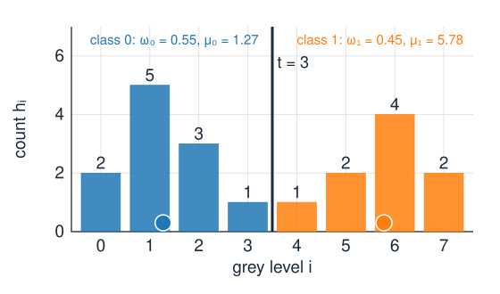
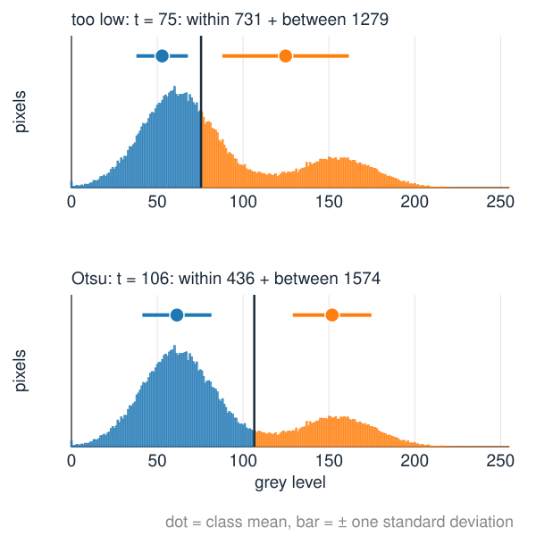
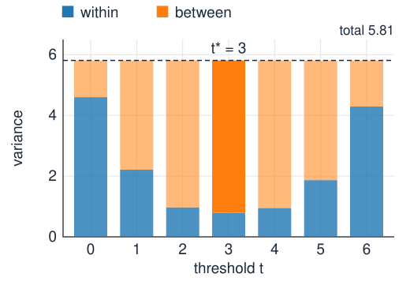
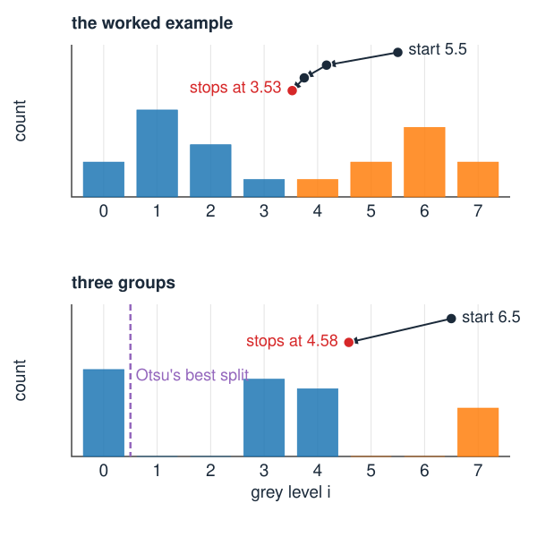
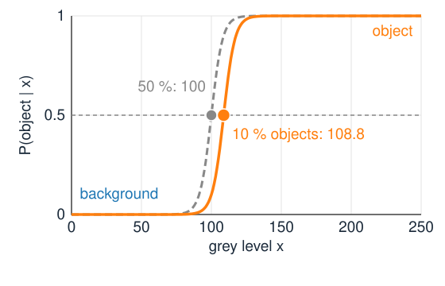
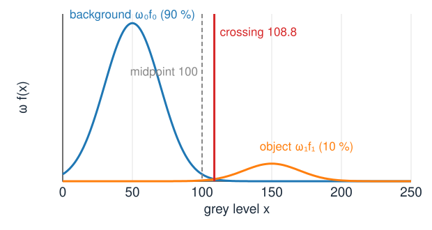
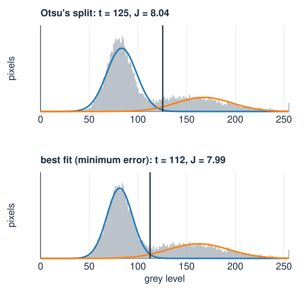
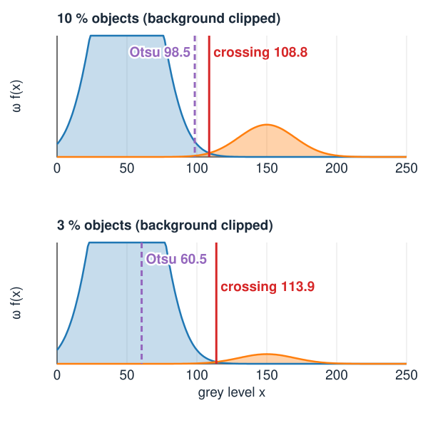
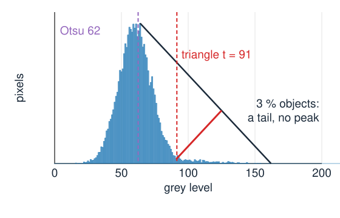

## About this lecture

Last unit: a threshold $t$ splits the histogram into background and object, and a good $t$ sits in a valley. Now the computer chooses $t$ from the histogram alone.

- **Otsu**: make both classes as **tight** as possible; equivalently, push their means **apart**.
- **Isodata**: two means and their midpoint, repeated; 1D k-means.
- **Minimum error**: model the histogram as **two normal distributions** and put $t$ where they **cross** (Bayes).
- Which method is **biased** when one class is small or wide, and in which direction.
- Briefly: the **triangle** and **maximum-entropy** methods, and **three classes**.

*Slides titled **The math** give the formulas and proofs; the ideas are complete without them.*

## Two classes

{width="56%"}

A threshold $t$ splits the grey levels into **class 0** (background, $i \le t$) and **class 1** (object, $i > t$). Each class has

- a **weight** $\omega_0$, $\omega_1$: the fraction of pixels in it ($\omega_0 = P(t)$, $\omega_1 = 1 - \omega_0$),
- a **mean** $\mu_0$, $\mu_1$ and a **variance** $\sigma_0^2$, $\sigma_1^2$ of its grey levels.

Worked example (8 grey levels, 20 pixels): $h = (2, 5, 3, 1, 1, 2, 4, 2)$, mean $\mu = 3.3$, variance $\sigma_T^2 = 5.81$. At $t = 3$: $\omega_0 = 0.55$, $\mu_0 = 1.27$, $\mu_1 = 5.78$.

## Otsu: tight classes, far apart

:::: {.columns}
::: {.column width="55%"}
Otsu (1979): a good split makes each class **tight** around its own mean.

- Measure the spread **within** the classes: $\sigma_W^2$ = the weighted average of the two class variances. Choose $t$ to make it smallest.
- The total spread of all pixels, $\sigma_T^2$, does not depend on $t$. It splits into **within** + **between**: the spread of the pixels around their class mean, plus the spread of the class means around the overall mean.
- So making the classes tight is the same as making the class means **far apart**: maximise the **between-class variance** $\sigma_B^2 = \omega_0\omega_1(\mu_0 - \mu_1)^2$.
- $\sigma_B^2$ is large when the means are far apart **and** both classes are substantial: a class with 1 % of the pixels contributes little, however far away it is.
:::
::: {.column width="45%"}
{fig-alt="The histogram of the noisy blob image split twice. At t = 75 (too low) the object class is wide and the two class means are close: within-class variance 731, between 1279. At Otsu's t = 106 both classes are tight: within 436, between 1574. The sum is 2010 in both." width="100%"}

The blob image (noise 20): within + between is 2010 at every $t$.
:::
::::

## The math: within + between {.math}

With $p_i$ the normalised histogram, class 0 = $\{i \le t\}$:
$$\sigma_T^2 = \sum_i (i - \mu)^2 p_i = \sum_{k=0}^{1}\sum_{i \in k} \big((i - \mu_k) + (\mu_k - \mu)\big)^2 p_i .$$
Expand the square. The cross term $2(\mu_k - \mu)\sum_{i \in k}(i - \mu_k)p_i$ vanishes, because the deviations from a class's own mean sum to zero. What remains:
$$\sigma_T^2 = \underbrace{\omega_0\sigma_0^2 + \omega_1\sigma_1^2}_{\sigma_W^2} + \underbrace{\omega_0(\mu_0 - \mu)^2 + \omega_1(\mu_1 - \mu)^2}_{\sigma_B^2}.$$
$\sigma_T^2$ is fixed, so $\arg\min_t \sigma_W^2 = \arg\max_t \sigma_B^2$. With $\mu = \omega_0\mu_0 + \omega_1\mu_1$: $\mu_0 - \mu = \omega_1(\mu_0 - \mu_1)$ and $\mu_1 - \mu = \omega_0(\mu_1 - \mu_0)$, so
$$\sigma_B^2 = \omega_0\omega_1^2(\mu_0 - \mu_1)^2 + \omega_1\omega_0^2(\mu_0 - \mu_1)^2 = \omega_0\omega_1(\mu_0 - \mu_1)^2 .$$

## The math: one pass over the histogram {.math}

With the running sums $P(t) = \sum_{i \le t} p_i$ and $M(t) = \sum_{i \le t} i\,p_i$ of the last unit: $\omega_0 = P$, $\mu_0 = M/P$, $\mu_1 = (\mu - M)/(1 - P)$, and
$$\mu_1 - \mu_0 = \frac{\mu P - M}{P(1 - P)} \quad\Longrightarrow\quad \sigma_B^2(t) = \frac{\big(\mu\,P(t) - M(t)\big)^2}{P(t)\,\big(1 - P(t)\big)} .$$

- Build the histogram: $O(N)$ for $N$ pixels. Then one pass over the $L$ grey levels evaluates $\sigma_B^2$ at every $t$: $O(L)$.
- For 256 grey levels the search is free; even for 16-bit data it is 65 536 evaluations.
- Undefined where a class is empty ($P = 0$ or $1$).

## The worked example

:::: {.columns}
::: {.column width="60%"}
| $t$ | 0 | 1 | 2 | **3** | 4 | 5 | 6 |
|---|---|---|---|---|---|---|---|
| $\omega_0$ | 0.10 | 0.35 | 0.50 | **0.55** | 0.60 | 0.70 | 0.90 |
| $\mu_0$ | 0.00 | 0.71 | 1.10 | **1.27** | 1.50 | 2.00 | 2.89 |
| $\mu_1$ | 3.67 | 4.69 | 5.50 | **5.78** | 6.00 | 6.33 | 7.00 |
| $\sigma_B^2$ | 1.21 | 3.60 | 4.84 | **5.02** | 4.86 | 3.94 | 1.52 |
| $\sigma_W^2$ | 4.60 | 2.21 | 0.97 | **0.79** | 0.95 | 1.87 | 4.29 |

- Every column adds up to $\sigma_T^2 = 5.81$ (up to rounding).
- Otsu's threshold: $t^* = 3$, with $\sigma_B^2 = 5.02$. The mask is $I > 3$.
:::
::: {.column width="40%"}
{fig-alt="Stacked bars for t = 0 to 6: within-class variance (blue) at the bottom, between-class variance (orange) on top. Every bar reaches the same total 5.81; at t = 3 the blue part is smallest and the orange part largest." width="100%"}
:::
::::

## Try it: Otsu by hand

```{=html}
<link rel="stylesheet" href="../demos/dist/demo.css">
<div data-demo="otsubars" data-preset="example"></div>
<script src="../demos/dist/otsubars.js"></script>
```

::: notes
The bars are the worked example; drag a bar to change its count, move t with the slider or by clicking a row. The stacked bar under the plot shows total = within + between: the total stays at 5.81 while t moves. Tour: move t from 0 to 6 and watch the star (best t) and the stacked bar. "isodata step" from 5.5: 4.17 → 3.75 → 3.53, the same split as Otsu. "two equal peaks": t* = 3 by symmetry. "isodata stuck": three groups of levels; isodata from 6.5 stops at 4.58 (split 4, σ_B² = 3.33) while Otsu's best is t = 0 (4.05).
:::

## Isodata: two means and their midpoint

:::: {.columns}
::: {.column width="57%"}
Ridler & Calvard (1978): start with any $t$, then repeat

1. split at $t$ and compute the two class means $\mu_0$, $\mu_1$;
2. move $t$ to their **midpoint** $(\mu_0 + \mu_1)/2$;

until $t$ stops moving.

- Every pixel joins the **nearer** mean, then the means are recomputed: this is **k-means with $k = 2$** in one dimension.
- The worked example from $t = 5.5$: $4.17 \to 3.75 \to 3.53$, which splits at 3, the same as Otsu.
- It can stop at a **different** fixed point: with three groups of grey levels (levels 0, 3–4 and 7), isodata from 6.5 stops at 4.58 (split $\{0, 3, 4\}$ vs $\{7\}$), while Otsu's best split is $\{0\}$ vs the rest. Isodata finds a **local** optimum; Otsu searches all $t$.
:::
::: {.column width="43%"}
{fig-alt="Top: the worked example histogram; isodata starts at 5.5 and moves to 4.17, 3.75 and stops at 3.53, splitting at 3. Bottom: three groups of grey levels (0, 3 to 4, and 7); isodata starts at 6.5 and stops at 4.58, while Otsu's best split is between 0 and 1." width="100%"}
:::
::::

## The math: Otsu's optimum is an isodata fixed point {.math}

Continuous grey levels with density $p(x)$: $P' = p(t)$, $M' = t\,p(t)$. Write $D = \mu P - M = P(1 - P)(\mu_1 - \mu_0)$, so $\sigma_B^2 = D^2 / (P(1 - P))$ and $D' = (\mu - t)\,p(t)$. Setting the derivative to zero (with $p(t) \ne 0$, $D \ne 0$):
$$2(\mu - t)\,P(1 - P) = D(1 - 2P) \;\Longrightarrow\; t = \mu - \tfrac12 (1 - 2P)(\mu_1 - \mu_0).$$
Insert $\mu = P\mu_0 + (1 - P)\mu_1$:
$$t = \frac{\mu_0 + \mu_1}{2}.$$
Every stationary point of $\sigma_B^2(t)$, the maximum included, is a fixed point of isodata. The converse fails: a fixed point can be a local maximum or even a minimum of $\sigma_B^2$.

## Two classes as probabilities: Bayes

:::: {.columns}
::: {.column width="58%"}
Treat the grey level $x$ of a pixel as random. Class $k$ has prior probability $\omega_k$ (its share of the pixels) and a distribution $f_k(x)$ of grey levels.

- **Bayes' rule**: the probability that a pixel with grey level $x$ is object is proportional to $\omega_1 f_1(x)$; that it is background, to $\omega_0 f_0(x)$. "Posterior ∝ likelihood × prior."
- Decide **object** where $\omega_1 f_1(x) > \omega_0 f_0(x)$: this rule makes the fewest errors.
- For a threshold $t$: the errors are the background **tail** above $t$ plus the object tail below $t$. Moving $t$ trades one tail for the other; the total is smallest where the two weighted curves **cross**.
:::
::: {.column width="42%"}
{fig-alt="The probability that a pixel is object, plotted against its grey level, for background mean 50 and object mean 150 with standard deviation 20. With 10 % objects the curve passes 0.5 at 108.8; with equal weights (dashed) at 100." width="100%"}

Background 50, objects 150, $\sigma = 20$: with 10 % objects the even-odds point moves from 100 to 108.8.
:::
::::

## Where the curves cross

{width="58%"}

Background $\mu_0 = 50$ (90 % of the pixels), objects $\mu_1 = 150$ (10 %), both with $\sigma = 20$.

- The crossing is at **108.8**, not at the midpoint 100: the rarer class gets less room. Error 0.35 %, against 0.62 % at the midpoint.
- Shaded: the two tails that a threshold at the crossing gets wrong.
- Equal variances, equal weights: the crossing **is** the midpoint, as in isodata.

## The math: the minimum-error threshold {.math}

The error of the rule "object if $x > t$":
$$E(t) = \omega_0 \int_t^\infty f_0(x)\,dx + \omega_1 \int_{-\infty}^t f_1(x)\,dx, \qquad E'(t) = -\omega_0 f_0(t) + \omega_1 f_1(t) = 0 .$$
For normal $f_k$ take logarithms: $\ln\omega_0 - \ln\sigma_0 - \frac{(t - \mu_0)^2}{2\sigma_0^2} = \ln\omega_1 - \ln\sigma_1 - \frac{(t - \mu_1)^2}{2\sigma_1^2}$.

- Equal variances: the $t^2$ terms cancel, and
$$t = \frac{\mu_0 + \mu_1}{2} + \frac{\sigma^2}{\mu_1 - \mu_0}\,\ln\frac{\omega_0}{\omega_1} .$$
  Example: $100 + \frac{400}{100}\ln 9 = 108.8$.
- Unequal variances: a quadratic in $t$ with up to **two** roots. The wider class wins in **both** tails: far out on either side its density is larger.

## Minimum error from the histogram

:::: {.columns}
::: {.column width="52%"}
We do not know $\omega_k$, $\mu_k$, $\sigma_k$. Kittler & Illingworth (1986): for every candidate $t$,

- **fit** a normal distribution to each side of the split (weight, mean and variance of the pixels on that side),
- measure how well the two fitted curves **explain the histogram**,
- keep the $t$ with the best fit, and threshold there.

When the histogram really is two normal peaks, this lands near the crossing, even for unequal weights or widths. When it is not (clipped values, a long tail, three groups), the fit can go badly wrong.

The demo's "unequal variances": Otsu splits at 125, minimum error at 112 ($J$ = average misfit, smaller is better).
:::
::: {.column width="48%"}
{fig-alt="A histogram with a narrow background peak at 80 and a wide object class around 150. Top: split at Otsu's t = 125, the fitted narrow and wide normal curves miss the histogram (J = 8.04). Bottom: split at t = 112, the two fitted curves follow the histogram (J = 7.99)." width="100%"}
:::
::::

## The math: Kittler–Illingworth {.math}

The criterion is the average negative log-likelihood of the pixels under the fitted mixture, with each pixel assigned to its side of $t$:
$$J(t) = -\sum_i p_i \ln\big(\omega_{k(i)}\, f_{k(i)}(i)\big) = \tfrac12\ln 2\pi + \tfrac12 + \sum_k \omega_k \ln\sigma_k - \sum_k \omega_k \ln\omega_k ,$$
using $\sum_{i \in k} p_i (i - \mu_k)^2 = \omega_k\sigma_k^2$. Dropping constants and doubling:
$$J(t) = 1 + 2(\omega_0\ln\sigma_0 + \omega_1\ln\sigma_1) - 2(\omega_0\ln\omega_0 + \omega_1\ln\omega_1), \qquad t^* = \arg\min_t J(t).$$
Like Otsu, one pass with running sums (now also $\sum_{i \le t} i^2 p_i$). A class with almost zero variance gives $\ln\sigma \to -\infty$: guard against empty or one-level classes.

## Who is biased, and which way

:::: {.columns}
::: {.column width="55%"}
Otsu and isodata use only the **means**. In effect they assume **equal variances and similar weights**.

- **Small object class** (10 % of the pixels): Otsu moves **into the larger class**. On the curves of the Bayes slide it chooses 98.5 instead of 108.8; at 3 % objects it falls to 60.5, inside the background peak.
- **Much wider background**: Otsu again moves into the wider class.
- Minimum error follows the crossing as long as **the two-Gaussian model fits**.
- **Heavy overlap**: every threshold has a large error; the grey level alone cannot decide. Neighbours must help (graph cuts, day 13).
:::
::: {.column width="45%"}
{fig-alt="The weighted densities of background (mean 50) and objects (mean 150, standard deviation 20). With 10 % objects Otsu chooses 98.5 and the crossing is at 108.8. With 3 % objects Otsu falls to 60.5, inside the background peak, while the crossing is at 113.9." width="100%"}
:::
::::

## Try it: two Gaussians, six thresholds

```{=html}
<link rel="stylesheet" href="../demos/dist/demo.css">
<div data-demo="mixture" data-preset="weights"></div>
<script src="../demos/dist/mixture.js"></script>
```

::: notes
The image (right) is drawn from the mixture: blob-shaped objects with fraction ω₁, each pixel's grey level sampled from its class. Top: histogram (grey), weighted densities (blue, orange), every method's threshold (dashed); the selected one is solid, its error tails shaded. Below: its criterion curve. Table: threshold and error rate under the model. Tour: "equal, well separated": all at 125 except the triangle. "unequal weights" (ω₁ = 0.1): Otsu 85 with 19.9 % error, Bayes 114.6 (3.4 %), min-error 123 (4.1 %). "unequal variances": two Bayes crossings, 40.8 and 105.4. "small object (3 %)": Otsu 62 (40.6 %), triangle 91, Kapur 93, min-error 98, Bayes 94.1, all about 1.4 %. "heavy overlap": the best possible error is 21.9 %. Shrink the image to 32² to see how noisy small histograms make every method.
:::

## Other criteria: triangle and maximum entropy

:::: {.columns}
::: {.column width="57%"}
- **Triangle** (Zack et al., 1977): draw a line from the histogram's **peak** to the far end of its long tail; the threshold is where the histogram lies farthest **below** that line. Made for a **unimodal** histogram with a few bright object pixels (fluorescent spots), where there is no valley and Otsu fails.
- **Maximum entropy** (Kapur et al., 1985): choose $t$ so that the grey levels within each class are as **spread out** as possible (the entropies $H_0 + H_1$ of the two class distributions $p_i/\omega_k$ are largest).
- Another criterion, another answer: there is no single "correct" threshold. The choice is a choice of **model** of the histogram.
:::
::: {.column width="43%"}
{fig-alt="A unimodal histogram with a peak at 64 and a faint tail of object pixels. A line runs from the peak to the end of the tail at 162; the histogram lies farthest below it at 91, the triangle threshold. Otsu chooses 62, at the peak." width="100%"}

The demo's "small object (3 %)": triangle 91, Otsu 62.
:::
::::

## Three classes: multi-level Otsu

$\sigma_B^2 = \sum_k \omega_k(\mu_k - \mu)^2$ for $K$ classes; for three, try all pairs $t_1 < t_2$ (about 32 000 for 256 levels).

```{=html}
<link rel="stylesheet" href="../demos/dist/demo.css">
<div data-demo="histthresh" data-preset="levels3" data-criterion="otsu" data-levels="3"></div>
<script src="../demos/dist/histthresh.js"></script>
```

::: notes
The micrograph with three-class Otsu: t₁ = 120, t₂ = 188 (dark material in purple, the middle grey levels in orange, the bright background unmarked). Two-class Otsu (untick "3 classes") gives 163 with η = σ_B²/σ_T² = 0.76. The middle class mixes cytoplasm and nucleus: their grey levels overlap, so no threshold separates them.
:::

## Summary

- **Otsu**: total variance = within + between; minimise the within-class variance $\Leftrightarrow$ maximise $\sigma_B^2 = \omega_0\omega_1(\mu_0 - \mu_1)^2$. One pass over the histogram.
- **Isodata**: $t \leftarrow (\mu_0 + \mu_1)/2$, repeated; 1D 2-means. Otsu's optimum is one of its fixed points; it may stop at another.
- **Bayes / minimum error**: decide object where $\omega_1 f_1 > \omega_0 f_0$; the best threshold is where the weighted densities **cross**. Equal variances: midpoint shifted by $\frac{\sigma^2}{\mu_1 - \mu_0}\ln\frac{\omega_0}{\omega_1}$.
- **Kittler–Illingworth** fits two Gaussians at every $t$ and keeps the best fit.
- Otsu and isodata are **biased into the larger or wider class**; triangle for a unimodal histogram with a tail; three classes by multi-level Otsu.
