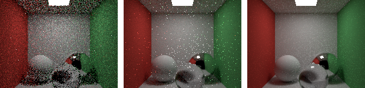
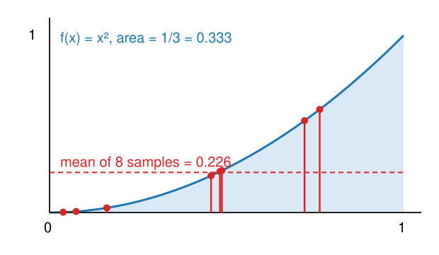

## About this lecture

[Whitted's ray tracer](../whitted/lec.qmd) follows a few special directions. Real light arrives at every point from **all** directions. This unit turns that into one integral and estimates it with random rays.

- **Radiance**, the **BRDF**, and the **rendering equation** in words.
- **Monte Carlo** integration: averaging random samples; unbiased, with noise that falls as $1/\sqrt N$.
- **Path tracing**: one random path per sample, many samples per pixel.
- **Importance sampling**: where to send the rays; **fireflies**; and a wrong image from a bad choice.
- **Denoising** a rendered image: the deconvolution day's problem again.

*Slides titled **The math** give the formulas and proofs; the ideas are complete without them.*

::: notes
This unit is the course's home for Monte Carlo integration and importance sampling (Ising's mcmc unit owns Markov chain sampling, where samples are correlated). Notation: radiance L, BRDF f_r, albedo ρ, a probability density p(·), N samples per pixel. Two demos: mcpixel (one pixel's integral in 2D, all numbers exact) and pathtracer (WebGL2, progressive).
:::

## What Whitted misses

{width="80%" fig-align="center"}

A closed box: white floor, ceiling and back wall, a red and a green wall, a square lamp in the ceiling, three balls (diffuse, mirror, glass). Path traced with 1, 16 and 256 samples per pixel.

- The white walls near the red wall turn **pinkish**: light bounces off the red wall onto them (**colour bleeding**).
- The shadows are **soft**: the lamp has an area.
- Under the glass ball: a bright spot of focused light (a **caustic**).
- And: **noise**, which shrinks as the number of samples grows.

## Radiance and the BRDF

- **Radiance** $L$: the light travelling along one ray, per direction. It does not change along a ray in empty space: what leaves one surface arrives at the next.
- A surface takes light arriving from one direction and sends some of it into another. The **BRDF** $f_r$ says how much, for every pair of directions.
  - **Lambertian** (matte): the same in every outgoing direction, $f_r = \rho/\pi$, with **albedo** $\rho$ = the fraction of light reflected.
  - **Mirror**: everything into one direction (the BRDF is a spike).
  - Glossy surfaces lie in between.
- Light that hits a surface at a slant is spread over a larger area: a factor $\cos\theta$ (Lambert's cosine of the 3D graphics day).

## The rendering equation

**Light leaving a point towards the eye = light it emits + the sum, over all incoming directions, of (incoming light × BRDF × cosine).** (Kajiya, 1986)

- The incoming light from a direction is the outgoing light of whatever point that direction hits, which itself depends on the light arriving *there*, and so on: the whole scene is inside the equation.
- Expanding it: emitted light + light that bounced once + twice + …
  - Whitted keeps only the mirror and refraction terms and point lights.
  - "Direct light only" stops after one bounce.
- Recall [Seeing voxels](../volrender/lec.qmd): the emission–absorption integral along a ray is the same bookkeeping, without bouncing.

## The math: the rendering equation {.math}

$$L_o(\mathbf x, \boldsymbol\omega_o) = L_e(\mathbf x, \boldsymbol\omega_o) + \int_\Omega f_r(\mathbf x, \boldsymbol\omega_i, \boldsymbol\omega_o)\,L_i(\mathbf x, \boldsymbol\omega_i)\,\cos\theta_i\,d\boldsymbol\omega_i,$$

$$L_i(\mathbf x, \boldsymbol\omega) = L_o\big(\text{hit}(\mathbf x, \boldsymbol\omega),\ -\boldsymbol\omega\big).$$

- $\Omega$: the hemisphere of directions above the surface; $d\boldsymbol\omega$: solid angle; $\theta_i$: angle between $\boldsymbol\omega_i$ and the normal.
- In operator form $L = L_e + \mathcal K L$, with $\mathcal K$ "bounce once". Solution $L = L_e + \mathcal K L_e + \mathcal K^2 L_e + \dots$ (a Neumann series), convergent because every bounce loses energy ($\rho < 1$).
- A path tracer estimates each term with random directions, and all of them at once by following a random path.

## Monte Carlo: integrals by random samples

{width="40%" fig-align="right"}

Estimate the area under a curve on $[0, 1]$: pick random points $x_1, \dots, x_N$, evaluate the curve, **average**.

- 8 random points under $f(x) = x^2$ (true area $1/3$): mean 0.226. Another 8 give another value.
- Throwing darts at a square and counting those inside a circle estimates $\pi$ the same way.
- **Unbiased**: right *on average*; each estimate is off by random noise.
- Why bother, when a 1D integral is easy? Because the rendering equation is an integral over directions, at every bounce, over all paths: hundreds of dimensions. Grids are hopeless there; random samples do not care about the dimension.

## The noise falls as $1/\sqrt N$

The error of a Monte Carlo estimate is random, with standard deviation $\sigma/\sqrt N$:

- $\sigma$: how much one sample varies; $N$: the number of samples.
- **4× the samples halve the noise**; 100× give one more decimal digit.
- In PSNR (recall [Camera noise, SNR and PSNR](../cameranoise/lec.qmd)): +3 dB per doubling of $N$, +12 dB from 16 to 256 samples per pixel.
- The same law as averaging $N$ beads ([Resolution](../resolution/lec.qmd)) and as shot noise: a path tracer is a **simulated camera** counting simulated photons, and its noise is the same kind as a real camera's.

## The math: unbiased, with variance $\sigma^2/N$ {.math}

Draw $X_1, \dots, X_N$ independently from a density $p$ (with $p > 0$ wherever $f \ne 0$):

$$\hat I = \frac1N\sum_{k=1}^N \frac{f(X_k)}{p(X_k)}, \qquad \mathbb E[\hat I] = \int \frac{f(x)}{p(x)}\,p(x)\,dx = \int f(x)\,dx.$$

- Independent samples: $\operatorname{Var}[\hat I] = \frac1N\operatorname{Var}\!\big[f(X)/p(X)\big] = \sigma^2/N$; RMS error $\sigma/\sqrt N$.
- Uniform $p = 1$ on $[0, 1]$, $f = x^2$: $\sigma^2 = \int x^4 - (\int x^2)^2 = 1/5 - 1/9$, $\sigma = 0.298$.
- PSNR $= 10\log_{10}(\text{peak}^2/\text{MSE})$ and MSE $\propto 1/N$: doubling $N$ adds $10\log_{10}2 = 3.0$ dB.
- Contrast [Sampling, temperature and the phase transition](../mcmc/lec.qmd): Markov chain samples are **correlated**, which inflates the variance beyond $\sigma^2/N$.

## Try it: one pixel's integral

```{=html}
<link rel="stylesheet" href="../demos/dist/demo.css">
<div data-demo="mcpixel" data-preset="uniform16"></div>
<script src="../demos/dist/mcpixel.js"></script>
```

::: notes
One surface point in 2D: light arrives over the half-circle of directions; the integrand is L(θ) cos θ. Samples are drawn from a pdf; the rays' lengths are the weights f/p; the estimate is their mean. "Repeat 500×": histogram of 500 estimates, and the RMS error against N on log–log axes with σ/√N. Tour: "uniform, 16 samples" (overcast sky, true value 1.714): RMS 0.244. "4× samples halves the error": N = 64, RMS 0.142 (σ/√N predicts 0.264 and 0.132). "Cosine sampling": σ drops from 1.06 to 0.30: the pdf follows the integrand. "Tiny lamp: fireflies": a lamp 0.5° wide; with cosine sampling, 81 % of the 64-sample estimates miss it (about 0.10), 19 % hit it once and jump by 9.4: the histogram has two humps, and the RMS is 4.2 for a true value of 2.1. "Sample the lamp": half the samples aimed at the lamp: σ 1.9 instead of 35. "A pdf that misses the lamp": the mean converges to 0.097 instead of 2.105, and the RMS error stops falling: biased, not noisy.
:::

## Path tracing

Per pixel, shoot $N$ **paths**; average them.

1. Start a ray from the eye through a random point in the pixel.
2. At the hit, add light if it is a lamp. Otherwise pick **one** random new direction (from the BRDF: a random direction for a matte surface, the mirror direction for a mirror, reflect or refract with probabilities $R$ and $1 - R$ for glass).
3. Multiply the path's **throughput** by BRDF × cosine ÷ pdf; continue from the hit.
4. Stop at a lamp, when the path leaves the scene, after a maximum number of bounces, or by **Russian roulette** (stop at random, and boost the survivors to stay unbiased).

One path per sample, not a tree: the work goes into **more samples** instead of more branches. **Progressive** rendering keeps a running mean per pixel; the image sharpens as you watch. Accumulate in linear light and convert to sRGB only for display (recall [RGB: gamma, linear maps and white balance](../rgb-linear/lec.qmd)).

## The math: the Lambertian BRDF and cosine sampling {.math}

- In spherical coordinates, $\int_\Omega\cos\theta\,d\omega = \int_0^{2\pi}\!\!\int_0^{\pi/2}\cos\theta\sin\theta\,d\theta\,d\phi = \pi$. A matte surface that reflects the fraction $\rho$ of the light under uniform illumination needs $f_r\cdot\pi = \rho$: $f_r = \rho/\pi$.
- Uniform directions on the hemisphere: $p = 1/(2\pi)$, weight $f_r L_i\cos\theta/p = 2\rho L_i\cos\theta$.
- **Cosine-weighted** directions: $p = \cos\theta/\pi$, weight $= \rho\,L_i$: the cosine and the $\pi$ cancel. Under a constant sky ($L_i$ = const) every sample gives exactly $\rho L_i$: **zero variance**.
- Sampling it (Malley's method): a uniform random point on the unit disc, lifted straight up onto the hemisphere.

## Importance sampling

Send the samples **where the integrand is large**, and divide by the pdf so that the average stays right.

- Matte surface: **cosine** sampling (directions near the normal matter most).
- Small bright lamp: **sample the lamp directly** (next-event estimation): at every matte hit, pick a point on the lamp and send a shadow ray to it.
- Without that, a tiny lamp is found by chance, rarely, and then gives a huge sample: **fireflies**, isolated bright pixels that average out very slowly.
- A pdf that is **zero** where light comes from never sees that light: the image is **wrong** (biased), not just noisy, and more samples do not help.
- Best of both: combine several pdfs (multiple importance sampling).

## The math: zero variance, Russian roulette, lamp sampling {.math}

- **Ideal pdf**: $p = f/\int f$ makes $f/p$ constant: zero variance. It needs the answer; it tells us to make $p$ *look like* $f$.
- **Russian roulette**: continue a path with probability $q$ and divide its contribution by $q$: $\mathbb E = q\cdot\frac{X}{q} + (1 - q)\cdot 0 = \mathbb E[X]$. Unbiased; it adds variance but saves work on dim paths.
- **Sampling the lamp**: pick a point $\mathbf y$ uniformly on the lamp (area $A$, density $1/A$) and change variables from solid angle to area:
$$d\omega = \frac{\cos\theta_\ell}{\lVert\mathbf x - \mathbf y\rVert^2}\,dA \quad\Rightarrow\quad \text{direct light} \approx f_r\,L_e\,\frac{\cos\theta_x\cos\theta_\ell}{\lVert\mathbf x - \mathbf y\rVert^2}\,A\cdot V(\mathbf x, \mathbf y),$$
with $V$ = 1 if the shadow ray from $\mathbf x$ to $\mathbf y$ is free. A lamp hit by a random bounce is then not counted again.

## Try it: a path tracer

```{=html}
<link rel="stylesheet" href="../demos/dist/demo.css">
<div data-demo="pathtracer" data-preset="one"></div>
<script src="../demos/dist/pathtracer.js"></script>
```

::: notes
WebGL2 path tracer (CPU fallback at 128 × 96), 400 × 300, every pass adds one path per pixel. Drag to turn the camera slightly. Tour: "1 sample per pixel": the noise of one path. "16 → 64 → 256": the std dev view darkens: half the noise per 4× samples; compute the reference (4096 samples per pixel) and the log–log error plot follows the 1/√N line. "Direct light only": max bounces 1, no colour bleeding, black ceiling (the lamp cannot light the ceiling directly). "Whitted vs path traced": hard shadows, black shadow under the glass ball. "Uniform vs cosine": the same 16 samples, visibly noisier with uniform directions. "Tiny light: fireflies": the lamp shrunk to 0.1 × 0.1 with the same power, cosine sampling only: bright speckles. "Light sampling removes them". "Glass ball caustic": the spot under the glass ball converges slowly even with light sampling: it is reached only by paths floor → glass → lamp. "Denoised 16 vs 1024 spp": joint bilateral with normal and albedo guides; compare RMSE/PSNR against the reference.
:::

## Denoising a rendered image

At 16 samples per pixel the image is noisy; reaching the noise of 1024 samples by brute force costs 64× the time. Instead, **denoise**: recall [Denoising, artefacts, and what you may measure](../denoise/lec.qmd).

- Gaussian, bilateral, non-local means work here too: the noise is (nearly) independent per pixel.
- A renderer has a bonus: it knows each pixel's **normal**, **depth** and **albedo** without noise (the first hit). A **joint (cross) bilateral** filter takes its "similar?" weights from these guides: it smooths within a surface and stops at geometric edges.
- **A denoised image is an estimate**: less variance, but **biased**. A shadow edge or a caustic has no edge in the guides, so it is blurred; fine texture is lost.
- Real-time ray tracing uses a few samples per pixel plus learned denoisers (the modern deep learning day).

## Where this connects

- **Light in tissue**: Monte Carlo simulation of photons that scatter and are absorbed is this method with a scattering medium, used to model light in thick samples.
- **Volume rendering** is the special case without scattering: one ray, emission and absorption ([Seeing voxels](../volrender/lec.qmd)).
- **Neural view synthesis** (radiance fields) renders with exactly that compositing along rays, not with surface hits: the geometry-from-images day.
- **Monte Carlo** reappears wherever an integral is too high-dimensional for a grid: expectations in the VAE's training objective, uncertainty of measurements by resampling.

## Summary

- The **rendering equation**: outgoing = emitted + ∫ incoming × BRDF × cosine over all directions; the scene is inside the integral.
- **Monte Carlo**: average $f/p$ at random samples drawn from $p$; **unbiased**; RMS error $\sigma/\sqrt N$: 4× samples, half the noise; +3 dB per doubling.
- **Path tracing**: one random path per sample; soft shadows, colour bleeding and caustics come out by themselves.
- **Importance sampling**: make $p$ look like the integrand; cosine-weighted for matte surfaces (zero variance under a constant sky); sample small lamps directly to avoid **fireflies**; never let $p = 0$ where light comes from.
- **Denoising** trades variance for **bias**; a renderer's normal, albedo and depth guide it.
