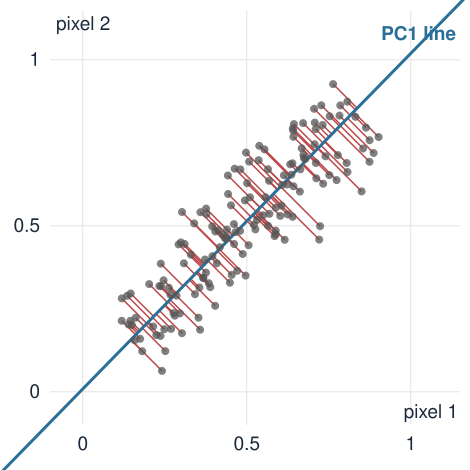
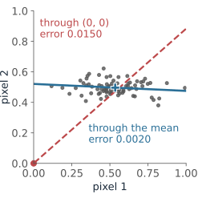
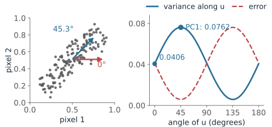
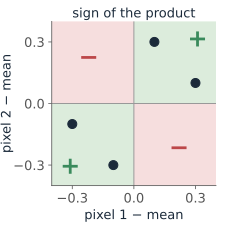
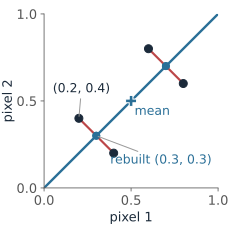
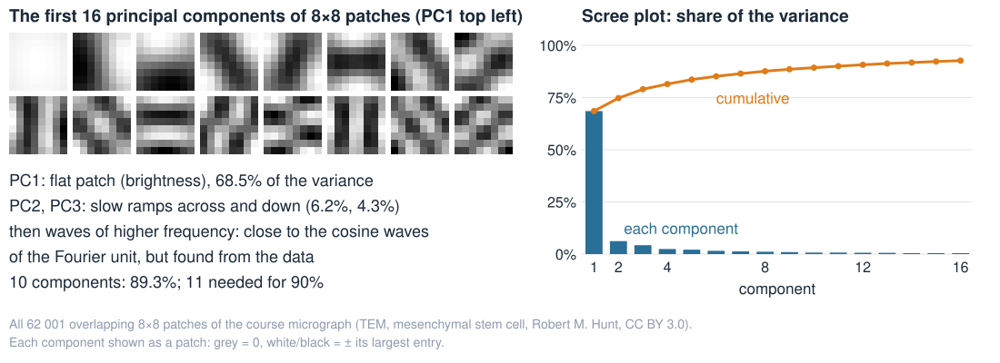
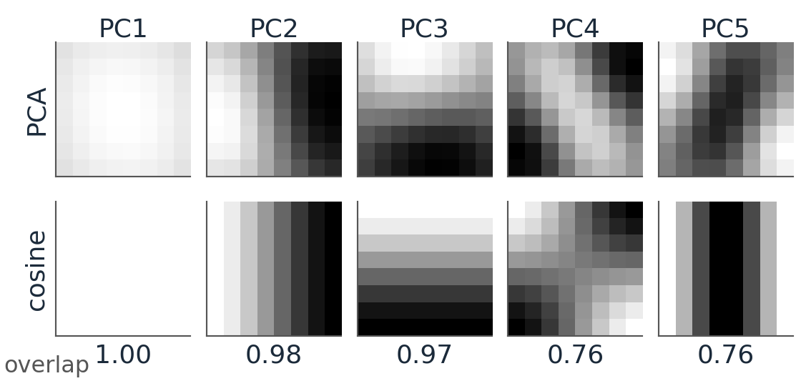
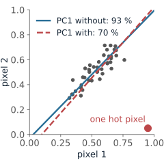

## About this lecture

The Fourier unit rewrote an image in a **fixed** basis of waves. PCA finds a basis from the **data**: the directions in which a set of images (or patches, or pixels) actually varies.

- Many small images are a **cloud of points**: one axis per pixel.
- **Centre** the cloud, then find the direction of **most spread**: the first principal component.
- The **covariance matrix** holds all the spreads; its **eigenvectors** are the principal components.
- Keep a few **scores**, rebuild the rest: **projection and reconstruction**, and how many components to keep.
- Image examples: two-pixel images, 8×8 patches, colour pixels.

*Slides titled **The math** give the formulas and proofs; the ideas are complete without them.*

::: notes
This is the course's PCA unit: every later day that needs PCA (the region's principal axes, shape models, colour decorrelation, compression, unmixing, autoencoders) recalls it from here. Linear algebra needed: dot product, unit vectors, eigenvectors of a symmetric 2 × 2 matrix. The covariance is divided by n throughout (as in the autoencoder unit); with n − 1 the eigenvectors are the same and the eigenvalues scale by n/(n − 1).
:::

## Two pixels, one point {.smaller}

:::: {.columns}
::: {.column width="50%"}
{width="100%"}
:::
::: {.column width="50%"}
Take two **neighbouring** pixels of a smooth image: a tiny image with two grey values $(p_1, p_2)$. Draw it as a **point**, pixel 1 across, pixel 2 up.

- 150 such pairs make a **cloud**. The two pixels are almost equally bright, so it lies along the **diagonal**.
- The cloud is long in one direction (**overall brightness** of the pair) and thin in the other (the small **difference**, a tiny edge).
- One number, the position along the blue line, almost describes each pair. Red: what that one number misses.

A $28 \times 28$ image is a point with 784 coordinates. Same idea; we just cannot draw it.
:::
::::

::: notes
The data are the "neighbouring pixels" preset of the demo (and of the autoencoder unit's demo): brightness uniform in [0.15, 0.85], difference ±0.06 (normal), fixed seed. Ask the class first: if the pixels were far apart in the image, what would the cloud look like? (Rounder: far-apart pixels are less related.)
:::

## Step 1: centre the cloud

:::: {.columns}
::: {.column width="62%"}
Subtract the **mean image** $\bar{\mathbf x}$ (the average of each pixel) from every image.

- The cloud now sits around the origin. Directions are measured **from the centre of the data**, not from black $(0, 0)$.
- Without centring, the "best direction" through $(0, 0)$ mostly points **at the mean**: it describes how bright the images are on average, which we already know, instead of how they **differ**.
- Every later step works on the centred images $\mathbf x - \bar{\mathbf x}$; the mean is added back at the end.
:::
::: {.column width="38%"}
{fig-alt="The demo's unrelated-pixels cloud around (0.53, 0.50), wide along pixel 1: the best line through the mean is nearly horizontal with mean squared error 0.0020; the best line through (0, 0) points at the cloud diagonally with error 0.0150." width="100%"}
:::
::::

::: notes
Figure: the demo's "no centring" preset (unrelated pixels, 80 points). The best line through the mean (PCA) has mean squared error 0.0020 (= λ2); the best line through (0, 0) leaves 0.0150, more than seven times as much, and points roughly at the mean (41.5°).
:::

## Spread along a direction

Pick a direction: a **unit vector** $\mathbf u$ (length 1). Each centred image gets one number, its **score**:

$$s = \mathbf u \cdot (\mathbf x - \bar{\mathbf x}) \qquad \text{(how far along } \mathbf u \text{ the image lies)}$$

- The scores of all images have a **variance**: the spread of the cloud **along** $\mathbf u$.
- Turn $\mathbf u$: the variance changes. For the neighbouring pixels it is largest along the diagonal, smallest across it.
- **PC1** (first principal component) = the direction of **largest** variance. **PC2** = the largest among the directions perpendicular to PC1 (in 2D: simply the perpendicular).

{fig-alt="Left: the 150 neighbouring-pixel pairs with two directions drawn from the mean, u at 0 degrees and PC1 at 45.3 degrees. Right: the variance of the scores against the angle of u, 0.0406 at 0 degrees and largest, 0.0762, at 45.3 degrees; the error curve is its mirror image, smallest there." width="60%" fig-align="center" .nostretch}

## Try it: the shape of a point cloud

```{=html}
<link rel="stylesheet" href="../demos/dist/demo.css">
<div data-demo="pca2d" data-data="pixels" data-angle="0"></div>
<script src="../demos/dist/pca2d.js"></script>
```

::: notes
Start at u = 0° (keep pixel 1 only): variance 0.0406, error 0.0414. Drag u round: the blue curve peaks at the orange tick (PC1, 45.3°, variance 0.0762), the red error curve bottoms out there (0.0058 = λ2). Blue + red is always tr S = 0.0820. Then "four images" (the next slides' example). Then "one outlier": a single hot pixel turns PC1 and drops PC1's share from 93 % to 70 %. Then "no centring": the line through (0, 0) is far worse than PCA. Drag dots to make the cloud round, or long in another direction.
:::

## The covariance matrix, by hand

:::: {.columns}
::: {.column width="70%"}
Four two-pixel images: $(0.2, 0.4)$, $(0.4, 0.2)$, $(0.6, 0.8)$, $(0.8, 0.6)$.

- Mean image $(0.5, 0.5)$. Centred: $(-0.3, -0.1)$, $(-0.1, -0.3)$, $(0.1, 0.3)$, $(0.3, 0.1)$.
- Average the products, over the 4 images:

$$S = \begin{pmatrix} \overline{y_1^2} & \overline{y_1 y_2} \\ \overline{y_2 y_1} & \overline{y_2^2} \end{pmatrix} = \begin{pmatrix} 0.05 & 0.03 \\ 0.03 & 0.05 \end{pmatrix}$$

- Diagonal: the **variance of each pixel** ($0.05$ each). Off-diagonal: the **covariance**, positive because the pixels tend to be bright together.
- The variance along any unit vector $\mathbf u$ follows from $S$ alone (math slide). Along the diagonal $\mathbf u = (1, 1)/\sqrt2$: $0.08$. Across it, $(1, -1)/\sqrt2$: $0.02$. Along pixel 1, $(1, 0)$: $0.05$.
:::
::: {.column width="30%"}
{fig-alt="The four centred images plotted as points (−0.3, −0.1), (−0.1, −0.3), (0.1, 0.3), (0.3, 0.1); all lie in the two quadrants where the product of the two coordinates is positive (marked +), so the covariance is positive." width="100%"}
:::
::::

::: notes
y = x − mean. Products for the off-diagonal: 0.03, 0.03, 0.03, 0.03, average 0.03. This is the demo's "four images" preset: the readout shows the same S. The total variance (sum of the diagonal) is 0.10; it is the same in every orthogonal pair of directions: 0.05 + 0.05 = 0.08 + 0.02.
:::

## The math: the best direction is an eigenvector {.math .smaller}

Centred images $\mathbf y_i = \mathbf x_i - \bar{\mathbf x}$, covariance $S = \frac1n\sum_i \mathbf y_i\mathbf y_i^\top$ (symmetric, $d \times d$). The variance of the scores along a unit vector $\mathbf u$:

$$\frac1n\sum_i (\mathbf u^\top\mathbf y_i)^2 = \frac1n\sum_i \mathbf u^\top\mathbf y_i\,\mathbf y_i^\top\mathbf u = \mathbf u^\top S\,\mathbf u.$$

Maximise $\mathbf u^\top S\mathbf u$ subject to $\mathbf u^\top\mathbf u = 1$. With a Lagrange multiplier $\lambda$, setting the gradient of $\mathbf u^\top S\mathbf u - \lambda(\mathbf u^\top\mathbf u - 1)$ to zero:

$$2S\mathbf u - 2\lambda\mathbf u = 0 \quad\Longleftrightarrow\quad S\mathbf u = \lambda\mathbf u, \qquad \text{and then } \mathbf u^\top S\mathbf u = \lambda.$$

- So the stationary directions are the **eigenvectors** of $S$, and the variance along each is its **eigenvalue**. The largest eigenvalue $\lambda_1$ gives PC1.
- $S$ is symmetric, so (spectral theorem) its eigenvectors can be chosen **orthonormal**, and all $\lambda_k \ge 0$. Order them **descending**: $\lambda_1 \ge \lambda_2 \ge \dots \ge \lambda_d$.
- For $S = \begin{pmatrix} a & b \\ b & a \end{pmatrix}$: eigenvectors $(1, \pm1)/\sqrt2$, eigenvalues $a \pm b$. The example: $0.05 \pm 0.03$.

## Principal components: new axes for the data

The eigenvectors $\mathbf u_1, \mathbf u_2, \dots$ of $S$, ordered by eigenvalue (largest first), are the **principal components**.

- They are **perpendicular** to each other: a rotated set of axes, fitted to the cloud.
- The **eigenvalue** $\lambda_k$ is the variance of the scores along $\mathbf u_k$.
- In the new axes the scores are **uncorrelated**: the cloud's tilt is gone.
- Nothing is lost by rotating: the **total variance** (sum of the pixel variances) equals $\lambda_1 + \lambda_2 + \dots$. In the example $0.05 + 0.05 = 0.08 + 0.02$.
- Share of PC1: $0.08 / 0.10 = 80\,\%$. For the 150 neighbouring pixel pairs: $93\,\%$.

::: notes
In the demo, the ellipse is the 2-SD contour of a Gaussian with covariance S: its axes are the PCs and its half-lengths are 2√λ. Sign: −u is as good as u; programs may return either.
:::

## Projection and reconstruction

:::: {.columns}
::: {.column width="68%"}
Keep only the first $k$ scores, $s_j = \mathbf u_j \cdot (\mathbf x - \bar{\mathbf x})$, and rebuild:

$$\hat{\mathbf x} = \bar{\mathbf x} + s_1\mathbf u_1 + \dots + s_k\mathbf u_k.$$

The example, $k = 1$, image $(0.2, 0.4)$, $\mathbf u_1 = (1, 1)/\sqrt2$:

- Score $s_1 = \big((-0.3) + (-0.1)\big)/\sqrt2 = -0.283$: the pair is darker than average.
- Rebuilt: $(0.5, 0.5) + s_1\,\mathbf u_1 = (0.5, 0.5) - (0.2, 0.2) = (0.3, 0.3)$: same brightness, the difference is gone.
- Error $(0.2, 0.4) - (0.3, 0.3) = (-0.1, 0.1)$, squared length $0.02$. All four images lose $0.02$: the mean error is $\lambda_2 = 0.02$, **the variance that was dropped**.

With all components the reconstruction is exact: rotate, rotate back. The saving comes from keeping **few**.
:::
::: {.column width="32%"}
{fig-alt="The four images and the PC1 line through the mean (0.5, 0.5); each image is moved perpendicularly onto the line, for example (0.2, 0.4) to (0.3, 0.3); the four red error segments have equal length." width="100%"}
:::
::::

## The math: the error is the sum of the dropped eigenvalues {.math .smaller}

Write a centred image in the PC basis: $\mathbf y = \sum_{j=1}^d s_j\mathbf u_j$ with $s_j = \mathbf u_j^\top\mathbf y$. Keeping the first $k$ terms leaves $\mathbf y - \hat{\mathbf y} = \sum_{j > k} s_j\mathbf u_j$, and since the $\mathbf u_j$ are orthonormal,

$$\|\mathbf y - \hat{\mathbf y}\|^2 = \sum_{j > k} s_j^2, \qquad \frac1n\sum_i\|\mathbf y_i - \hat{\mathbf y}_i\|^2 = \sum_{j > k}\lambda_j = \operatorname{tr}S - \sum_{j \le k}\lambda_j.$$

- For one direction $\mathbf u$ (not necessarily a PC): mean error $= \operatorname{tr}S - \mathbf u^\top S\mathbf u$ (Pythagoras for each image). Smallest error ⇔ largest variance kept: the same $\mathbf u_1$.
- More generally (Eckart–Young): no $k$-dimensional flat subspace through the mean fits the images better in squared error than the first $k$ PCs.
- The scores are uncorrelated: $\frac1n\sum_i s_{ij}s_{il} = \mathbf u_j^\top S\mathbf u_l = \lambda_l\,\mathbf u_j^\top\mathbf u_l = 0$ for $j \ne l$.

## How many components? The scree plot

{width="100%"}

- Plot the eigenvalues, largest first (a **scree plot**), or the cumulative share of the variance.
- Keep components up to the "elbow", or until a target share is reached (90 %: here 11 of 64 numbers per patch).
- The small eigenvalues are often mostly **noise**: dropping them also **denoises**.

::: notes
Numbers computed with NumPy from the course micrograph (cell256.png, values scaled to [0, 1]): all 62 001 overlapping 8 × 8 patches, covariance divided by n. Shares: 68.5, 6.2, 4.3, 2.5, 2.1 % for PC1–5; cumulative 89.3 % at 10 components, 90 % needs 11, 95 % needs 24, 99 % needs 50. Rebuilding the image from non-overlapping patches with 1, 4 and 10 components gives RMS errors 0.131, 0.100 and 0.076. There is no universal rule for k: the elbow, a share, or what the next step (classification, display, compression) needs.
:::

## PCA and Fourier: two changes of basis

Both rewrite an image (or patch) as a weighted sum of **basis images**, with **orthonormal** basis vectors: rotate, keep the important coefficients, rotate back.

| | Fourier (DFT/DCT) | PCA |
|---|---|---|
| basis | **fixed** waves, the same for every image set | **learned** from the data: eigenvectors of $S$ |
| order | by frequency | by variance in **these** data |
| best for | any image; fast to compute | the data it was fitted on: fewest components for a given error |

:::: {.columns}
::: {.column width="56%"}
- On the micrograph's patches, the PCs **look like waves**: flat, then slow ramps, then faster patterns. PC1–3 match the three lowest cosine waves (overlap 0.97 or more). For images whose statistics are the same everywhere, PCA and cosines nearly agree, which is why JPEG can use the fixed cosines.
- On a special data set (faces, cell shapes, one kind of tissue) the learned basis wins.
:::
::: {.column width="44%"}
{fig-alt="Top row: the first five principal components of the micrograph's 8 × 8 patches; bottom row: the closest cosine basis image for each, with overlaps 0.999, 0.98, 0.97, 0.76 and 0.76. PC1 is flat, PC2 and PC3 are slow ramps across and down." width="100%"}
:::
::::

::: notes
Micrograph: transmission electron micrograph of a mesenchymal stem cell, Robert M. Hunt, CC BY 3.0, via Wikimedia Commons. "Overlap" is |dot product| of the unit-length PC and the best-matching 8 × 8 DCT basis image: 0.999 (PC1, the flat patch), 0.981 (PC2), 0.973 (PC3); PC4 and PC5 are mixtures (0.76). Same NumPy computation as the scree figure. The theorem behind "PCA ≈ Fourier": for a stationary process the covariance of a patch is (nearly) a convolution matrix, and convolution matrices are diagonalised by the Fourier basis (the convolution theorem of the Fourier unit). PCA under the name Karhunen–Loève transform is the optimal (but data-dependent) transform coder.
:::

## Colour pixels: three numbers per pixel

A colour pixel $(R, G, B)$ is a point in 3D; the pixels of a photograph are a cloud.

- In most scenes the three channels rise and fall **together** (light and shadow change all three). PC1 points close to $(1, 1, 1)/\sqrt3$: **brightness**, carrying most of the variance.
- PC2 and PC3 are **colour differences** (e.g. red against blue, green against magenta), with much less variance.
- That is why image formats store brightness plus two colour differences, and give the differences fewer bits or fewer pixels: the decorrelation PCA would find, fixed in advance.
- For a stained tissue section the PCs follow the **stains**, not the screen colours: a starting point for separating them.

## When PCA misleads

:::: {.columns}
::: {.column width="66%"}
- **Outliers**: variance is a sum of squares, so one hot pixel or one bad image can turn PC1 (demo: "one outlier").
- **Units**: mix a cell area in µm² with an intensity in [0, 1], and PC1 is simply "area". Standardise each feature (divide by its standard deviation) first when units differ.
- **Nearly equal eigenvalues**: a round cloud has no preferred direction; the PCs swing when one point moves. Report the subspace, not the individual axes.
- **Curved clouds**: PCA fits flat subspaces. Images of a moving spot lie on a curve; one PCA score folds it. A nonlinear **autoencoder** can follow it ([autoencoders](../autoencoder/lec.qmd)).
- PCA finds directions of **variance**, not of **meaning**: the largest spread may be lighting, not biology.
:::
::: {.column width="34%"}
{fig-alt="Forty neighbouring-pixel pairs along the diagonal plus one hot pixel at (0.95, 0.05): without it PC1 follows the diagonal and carries 93 percent of the variance; with it PC1 tilts and carries 70 percent." width="100%"}
:::
::::

## Summary

| Idea | In one line |
|---|---|
| Image as a point | one axis per pixel; a set of images is a cloud |
| Centre | subtract the mean image first |
| Covariance $S$ | pixel variances on the diagonal, covariances off it |
| Principal components | eigenvectors of $S$, largest eigenvalue first; perpendicular; scores uncorrelated |
| Eigenvalue | the variance along that component; they add up to the total variance |
| Reconstruction | mean + scores × components; error = the dropped eigenvalues |
| Scree plot | how many components carry most of the variance |
| vs Fourier | both a change of basis: Fourier fixed, PCA learned from the data |
