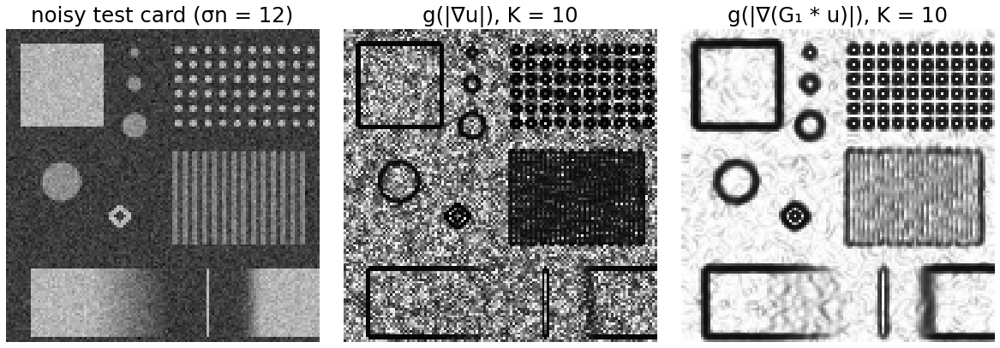
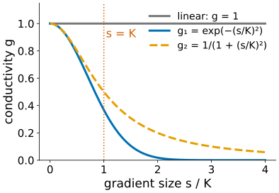
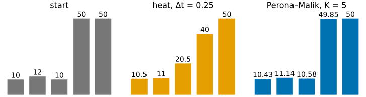
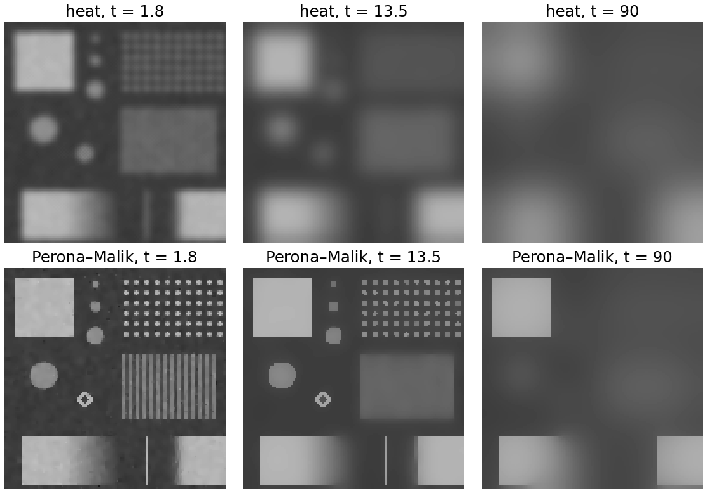
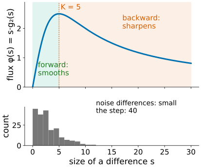
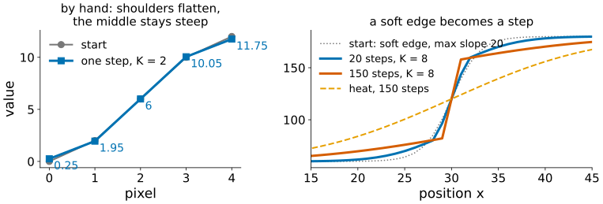
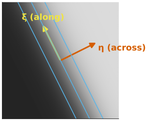
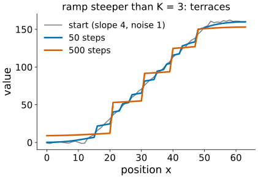
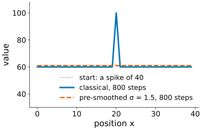
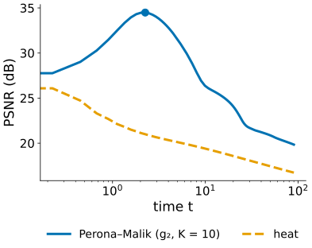

## About this lecture

Last unit: heat flow is a Gaussian blur, built step by step. A blur removes noise **and** edges. Now we let the image decide how much heat may flow (Perona & Malik, 1990).

- **Edge-stopping**: the conductivity $g$ falls where the gradient is large; a contrast parameter $K$ separates noise from edges.
- **Backward diffusion**: edges steeper than $K$ get **sharper**.
- The prices: **staircases** on ramps, spikes that never go, and the cure: compute $g$ from a slightly smoothed image.
- **When to stop**: the stopping time is a regularisation parameter.

Slides titled **The math** give the formulas and proofs; the ideas are complete without them.

::: notes
Prerequisite: the heat-equation unit (explicit step, stability limit). Recalled: the gradient at scale σ (Canny), "stopping early regularises" (regularisation unit, deconvolution day). The geodesic active contours of the level-set elective use the same edge-stopping function for speeds; one line only.
:::

## The wish: smooth inside, not across

:::: {.columns}
::: {.column width="45%"}
Make the heat step **image-dependent**: between two neighbours, the flow is

$$g(|\text{difference}|) \times \text{difference},$$

with a **conductivity** $g$ between 0 and 1:

- $g \approx 1$ where the image is flat: heat flows, noise is averaged away;
- $g \approx 0$ across a strong edge: an **insulator**, the two sides do not mix.

Continuous form: $u_t = \nabla\cdot\big(g(|\nabla u|)\,\nabla u\big)$. With $g = 1$ it is the heat equation again.
:::
::: {.column width="55%"}
{width="100%" fig-alt="Left: the noisy test card. Middle: the conductivity g computed from the raw gradient with K = 10, speckled black and white in flat regions because the noise itself has large gradients. Right: g computed from the image smoothed with sigma 1: white (heat flows) in flat regions, black lines (insulators) along every edge."}

White: heat flows. Black: insulates.
:::
::::

## Edge-stopping functions

:::: {.columns}
::: {.column width="48%"}
Two classical choices, with a **contrast parameter** $K$:

$$g_1(s) = e^{-(s/K)^2}, \qquad g_2(s) = \frac{1}{1 + (s/K)^2}$$

- Differences much smaller than $K$: $g \approx 1$, treated as **noise**.
- Differences much larger than $K$: $g \approx 0$, treated as **edges**.
- $g_1$ stops more sharply; $g_2$ lets a little heat through even at strong edges.

$K$ is a threshold in disguise, like the hysteresis thresholds of [Canny](../canny/lec.qmd): it has to sit between the typical noise difference and the typical edge height.
:::
::: {.column width="52%"}
{width="100%" fig-alt="Conductivity against the gradient size divided by K: linear diffusion has g = 1 everywhere; g1 = exp(−(s/K)²) falls to 0.37 at s = K and almost 0 by s = 2K; g2 = 1/(1 + (s/K)²) falls to 0.5 at s = K and keeps a long tail."}
:::
::::

## One step by hand

:::: {.columns}
::: {.column width="48%"}
Row $(10, 12, 10, 50, 50)$, $g_2$ with $K = 5$, $\Delta t = 0.25$, mirror border.

| pair | difference | $g_2$ | flow $g \cdot d$ |
|---|---|---|---|
| 1–2 | 2 | 0.862 | 1.72 |
| 2–3 | −2 | 0.862 | −1.72 |
| 3–4 | 40 | **0.015** | 0.62 |
| 4–5 | 0 | 1 | 0 |

- **Heat**: $(10.5, 11, 20.5, 40, 50)$: the step is already smeared.
- **Perona–Malik**: $(10.43, 11.14, 10.58, 49.85, 50)$: the small wiggle is smoothed, the step hardly moves.
:::
::: {.column width="52%"}
{width="100%" fig-alt="Bar charts of the row 10 12 10 50 50: after one heat step 10.5 11 20.5 40 50, the step smeared; after one Perona–Malik step with K = 5: 10.43 11.14 10.58 49.85 50, the step intact."}
:::
::::

## The math: divergence form and flux {.math}

- In 1D: $u_t = \partial_x\big(\phi(u_x)\big)$ with the **flux function** $\phi(s) = s\,g(|s|)$.
- The explicit scheme on a grid: $u_i \leftarrow u_i + \Delta t\,\big[\phi(u_{i+1} - u_i) - \phi(u_i - u_{i-1})\big]$; what leaves one pixel enters its neighbour, so the total is kept (mirror border).
- In 2D the same flux on each of the four pairs of neighbours (the original scheme of Perona and Malik). Since $0 \le g \le 1$, the heat limit $\Delta t \le 1/4$ still applies.
- Expanding the derivative: $u_t = \phi'(u_x)\,u_{xx}$: the **local diffusion coefficient** is $\phi'$, not $g$. This is the key to the next slides.

## Heat and Perona–Malik side by side

:::: {.columns}
::: {.column width="40%"}
The noisy test card ($\sigma_n = 12$) under heat and under Perona–Malik ($g_2$, $K = 10$) **for the same time**.

- Early ($t = 1.8$): heat already blurs every edge; Perona–Malik has removed the noise inside the regions and kept the square, the discs, the line.
- Later: heat is a Gaussian blur of growing σ; Perona–Malik flattens each region, keeps the large contrasts, and removes the lattice and the stripes (their differences are too small).
- Much later: everything merges, slowly. Insulation is never perfect.
:::
::: {.column width="60%"}
{width="100%" fig-alt="Top row: heat at t = 1.8, 13.5 and 90, increasingly blurred. Bottom row: Perona–Malik at the same times: at 1.8 the card is clean with sharp edges; at 13.5 the lattice dots and stripes have faded but the square, discs and line remain sharp; at 90 only the square and the bright regions remain."}
:::
::::

## Try it: edge-stopping diffusion

```{=html}
<link rel="stylesheet" href="../demos/dist/demo.css">
<div data-demo="peronamalik" data-preset="edges"></div>
<script src="../demos/dist/peronamalik.js"></script>
```

::: notes
2D tab: the noisy test card; current image, conductivity map, PSNR against time (red dot: the best so far), and the profile along row 112 (step, ramp, 1-px line, soft step) with the truth dashed. Tour: "linear: plain blur": PSNR only falls on this card (26.5 dB at the start, 19.5 after 40 steps): it is full of fine detail. "edges stop the heat" (g2, K = 10): PSNR peaks at 34.5 dB around t = 2.3, then falls as the lattice and the stripes go. "K too small" (K = 2): almost everything insulates, noise stays; PSNR still creeps up after 60 steps (31.5). "K too large" (K = 150): linear again. "run forever": after 3000 steps the range has shrunk to 79–114: every region drifts towards the mean. "nuclei in the micrograph": K = 6, pre-smoothing σ = 1: the nuclear envelope stays, the texture inside goes.
:::

## Backward diffusion: edges get sharper

:::: {.columns}
::: {.column width="45%"}
Look at the **flow** $\phi(s) = s\,g(s)$, not at $g$:

- for small differences the flow **grows** with the difference: ordinary smoothing;
- beyond $s = K$ ($g_2$; $K/\sqrt2$ for $g_1$) it **falls**: a steeper edge lets **less** heat through.

Across a soft edge whose middle is steeper than $K$, the middle passes less heat than its gentler shoulders. The shoulders flatten, the heat piles up on both sides of the middle, and the middle gets **steeper**: heat flows "uphill". This is **backward diffusion**, an un-blurring.

The histogram below: noise differences sit in the forward range, the step in the backward one.
:::
::: {.column width="55%"}
{width="100%" fig-alt="Top: the flux s times g2(s) for K = 5 rises to a maximum of 2.5 at s = 5 (green, forward range) and then falls (red, backward range). Bottom: the histogram of neighbour differences of a noisy step: most noise differences are below 5; the single step difference is about 40."}
:::
::::

## Sharpening by hand

Row $(0, 2, 6, 10, 12)$, $g_2$ with $K = 2$, $\Delta t = 0.25$. Differences 2, 4, 4, 2; flows $\phi(2) = 1$ (at the peak) and $\phi(4) = 0.8$ (past it).

After one step: $(0.25, 1.95, 6, 10.05, 11.75)$. The **shoulders** moved towards each other (differences 2 → 1.7), the **middle** moved apart (4 → 4.05). A heat step would have done the opposite in the middle.

{width="92%" fig-align="center" fig-alt="Left: the row 0 2 6 10 12 and after one Perona–Malik step: 0.25 1.95 6 10.05 11.75. Right: a soft edge from 60 to 180 with maximum slope 20 under g2 with K = 8: after 20 steps it is a sharp step with flat sides, after 150 steps still a step; the heat equation for 150 steps has blurred it into a wide ramp."}

## The math: where the switch happens {.math}

:::: {.columns}
::: {.column width="58%"}
- $g_2$: $\phi(s) = \dfrac{s}{1 + s^2/K^2}$, $\phi'(s) = \dfrac{1 - s^2/K^2}{(1 + s^2/K^2)^2} < 0 \iff s > K$.
- $g_1$: $\phi(s) = s\,e^{-s^2/K^2}$, $\phi'(s) = (1 - 2s^2/K^2)\,e^{-s^2/K^2} < 0 \iff s > K/\sqrt2$.
- Where $\phi' < 0$, $u_t = \phi'(u_x)\,u_{xx}$ is a **backward heat equation**: a mode $e^{i\omega x}$ grows like $e^{|\phi'|\omega^2 t}$. Ill-posed: the finest wiggles grow fastest.
- In 2D, split at an edge pixel into the gradient direction η and the level-line direction ξ:
$$u_t = g(|\nabla u|)\,u_{\xi\xi} + \phi'(|\nabla u|)\,u_{\eta\eta}.$$
Along the edge it always smooths ($g > 0$); across it, it smooths or sharpens.
:::
::: {.column width="42%"}
{width="92%" fig-alt="A soft diagonal edge with its level lines (cyan). At a point on the edge, the red arrow eta points across the edge along the gradient, the yellow arrow xi points along the level line."}
:::
::::

## Price 1: staircases

:::: {.columns}
::: {.column width="45%"}
A **ramp** whose slope is larger than $K$ sits in the backward range everywhere. Tiny noise decides where it starts to sharpen first; neighbouring parts sharpen into separate small edges, the parts in between flatten.

The ramp breaks into **terraces**: a staircase, at random places.

- A ramp gentler than $K$ is smoothed (forward range), so $K$ also decides which slopes count as "edges".
- TV, in the next unit, has the same artefact for a different reason.
:::
::: {.column width="55%"}
{width="100%" fig-alt="A ramp of slope 4 with noise of size 1 under Perona–Malik with K = 3: after 50 steps it has small kinks; after 500 steps it is a staircase of flat terraces separated by sharp steps."}
:::
::::

## Try it: sharpening and staircases in 1D

```{=html}
<div data-demo="peronamalik" data-preset="sharpen"></div>
<script src="../demos/dist/peronamalik.js"></script>
```

::: notes
1D tab: profile with a step, a soft step (max slope about 19), a ramp of slope 4 and a spike; Perona–Malik in blue, heat for the same time in orange, truth dashed. Below: the flux φ against the size of a difference, with the histogram of the current differences (green bars); drag on it to move K; the shaded region is the backward range. Tour: "soft edge sharpens" (K = 8): after 150 steps the soft step is a sharp step (max slope above 50); move K: at K = 11 it still sharpens, at K = 12 it diffuses (the theory says "slope above K", but only the very middle of the edge is that steep and the shoulders spread faster: in practice K must be well below the steepest slope). "ramp becomes a staircase" (K = 3, noise): after 600 steps the ramp is three terraces with jumps of about 21, 45 and 21. "a spike survives forever" (g1, K = 10): after 150 steps the spike is still exactly 100. "pre-smoothing fixes the spike": σ = 1.5, the spike is gone at once.
:::

## Price 2: ill-posed, and the cure

:::: {.columns}
::: {.column width="45%"}
Backward diffusion amplifies whatever is steep, including **noise**:

- an isolated spike higher than about $K$ is seen as an edge: its flux is almost zero, so it is **kept** (with $g_1$, forever);
- noisy pixels with large differences can sharpen into speckles instead of being smoothed.

The result depends on tiny details of the input, and on the grid.

**Cure** (Catté, Lions, Morel & Coll, 1992): compute $g$ from a slightly **smoothed** image, $g\big(|\nabla(G_\sigma * u)|\big)$, with σ about 1 (the Canny σ). A single-pixel spike has no large gradient after smoothing, a real edge still does.
:::
::: {.column width="55%"}
{width="100%" fig-alt="A spike of height 40 on a flat profile under Perona–Malik with g1 and K = 10. Classical (blue): after 800 steps the spike is unchanged at 100. Pre-smoothed with sigma 1.5 (orange dashed): the spike is gone, the profile is flat at about 61."}
:::
::::

## The math: maximum principle and well-posedness {.math}

- In 1D the explicit step is $u_i \leftarrow (1 - \Delta t\,(g_{i-\frac12} + g_{i+\frac12}))\,u_i + \Delta t\,g_{i-\frac12}\,u_{i-1} + \Delta t\,g_{i+\frac12}\,u_{i+1}$. With $0 \le g \le 1$ and $\Delta t \le 1/2$ all weights are $\ge 0$ and sum to 1: a **convex combination**, no new extrema (in 2D: $\Delta t \le 1/4$).
- So the **discrete** scheme is stable even where the continuous PDE is ill-posed: the grid itself regularises it, and the result depends on the pixel size.
- With $g$ computed from $G_\sigma * u$ the problem has a unique solution that depends continuously on the input (Catté et al., stated without proof).

## When to stop?

:::: {.columns}
::: {.column width="45%"}
Perona–Malik has **no steady state** worth having: insulation is never perfect ($g > 0$), so if you run forever every region drifts to the mean of the image.

The **stopping time** is a **regularisation parameter**, like λ or the number of iterations in the deconvolution day ([stopping early regularises](../regularise/lec.qmd)):

- too early: noise left;
- too late: small regions and fine detail merged;
- the PSNR against time has a maximum (here 34.5 dB at $t \approx 2.3$, from 26.5 dB). On this card the heat equation hardly helps: from its first step on, its PSNR only falls, because the fine detail it blurs costs more than the noise it removes.
:::
::: {.column width="55%"}
{width="100%" fig-alt="PSNR against time on a log axis for the noisy test card: Perona–Malik with g2 and K = 10 rises from 26.5 to a maximum of 34.5 dB around t = 2.3 and then falls; the heat equation only falls."}
:::
::::

## Choosing $K$ and the other knobs

- **$K$ between noise and edges**: with noise $\sigma_n$, differences of two noisy neighbours have spread $\sqrt2\,\sigma_n$. For $\sigma_n = 5$ that is about 7; edges of 40 should be stopped: $K \approx 10$–$15$ gives $g_2 \approx 0.8$ for typical noise differences and $\approx 0.1$ at the edges.
- **Pre-smoothing σ**: about 1 pixel; larger σ also moves edges and merges close ones (as in Canny).
- **Time step**: the heat limit, $\Delta t \le 1/4$ in 2D, because $g \le 1$.
- **Stopping time**: grows with the noise. In the demo with $K = 10$: best at $t \approx 0.9$ for $\sigma_n = 6$, $2.3$ for 12, $5.4$ for 24.

Image libraries usually call this filter "anisotropic diffusion".

## Isotropic or anisotropic?

- Perona and Malik called their method **anisotropic diffusion**. Strictly it is not: the conductivity is one **number** per pixel, and the flow still points down the gradient. It is better called **nonlinear isotropic** diffusion.
- True **anisotropy** smooths **along** an edge but not across it: the conductivity becomes a 2 × 2 **tensor** built from the [structure tensor](../structure-tensor/lec.qmd) (edge- and coherence-enhancing diffusion; it closes gaps in fibres and membranes).
- The 2D math slide shows that even the scalar version treats the two directions differently through $\phi'$; that is where the name comes from.
- The same edge-stopping $g$ appears in the level-set elective ([geodesic active contours](../geodesic/lec.qmd)): there it slows a moving front at edges, here it stops heat.

## Summary

- Perona–Malik: $u_t = \nabla\cdot(g(|\nabla u|)\nabla u)$, a heat flow with an **edge-stopping conductivity** $g_1$ or $g_2$ and a contrast parameter $K$.
- Differences below $K$ are smoothed as noise; above $K$ the flux **falls** and edges are kept or even **sharpened** (backward diffusion).
- The prices: ramps steeper than $K$ become **staircases**; isolated spikes survive; the continuous problem is ill-posed. Computing $g$ from a slightly smoothed image fixes the worst of it.
- There is no useful steady state: the **stopping time** regularises, and the best one grows with the noise.
- Explicit steps need the same limit as heat: $\Delta t \le 1/4$ in 2D.
