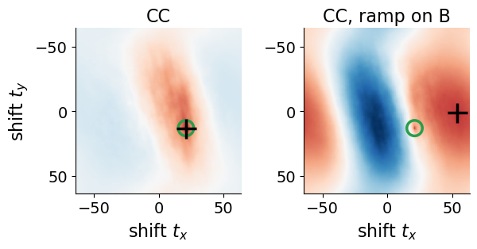
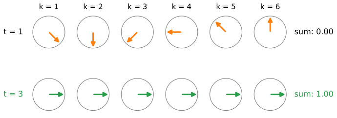
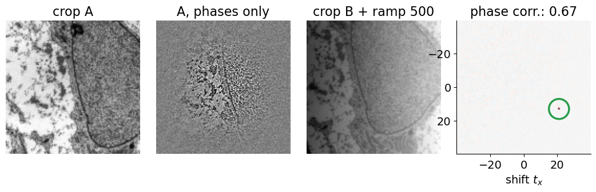
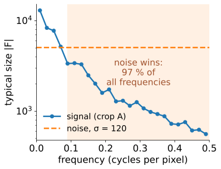
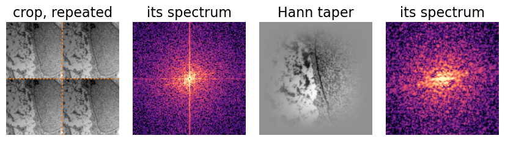
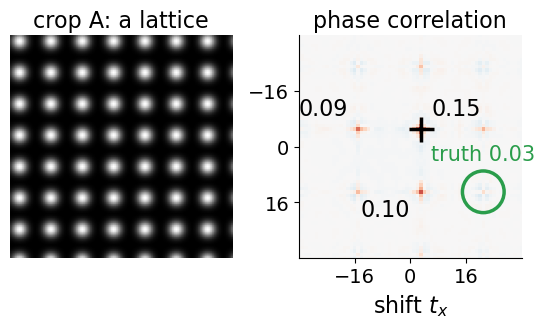

## About this lecture

[Last unit](../xcorr-fft/lec.qmd): the cross-correlation of two images for every shift, as the inverse FFT of $A_k\overline{B_k}$. Its peak is **broad**, and uneven brightness can move it. Today: throw away the size of each wave and keep only its **phase**.

- Why that gives a **sharp spike** at the shift (Kuglin & Hines, 1975).
- What it buys: **brightness** does not matter, the spike is easy to find.
- What it costs: **noise** gets the same vote as signal; low-pass weighting, partial normalisation.
- The border of the image: a **taper** against the false peak at zero.
- How much to **trust** a peak: peak height and peak ratio.

Recall: a complex number $z = |z|e^{i\varphi}$ has a size $|z|$ and a phase $\varphi$; $z/|z|$ keeps the phase only.

*Slides titled **The math** give the formulas and proofs; the ideas are complete without them.*

## The trouble with plain cross-correlation

:::: {.columns}
::: {.column width="53%"}
- Images are dominated by **slow waves**: smooth brightness changes carry most of the strength. Their votes are the biggest, and a slow wave agrees with many nearby shifts: the peak is **broad**.
- A broad peak is hard to locate precisely and easily pushed sideways.
- **Uneven brightness** (an illumination ramp, a bright region) changes the slow waves most, exactly the ones with the biggest votes. The peak can move to a wrong place.

In the demo: two $128 \times 128$ crops of the micrograph, shifted by $(21, 13)$. CC finds the shift, but the neighbouring shift $(20, 10)$ still scores 70 % of the peak. Add a brightness ramp of 500 grey levels across B: CC's peak jumps to $(54, 1)$.
:::
::: {.column width="47%"}
{fig-alt="Two cross-correlation surfaces, shift zero in the middle, red high and blue low. Left: a broad red ridge whose top (black cross) is at the true shift (green ring). Right, with a brightness ramp on B: the surface is dominated by broad red and blue bands and the highest point is far off at (54, 1)." width="100%"}
:::
::::

::: notes
The figure is the demo's "CC: broad peak" and "illumination ramp on B" presets (crops 128², true shift (21, 13)). Micrograph: transmission electron micrograph of a mesenchymal stem cell, Robert M. Hunt, CC BY 3.0, via Wikimedia Commons.
:::

## Keep only the phase

The shift theorem ([the Fourier unit](../fourier/exercise.qmd), exercise B4): **a shift changes the phases of the waves, not their sizes**. So the shift is in the phase differences alone.

- Divide each $A_k\overline{B_k}$ by its own size: every wave keeps its phase difference and gets a vote of **exactly 1**.
- At the true shift all votes agree, and nothing else is left: the inverse FFT is a **single spike**, height 1 for a pure (circular) shift, zero everywhere else.
- Picture: arrows on unit circles, all of the same length, each turning at its own rate as the shift changes. Only at the true shift do they all point the same way.

{fig-alt="Six unit circles, one per frequency k = 1 to 6, each with an arrow of length 1. At shift t = 1 the arrows point in all directions and their sum is 0. At the true shift t = 3 all six point to the right and the sum is 1." width="72%" fig-align="center"}

::: notes
The figure: a 16-sample signal and a circularly shifted copy (shift 3); each arrow is R_k rotated by the shift t; the sum is the phase-correlation value r(t) over all 16 frequencies.
:::

## The math: why a delta {.math}

If B is A shifted circularly, $g(x) = f(x + t_0)$, then (the shift theorem, [the Fourier unit](../fourier/exercise.qmd) B9)
$$G_k = e^{2\pi i\,k\cdot t_0/N}F_k \quad\Longrightarrow\quad R_k = \frac{F_k\overline{G_k}}{|F_k\overline{G_k}|} = e^{-2\pi i\,k\cdot t_0/N}$$
for every $k$ with $F_k \ne 0$. The inverse DFT of a pure phase ramp is a delta:
$$r(t) = \frac1N\sum_k e^{2\pi i\,k\cdot(t - t_0)/N} = \delta(t - t_0) = \begin{cases} 1 & t = t_0 \\ 0 & \text{otherwise.}\end{cases}$$
In 2D, $k\cdot t$ means $k_xt_x/N_x + k_yt_y/N_y$ (times $N$). In practice $R_k = F_k\overline{G_k}/(|F_k\overline{G_k}| + \varepsilon)$, computed in floating point ([the bit-depth day](../floatingpoint/lec.qmd)): the magnitudes can be tiny.

## Try it: phase correlation

```{=html}
<link rel="stylesheet" href="../demos/dist/demo.css">
<div data-demo="phasecorr" data-preset="delta" data-presets="delta,cc,phase,ramp" data-controls="p,ramp,gain,offset"></div>
<script src="../demos/dist/phasecorr.js"></script>
```

::: notes
Left: the micrograph with frame A (blue) and frame B (red), which you can drag. Middle: the two crops and the spectrum of A. Right: the correlation surface, shift 0 in the centre; green ring = true shift, cyan cross = highest peak. Tour: "same image, shifted: delta" (B = A rolled around): a single spike of height 1.000, peak ratio ∞. "CC: broad peak": a big blob, (20, 10) scores 70 % of the peak, ratio 1.44. "phase: sharp peak": height 0.671 (the crops overlap by 75 %), next peaks 0.029, ratio 23. "illumination ramp on B" (CC): peak at (54, 1), wrong; switch to phase: correct again, still 0.671. Then slide p from 1 to 0 to go back from phase correlation to CC. Gain and offset on B do not change the phase-correlation surface at all.
:::

## What it buys

- **Brightness and contrast.** A gain multiplies every $B_k$ by the same number; an offset changes only the constant wave ($k = 0$). Neither changes any phase: the surface is identical.
- **Uneven illumination** mostly changes the slow waves, which now get no more vote than any other.
- **A sharp spike**: easy to locate, and two different shifts in one picture (two moving objects) give two separate spikes.
- In words: phase correlation compares **edges and texture**; CC compares **blobs of brightness**. Normalising the spectrum is "whitening" the images: an edge-enhancing filter.

{fig-alt="Four panels: crop A of the micrograph; the same crop with every wave set to size 1, which keeps only edges and fine texture; crop B with a strong brightness ramp across it; and the phase-correlation surface, a single spike of height 0.67 at the true shift (21, 13)." width="80%" fig-align="center"}

::: notes
Micrograph: transmission electron micrograph of a mesenchymal stem cell, Robert M. Hunt, CC BY 3.0, via Wikimedia Commons. "Phases only": the tapered crop with every Fourier coefficient divided by its size. The surface is the demo's "illumination ramp on B" preset with phase correlation.
:::

## By hand: normalising the example

The last unit's example: $A = (0, 1, 2, 0)$, $B = (1, 2, 0, 0)$, $A_k\overline{B_k} = (9, -5i, -1, 5i)$.

- Divide by the sizes $(9, 5, 1, 5)$: $R = (1, -i, -1, i)$.
- Inverse DFT: $r(t) = \tfrac14\sum_k R_k\,i^{kt}$: $r(0) = \tfrac14(1 - i - 1 + i) = 0$, $r(1) = \tfrac14(1 + 1 + 1 + 1) = 1$, $r(2) = r(3) = 0$.
- A delta at $t = 1$; the CC was $(2, 5, 2, 0)$.

Now take $B' = 2B + 1 = (3, 5, 1, 1)$: $B'_k = (10, 2 - 4i, -2, 2 + 4i)$. Only $B'_0$ changed beyond a factor 2, and $k = 0$ is normalised to 1 anyway: $R$ is unchanged.

## Partial overlap and the peak height

Real tiles are not circular shifts: part of each crop has no partner.

- The spike is still at the shift, but its height is roughly the **fraction of shared content**. Crops of $128^2$ shifted by $(21, 13)$ share $\frac{107 \cdot 115}{128^2} = 75\,\%$: the peak is 0.62 (0.67 with a taper, which favours the centre).
- The rest of the surface is a low, noisy floor (here about 0.03).
- Smaller crops, $64^2$, share only 54 % with the same shift: the peak drops to 0.32, the ratio to the next peak from 23 to 5.

## What it costs: noise

:::: {.columns}
::: {.column width="58%"}
Normalising gives every frequency the same vote, **including the ones that are mostly noise**.

- Fine detail (high frequencies) is weak in most images; there, the noise ([the camera-noise unit](../cameranoise/lec.qmd)'s $\sigma_n$) is as strong as the signal, and the phase difference is random.
- There are many more high frequencies than low ones: their random votes add up to a noisy floor that can drown the spike.
- Remedies:
  - **low-pass weighting**: normalise, then multiply by a smooth weight that fades out the highest frequencies;
  - **partial normalisation**: divide by $|A_k\overline{B_k}|^p$ with $0 < p < 1$ ($p = 0$: CC, $p = 1$: phase correlation);
  - a small $\varepsilon$ in the denominator, so that nearly empty frequencies do not get a full vote.
:::
::: {.column width="42%"}
{fig-alt="Typical size of the Fourier coefficients of a 128 by 128 crop against frequency, falling from about 10 000 to 600, and a flat line for noise with sigma 120 at about 5 000. Above 0.09 cycles per pixel the noise is larger: 97 per cent of all frequencies." width="100%"}
:::
::::

::: notes
The figure: the tapered crop A of the demo; median size per frequency ring; the noise line is the mean size of the coefficients of tapered white noise with σ = 120, as in the "noise: phase peak drowns" preset.
:::

## Try it: noise and low-pass

```{=html}
<link rel="stylesheet" href="../demos/dist/demo.css">
<div data-demo="phasecorr" data-preset="noise" data-presets="phase,noise,lowpass" data-controls="p,low-pass,noise"></div>
<script src="../demos/dist/phasecorr.js"></script>
```

::: notes
"noise: phase peak drowns": independent noise σ = 120 on both crops. The phase-correlation peak at the truth is only 0.033, below the highest noise peak at (−6, 7) (0.043), ratio 1.03: wrong. "noise + low-pass weight" (sd 0.08 cycles/pixel): the spike is back at (21, 13), ratio 1.54; the surface looks smoother because the fine detail is weighted down. Also try p = 0.5 without low-pass: (21, 14), one pixel off; CC (p = 0) also lands on (21, 14). Show the cross-power phase panel: with noise the hue is random at high frequencies.
:::

## Tapering: the border problem

The DFT assumes each crop repeats ([the Fourier unit](../fourier/lec.qmd)): the right border meets the left one, usually with a **jump** in brightness.

- These jump lines belong to the frame, not to the sample: they are at the same place in A and in B and **do not move with the shift**.
- They add strong vertical and horizontal waves (a bright **cross** in the spectrum) that vote for shift **zero**, and for shifts along the axes.
- Cure: multiply both crops by a **Hann taper**, a smooth bump that is 1 in the middle and 0 at the border, after subtracting the mean. No jump, no cross.
- Price: the content near the border counts less, so overlaps at the edge of a tile are weighted down ([the stitching unit](../stitching/lec.qmd) therefore does not taper).

{fig-alt="Left: an unevenly lit crop repeated two by two, with visible jumps where the copies meet, and its spectrum with a bright vertical and horizontal cross. Right: the same crop after a Hann taper, fading to grey at the border, and its spectrum without the cross." width="74%" fig-align="center"}

::: notes
Micrograph: transmission electron micrograph of a mesenchymal stem cell, Robert M. Hunt, CC BY 3.0, via Wikimedia Commons. The crop is the demo's frame A with the uneven illumination of the "no taper" preset (600 grey levels from corner to corner).
:::

## Try it: no taper

```{=html}
<link rel="stylesheet" href="../demos/dist/demo.css">
<div data-demo="phasecorr" data-preset="notaper" data-presets="notaper,phase" data-controls="uneven,hann,p"></div>
<script src="../demos/dist/phasecorr.js"></script>
```

::: notes
"no taper: false (0, 0) peak": the whole field is unevenly lit (brightness rising by 600 grey levels from corner to corner), CC, no taper. The crops' borders jump strongly, the spectrum (small panel) shows a bright cross, and the highest peak is at (0, 0); the next peaks lie on the line t_y = 0. Tick "Hann taper": the cross disappears and CC finds (21, 13) again (ratio 1.31). Phase correlation without a taper survives here (0.617), but shows the same line of small false peaks at (15, 0), (12, 0).
:::

## The math: tapers and noise {.math}

**Hann taper** of length $N$: $w(n) = \tfrac12\big(1 - \cos\frac{2\pi n}{N - 1}\big)$, $n = 0, \ldots, N-1$; in 2D the product $w(x)\,w(y)$. Multiplying by $w$ convolves the spectrum with $\hat w$, a narrow bump: leakage is local instead of a $1/k$ tail along the axes.

**Noise.** With $g(x) = f(x + t_0) + \eta(x)$:
$$G_k = e^{2\pi i k t_0/N}F_k + H_k, \qquad \arg G_k = \frac{2\pi k t_0}{N} + \arg F_k + \delta_k, \quad |\delta_k| \lesssim \frac{|H_k|}{|F_k|}.$$
The phase error $\delta_k$ is small where the signal is strong and random where $|F_k| \lesssim |H_k|$, typically at high $|k|$. Phase correlation gives those frequencies full weight; a low-pass weight $W_k$ (e.g. Gaussian in $|k|$) or $|F_k\overline{G_k}|^{-p}$ with $p < 1$ reduces their share of the sum $\sum_k W_k R_k e^{2\pi i k t/N}$.

## How much to trust a peak

- **Peak height**: about the shared fraction of the content (for phase correlation). A low peak means little overlap, or noise, or no match.
- **Peak ratio**: highest peak divided by the second highest. A ratio near 1 means two shifts are about equally good: do not trust this pair.
- Typical low-ratio cases: a **blank** tile (nothing to match), **periodic texture** (every period gives a peak), strong noise.
- A mosaic program uses this confidence to decide which pairwise shifts to believe ([the stitching unit](../stitching/lec.qmd)).

:::: {.columns}
::: {.column width="50%"}
In the demo, a lattice of blobs 18 pixels apart shifted by $(21, 13)$: the highest peak is at $(3, -5)$, one lattice period away in each direction; the true shift scores only 0.03.
:::
::: {.column width="50%"}
{fig-alt="A lattice of bright blobs and its phase-correlation surface: small peaks repeat every 18 pixels; the highest, 0.15, is at (3, −5), the next ones 0.10 and 0.09, while the true shift (green ring) scores only 0.03." width="100%"}
:::
::::

## Summary

- **Phase correlation**: normalise $A_k\overline{B_k}$ to size 1, inverse FFT. A pure shift gives a spike of height 1 at the shift.
- Gains and offsets do not change it; uneven illumination hardly does. It compares edges and texture.
- **Noise** gets a full vote too: weight down the high frequencies (low-pass) or normalise only partly ($0 < p < 1$).
- The image border repeats with a **jump**: a **Hann taper** removes the cross in the spectrum and the false peak at zero.
- Trust a peak by its **height** (shared fraction) and its **ratio** to the next one; periodic and empty images give ambiguous peaks.
