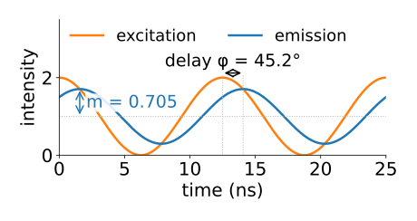
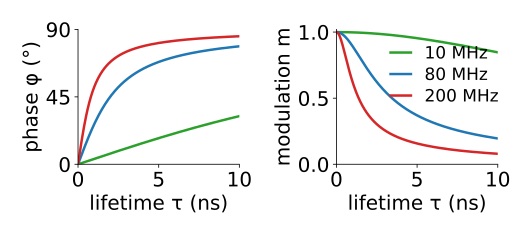
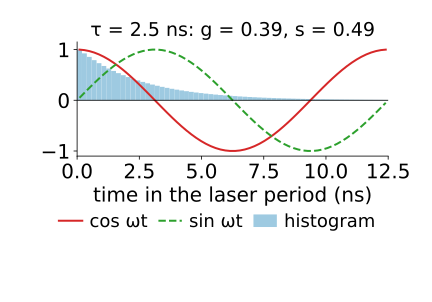
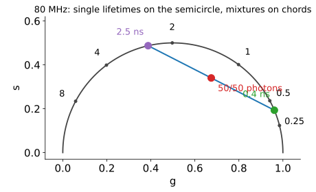
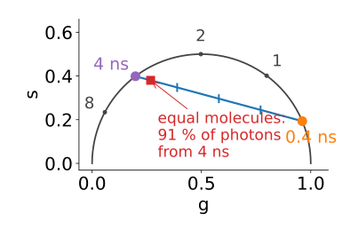
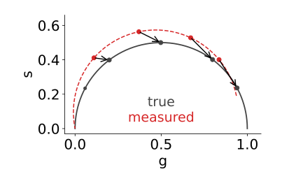
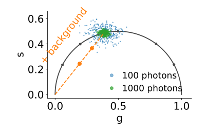

## About this lecture

[Fitting](../decayfit/lec.qmd) needs a model and a search per pixel. Today: **two numbers per pixel, no fit, no model**.

- **Frequency-domain** lifetime measurement: a modulated light source, a delayed and flattened response.
- The two numbers are one **Fourier coefficient** of the decay: the same from a TCSPC histogram.
- The **phasor plot**: single lifetimes on a semicircle, **mixtures on straight lines**.
- **Calibration**: removing the instrument response is one complex division, a deconvolution that cannot blow up.
- Noise, background, and reading a whole image as a cloud of points.

*Slides titled **The math** give the formulas and proofs; the ideas are complete without them.*

::: notes
This day owns phasors for the course. The spectral phasor (not covered on the spectral unmixing day) is the same transform applied to a spectrum instead of a decay.
:::

## Frequency-domain FLIM

Instead of short pulses, excite with light whose intensity is a **wave** at frequency f (tens of MHz).

:::: {.columns}
::: {.column width="55%"}
- The emission is a wave of the **same** frequency, but **delayed** by a phase φ and **flattened**: its modulation depth m is less than 1.
- Why: emission is the excitation smeared by the decay. Light emitted now comes from excitation over the last few nanoseconds, so it lags behind and the peaks and troughs average out.
- Longer τ: more delay, more flattening.
- Measured with a detector or camera whose gain is modulated at the same frequency, at a few phase steps: a few samples of one wave (recall [the Fourier unit](../fourier/lec.qmd): projecting onto a wave).
:::
::: {.column width="45%"}
{fig-alt="Excitation (orange) and emission (blue) over two periods at 80 MHz for a 2 ns lifetime: the emission wave is delayed by φ = 45.2° and its swing around the mean is only m = 0.705 of the excitation's." width="100%"}
:::
::::


## Why the output is still a wave

Emission = excitation ∗ decay, a convolution. And **waves are the eigenvectors of convolution** ([the Fourier unit's math slide](../fourier/lec.qmd)): convolving a wave with anything gives the same wave, multiplied by one complex number.

- That number is the decay's **Fourier coefficient at f**.
- Its **angle** is the phase delay φ; its **length** is the modulation m.
- So the decay's whole effect on a wave of frequency f is captured by two numbers. Different frequencies give different pairs; one is usually enough.

## The math: phase and modulation of one exponential {.math}

Excitation $1 + \cos\omega t$, $\omega = 2\pi f$. Decay $p(t) = \tau^{-1}e^{-t/\tau}$ (area 1). The emission is

$$(p * e^{i\omega t})(t) = \hat p\,e^{i\omega t}, \qquad \hat p = \int_0^\infty p(u)\,e^{-i\omega u}\,du = \frac{1}{1 + i\omega\tau},$$

so the emission is $1 + m\cos(\omega t - \phi)$ with

$$\tan\phi = \omega\tau, \qquad m = |\hat p| = \frac{1}{\sqrt{1 + \omega^2\tau^2}}.$$

- Two ways to read τ: the **phase lifetime** $\tau_\phi = \tan\phi/\omega$ and the **modulation lifetime** $\tau_m = \sqrt{1/m^2 - 1}\,/\,\omega$.
- 80 MHz: ω = 0.503 rad/ns. τ = 2 ns: ωτ = 1.005, φ = 45.2°, m = 0.705.

## Phase and modulation lifetimes

- For **one** exponential, $\tau_\phi = \tau_m = \tau$.
- For a **mixture**, they disagree: $\tau_\phi < \tau_m$. A free test for "more than one lifetime", without any fit.
- **Choice of frequency**: best when ωτ ≈ 1 (80 MHz for τ ≈ 2 ns).
  - Too low: every lifetime gives φ ≈ 0, m ≈ 1, and all decays look alike.
  - Too high: the emission is flattened to almost nothing (m → 0) and buried in noise.

{fig-alt="Phase delay and modulation against the lifetime (0 to 10 ns) at 10, 80 and 200 MHz. At 10 MHz the phase stays below about 30° and the modulation near 1 for all lifetimes; at 200 MHz the phase saturates near 90° and the modulation drops towards 0 beyond a few ns; 80 MHz spreads the lifetimes of 1 to 5 ns best." width="68%" fig-align="center"}


## Try it: excitation and emission waves

```{=html}
<link rel="stylesheet" href="../demos/dist/demo.css">
<div data-demo="modulation" data-preset="two"></div>
<script src="../demos/dist/modulation.js"></script>
```

::: notes
Top: excitation (orange) and emission (blue) over two periods, both with mean 1. Bottom left: the decay and its components; right: the phasor point. Tour, numbers from the demo: "one lifetime" (2.5 ns, 80 MHz): φ = 51.5°, m = 0.623, τ_φ = τ_m = 2.50 ns. "Two lifetimes" (4 ns and 0.5 ns, half the photons each): φ = 29.1°, m = 0.652, τ_φ = 1.11 ns, τ_m = 2.31 ns. "Too low" (10 MHz): φ = 8.9°, m = 0.988; drag τ₁ down to 1.26 ns: φ = 4.5°, m = 0.997, nearly the same wave. "Too high" (200 MHz, 4 ns): m = 0.195. "ωτ ≈ 1" (2 ns at 80 MHz): φ = 45.2°, m = 0.705.
:::

## The same two numbers from a histogram

A TCSPC histogram covers one laser period $T$: a periodic signal. Take its **first Fourier coefficient** at $\omega = 2\pi/T$ (80 MHz for 12.5 ns) and divide by the total count:

$$g = \frac{\sum_j y_j\cos\omega t_j}{\sum_j y_j}, \qquad s = \frac{\sum_j y_j\sin\omega t_j}{\sum_j y_j}.$$

:::: {.columns}
::: {.column width="54%"}
- The same complex number as the frequency-domain $(m\cos\phi, m\sin\phi)$: time and frequency domain meet in one plot.
- One multiply-add per time bin and pixel: no model, no search.
- Wrap-around does not hurt: the periodic sum over earlier pulses is exactly the signal a Fourier coefficient at the repetition frequency expects.
:::
::: {.column width="46%"}
{fig-alt="A TCSPC histogram of a 2.5 ns decay over one 12.5 ns laser period, with one period of a cosine and a sine; the weighted sums give g = 0.39 and s = 0.49." width="100%"}
:::
::::


## The phasor plot

Plot every pixel at $(g, s)$:

{width="58%" fig-align="center"}

- Every single exponential lies on the **universal semicircle**: centre $(\tfrac12, 0)$, radius $\tfrac12$. Short lifetimes near $(1, 0)$, long ones near the origin.
- The lifetime can be read from the position: $\tau = s/(g\,\omega)$.
- Points **inside** the semicircle are not single exponentials.

## The math: the phasor of an exponential {.math}

$$P = g + is = \frac{\int_0^\infty e^{-t/\tau}e^{i\omega t}\,dt}{\int_0^\infty e^{-t/\tau}\,dt} = \frac{1}{1 - i\omega\tau} = \frac{1 + i\omega\tau}{1 + \omega^2\tau^2}.$$

- $g = \dfrac{1}{1 + \omega^2\tau^2}$, $s = \dfrac{\omega\tau}{1 + \omega^2\tau^2}$, so $s/g = \omega\tau$ and $g^2 + s^2 = g$, i.e. $(g - \tfrac12)^2 + s^2 = \tfrac14$: the semicircle.
- Sign: the Fourier unit's $c_k = \int f\,e^{-2\pi ikt}dt$ uses $e^{-i\omega t}$, so $P = \overline{c_1}/c_0$; the phasor plot draws $s$ upwards.
- Discrete: $P = \sum_j y_j e^{i\omega t_j}/\sum_j y_j$ is the conjugate of DFT bin 1 over bin 0 (with $t_j$ at bin centres).

## Mixtures lie on straight lines

:::: {.columns}
::: {.column width="53%"}
The phasor is **linear** in the decay and **normalised** by the intensity. So a pixel holding two species lies on the **straight line** (chord) between their two semicircle points.

- Its position on the chord is the **photon fraction** (lever rule): 70 % of the photons from species B → 70 % of the way from A to B.
- Photon fraction is **not** molecule fraction: a long-lived species gives more photons per molecule. Equal molecules of 0.4 and 4 ns: 91 % of the photons come from the long one.
- Many pixels with the same two species in varying amounts: a cloud **along a line**. Extend it to the semicircle: both lifetimes, without any fit.
- Three species fill a **triangle**; the fractions are barycentric coordinates (the simplex of [endmembers](../endmembers/lec.qmd), in a fixed 2D projection).
:::
::: {.column width="47%"}
{fig-alt="The universal semicircle with points for 0.4 ns (right) and 4 ns (left) joined by a straight chord with ticks at a quarter, half and three quarters. A red square for equal numbers of molecules sits near the 4 ns end: 91 % of the photons come from the 4 ns species." width="100%"}
:::
::::


## The math: linearity {.math}

Decay $I = \sum_k I_k$ with integrals $N_k = \int I_k$, $N = \sum_k N_k$:

$$P = \frac{\int I\,e^{i\omega t}}{\int I} = \sum_k \frac{N_k}{N}\,\frac{\int I_k e^{i\omega t}}{N_k} = \sum_k f_k P_k, \qquad f_k = \frac{N_k}{N}.$$

- Weights $f_k \ge 0$ summing to 1: a **convex** combination (segment, triangle).
- With amplitudes $\alpha_k$: $N_k \propto \alpha_k\tau_k$, so $f_k = \alpha_k\tau_k/\sum_j\alpha_j\tau_j$.
- For a mixture, $P$ lies inside the circle; $\tau_\phi = s/(g\omega)$ and $\tau_m$ then differ ($\tau_\phi < \tau_m$ for any two-component mixture: exercise).

## Try it: the phasor plot

```{=html}
<link rel="stylesheet" href="../demos/dist/demo.css">
<div data-demo="phasorplot" data-preset="line"></div>
<script src="../demos/dist/phasorplot.js"></script>
```

::: notes
Drag the species along the semicircle and the red mixture point along the chord or inside the triangle. Middle: the mixture's expected histogram through the IRF, with its components. Tour, numbers from the demo: "two species" (0.5 and 3 ns, half the photons each): the point (0.623, 0.348), τ_φ = 1.11 ns, τ_m = 1.95 ns; amplitude fractions 0.86 and 0.14. "Photon fraction is not amplitude fraction" (0.4 and 4 ns, equal molecules): 91 % of the photons from the long species, the point sits near it. "Three species": a triangle. "Uncalibrated IRF" (σ = 0.6 ns, delay 0.4 ns): the measured phasors are turned by 11.5° and shrunk by 0.956; the dashed red curve is where single exponentials land without calibration. "100 photons: a cloud": spread 0.052 per coordinate (about ½/√N). "Coarse time bins" (4 bins): a 2.5 ns decay lands at (0.267, 0.581), outside the semicircle; calibration with a reference measured on the same bins puts it back at (0.388, 0.487).
:::

## Calibration: removing the IRF

Convolution with the IRF **multiplies** the phasor by the IRF's phasor: a **rotation** (the IRF's delay) and a **shrink** (its width). Coarse time bins do something similar.

:::: {.columns}
::: {.column width="53%"}
- Measure a **reference** of known lifetime (or the IRF itself) with the same settings.
- One complex correction factor for the whole image: $P_\text{true} = P_\text{measured} \times P_\text{reference, true}/P_\text{reference, measured}$.
- This **is** deconvolution, but at a **single low frequency**, where the IRF's response is close to 1: nothing explodes. Contrast [the inverse filter](../illposed/lec.qmd), which divides by responses near 0 at high frequencies.
:::
::: {.column width="47%"}
{fig-alt="The semicircle with true single-exponential phasors (grey dots, 0.5 to 4 ns) and the measured ones (red dots), turned by 11.5° towards larger phase and shrunk by 0.956 onto a dashed red curve; arrows lead from each measured point back to its true point." width="100%"}
:::
::::


## The math: convolution multiplies phasors {.math}

For normalised $h$ (IRF) and $I$ (decay), by the convolution theorem at one frequency:

$$P_{h*I} = \frac{\int (h * I)\,e^{i\omega t}}{\int h * I} = \frac{\hat h(\omega)\,\hat I(\omega)}{\hat h(0)\,\hat I(0)} = P_h\,P_I.$$

- Calibration with a reference of lifetime $\tau_r$: $P_h = P_{\text{ref,meas}}/P_{\tau_r}$, so $P_I = P_\text{meas}\,P_{\tau_r}/P_\text{ref,meas}$. In polar form: subtract the phase error, divide by the modulation error.
- Example: a 4.0 ns reference should give φ = 63.6°, m = 0.445 at 80 MHz but gives 70°, 0.40. A sample measured at 50°, 0.60 is really at 43.6°, 0.668.
- Binning: integrating over bins of width Δt multiplies $P$ by $\mathrm{sinc}(\omega\Delta t/2)$ (and sampling at bin centres folds in higher harmonics): a known factor, removed by the same calibration.

## Noise and background

:::: {.columns}
::: {.column width="53%"}
- With $N$ photons a pixel's phasor scatters around the true point; the spread per coordinate is roughly $\tfrac12/\sqrt N$ (5 % of the plot at 100 photons).
- **Dim pixels** scatter widely; **flat background** has phasor $(0, 0)$, so it pulls points **towards the origin** along a straight line (a mixture with "background").
- **Median-filter** the $g$ and $s$ images (recall [denoising](../denoise/lec.qmd)): the cloud tightens while the intensity image stays sharp.
- **Reciprocity**: select a region on the phasor plot (a cursor), and its pixels light up in the image; paint a region in the image, and its pixels light up on the plot.
- Species whose first-harmonic phasors coincide can separate at the **second harmonic** (2ω).
:::
::: {.column width="47%"}
{fig-alt="Phasors of a 2.5 ns decay on the semicircle: 300 pixels with 100 photons form a wide blue cloud around the true point, with 1000 photons a tight green cloud. An orange dashed line runs from the true point to the origin, with dots at 25 % and 50 % background." width="100%"}
:::
::::


## Try it: a cell on the phasor plot

```{=html}
<link rel="stylesheet" href="../demos/dist/demo.css">
<div data-demo="flimcell" data-mode="phasor" data-preset="cursor"></div>
<script src="../demos/dist/flimcell.js"></script>
```

::: notes
The cell's phasor histogram (calibrated with a 4 ns reference through the same IRF). The magenta cursor's pixels are magenta in the intensity image; drag the cursor, change its radius; paint on an image to see those pixels (orange) on the plot. Tour, numbers from the demo: "cursor ↔ image" (two dyes, 1.0 ns in the nucleus, 3.0 ns elsewhere, same brightness): the cursor at (0.80, 0.40) catches 870 pixels, all in the nucleus. "A cloud on a line" (0.6 and 3.5 ns in varying fractions): the line through the cloud meets the semicircle at 0.60 and 3.55 ns. "Median-filtered phasors" (60 photons): with the filter the cursor holds 1 374 pixels instead of 744, and the line gives 0.63 and 3.67 ns. "Background pulls to the origin": the line misses badly (1.01 and 18.3 ns); masking pixels below 100 photons brings it back to 0.54 and 4.29 ns.
:::

## Summary

- Frequency-domain FLIM: modulated excitation gives an emission wave with a **phase delay** φ and a **modulation** m; $\tan\phi = \omega\tau$, $m = 1/\sqrt{1 + \omega^2\tau^2}$. $\tau_\phi < \tau_m$ flags a mixture.
- The **phasor** $(g, s) = (m\cos\phi, m\sin\phi)$ is the normalised first Fourier coefficient of the decay: computed from a TCSPC histogram in one pass, no model.
- Single exponentials lie on the **universal semicircle**; mixtures on **chords** at their **photon fractions**; three species fill a triangle.
- The IRF **multiplies** phasors: calibration with a reference is one complex division, a safe deconvolution at one frequency.
- Noise spreads the cloud as $1/\sqrt N$; background pulls it to the origin; median filtering of $g$, $s$ helps.
- The same transform on a **spectrum** gives a spectral phasor, an alternative to the least squares of the [unmixing day](../lsunmix/lec.qmd) (not covered there).
