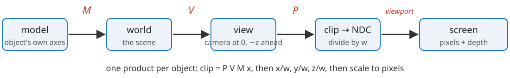
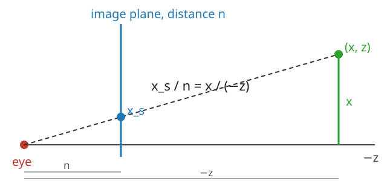

## About this lecture

A 3D object is stored either as a **surface** (polygons) or as a **volume** (voxels). Today: how each becomes an image on a screen. This unit and the next follow polygons; then textures (how the graphics card stores and samples images); then voxels.

- A **mesh**: vertices, an indexed list of triangles, winding and normals.
- **Coordinate spaces**: model → world → view → clip → screen, one $4\times4$ matrix each.
- The **camera** as a change of basis, and **perspective** from similar triangles.
- Conventions: those of OpenGL/WebGL (the camera looks down $-z$, depth after projection in $[-1, 1]$; some systems use $[0, 1]$).

Slides titled **The math** give the formulas and proofs; the ideas are complete without them.

::: notes
An elective day of the 3D group, after the marching-cubes day. Everything is linear algebra the students know (homogeneous coordinates, change of basis, inverses); the only new matrix is the perspective projection. Demo tour at the "Try it" slide.
:::

## Surfaces as meshes

A **mesh** is two arrays:

- a **vertex array**: a position $(x, y, z)$ per vertex, plus optional attributes (normal, colour, texture coordinate);
- a **triangle list**: three vertex **indices** per triangle.

A cube: 8 vertices, 12 triangles. Stored as a "triangle soup" (three positions per triangle) it needs 36 positions; indexed, 8 positions and 36 small integers.

- A **closed** mesh has about **twice as many triangles as vertices**: $10^6$ triangles share about $5\cdot10^5$ vertices.
- Why triangles? Three points are always **flat** and **convex**, and a value given at the corners has one natural interpolation inside (next unit).

## Winding, normals, manifolds

- The **order** $a, b, c$ of a triangle's indices is its **winding**. Seen from the front, the corners go **counter-clockwise**.
- The **face normal** $\mathbf n = (\mathbf b - \mathbf a)\times(\mathbf c - \mathbf a)$ points out of the front side (right-hand rule).
- **Consistent** orientation: neighbouring triangles use their shared edge in **opposite** directions. Then all normals point outwards, and "inside" is defined.
- **Manifold**: every edge belongs to exactly two triangles, and the triangles around a vertex form one disc. Not manifold: three triangles on one edge; two cubes touching at a corner.

Tools need this: smooth normals, inside/outside tests, the volume formula of the marching-cubes day, and back-face culling (next unit) all assume a consistent, closed mesh.

## The math: why a closed mesh has $F \approx 2V$ {.math}

Euler's formula for a closed surface without holes (a sphere-like mesh): $V - E + F = 2$.

Each triangle has 3 edges and each edge belongs to 2 triangles, so $3F = 2E$. Substituting $E = \tfrac32 F$:

$$V - \tfrac32 F + F = 2 \quad\Longrightarrow\quad F = 2V - 4.$$

For a surface with $g$ handles (a torus has $g = 1$), $V - E + F = 2 - 2g$ and $F = 2V - 4 + 4g$: still about $2V$.

Memory of an indexed mesh with 32-bit floats and indices: $12V + 12F \approx 12V + 24V = 36V$ bytes (plus $12V$ for normals).

## From $3\times3$ to $4\times4$

Recall the *images* unit: in 2D, $\mathbf x' = A\mathbf x + \mathbf t$ became **one** $3\times3$ matrix by adding a coordinate 1. In 3D the same trick gives $4\times4$ matrices:

$$\begin{bmatrix} \mathbf x' \\ 1 \end{bmatrix} = \begin{bmatrix} A & \mathbf t \\ \mathbf 0^\top & 1 \end{bmatrix} \begin{bmatrix} \mathbf x \\ 1 \end{bmatrix}.$$

- **Points** get $w = 1$; **directions** (normals, light directions) get $w = 0$: translation does not move a direction.
- A chain of moves is a **product**, applied right to left. "Rotate 90° about $z$, then move by $(1, 0, 0)$" is $T R$, and sends the point $(1, 0, 0)$ to $(1, 1, 0)$. In the other order, $R T$ sends it to $(0, 2, 0)$.
- Rotations do not interpolate linearly (the average of two rotation matrices is not a rotation); animation uses quaternions, not covered here.

## A chain of coordinate spaces

{width=100%}

- **Model** space: the object's own axes (the house's floor centred at the origin).
- **World** space: the scene. The **model matrix** $M$ places, turns and scales the object.
- **View** space: the camera's axes; the **view matrix** $V$.
- **Clip** space, then **NDC**: the **projection** $P$, then division by $w$.
- **Screen**: the **viewport** scales $[-1, 1]$ to pixels.

All the vertices of one object get the same product $P\,V\,M$: one matrix per object per frame, the same work for every vertex.

## The camera as a change of basis

A camera has a position $\mathbf e$ (eye), looks at a target $\mathbf g$, and has an "up" direction. Its own axes:

- **forward** $\mathbf f$ = from the eye towards the target; **right** $\mathbf r$ = perpendicular to forward and up; **up** $\mathbf u'$ = perpendicular to both.
- **View space** writes every point in these axes, with the eye at the origin: right = $+x$, up = $+y$, and forward = $-z$ (the camera looks down $-z$).

The view matrix does what the camera's placement undoes: if a matrix $C$ puts a camera into the world, then $V = C^{-1}$. Moving the camera left is the same as moving the whole world right.

**Orbiting** the camera = rotating $\mathbf e$ about $\mathbf g$: the drag in every 3D demo of the course.

## The math: the look-at matrix {.math}

$$\mathbf f = \frac{\mathbf g - \mathbf e}{\lVert \mathbf g - \mathbf e\rVert}, \qquad \mathbf r = \frac{\mathbf f\times\mathbf u}{\lVert \mathbf f\times\mathbf u\rVert}, \qquad \mathbf u' = \mathbf r\times\mathbf f.$$

The rows of $R$ are $\mathbf r^\top, \mathbf u'^\top, -\mathbf f^\top$ (orthonormal), and

$$V = \begin{bmatrix} R & -R\,\mathbf e \\ \mathbf 0^\top & 1 \end{bmatrix}, \qquad V\begin{bmatrix}\mathbf e\\1\end{bmatrix} = \begin{bmatrix}\mathbf 0\\1\end{bmatrix}.$$

The camera's placement is $C = \begin{bmatrix} R^\top & \mathbf e \\ \mathbf 0^\top & 1\end{bmatrix}$ (its columns are the camera's axes in world coordinates, and its position). Since $R^{-1} = R^\top$ for an orthonormal $R$, $C^{-1} = \begin{bmatrix} R & -R\mathbf e\\ \mathbf 0^\top & 1\end{bmatrix} = V$.

Example: $\mathbf e = (0, 0, 5)$, $\mathbf g = \mathbf 0$, $\mathbf u = (0, 1, 0)$ gives $\mathbf f = (0, 0, -1)$, $\mathbf r = (1, 0, 0)$, $\mathbf u' = (0, 1, 0)$, $R = I$ and $V$ = translation by $(0, 0, -5)$.

## Perspective by similar triangles

{width=55%}

A point at depth $-z$ in front of the eye lands on an image plane at distance $n$ at

$$x_s = \frac{n\,x}{-z}, \qquad y_s = \frac{n\,y}{-z}.$$

Twice as far away = half as big. Dividing by $z$ is **not linear**, so no matrix can do it. The trick: the matrix copies $-z$ into the fourth coordinate $w$, and the hardware **divides by $w$** afterwards (the **perspective divide**).

## The math: the perspective matrix {.math}

We also need a depth for hiding surfaces (next unit). After the divide every coordinate has the form (row of $P$)·$\mathbf x$ / $(-z)$, so the new depth must be $z_\text{ndc} = A + B/z$. Choose $A, B$ so that the **near** plane $z = -n$ goes to $-1$ and the **far** plane $z = -f$ to $+1$:

$$A - \frac{B}{n} = -1, \quad A - \frac{B}{f} = 1 \quad\Longrightarrow\quad A = \frac{f + n}{f - n}, \;\; B = \frac{2fn}{f - n}.$$

With a vertical field of view $\theta$ and aspect ratio $a$ (width/height), let $s = 1/\tan(\theta/2)$:

$$P = \begin{bmatrix} s/a & 0 & 0 & 0 \\ 0 & s & 0 & 0 \\ 0 & 0 & -\frac{f+n}{f-n} & -\frac{2fn}{f-n} \\ 0 & 0 & -1 & 0 \end{bmatrix}, \qquad w_\text{clip} = -z.$$

Example: $n = 1$, $f = 3$: $A = 2$, $B = 3$, so $z_\text{ndc} = 2 + 3/z$; the point at $z = -2$ gets depth $0.5$, past the middle. Depth is **not** linear in distance.

## Try it: follow a vertex through the spaces

```{=html}
<link rel="stylesheet" href="../demos/dist/demo.css">
<div data-demo="pipeline3d" data-space="view"></div>
<script src="../demos/dist/pipeline3d.js"></script>
```

::: notes
Left: the world from far away, with the camera (pink pyramid) and its view frustum. Right: the selected space. Under it M, V, P. The readout follows vertex 9 (the front end of the roof ridge; click another vertex to change it). Tour: in view space vertex 9 is at (−0.044, 0.769, −3.190): 3.19 in front of the camera, and its clip w is 3.190 = −z. Switch to clip → NDC: the frustum has become the cube; the house is squashed towards the far side. "orthographic vs perspective": w = 1 for every vertex, parallel edges stay parallel. "dolly zoom": distance 9, field of view 18.4°: the house keeps its size on the screen but looks flatter. "near plane too close": all NDC depths between 0.972 and 0.982. "a vertex behind the camera": vertices 4, 6, 9 have w < 0; the divide flips them, so they must be clipped first. "non-uniform scale": M has 2.165 in its corner.
:::

## Orthographic projection

**Orthographic**: drop the depth instead of dividing by it. $P$ just scales and shifts a box $[l, r]\times[b, t]\times[-n, -f]$ to the cube $[-1, 1]^3$; $w$ stays 1.

- Parallel lines stay parallel; size does **not** depend on distance.
- Used where measurements matter: technical drawings, most microscopy viewers, and maximum-intensity projections (unit 4).
- **Dolly zoom**: move the camera back and narrow the field of view together. The subject keeps its size ($d\tan(\theta/2)$ constant: from $d = 4$, $\theta = 40°$ to $d = 9$, $\theta = 18.4°$), but the background grows: perspective depends on the **distance**, not on the zoom. Far away with a narrow field of view approaches orthographic.

## Clip space and the frustum

What the camera sees is a truncated pyramid, the **view frustum**, between the near and far planes. After $P$ (before the divide) it is the region

$$-w \le x \le w, \qquad -w \le y \le w, \qquad -w \le z \le w,$$

and after the divide it is the cube $[-1, 1]^3$ (**NDC**, normalised device coordinates).

- Triangles outside are dropped; triangles crossing the boundary are **clipped**. This happens in clip space, **before** the divide.
- Why before: a vertex **behind** the camera has $w < 0$; dividing flips it to the other side of the screen. The near plane cuts the triangle first (next unit).
- The viewport then maps $x_\text{ndc} \in [-1, 1]$ to $[0, \text{width}]$ pixels (and $y$ likewise).

## From pixels back to rays

Run the chain backwards: a pixel is not a point but a **ray** from the eye through the pixel.

- $(P V)^{-1}$ applied to the pixel at NDC depth $-1$ and at $+1$ gives two points on the ray. Volume rendering (unit 4) and picking a vertex with the mouse both start like this.
- One camera cannot tell how far along the ray a point is: depth is lost. Two cameras can (stereo, epipolar geometry): the inverse problem of reconstructing geometry from images, an elective of its own.

## Summary

- A mesh = vertices + indexed triangles; **winding** gives the front side and the normal $(\mathbf b - \mathbf a)\times(\mathbf c - \mathbf a)$; closed meshes have $F \approx 2V$.
- $4\times4$ homogeneous matrices: points $w = 1$, directions $w = 0$; products apply right to left.
- model $\xrightarrow{M}$ world $\xrightarrow{V}$ view $\xrightarrow{P}$ clip $\xrightarrow{\div w}$ NDC $\xrightarrow{\text{viewport}}$ screen.
- The view matrix is the **inverse** of the camera's placement (a change of basis to the camera's axes).
- **Perspective** = divide by distance; the matrix puts $-z$ into $w$. Depth after the divide is $A + B/z$: not linear.
- **Orthographic**: $w = 1$, no shrinking with distance.
