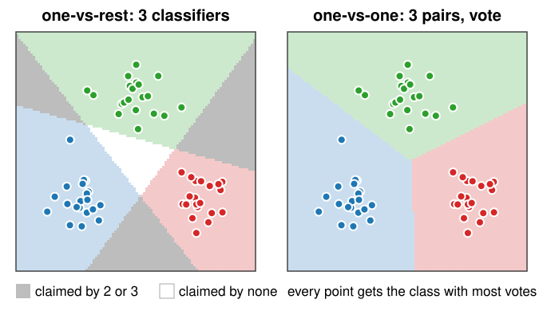

## About this lecture

Back to images. The random forests day built the pixel classifier: paint strokes, compute a feature stack, train, correct. This unit puts an SVM into the same loop and covers what is **specific to SVMs**:

- **Standardise** the features: essential for the RBF kernel function, irrelevant for a forest.
- Choose $(C, \gamma)$ by **cross-validation**, with folds **by stroke**.
- **Class imbalance**: class weights, or moving the threshold on $f$.
- **More than two classes**: one-vs-rest and one-vs-one.
- When is an SVM the right choice?

*Slides titled **The math** give the formulas and proofs; the ideas are complete without them.*

::: notes
Short unit: the feature stack, the painting loop and cross-validation are recalls. The demo is the random forests day's pixelclass shell with the SVM plugged in (classifier switch) and this day's settings and cross-validation panel.
:::

## Recall: paint, train, look, correct (the random forests day)

- Paint a few **strokes** per class on the image.
- Every pixel gets a **feature vector** from the **feature stack**: intensity, edges, blobs, ridges, texture, each at several scales $\sigma$ (here 42 channels).
- Train on the painted pixels, classify every pixel, look at the result and the uncertainty, paint where it is wrong.
- Neighbouring pixels are near copies: evaluate on a **held-out region**, not on random painted pixels.

The SVM replaces the forest in this loop. Everything else stays.

## Standardise the features

The RBF kernel function compares pixels by their **distance** $\|\mathbf x - \mathbf z\|$ in feature space.

- The channels of a stack have very different ranges: in the test image, one structure-tensor channel has a standard deviation of 0.6, another of 208.
- The distance is then decided by the few channels with large numbers; the others are invisible (unit 1's exercise B6: area in pixels vs intensity 0–1).
- **z-scores** per channel: $z_j = (x_j - \mu_j)/s_j$, mean 0 and standard deviation 1 (the same z-score as on the measurements day).
- Use the **training** pixels' $\mu_j$, $s_j$, and apply the same numbers to every other pixel.
- A **forest** does not care: a threshold on one channel is unaffected by its units. A linear SVM can absorb scales into $\mathbf w$, but its penalty $\|\mathbf w\|^2$ still depends on them.

## Try it: an SVM in the pixel classifier

```{=html}
<link rel="stylesheet" href="../demos/dist/demo.css">
<div data-demo="pixelclass" data-preset="full" data-classifier="svm" data-classifiers="forest,svm" data-tabs="svmcv"></div>
<script src="../demos/dist/pixelclass.js"></script>
```

::: notes
The random forests day's demo with the SVM selected (RBF, C = 10, γ = 0.01, standardised, one-vs-one; a random subset of about 500 painted pixels is used for training). The prediction fills in row by row; the SVM is slower to predict than the forest. Tour: "full stack": SVM 96.4 % on the truth, the forest 96.3 %. Panel below: "unscaled features": 82.0 %, nuclei almost vanish (Dice 0.06), 410 support vectors; switch to the forest: unaffected. "γ = 10": 81.8 %, every training pixel a support vector. "linear": 96.2 %.
:::

## $(C, \gamma)$ by cross-validation

The SVM has two settings that matter, and their best values depend on the data. Choose them by **measurement**:

- A **log grid**: $C \in \{0.1, 1, 10, 100, 1000\}$, $\gamma \in \{0.001, \dots, 10\}$.
- For each cell, $k$-fold cross-validation (the random forests day): train on $k - 1$ folds, count errors on the held-out fold.
- Pick the best cell, train on all training data, and look at the **test** data once.
- Small $C$ and small $\gamma$: underfit. Large $C$ and large $\gamma$: overfit. The best cell is in between, often along a diagonal band.

## Folds by stroke, not by pixel

Painted pixels come in **strokes**: dozens of neighbouring, nearly identical pixels.

- **By pixel** (random pixels in each fold): every held-out pixel has its neighbours in the training folds. The CV error is far too **optimistic**.
- **By stroke**: whole strokes go into one fold. The held-out pixels are new in the sense that matters.
- In the demo's test image: by pixel, many cells show **0 %** error; by stroke, the best cell has 19 %.
- By-stroke CV needs **several strokes per class**: a class with one stroke is missing from training whenever its stroke is held out.

## The math: no peeking {.math}

- The standardisation statistics $\mu_j$, $s_j$ are part of the model: compute them on the **training folds only**, inside each CV split. Computing them on all pixels lets the held-out data leak into training.
- The same holds for any step that looks at the data: feature selection, balancing weights, the choice of $(C, \gamma)$ itself.
- After the grid search, the CV error of the best cell is optimistic too (it was the minimum of many noisy estimates): report the error on a **test** set that played no part in any choice.

## Class imbalance

Background strokes are long and easy; nuclei are small.

- With many more background pixels, every violation by a nucleus pixel is "cheap" compared with the total: the street shifts into the nucleus class.
- **Class weights**: a separate penalty per class, $C_+ \ne C_-$. Balancing weights $n/(k\,n_c)$ make each class count the same in total.
- Or keep the SVM and **move the threshold** on $f$: classify as nucleus when $f > \theta$ instead of $f > 0$.
- **Evaluate** with the thresholding day's tools: the confusion matrix, precision and recall. $f$ plays the role of the intensity: sweeping $\theta$ traces an **ROC curve**.

## More than two classes

:::: {.columns}
::: {.column width="55%"}
{width="100%"}
:::
::: {.column width="45%"}
The SVM separates **two** classes. For $K$ classes:

- **One-vs-rest**: $K$ SVMs, class $k$ against all others; take the largest $f_k$. Regions claimed by several, or by none, are decided by comparing $f$ values that were never calibrated against each other.
- **One-vs-one**: $K(K-1)/2$ SVMs, one per pair; each votes, the class with most votes wins. More classifiers, but each on less data.
- Probabilities: fit a sigmoid to $f$ on held-out data (one line in practice).
:::
::::

## The math: counting the work {.math}

$K$ classes with $n/K$ training points each. Training a kernel SVM costs roughly $n^2$ (the kernel matrix) or more.

- One-vs-rest: $K$ problems of size $n$: about $K\,n^2$.
- One-vs-one: $K(K-1)/2$ problems of size $2n/K$: about $\frac{K(K-1)}{2}\cdot\frac{4n^2}{K^2} = \frac{2(K-1)}{K}n^2 < 2n^2$.
- So one-vs-one is **cheaper** to train for $K \ge 3$, although it has more classifiers. Prediction needs the kernel function between each pixel and the union of all support vectors, in both cases.

## From pixels to objects

- The decision value $f$ (or the class probability) can serve as the **data term** of a graph cut (the graph cuts day): smooth the labelling with $\lambda$ × boundary length, instead of thresholding each pixel on its own.
- Then label the connected components and measure them, as with the forest.

## SVM, forest, neighbours, networks

| | forest | SVM (RBF) | $k$-NN | network |
|---|---|---|---|---|
| feature scaling | not needed | **essential** | essential | helpful |
| settings | few, robust | $C$, $\gamma$: cross-validate | $k$ | many |
| training | fast | convex, one optimum | none | non-convex |
| prediction cost | depth × trees | number of support vectors | all training points | layers |
| features | hand-made stack | hand-made stack | hand-made stack | **learnt** (the neural networks day) |

An SVM is a good choice with **few labels** and tens to a few hundred **hand-made features**; on a pixel stack it is about as accurate as a forest, slower to predict, and needs more care. With many labels, networks that learn their own features win.

## Summary

- An SVM drops into the paint – train – correct loop of the random forests day.
- **Standardise** every feature with training statistics: RBF distances are otherwise ruled by the channel with the largest numbers.
- Choose $(C, \gamma)$ on a **log grid** by cross-validation with folds **by stroke**; by-pixel folds are optimistic.
- **Imbalance**: class weights $C_+ \ne C_-$ or a moved threshold on $f$; evaluate with confusion matrices and ROC curves.
- **Multi-class**: one-vs-rest ($K$ SVMs, largest $f$) or one-vs-one ($K(K-1)/2$ SVMs, vote).
