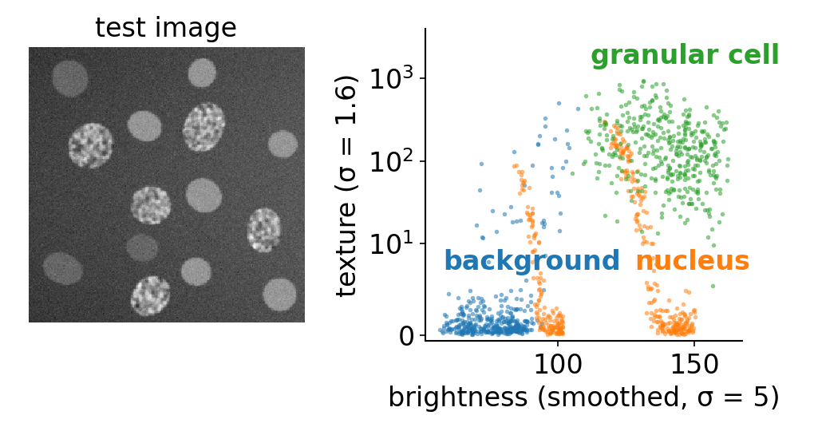
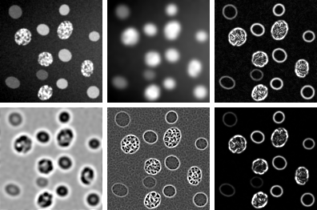
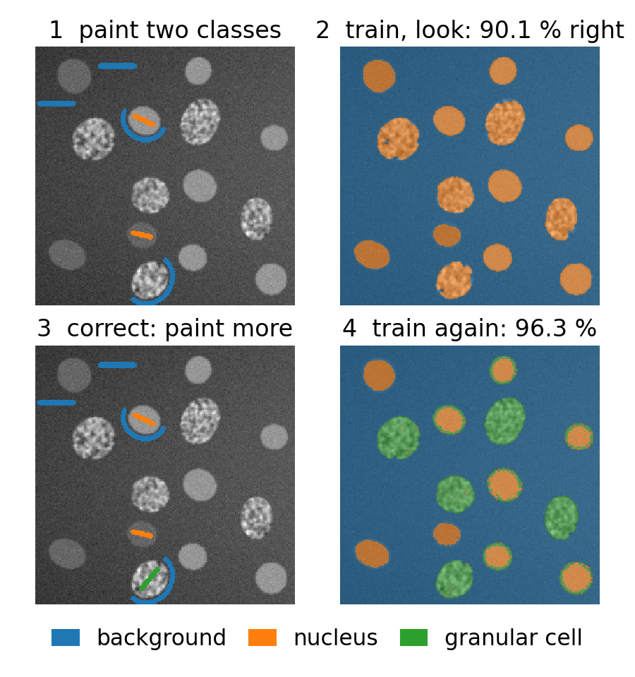
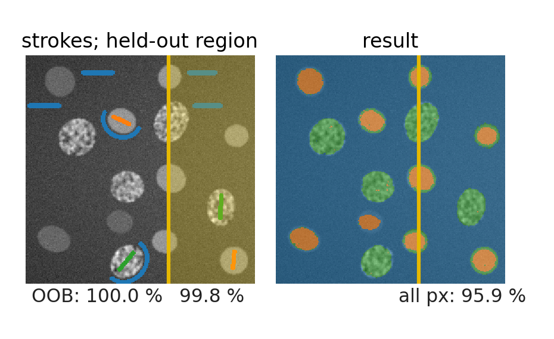
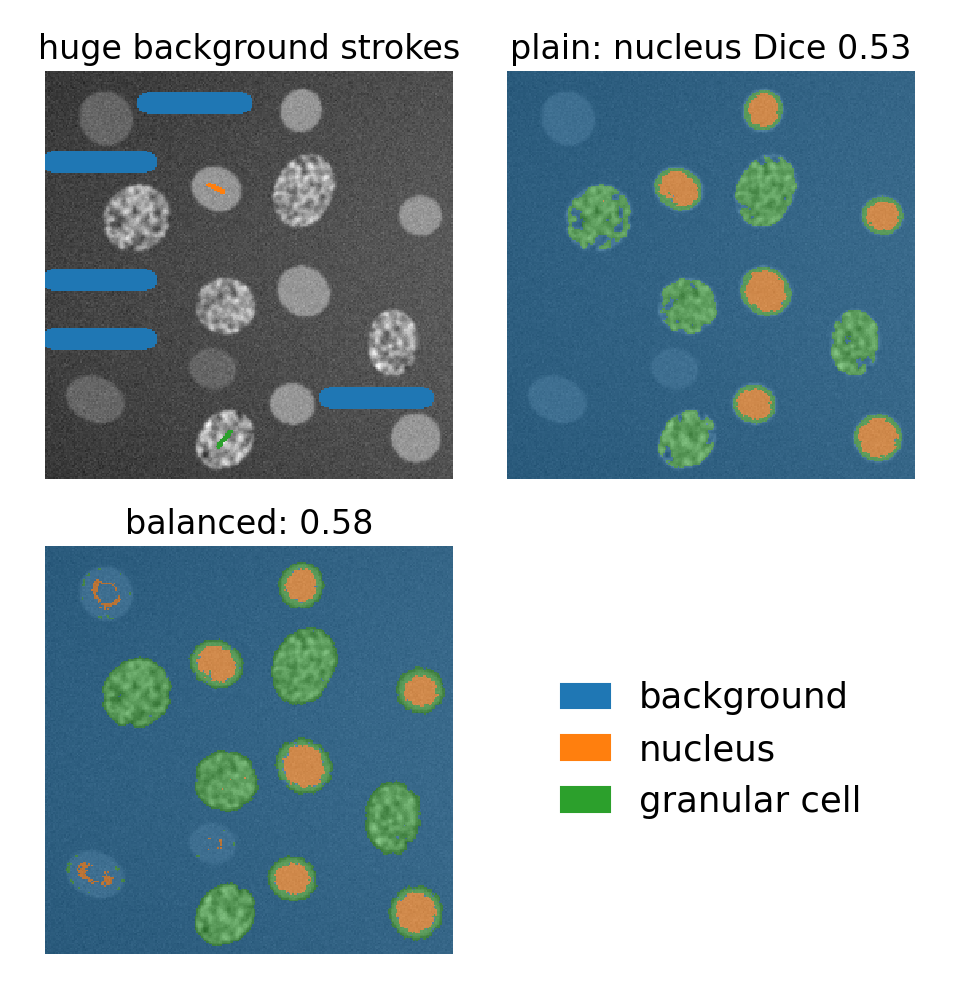
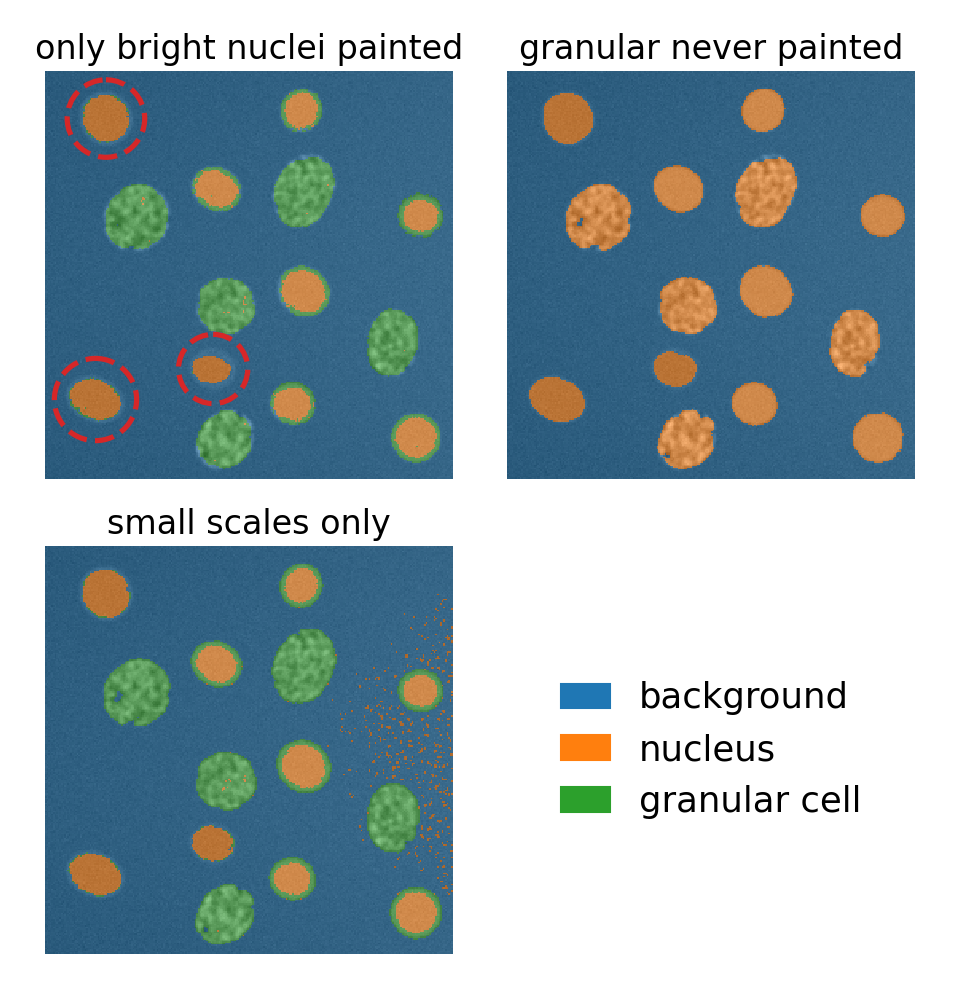
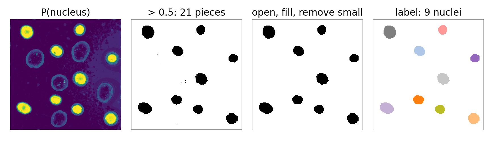

## About this lecture

Paint a few strokes on an image, "this is nucleus, this is background", and let a forest label **every** pixel: semantic segmentation without deep learning.

- Every pixel becomes a **point in feature space**; the painted pixels are the training set.
- The **feature stack**: filters at several scales describe each pixel's neighbourhood.
- The **interactive loop**: paint, train, look at the result and the uncertainty, correct.
- The traps: **neighbouring pixels are not independent**, **label imbalance**, painting only the **easy** cases.
- From probabilities to objects.

*Slides titled **The math** give the formulas and proofs; the ideas are complete without them.*

::: notes
This unit owns the pixel feature stack and the paint – train – correct loop for the course. The [SVM](../pixel-classify/lec.qmd), [integral-images](../rect-features/lec.qmd) and [neural-network](../cnn/lec.qmd) days recall it. The demo works on a synthetic test image with ground truth (so we can measure honestly) and on the course micrograph.
:::

## Every pixel is a point

:::: {.columns}
::: {.column width="50%"}
- Thresholding asked one question of one number: is the pixel bright?
- Instead, describe each pixel by **many numbers**: its brightness at several blurs, how strong the edges near it are, whether it sits in a blob, a line or a texture.
- The painted pixels, with their classes, are **training points** in this feature space.
- The forest colours the whole feature space, and with it every pixel of the image.

Why not intensity alone? Two kinds of cell in the test image have the **same mean brightness**: smooth nuclei and granular cells. Only their **texture** differs: exactly the situation of the eight pixels in the [decision-trees unit](../dtree/lec.qmd).
:::
::: {.column width="50%"}
{fig-alt="The synthetic test image and 400 pixels from inside each class, plotted by smoothed brightness and texture: background, nuclei and granular cells form separate clouds, and nuclei and granular cells overlap in brightness but not in texture." width="100%"}

Each dot is one pixel. Brightness alone puts bright nuclei and granular cells together (right); texture pulls them apart. The vertical orange streaks are nucleus pixels near the rims, where the σ = 5 blur mixes in background.
:::
::::

## The feature stack

{width="62%"}

Each **filter family** at each scale $\sigma$ gives one image, a **channel**; a pixel's feature vector is its value in every channel. Above (test image, left to right, top row then bottom): smoothed at $\sigma = 1$ and $5$, gradient magnitude ($\sigma = 1.6$), Laplacian of Gaussian ($\sigma = 5$), Hessian eigenvalue and structure-tensor eigenvalue ($\sigma = 1.6$).

::: notes
Scales used in the demo: σ = 0.7, 1, 1.6 (small) and 3.5, 5, 10 (large). Five families: intensity (1 channel per σ), edges (1), blobs (1), ridges (2), texture (2): 7 channels per σ, 42 in all. The granular cells light up in the gradient and structure-tensor channels at small σ; the LoG at σ = 5 is a "blob of this size" detector.
:::

## The families (recall)

| family | channel | lights up on |
|---|---|---|
| intensity | Gaussian-smoothed image | how bright is it here, at this scale? |
| edges | gradient magnitude | is there a boundary nearby? |
| blobs | Laplacian of Gaussian | a bright or dark spot of this size |
| ridges | Hessian eigenvalues | lines versus blobs |
| texture | structure-tensor eigenvalues | oriented or busy texture, corners |

The filters come from the [filtering unit](../kernels/lec.qmd) (Gaussian, derivatives, Laplacian) and the [edges, blobs and ridges day](../scale-space/lec.qmd) (LoG, Hessian, structure tensor). The forest takes the whole pile as it is: **no scaling**, and redundant channels do no harm. Box means and local variances are the cheap cousins (integral-images day).

## The math: the stack as formulas {.math}

With $L_\sigma = G_\sigma * I$ the image smoothed at scale $\sigma$:

- intensity $L_\sigma$; edges $\|\nabla L_\sigma\| = \sqrt{L_x^2 + L_y^2}$; blobs $\sigma^2 \nabla^2 L_\sigma = \sigma^2(L_{xx} + L_{yy})$;
- ridges: the eigenvalues $\lambda_1 \ge \lambda_2$ of the Hessian $\sigma^2\begin{pmatrix}L_{xx} & L_{xy}\\ L_{xy} & L_{yy}\end{pmatrix}$;
- texture: the eigenvalues $\mu_1 \ge \mu_2$ of the structure tensor $G_{\sigma/2} * \big(\nabla L_\sigma \nabla L_\sigma^{\top}\big)$, times $\sigma^2$.

The factor $\sigma^2$ makes responses comparable across scales. Derived and explained on the [edges, blobs and ridges day](../scale-space/lec.qmd); here they are only inputs.

## The loop: paint, train, look, correct

:::: {.columns}
::: {.column width="56%"}
1. **Paint** a few strokes per class.
2. **Train** the forest on the painted pixels (seconds, or less).
3. **Look** at the segmentation and at the **uncertainty** map (1 − the largest vote fraction).
4. **Correct**: paint where the result is wrong or uncertain, and train again.

Few strokes go a long way, because each stroke holds hundreds of pixels and the features describe their neighbourhoods. Interactive pixel-classification programs implement exactly this loop.
:::
::: {.column width="44%"}
{fig-alt="Four panels: strokes for background and nucleus; the result calls the granular cells nucleus (90.1 % of pixels right); a granular stroke is added; the retrained result separates all three classes (96.3 %)." width="88%"}
:::
::::

## Try it: paint and classify

```{=html}
<link rel="stylesheet" href="../demos/dist/demo.css">
<div data-demo="pixelclass" data-preset="two"></div>
<script src="../demos/dist/pixelclass.js"></script>
```

::: notes
Synthetic test image: background (uneven illumination, brighter to the right), smooth nuclei (some dim), granular cells as bright as the nuclei. Tour: "two strokes" (nucleus + background): 87.4 % of the pixels right; the granular cells are called nucleus (8.5 % of the image). "intensity only" (three classes painted): 91.3 %, granular cells partly nucleus. "full stack": 96.3 %, Dice nucleus 0.85, granular 0.86. "uncertainty": without a granular stroke the granular cells are classified confidently as nucleus — the uncertainty map shows the object rims and the brighter background on the right, not the granular cells. Then "micrograph: nucleus" and "+ cytoplasm".
:::

## Trap 1: neighbouring pixels are near copies

:::: {.columns}
::: {.column width="50%"}
- The pixels of one stroke are almost identical in every channel (the filters even mix them).
- **OOB error assumes independent samples.** A pixel left out of a tree's bootstrap sample has its neighbour inside it: the "unseen" pixel is not new. OOB accuracy is close to 100 % almost regardless of the result.
- Honest evaluation: a **held-out region** (or another image) with its own labels: the confusion matrix and Dice of the [thresholding day](../seg-eval/lec.qmd).
- Even then: your strokes sit where labelling was **easy**. Accuracy on painted pixels overrates the result; a full annotation of a region is the honest test.

Rule: split by image or region, never by pixel. The evaluation day treats [leakage](../leakage/lec.qmd) and [object-level evaluation](../object-eval/lec.qmd) in full.
:::
::: {.column width="50%"}
{fig-alt="Left: training strokes left of a yellow line, test strokes in the held-out region on the right. Right: the segmentation. OOB accuracy 100.0 %, painted pixels in the held-out region 99.8 %, all pixels of the held-out region against the ground truth 95.9 %." width="100%"}

Same forest, three scores: the OOB estimate (left of the line), the held-out strokes, and every pixel of the held-out region against the truth.
:::
::::

::: notes
"OOB vs held-out region": training strokes only left of the yellow line. OOB accuracy 100.0 %; the held-out region's painted pixels 99.8 % right (650 pixels); against the full ground truth in that region 95.9 %.
:::

## The math: why OOB fails here {.math}

The bootstrap treats the $n$ painted pixels as $n$ independent draws. Pixels along a stroke are strongly correlated: the **effective** number of independent samples is close to the number of strokes, not the number of pixels. A tree that saw pixel $p + 1$ has, in effect, seen pixel $p$, so the OOB vote on $p$ is not a prediction for new data. The OOB error is then an estimate of the error on **pixels next to the strokes**. Leaving out whole strokes (or regions) restores independence: the [SVM day](../pixel-classify/lec.qmd)'s by-stroke cross-validation does exactly that.

## Trap 2: label imbalance

:::: {.columns}
::: {.column width="55%"}
- A big background stroke has thousands of pixels; a nucleus stroke a few dozen.
- Ambiguous pixels (dim nuclei, object rims) fall into leaves dominated by background: the probabilities lean towards the big class.
- Fix: **balance**: weight each class by $1/n_c$ (or sample the same number of pixels per class).
- Balancing moves errors from the small classes to the large one: the small classes are found more often, the background a little less. It cannot invent information the strokes lack.
:::
::: {.column width="45%"}
{fig-alt="Huge background strokes against one short nucleus and one short granular stroke. Without balancing the dim nuclei vanish into background (nucleus Dice 0.53); with balancing parts of them come back (0.58)." width="92%"}
:::
::::

::: notes
The "huge background strokes" preset: 4772 background, 37 nucleus, 45 granular pixels painted. Balancing raises the share of pixels called nucleus from 3.5 % to 3.9 % and granular from 9.5 % to 13.7 % of the image; nucleus Dice 0.53 → 0.58, granular 0.82 → 0.78 (more granular false positives), whole-image accuracy 92.6 % → 91.8 %.
:::

## The math: class weights = resampling {.math}

With weight $w_k$ for every sample of class $k$, the class shares in a node become
$$p_k = \frac{w_k n_k}{\sum_l w_l n_l} ,$$
the same as if each sample of class $k$ were copied $w_k$ times. So weighted Gini picks the same splits as Gini on the resampled data. Balancing weights $w_k = \dfrac{n}{K\, n_k}$ give every class the same total weight $n/K$. Example: 400 background and 20 nucleus pixels: $w = 0.525$ and $10.5$ (ratio 20). A leaf with 8 background and 2 nucleus pixels: $P(\text{nucleus})$ = 0.2 unweighted, 0.83 weighted.

## Trap 3: the forest knows only what it was shown

:::: {.columns}
::: {.column width="55%"}
- Paint only the bright nuclei, and the dim ones look like nothing the forest knows: part of them become background.
- Leave out a whole class (the granular cells) and its pixels are forced into the classes that exist, often **confidently**: the uncertainty map flags rims and new illumination, but not "something else that looks like a nucleus".
- **Scale**: channels much larger than the structures blur across boundaries; with only small scales the result is speckled and loses context.
:::
::: {.column width="45%"}
{fig-alt="Three segmentations. Only bright nuclei painted: the dim nuclei (dashed circles) shrink to their cores. Granular cells never painted: they are all called nucleus. Small scales only: speckles in the brighter background on the right." width="92%"}
:::
::::

::: notes
Numbers (demo presets, forest defaults): "only bright nuclei painted": 28.4 % of the dim nuclei's pixels become background, whole-image accuracy 95.9 %. Without a granular stroke 94.9 % of the granular pixels are called nucleus (accuracy 90.1 %). "Small scales only": 94.8 % (full stack 96.3 %).
:::

## From probabilities to objects

- **Threshold** the probability map of the class you want (0.5, or chosen with the ROC or precision–recall curve of the [thresholding day](../seg-eval/lec.qmd)).
- **Clean up** with morphology: opening, filling holes, removing small pieces.
- Or smooth with a **graph cut**: use $-\log P(\text{class} \mid \text{features})$ as the data term (the [graph-cuts day](../graphcut-seg/lec.qmd)).
- Then **label** the connected components and **measure** them, and the measurement table may go into another forest ([previous unit](../forest-objects/lec.qmd)).

{fig-alt="From left: the forest's nucleus probability on the test image; thresholded at 0.5 (21 pieces, many single pixels); after opening, hole filling and removing pieces under 30 pixels; the labelled result, 9 nuclei, as in the ground truth." width="92%"}

## Forests, SVMs and networks on the same pixels

- A **forest on a hand-made stack** is the strong baseline that works from a few strokes: no scaling, little tuning, fast.
- An **SVM** on the same stack needs standardised features and a search over its settings (the [SVM day](../pixel-classify/lec.qmd) plugs into the same demo).
- A **convolutional network** ([U-Net](../unet/lec.qmd), the neural-networks day) learns its own filters instead of the stack, and needs many more labelled pixels.

## Summary

- Pixel classification = classification in a feature space whose axes are **filter responses at several scales**.
- The **feature stack**: intensity, edges, blobs, ridges, texture; the forest needs no scaling.
- The **loop**: paint, train, look at segmentation and uncertainty, correct.
- **OOB is optimistic** for pixels (neighbours are near copies): evaluate on a held-out region with full labels.
- **Imbalance**: weight or resample; the forest knows only what it was shown.
- Probabilities → threshold, morphology or graph cut → objects.
