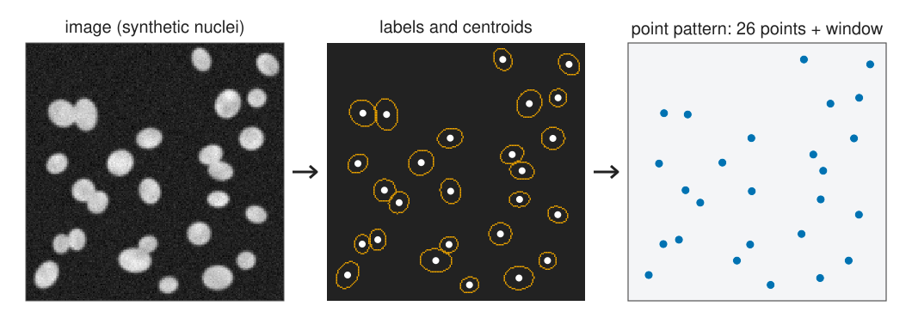
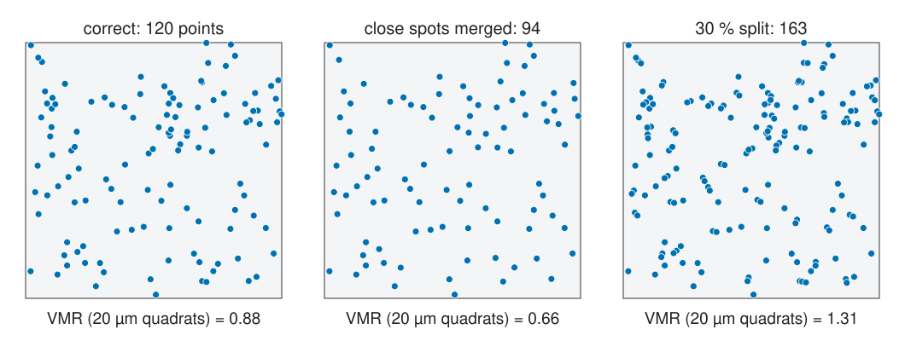
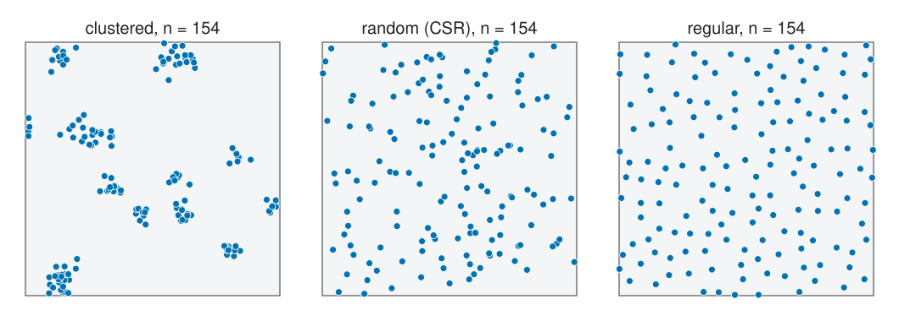
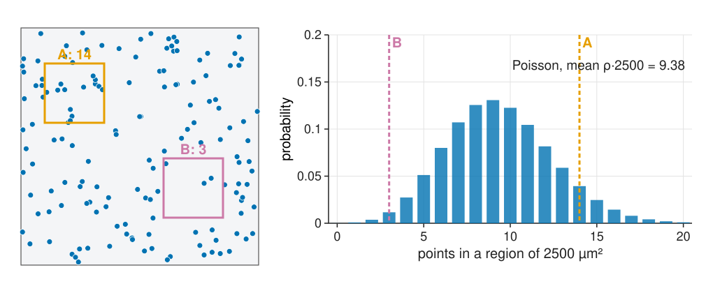
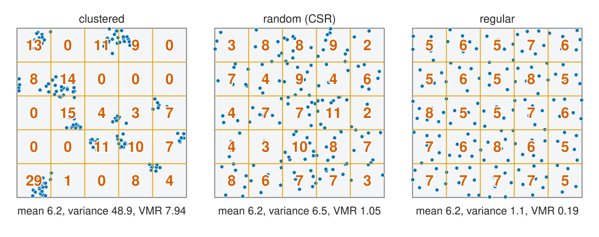
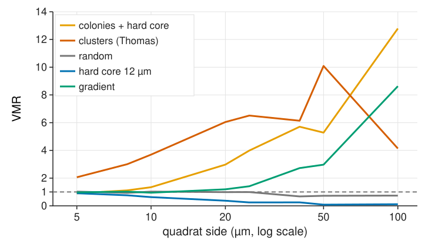
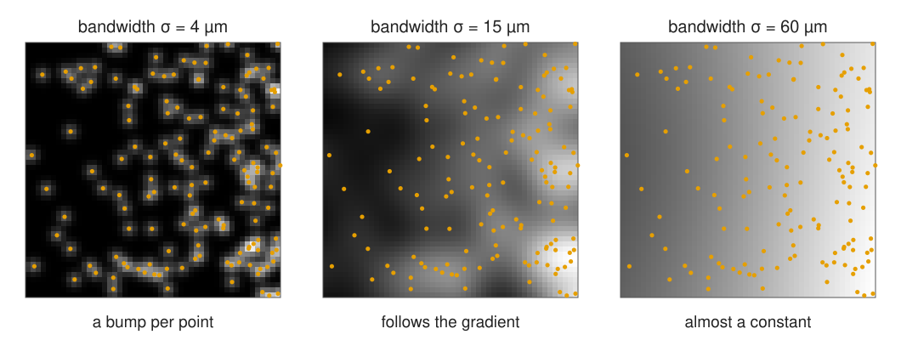
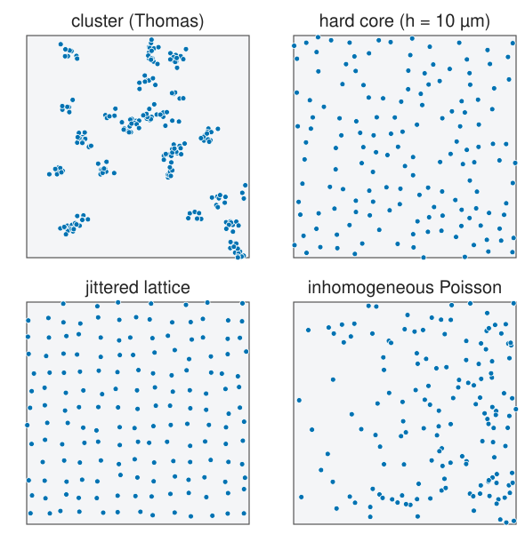

## About this lecture

Labelling gave us objects, spot detection gave us spots. Often the question is not about one object but about **where they are**: are the cells clustered, spread evenly, or scattered at random?

- A **point pattern**: positions, the **window** we looked in, and optional **marks**.
- How detection errors turn into **pattern artefacts**.
- **Complete spatial randomness** (the Poisson process): the null model of the day.
- **Clustered, random, regular**, and why the eye is a poor judge.
- **Quadrat counts** and the variance-to-mean ratio, and why the answer depends on the quadrat size.
- **Intensity**: how many points per µm², and a map of it.

*Slides titled **The math** give the formulas and proofs; the ideas are complete without them.*

::: notes
First unit of the spatial statistics day (elective group "Objects"). The day owns point-pattern statistics: CSR, quadrats, G/F/J, K/L/g, edge corrections, envelopes and global tests, cross and mark functions, the inhomogeneous K. Notation: the intensity is ρ (points per µm²), as in the measurements day's relations unit; the spatial statistics literature writes λ, which the course keeps for the weight of a prior. All patterns are synthetic and seeded; the window is 200 × 200 µm unless said otherwise. Demo of the unit: csrplay.
:::

## From objects to points

{width="100%" fig-alt="Three panels. A synthetic image of 26 bright nuclei; the same nuclei as orange outlines with a white dot at each centroid; the 26 centroids as blue points in a light square, the window."}

A **point pattern** is three things:

- the **positions** $\mathbf x_1, \dots, \mathbf x_n$ (centroids of labelled objects, or detected spots), in µm;
- the **window** $W$: where we looked. "No points here" only means something inside $W$; for tissue that is the **tissue mask**, not the whole image;
- optional **marks** per point: a type (tumour or immune cell), a size, an intensity.

::: notes
The window is part of the data. A pattern of cells in a tissue section looks clustered if the analysis pretends that the empty slide around the tissue was also searched. Marks come back in unit 5.
:::

## Where the points come from {.smaller}

:::: {.columns}
::: {.column width="40%"}
Recall: centroids from [region properties](../regionprops/lec.qmd); spots from [spot filters](../spot-filters/lec.qmd); two spots closer than about the PSF width **merge** into one ([crowding](../spot-crowd/lec.qmd)).

Every detection error becomes a **pattern artefact**:

- **merged** spots: no short distances, the pattern looks **regular**;
- **over-split** nuclei: pairs at tiny distances, it looks **clustered**;
- objects of diameter $D$ cannot have centres closer than about $D$: a **hard core**. Real cells are never exactly random.
:::
::: {.column width="60%"}
{width="100%" fig-alt="Three panels of the same 120 random positions. Correct detection: 120 points, VMR 0.88 with 20 µm quadrats. Spots closer than 8 µm merged: 94 points, more evenly spread, VMR 0.66. 30 percent of the objects split into two points 3 µm apart: 163 points with many tight pairs, VMR 1.31."}

The same 120 true positions, detected three ways (VMR: next slides).
:::
::::

::: notes
The relations unit found Clark–Evans R = 1.11 for "randomly placed" nuclei: they cannot overlap, so short distances are missing. Ask the class: you have a list of spot positions from a widefield image with PSF σ = 3 px; will it look more or less regular than the true molecules? (More regular: close pairs merge.) The demo's "from an image" tab shows it: 150 random spots, 107 detected at PSF σ = 3 µm, Clark–Evans R 1.06 → 1.34.
:::

## Clustered, random, regular

{width="100%" fig-alt="Three patterns of 154 points each in a 200 × 200 µm window. Clustered: tight groups with empty space between. Random: points scattered independently, with some chance clumps and gaps. Regular: points that keep a distance of at least 11 µm, spread evenly."}

- **Clustered**: cells in colonies, receptors in clusters, cells near a vessel.
- **Random**: no interaction and no preferred place.
- **Regular**: cells that keep a distance (photoreceptors, epithelia; any object with a size).

## Try it: which one is random?

```{=html}
<link rel="stylesheet" href="../demos/dist/demo.css">
<div data-demo="csrplay" data-preset="random"></div>
<script src="../demos/dist/csrplay.js"></script>
```

::: notes
Three patterns of the same size: one random (CSR), one weakly clustered (Thomas, 40 parents, 4 offspring each, σ = 7 µm), one weakly regular (hard core 8 µm), shuffled per seed. Let the room vote before clicking. Most people pick the regular one as "random": real randomness has clumps and gaps that look like structure. Press "new trio" a few times. The lesson: we need a test, not an eye.
:::

## Complete spatial randomness (CSR)

:::: {.columns}
::: {.column width="45%"}
The **homogeneous Poisson process** with **intensity** ρ (points per µm²):

1. the number of points in any region $A$ is **Poisson** with mean $\rho\,|A|$;
2. counts in **non-overlapping** regions are **independent**.

Consequence: **given** $n$ points in $W$, they are $n$ independent **uniform** positions. Simulating CSR is easy.

Recall the Poisson distribution from [camera noise](../cameranoise/lec.qmd): photons arriving at random in time. Here: points arriving at random in space.
:::
::: {.column width="55%"}
{width="100%" fig-alt="Left: 150 random points with two 50 × 50 µm squares, A holding 14 points and B holding 3. Right: the Poisson distribution with mean ρ·2500 = 9.38 as bars, with A at 14 and B at 3 marked as dashed lines; both are plausible values."}

ρ = 150 / 40 000 µm² = 3.75 per 1000 µm²: a 50 × 50 µm square holds 9.4 points on average. A has 14, B has 3: both are ordinary under CSR.
:::
::::

## The math: the Poisson process {.math}

$N(A) \sim \text{Poisson}(\rho|A|)$: $\;P(N(A) = k) = e^{-\rho|A|}\dfrac{(\rho|A|)^k}{k!}$, independent for disjoint $A_1, A_2, \dots$

- **Conditional uniformity**: for $A \subset W$, $P(N(A) = k \mid N(W) = n) = \binom{n}{k}p^k(1 - p)^{n-k}$ with $p = |A|/|W|$: each of the $n$ points falls in $A$ with probability $|A|/|W|$, independently. (Proof: split $W$ into $A$ and $W \setminus A$, use independence, divide by $P(N(W) = n)$.)
- **Simulation**: draw $N \sim \text{Poisson}(\rho|W|)$, then $N$ uniform points. In a mask: uniform points in the bounding box, keep those inside (rejection).
- **Empty regions**: $P(N(A) = 0) = e^{-\rho|A|}$. This gives the nearest-neighbour law of unit 2.
- For tests we usually **condition on n** (the binomial process): simulate exactly $n$ uniform points in $W$.

## CSR is a null model, not a hypothesis about cells

- CSR means **no interaction** (points ignore each other) and **no preferred place** (constant ρ).
- Real cells are almost never CSR: they have a size, they divide, they follow vessels and tissue layers.
- So "CSR rejected" is the **start** of an analysis, not the result. The useful questions: **how** does the pattern differ (more or fewer neighbours than chance?) and **at which distance**?
- Two different reasons for "clustered-looking" patterns:
  - **first order**: the intensity ρ(**x**) varies (more cells near a vessel), but cells do not interact;
  - **second order**: cells attract or repel each other (colonies, contact inhibition).
- Units 2–4 assume a constant ρ. Unit 5 relaxes it.

::: notes
The same picture can come from both mechanisms; from a single pattern they cannot always be separated (unit 5, "the honest limit").
:::

## Quadrat counts

{width="100%" fig-alt="The three archetypes with a 5 × 5 grid of 40 µm quadrats and the count written in each. Clustered: counts from 0 to 29, mean 6.2, variance 48.9, VMR 7.94. Random: counts 2 to 11, variance 6.5, VMR 1.05. Regular: counts 5 to 8, variance 1.1, VMR 0.19."}

Divide $W$ into $m$ equal squares and count. Under CSR the counts are Poisson, so **variance ≈ mean**. The **index of dispersion** $\text{VMR} = s^2/\bar n$: **> 1 clustered**, ≈ 1 random, **< 1 regular**.

## The math: the quadrat test {.math}

With $m$ quadrats, counts $n_k$ and mean $\bar n$:

$$X^2 = \sum_{k=1}^m \frac{(n_k - \bar n)^2}{\bar n} = (m - 1)\,\text{VMR} \;\approx\; \chi^2_{m-1} \text{ under CSR}.$$

- It is the Pearson χ² test of "all quadrats have the same expected count" (given $n$, the counts are multinomial with equal probabilities).
- **Large** $X^2$: clustered. **Small** $X^2$: regular (use the lower tail).
- 100 points in 25 quadrats: reject CSR towards clustering at 5 % if $X^2 > 36.4$ (VMR > 1.52), towards regularity if VMR < 0.58.
- The approximation needs expected counts of about 5 or more per quadrat; with very small quadrats, use simulation (unit 4).

## Try it: quadrats

```{=html}
<link rel="stylesheet" href="../demos/dist/demo.css">
<div data-demo="csrplay" data-preset="clusters"></div>
<script src="../demos/dist/csrplay.js"></script>
```

::: notes
Tab "quadrats": the grid with counts, the histogram of counts against the Poisson distribution of the same mean (red dots), the χ² test, and VMR against the quadrat side. Tour (8 × 8 quadrats of 25 µm): "CSR": mean 2.34, variance 2.32, VMR 0.99, p = 0.49 both ways. "clusters": 229 points, VMR 6.51; the histogram has far too many empty quadrats and a long tail. "regular" (hard core 12 µm): VMR 0.25, p regular < 0.001; the histogram is narrower than Poisson. "merged spots" (CSR, spots closer than 8 µm merged, 10 × 10 quadrats): 110 points, VMR 0.65, p regular 0.003. "split nuclei": 198 points, VMR 1.29, p clustered 0.03. The VMR-against-size plot is the next slide.
:::

## One number, which scale?

:::: {.columns}
::: {.column width="55%"}
{width="100%" fig-alt="VMR against the quadrat side from 5 to 100 µm on a log scale for five patterns. Random stays near 1. A hard core of 12 µm stays below 1, lowest for large quadrats. Thomas clusters rise from 2 at 5 µm to above 6. Colonies with a hard core are below 1 (0.90) at 5 µm and rise above 12 at 100 µm. A density gradient is near 1 for small quadrats and rises to 8.6 for 100 µm quadrats."}
:::
::: {.column width="45%"}
The VMR depends on the **quadrat size**:

- quadrats much **smaller** than the clusters: almost every count is 0 or 1, VMR → 1 (or < 1 with a hard core);
- quadrats that hold whole clusters: VMR up to about 1 + (points per cluster);
- **colonies of cells with a size**: **regular** at 5 µm (0.90) and **clustered** at 20 µm (2.97). Both are true.
- a **gradient** looks random in small quadrats and clustered in large ones.

One number cannot describe structure at several scales. Units 2–3 replace it by **functions of the distance r**.
:::
::::

::: notes
In the demo: preset "quadrat size changes the verdict" (colonies, 40 × 40 quadrats of 5 µm): VMR 0.90, X² = 1439 on 1599 df, p regular 0.002. Set 10 quadrats per side (20 µm): VMR 2.97, p clustered < 0.001. "gradient" (4 × 4 quadrats of 50 µm): VMR 2.97, p clustered < 0.001; at 20 × 20 quadrats (10 µm): VMR 0.95. Math question B7 shows why VMR → 1 + μ for large quadrats of a cluster process.
:::

## Estimating the intensity

{width="100%" fig-alt="A pattern whose density increases from left to right, with kernel estimates of the intensity at bandwidths 4, 15 and 60 µm as grey maps. At 4 µm the map is a bump at each point; at 15 µm it shows the gradient with some local bumps; at 60 µm it is a smooth left-to-right ramp, almost constant."}

- One number: $\hat\rho = n / |W|$ (use the **tissue** area).
- A map: **blur the point image with a Gaussian** of bandwidth σ (recall [kernels](../kernels/lec.qmd)), and divide by the blurred window, so that the estimate does not drop near the border.
- σ too small: a bump per point. σ too large: a constant. The same trade-off as any smoothing; unit 5 needs it.

## The math: kernel intensity {.math}

$$\hat\rho(\mathbf x) = \frac{1}{e(\mathbf x)}\sum_{i=1}^n k_\sigma(\mathbf x - \mathbf x_i), \qquad e(\mathbf x) = \int_W k_\sigma(\mathbf x - \mathbf y)\,d\mathbf y,$$

with $k_\sigma$ the 2D Gaussian (integral 1).

- Without $e(\mathbf x)$, part of each kernel's mass falls outside $W$ and $\hat\rho$ is too low near the border (up to a factor 4 in a corner). $e(\mathbf x)$ is the blurred **window indicator**: one more Gaussian blur.
- For a rectangle $[0, a] \times [0, b]$: $e(x, y) = [\Phi(\tfrac{a - x}{\sigma}) - \Phi(\tfrac{-x}{\sigma})]\,[\Phi(\tfrac{b - y}{\sigma}) - \Phi(\tfrac{-y}{\sigma})]$, with Φ the normal CDF.
- Integral: $\int_W \hat\rho \approx n$; the estimate is unbiased for a smoothed version of ρ(**x**).
- **Leave-one-out** at the data points ($\sum_{j \ne i}$) is needed when $\hat\rho(\mathbf x_i)$ is used to correct a second-order function (unit 5).

## Models that are not CSR

:::: {.columns}
::: {.column width="45%"}
{width="100%" fig-alt="Four patterns in 2 × 2 panels: a Thomas cluster process with tight groups, a hard-core process with minimum distance 10 µm, a jittered square lattice, and an inhomogeneous Poisson process whose density increases to the right."}
:::
::: {.column width="55%"}
Named models, so that the demos and the tests have something to find:

- **cluster** (Thomas, Matérn): parents at random, each with a Poisson number of offspring scattered around it;
- **hard core**: no two points closer than $h$ (add points at random, reject those too close);
- **jittered lattice**: a grid with random displacements; strongly regular;
- **inhomogeneous Poisson**: independent points, uneven ρ(**x**).

Image libraries and statistics packages call the field **spatial point pattern analysis**.
:::
::::

## The math: the cluster process {.math}

**Thomas process**: parents form a Poisson process of intensity κ; each parent has $M \sim \text{Poisson}(\mu)$ offspring, displaced by independent $N(0, \sigma^2 I)$ vectors; the parents are discarded.

- Intensity: $\rho = \kappa\mu$ (superposition of the offspring of all parents).
- Counts in a region $Q$ much larger than σ: $N(Q) \approx \sum_{\text{parents in } Q} M_j$, a compound Poisson sum, so $E[N] = \kappa|Q|\mu$, $\text{Var}[N] = \kappa|Q|(\mu + \mu^2)$ and $\text{VMR} \to 1 + \mu$.
- Region much smaller than σ: offspring of one parent rarely share it, VMR → 1.
- Simulation: draw parents in $W$ enlarged by about 4σ, so that clusters whose parent lies just outside $W$ are not lost.
- Matérn cluster: offspring uniform in a disc of radius $R$ instead of Gaussian.

## Try it: points detected from an image

```{=html}
<link rel="stylesheet" href="../demos/dist/demo.css">
<div data-demo="csrplay" data-preset="image"></div>
<script src="../demos/dist/csrplay.js"></script>
```

::: notes
Tab "from an image": the 150 random positions are rendered as Gaussian spots (PSF σ slider) with noise, detected again (LoG filter, local maxima, threshold 5 noise sd); orange dots are the true positions, green circles the detections. At PSF σ = 3 µm: 107 of 150 detected, Clark–Evans R 1.06 → 1.34, VMR with 20 µm quadrats 0.99 → 0.53; the nearest-neighbour histogram loses everything below about 6 µm. At σ = 1.5 µm: 131 detected, R 1.20. Detection makes a random pattern regular. Tab "intensity", preset "intensity bandwidth" (gradient): at σ = 15 µm the column profile follows the true ramp; move σ to 3 (bumps) and 60 (flat).
:::

## Where this leads

- **Unit 2**: distances to the **nearest** neighbour and to the nearest point from an empty location (G, F, J), and the **edge** of the window.
- **Unit 3**: **all** neighbours at every distance (Ripley's K, L and the pair correlation g): the scale question of the quadrats, answered.
- **Unit 4**: is the difference from CSR more than chance? **Simulation envelopes**.
- **Unit 5**: two cell types, and an uneven ρ(**x**).
- The [relations unit](../relations/lec.qmd) of the measurements day met the nearest-neighbour distance and Clark–Evans; unit 2 starts there.

## Summary

- A point pattern is **positions + window + marks**; the window (tissue mask) is part of the data.
- Detection leaves fingerprints: **merged** spots look regular, **split** objects look clustered, objects with a **size** have a hard core.
- **CSR** (homogeneous Poisson): Poisson counts with mean ρ|A|, independent regions; given n, uniform positions. It is the **null model**, almost never the truth.
- **Quadrat counts**: VMR > 1 clustered, < 1 regular; the χ² test. The verdict **depends on the quadrat size**.
- **Intensity**: n/|W|, or a kernel map with an edge correction; the bandwidth decides what counts as "density".
