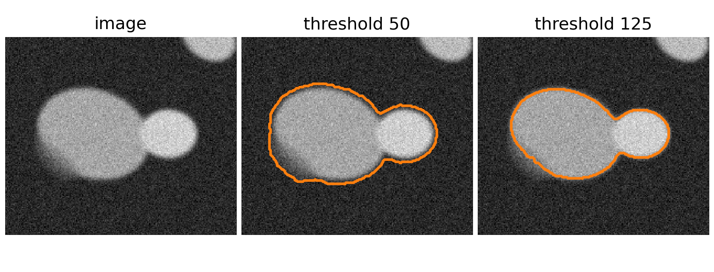
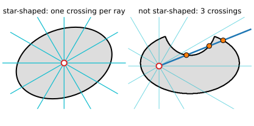
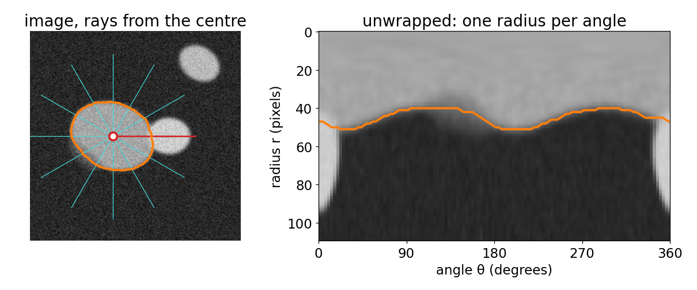
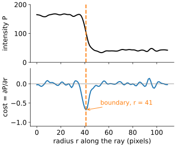
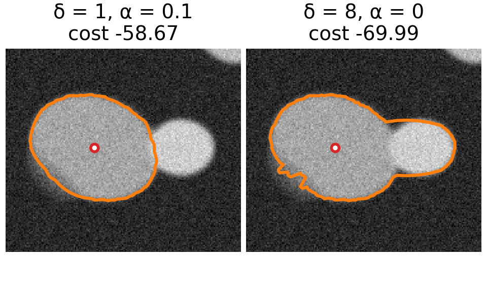
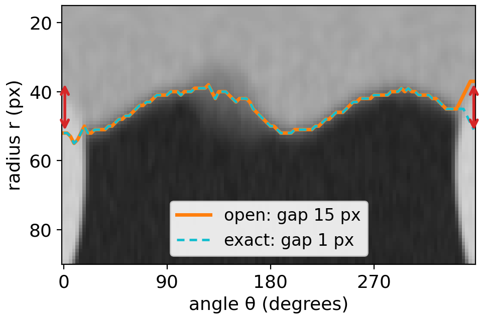
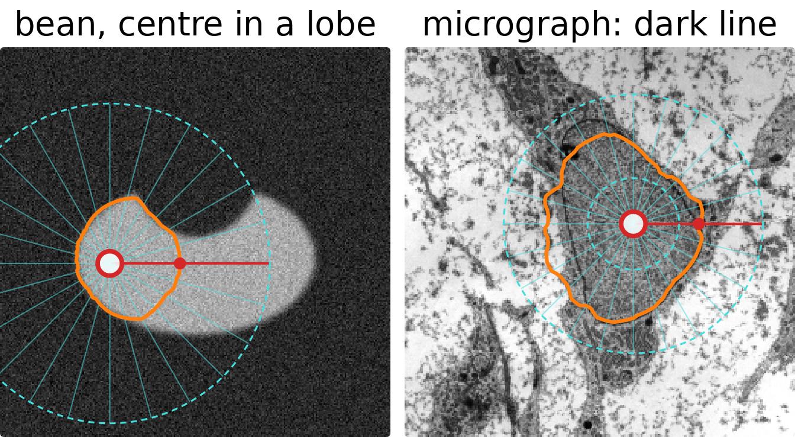
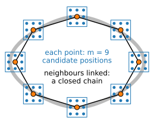

## About this lecture

Last unit: the cheapest path from the top to the bottom of a cost image, exactly, by filling a table row by row. Today the same table finds a **closed boundary** around a nucleus.

- A boundary around a centre is **one radius per angle**, if the object is **star-shaped**.
- **Unwrap** the image to polar coordinates: the closed curve becomes a path from left to right.
- A **cost** that is low on the edge, with the right **polarity**, and a **smoothness** limit.
- The catch: the path must **close**. Three ways to handle it.
- Where it fails, and DP for **snakes**.

*Slides titled **The math** give the formulas and proofs; the ideas are complete without them.*

::: notes
Prerequisites: the DP table of the previous unit; inverse mapping and bilinear interpolation from the Images unit (day 1), recalled on one slide; the snake energy from the snakes day (first day of this elective chain), quoted on one slide.
:::

## The problem

A fluorescent nucleus, blurred, noisy, with a **weak** part of its boundary and a brighter **neighbour** touching it.

- A **threshold** that keeps the weak part leaks into the background; one that avoids the leak cuts the nucleus. And it merges the neighbour.
- **Snakes and level sets** (the previous two days) need a starting curve and descend **locally**: they can stop at the wrong edge.
- We know something about the shape: it is a **blob around a centre**. Can we use that to get the **best** boundary, not just a nearby one?

{fig-alt="A synthetic nucleus with a faint, blurred lower-left edge and a brighter round neighbour touching it on the right. Threshold 50: the outline bulges into the faint halo and includes the neighbour. Threshold 125: the outline cuts off the faint part and still includes the neighbour." width="70%" fig-align="center"}

## Star-shaped objects

An object is **star-shaped** around a centre $c$ if every ray from $c$ leaves the object exactly once.

- Every convex shape is star-shaped around any of its points; a nucleus usually is around its middle.
- Then the boundary is a **function**: one radius $r(\theta)$ for each angle $\theta$.
- Finding a closed curve becomes finding one number per angle: a **chain**, exactly what DP handles.

Not star-shaped: a bean seen from a point in one of its lobes, a dumbbell, a cell with long protrusions. We come back to them.

{fig-alt="Left: an ellipse with rays from its centre, each ray crossing the boundary once. Right: a bean shape seen from a point in its left lobe; one highlighted ray crosses the boundary three times." width="58%" fig-align="center"}

## Unwrapping: the image in polar coordinates

{fig-alt="Left: the synthetic nucleus with rays from its centre and the boundary in orange. Right: the unwrapped image, angle 0 to 360 degrees across and radius 0 to 110 pixels down; the boundary is a left-to-right path at radii of about 40 to 50 pixels." width="88%" fig-align="center"}

Sample the image along $K$ rays at radii $0, 1, 2, \dots$ The rays become **columns**: angle across, radius down. The circle-like boundary becomes a **path from left to right**, one radius per column.

## The math: unwrapping {.math}

Centre $c = (c_x, c_y)$, angles $\theta_k = 2\pi k / K$, radii $r = 0, 1, \dots, R-1$:

$$P(k, r) = I\big(c_x + r\cos\theta_k,\ c_y + r\sin\theta_k\big).$$

The sample point is not a pixel centre, so $I$ is read by **bilinear interpolation** (the inverse mapping of the Images unit): with $x = x_0 + f_x$, $y = y_0 + f_y$, $0 \le f_x, f_y < 1$,

$$I(x, y) = (1 - f_y)\big[(1-f_x) I_{x_0, y_0} + f_x I_{x_0+1, y_0}\big] + f_y\big[(1-f_x) I_{x_0, y_1} + f_x I_{x_0+1, y_1}\big],\quad y_1 = y_0 + 1.$$

The $y$-axis points down, so $\theta$ increases **clockwise** on the screen. Mapping back: a path $r_k$ is the closed polygon $c + r_k(\cos\theta_k, \sin\theta_k)$.

## A cost along each ray

:::: {.columns}
::: {.column width="58%"}
Along a ray, a bright nucleus on a dark background goes **bright → dark** at the boundary: the intensity drops. Use the **radial derivative** $\partial P / \partial r$:

- **bright → dark** (bright inside): cost $= +\partial P/\partial r$, very negative at the boundary;
- **dark → bright**: cost $= -\partial P/\partial r$;
- **either**: cost $= -|\partial P/\partial r|$.
- A thin **dark line** (a nuclear envelope in an electron micrograph): the second derivative, low in the middle of the line.
:::
::: {.column width="42%"}
{fig-alt="Top: the intensity along the ray pointing straight down from the centre of the synthetic nucleus, about 165 inside and 40 outside, dropping at radius 41. Bottom: the cost (the radial derivative, scaled), near zero except for a sharp minimum at radius 41, marked as the boundary." width="100%"}
:::
::::

The **sign** selects the edge we want. A plain gradient magnitude cannot tell the outer edge of the nucleus from the inner edge of a brighter neighbour; the radial derivative can. Smooth the image a little first (a Gaussian, as in the Filtering unit), or the noise dominates the derivative.

## Smoothness: how far may the radius jump?

:::: {.columns}
::: {.column width="54%"}
Without a limit, the path picks the best edge on every ray independently, and jumps between edges (and noise).

- **Hard limit**: $|r_{k+1} - r_k| \le \delta$ pixels between neighbouring angles.
- **Soft penalty**: add $\alpha\,|r_{k+1} - r_k|$ for every pixel of change.
:::
::: {.column width="46%"}
{fig-alt="The synthetic nucleus with two boundaries from the demo. With delta 1 and alpha 0.1 (cost -58.67) the contour follows the nucleus. With delta 8 and alpha 0 (cost -69.99) it runs out around the brighter neighbour and wiggles along the faint lower-left edge." width="100%"}
:::
::::

This is the previous unit **turned sideways**: the angles are the stages (rows of the table), the radii are the states (columns), the steps go up to $\delta$ columns sideways, with a penalty.

Note: $\delta$ is per **angle step**. With more angles ($K$ larger) the same $\delta$ allows a steeper boundary.

## The math: the recursion {.math}

Cost $C(k, r)$ for angle $k = 0, \dots, K-1$ and radius $r \in [r_{\min}, r_{\max}]$:

$$M(0, r) = C(0, r), \qquad M(k, r) = C(k, r) + \min_{|d| \le \delta} \big(M(k-1, r+d) + \alpha |d|\big).$$

The best **open** path ends at $\arg\min_r M(K-1, r)$ and is read off by backtracking. Work: $(2\delta + 1)$ candidates per cell, $O(K R \delta)$ in total: for $K = 360$, $R = 100$, $\delta = 3$ about 250 000 operations.

The energy that is minimised is

$$E(r_0, \dots, r_{K-1}) = \sum_k C(k, r_k) + \alpha \sum_{k} |r_{k} - r_{k-1}|, \qquad |r_k - r_{k-1}| \le \delta,$$

a data term plus a smoothness term, as on the graph-cut day, but over a chain.

## Closing the curve

:::: {.columns}
::: {.column width="56%"}
Angle $0°$ and angle $360°$ are the same ray, so the path must satisfy $|r_0 - r_{K-1}| \le \delta$ too. The table of the previous slide does not know that.
:::
::: {.column width="44%"}
{fig-alt="The unwrapped nucleus (angle across, radius down) with two paths for delta 2, alpha 0. The open path starts at radius 52 and ends at radius 37, a gap of 15 pixels (red arrows at both ends); the exact closed path (dashed) has a gap of 1 pixel. In between the two paths coincide." width="100%"}
:::
::::

- **Open** (ignore it): the result often has a visible **jump** at $0°$.
- **Exact**: fix the start radius $r_0$, run DP, and accept only end radii within $\delta$ of $r_0$. Do this for **every** start radius and keep the best closed path. $R$ times the work, still a few milliseconds.
- **Unroll** (the common heuristic): repeat the angles three times ($0° \dots 1080°$), run DP once, and keep the middle copy. The ends of the long path are far away, so the middle usually closes. Not guaranteed, and not guaranteed optimal.

## The math: why the exact closure is exact {.math}

Every closed path has some start radius $s = r_0$. For fixed $s$, set $M_s(0, r) = C(0, r)$ if $r = s$ and $\infty$ otherwise, run the recursion, and close:

$$E^*_s = \min_{|r - s| \le \delta} \big(M_s(K-1, r) + \alpha|r - s|\big).$$

$E^*_s$ is the cheapest closed path that starts at $s$ (the principle of optimality, with the extra closing step). The best closed path is $\min_s E^*_s$. Work: $R$ runs, $O(K R^2 \delta)$: for $K = 360$, $R = 100$, $\delta = 3$ about 25 million operations, a few tens of milliseconds.

Faster exact methods exist (branch and bound over the start radius, Appleton & Sun 2003). Unrolling costs only 3 runs, but a counterexample where its middle copy does not close is in the exercise.

## Try it: boundaries in polar coordinates

```{=html}
<link rel="stylesheet" href="../demos/dist/demo.css">
<div data-demo="polarseg" data-preset="done"></div>
<script src="../demos/dist/polarseg.js"></script>
```

::: notes
Left: the image, the centre (drag it), every few rays (red: angle 0), the annulus [r min, r max] and the contour. Middle: the unwrapped image (angle across, radius down) with the path; switch to the cost (blue = cheap) or the table M. Tour: "nucleus: done" (δ = 1, α = 0.1, exact: gap 0, cost −58.67). Closure "open": gap 7 px at angle 0. "no smoothness" (δ = 8, α = 0): the path jumps out to the outer edge of the brighter neighbour (radius 94 at 0°), because that edge is stronger: the cost is lower (−69.99), so the energy prefers it, and only the smoothness limit stops it. "open path: jump at 0°" (δ = 2): gap 15 px. "bad centre": the bean seen from its left lobe; "centre → centroid" a few times moves the centre but the right lobe stays outside. "wrong polarity": dark → bright finds nothing useful near the boundary. "micrograph nucleus": dark line cost on the nuclear envelope; on the left it follows the parallel cell membrane instead.
:::

## Where it fails

:::: {.columns}
::: {.column width="60%"}
- **Not star-shaped**: a ray that crosses the boundary twice can only report one crossing. The bean seen from one lobe loses the other lobe.
- **Wrong centre**: even a convex nucleus looks distorted from a centre near its edge: the angles are spread unevenly, and $\delta$ limits the slope.
- **A brighter edge on the same ray**: the neighbour's outer edge, a parallel membrane. If it is cheaper and reachable within the smoothness limit, the optimum **is** that edge: the energy is wrong, not the optimisation.
:::
::: {.column width="40%"}
{fig-alt="Two stills of the polar demo. Left: the bean seen from a centre in its left lobe; the contour closes around the left lobe only. Right: the micrograph nucleus with the dark-line cost; the contour follows the nuclear envelope on most sides but runs along a parallel structure in places." width="100%"}

[Micrograph: transmission electron micrograph of a mesenchymal stem cell, Robert M. Hunt, CC BY 3.0, via Wikimedia Commons.]{style="font-size: 0.6em; color: #666;"}
:::
::::

Remedies: a **centre** from a seed click or from the peak of the distance transform (morphology day) of a rough mask; an **annulus** $r_{\min} \le r \le r_{\max}$; **iterate** (new centre = centroid of the result, then run again); the right **polarity**.

## Global, but in a small family

Three ways to find a nucleus boundary, three kinds of guarantee:

| Method | Optimises | Guarantee |
|---|---|---|
| Graph cuts (graph-cut day) | a 2D labelling, binary, submodular | global minimum |
| Snakes, level sets (previous days) | a curve, by local descent | a local minimum near the start |
| Polar DP (today) | one radius per angle | global minimum among star-shaped curves around $c$ |

Polar DP needs no starting curve, only a centre, and is never trapped by a nearby weak edge. The price is the restriction: star-shaped around a known centre.

## DP for snakes

:::: {.columns}
::: {.column width="64%"}
Recall from the snakes day: a snake is a closed curve of $n$ points $v_i$ with an energy of an **internal** part (elasticity, rigidity) and an **image** part. Gradient descent moves it to a nearby local minimum.

DP version (Amini, Weymouth & Jain 1990): let each point move only within a small **window** of $m$ candidate positions around its current place.
:::
::: {.column width="36%"}
{fig-alt="Eight snake points on a closed polygon around a grey ring (the edge); each point has a 3 by 3 window of nine candidate positions; neighbouring points are linked, forming a closed chain." width="100%"}
:::
::::

- With only the **elastic** term $\sum_i |v_{i} - v_{i-1}|^2$, the energy links each point to the next one only: a closed **chain**, so DP finds the best move of **all points at once**. Repeat until nothing moves.
- Polar DP is the special case "each point moves along its ray".
- The **rigidity** (bending) term links three consecutive points: the states become **pairs** of positions, $m^2$ per stage, and the work grows to about $n m^3$.

## The math: DP snakes {.math}

Candidate positions $v_i \in W_i$ ($|W_i| = m$). First-order energy

$$E = \sum_i \big[E_{\text{img}}(v_i) + \alpha\,|v_i - v_{i-1}|^2\big]$$

is a chain: $M_i(v) = E_{\text{img}}(v) + \min_{u \in W_{i-1}} \big(M_{i-1}(u) + \alpha|v - u|^2\big)$, $m^2$ work per point, $O(nm^2)$ in total (times $m$ for the exact closure, as before).

With the bending term $\beta\,|v_{i+1} - 2v_i + v_{i-1}|^2$ (as on the snakes day) each term involves three points. Use the pair $(v_{i-1}, v_i)$ as the state: $M_i(v_{i-1}, v_i) = \min_{v_{i-2}} \big(M_{i-1}(v_{i-2}, v_{i-1}) + \dots\big)$: $m^2$ states, $m$ candidates each, $O(nm^3)$.

## Summary

- A **star-shaped** boundary around a centre is one radius per angle: a **chain**.
- **Unwrap** the image (bilinear sampling along rays); the boundary becomes a left-to-right path.
- **Cost** from the radial derivative, with the right **polarity**; **smoothness** by a step limit $\delta$ and a penalty $\alpha$.
- DP gives the **global** optimum of this restricted problem; **closing** the curve needs the exact method (all start radii) or the unroll heuristic.
- Fails for non-star-shaped objects, bad centres, and brighter edges on the same rays. The same idea optimises **snakes** (DP over a window per point).
