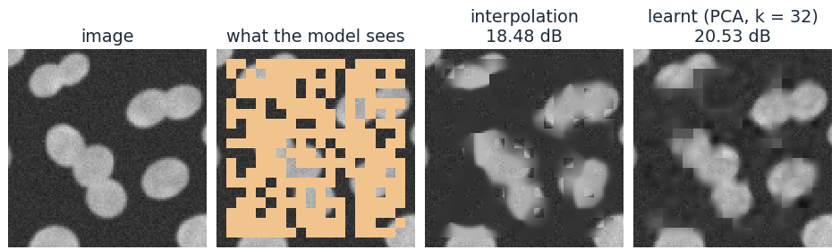
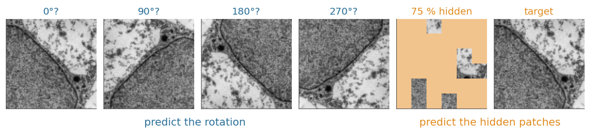
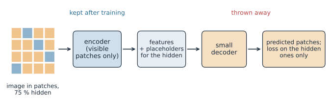
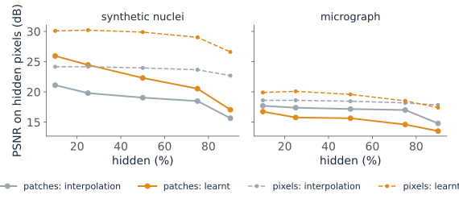
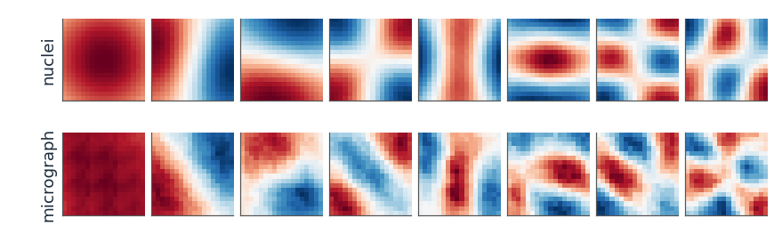
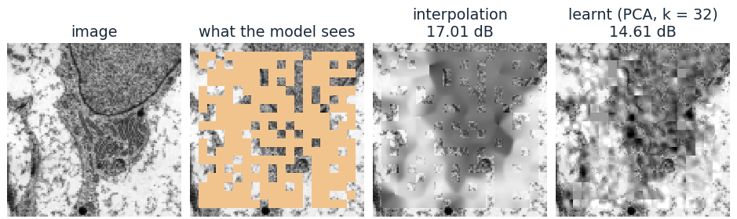

## About this lecture

*Annotating 100 cells takes an afternoon; a screen produces a million unlabelled images a night. Can a network learn useful features from the images alone?*

- **Pretext tasks**: made-up tasks whose answers come free with the images (which way is up? what is under the mask?).
- **Masked image modelling**: hide most of the patches, predict them; why 75 % and not 10 %.
- A **linear** masked model (PCA of windows) as a small working example: what it learns, and where prediction is impossible.
- Judge the **features**, not the reconstructions: linear probe and nearest neighbours.

*Slides titled **The math** give the formulas and proofs; the ideas are complete without them.*

::: notes
First unit of the day "Learning without labels". Recalls: PCA (day 1), autoencoders (VAE day), patches as tokens, frozen features and the linear probe (attention unit), inpainting. The demo (maskfill) uses a PCA model of 18 × 18 windows learnt from other images, so that it is exact, fast and needs no training loop; a masked autoencoder does the same with a transformer. Masked autoencoders: He et al. 2022; rotation prediction: Gidaris et al. 2018; context prediction / jigsaw: Doersch et al. 2015, Noroozi and Favaro 2016.
:::

## Labels are expensive, images are free

:::: {.columns}
::: {.column width="55%"}
- Supervised training needs **labels**: masks, classes, counts. Each costs an expert's time, and every new microscope, stain or cell line needs new ones.
- Unlabelled images cost almost nothing, and there are millions of them.
- **Self-supervised learning**: train on a task whose answers are **in the images themselves**, then reuse what the network learnt (its features) for the real task, with few labels.
- The made-up task is the **pretext**; the real task is the **downstream** task.
:::
::: {.column width="45%"}
{fig-alt="The maskfill demo on synthetic nuclei: the image; what the model sees with 75 % of the inner 6 × 6 patches hidden (orange); the hidden patches filled by interpolation (18.48 dB, smeared) and by a learnt linear model (20.53 dB, the nuclei outlines continue across the holes)." width="100%"}
:::
::::

## Pretext tasks

{fig-alt="Two pretext tasks on a crop of the electron micrograph. Left: the same crop rotated by 0, 90, 180 and 270 degrees; the network must say which. Right: the crop with 75 % of its 16 × 16 patches hidden (orange) and the complete crop as the target." width="100%"}

- **Rotation**: which way was the image turned? **Jigsaw**: put shuffled tiles back in order. **Inpainting / masking**: fill in what is hidden. **Colourisation**: predict colour from grey. **Next frame**: predict the next image of a movie.
- Each forces the network to learn something about images, because the answer is not in any single pixel.

## What must the network learn, and what does it cheat with?

- **Rotation** needs "which way is up": easy in photographs (sky, people standing), meaningless for cells, which have no up. In microscopy, a rotation network may learn only the **illumination gradient** or the **scale bar**.
- **Shortcuts**: the easiest cue wins. Jigsaw tiles can be ordered by matching their **edges** pixel by pixel, or by the vignetting of the lens; masked pixels can be filled from their direct neighbours.
- So the pretext task must be **hard in the right way**: solvable only with the kind of knowledge we want (shapes, textures, how cells look).
- The cure for shortcuts is part of the task design: gaps between jigsaw tiles, random crops, and in masking: hide **whole patches**, and **most** of them.

## Masked image modelling

{fig-alt="A masked autoencoder: an image in patches with 75 % of them hidden; an encoder that sees only the visible patches; its features plus placeholders for the hidden patches; a small decoder; the predicted patches, with the loss computed on the hidden ones only. The encoder is kept after training, the decoder thrown away." width="100%"}

- Cut the image into patches (the [attention unit](../attention/lec.qmd)'s tokens), hide **75 %**, predict their pixels from the rest; loss on the hidden patches only.
- The encoder sees only a quarter of the patches: training is cheap. Afterwards the decoder is thrown away; the encoder's features are the product.

## Why hide so much?

:::: {.columns}
::: {.column width="45%"}
- **Single pixels** are easy: their neighbours are visible, and interpolation already gets 23.7 dB on the demo's nuclei with 75 % of the pixels hidden.
- **Whole patches** are hard: with 75 % hidden, interpolation drops to 18.5 dB. The learnt model gets 20.5 dB: it knows that nuclei are smooth blobs with sharp outlines.
- At 90 % both fail: too little is left to say where the nuclei are.
- Too easy a task teaches nothing; too hard a task cannot be solved. Images are redundant, so the right amount is **a lot**.
:::
::: {.column width="55%"}
{fig-alt="PSNR on the hidden pixels against the fraction hidden. Synthetic nuclei: hiding pixels, interpolation stays near 24 dB and the learnt model near 30 dB; hiding patches, interpolation falls from 21 to 16 dB and the learnt model from 26 to 17 dB. Micrograph: all curves between 14 and 20 dB; for patches the learnt model is below interpolation." width="100%"}
:::
::::

## A linear masked model

The demo's "learnt" model is the simplest possible masked model: **PCA of windows** (day 1).

- Training, no labels: take thousands of 18 × 18 windows (3 × 3 patches) from **other** images of the same kind; their mean and principal components.
- Filling a hidden patch: find the combination of mean + components that best matches the **visible** pixels of its window, and read off the hidden ones.
- By hand: windows that only vary along $(1, 1, 1, 1)/2$ around a mean of 1. A new window has visible pixels 1.4 and 1.4 and two hidden: the coefficient must be 0.8, so the hidden pixels are **1.4** as well.
- A masked autoencoder replaces "mean + components" by a deep network: nonlinear, far more expressive, the same training signal.

::: notes
The PCA model is the linear autoencoder of the autoencoder unit: encoder = projection on the components, decoder = the components. Fitting the coefficients to the visible pixels only is what turns it into a masked model. The ridge (next math slide) keeps it from wild coefficients when few pixels are visible.
:::

## The math: the masked loss, and the linear fill {.math}

Patches $\mathbf x_1, \dots, \mathbf x_n$, hidden set $M$ (random), network $f$:

$$\mathcal L = \frac{1}{|M|}\sum_{j \in M}\big\|f_j(\mathbf x_{\setminus M}) - \mathbf x_j\big\|^2 \qquad(\text{the visible patches do not count}).$$

Linear model of a window: $\mathbf x \approx \boldsymbol\mu + U\mathbf c$, $U$ = the $k$ leading principal components, variances $\lambda_a$. With visible pixels $V$:

$$\hat{\mathbf c} = \arg\min_{\mathbf c}\ \|(\boldsymbol\mu + U\mathbf c - \mathbf x)_V\|^2 + \sigma^2\sum_a c_a^2/\lambda_a = (U_V^\top U_V + \sigma^2\Lambda^{-1})^{-1}U_V^\top(\mathbf x - \boldsymbol\mu)_V,$$

and the hidden pixels are $(\boldsymbol\mu + U\hat{\mathbf c})_{\setminus V}$.

- This is the conditional mean of a Gaussian model of the windows (covariance $U\Lambda U^\top$ plus noise $\sigma^2 I$), given the visible pixels: the best linear prediction.
- $k = 0$: the mean window everywhere (13.3 dB in the demo): the model must use the visible pixels to be any good.

## Try it: fill the hidden patches

```{=html}
<link rel="stylesheet" href="../demos/dist/demo.css">
<div data-demo="maskfill" data-preset="p75"></div>
<script src="../demos/dist/maskfill.js"></script>
```

::: notes
PSNR over the hidden pixels; the PCA model (k = 32 components) is learnt at start-up from another synthetic image (or the micrograph's upper half). Presets: "25 %": interpolation 19.80 dB, learnt 24.46. "75 %": 18.48 against 20.53. "90 %": 15.66 against 17.05. "75 % of the pixels": 23.66 against 29.02: random pixels are easy. "k = 0": 13.32 dB, the average window. "micrograph": interpolation 17.01, learnt 14.61: fine texture cannot be predicted from the surroundings, and the linear model does worse than a local average.
:::

## What the model learnt

:::: {.columns}
::: {.column width="50%"}
- The principal components of the windows are the model's **features**: what varies most between windows of these images.
- Nuclei: a bright blob, then edges in two directions, then curved outlines and pairs of blobs. They were learnt **without a single label**.
- Micrograph: the brightness of the window first, then slow ramps; the fine texture is spread over hundreds of weak components.
- A deep masked model learns far richer features, layer by layer, by the same principle.
:::
::: {.column width="50%"}
{fig-alt="The first eight principal components of 18 × 18 windows (red positive, blue negative). Nuclei: a central blob, horizontal and vertical edges, curved and paired shapes. Micrograph: a uniform window, ramps, and less structured patterns." width="100%"}
:::
::::

## Where prediction is impossible

{fig-alt="The demo on the micrograph with 75 % of the patches hidden: the image, what the model sees, interpolation (17.01 dB, smooth fills) and the learnt model (14.61 dB, blotchy fills that do not match the texture)." width="85%" fig-align="center"}

- The micrograph's grainy texture is not predictable from the surroundings: no model can know the exact grain under a hidden patch.
- With a squared error the best guess is the **average** of what could be there: smooth and blurry. Masked autoencoders' reconstructions are blurry for this reason.
- Here the linear model is even **worse** than a local average (14.6 against 17.0 dB): one global model of 760 windows of a varied image, not enough to know this region.
- The reconstructions are a by-product; what counts is whether the encoder's **features** help the real task.

## The math: the best guess is the conditional mean {.math}

For any prediction $\hat{\mathbf x}$ of the hidden part $\mathbf x_M$ given the visible part $\mathbf x_V$:

$$\mathbb E\big[\|\hat{\mathbf x} - \mathbf x_M\|^2 \,\big|\, \mathbf x_V\big] = \big\|\hat{\mathbf x} - \mathbb E[\mathbf x_M \mid \mathbf x_V]\big\|^2 + \mathrm{tr}\,\mathrm{Cov}(\mathbf x_M \mid \mathbf x_V).$$

- The minimiser is the **conditional mean**: an average over all plausible fillings. If several textures are equally plausible, their average is a blur.
- The second term is the part no model can remove: the PSNR has a ceiling set by the images, not the method.
- Generative models (the [diffusion day](../score-matching/lec.qmd)) instead draw **one** plausible filling: sharp, and possibly wrong.

## Masked image modelling as pseudocode

```
repeat for every batch of unlabelled images:
    cut each image into patches
    choose 75 % of them at random: hidden
    features = encoder(visible patches, with their position codes)
    prediction = decoder(features, a placeholder for every hidden patch)
    loss = mean over the hidden patches of (prediction − true patch)²
    update encoder and decoder by backpropagation
keep the encoder
```

::: notes
The coding exercise (selfsup/src/pretext/ in the course code download) builds the linear version: windows, PCA, completing a window from its visible pixels, and the comparison with interpolation on the synthetic nuclei and the micrograph.
:::

## Judge the features, not the reconstruction

:::: {.columns}
::: {.column width="55%"}
- After pretraining, freeze the encoder and use its features for the real task, as in the [attention unit](../attention/lec.qmd):
  - a **linear probe**: logistic regression on the frozen features, trained with a few labels;
  - **k nearest neighbours**: a new cell gets the label of the most similar labelled cells.
- Good features: high accuracy with few labels. A sharper reconstruction does not guarantee that.
- Or **fine-tune** the whole encoder with the labels ([fine-tuning day](../transfer/lec.qmd)).
- The [next unit](../contrastive/lec.qmd) learns features without predicting pixels at all: by comparing views.
:::
::: {.column width="45%"}
| features (five painted strokes) | probe Dice |
|---|---|
| raw 9 × 9 patches | 0.39 |
| hand-made filter stack | 0.53 |
| tiny self-supervised encoder | 0.55 |

From the [attention unit's demo](../attention/exercise.qmd#explore-embedprobe) (synthetic nuclei among debris). A tiny encoder is no better than a good filter stack; large ones are.
:::
::::

## Summary

| Idea | In one line |
|---|---|
| Pretext task | a made-up task with free answers, to learn features from unlabelled images |
| Shortcuts | the easiest cue wins: design the task so that only the wanted knowledge solves it |
| Masked image modelling | hide 75 % of the patches, predict them; loss on the hidden ones |
| Why so much | hidden pixels are filled by interpolation; hidden patches need knowledge of the images |
| Limits | unpredictable texture: the best guess is a blurry average |
| Evaluation | features, by a linear probe or nearest neighbours, not reconstructions |

Next: learning by comparing two views of the same image.
