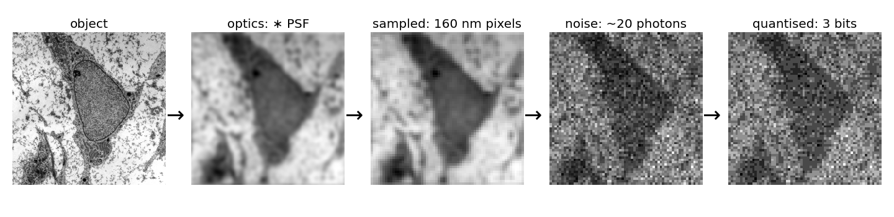
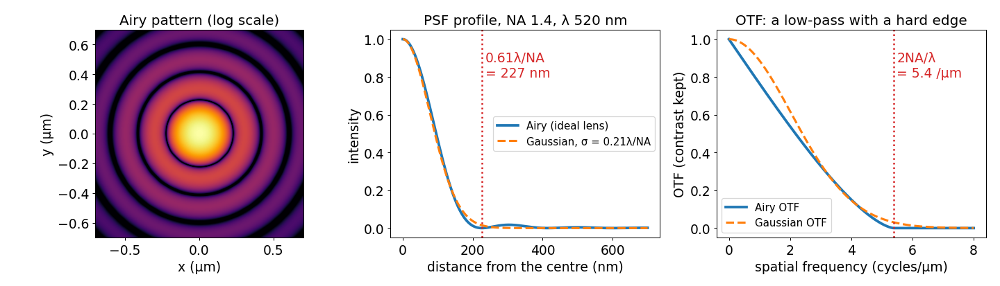

## About this lecture

A microscope does not deliver the object; it delivers a blurred, sampled, noisy version of it. Today we write down what it does, step by step:

- The **imaging chain** as a **forward model**: object → optics → pixels → noise.
- The image of a point, the **point spread function (PSF)**: image = object ∗ PSF.
- Its Fourier transform, the **OTF**: how much contrast survives at each frequency.
- **Diffraction**: a lens passes nothing above $2\mathrm{NA}/\lambda$. Resolution in nanometres.
- Other blurs: **defocus** (contrast can reverse) and **motion** (the OTF has zeros).

*Slides titled **The math** give the formulas and proofs; the ideas are complete without them.*

::: notes
First unit of the image formation day (day 4). It owns the PSF, the OTF and the forward model. Recalls (one slide each, no re-teaching): convolution (filtering unit, day 1), the convolution theorem (frequency unit, day 1), noise and quantisation (bit depth and noise day, day 3). Notation: f = object, h = PSF, g = image, H = OTF, n = noise. Wavelength λ in nm, NA = numerical aperture. Restoration (deconvolution) is the next day; this day ends with the diagnosis only (third unit).
:::

## The imaging chain

{width="100%"}

- **Optics** blur: every point becomes a small blob.
- **Sampling**: the pixel grid records one number per pixel.
- **Noise**: photons arrive at random, the camera adds read noise.
- **Quantisation**: a finite number of grey levels.

This chain is the **forward model**: what the instrument does to the truth. Analysis that wants to measure the object has to know it.

::: notes
Image: transmission electron micrograph of a mesenchymal stem cell, Robert M. Hunt, CC BY 3.0, via Wikimedia Commons. It is itself already a blurred image; here it plays the role of the "true object". Emphasise the order: blur happens in the continuous world before the pixels; noise is added per pixel after sampling.
:::

## Recall: the last two steps

From the bit depth and noise day:

- **Noise** (the camera noise unit): photon counts are Poisson, $\text{SNR} = \sqrt{N}$ for $N$ photons; the camera adds read noise and an offset.
- **Quantisation** (the quantisation unit): a finite bit depth rounds every value to a grey level.

Today is about the **first** steps: the optics, and (next unit) the pixels. The noise comes back at the end of the day, where it decides what can be undone.

## The image of a point

A lens cannot focus light to a point. The image of a point is a small blob: the **point spread function**, $h$.

- Fluorescence is **incoherent**: the images of different points add up in **intensity**.
- So the image is a **sum of shifted copies of the PSF**, each weighted by the brightness of its point: a **convolution**, image = object ∗ PSF.
- This is the convolution of the filtering unit, with a kernel made by physics. A blur kernel *is* a PSF.

**By hand.** Three point sources on a line, brightness 1, 2, 1 at positions 1, 4 and 6; PSF $(1, 2, 1)/4$:

| position | 0 | 1 | 2 | 3 | 4 | 5 | 6 | 7 |
|---|---|---|---|---|---|---|---|---|
| object | 0 | 1 | 0 | 0 | 2 | 0 | 1 | 0 |
| image | 0.25 | 0.5 | 0.25 | 0.5 | 1 | 0.75 | 0.5 | 0.25 |

The total stays 4: blur moves light around, it does not remove it.

## The math: convolution and the OTF {.math}

Object $f$, PSF $h$, noise $n$:

$$g(\mathbf x) = (f \ast h)(\mathbf x) + n(\mathbf x) = \int f(\mathbf y)\,h(\mathbf x - \mathbf y)\,d\mathbf y + n(\mathbf x).$$

Fourier transform (capital letters), by the convolution theorem:

$$G(\mathbf k) = F(\mathbf k)\,H(\mathbf k) + N(\mathbf k).$$

- $H$ is the **optical transfer function** (OTF); $|H|$ is the **modulation transfer function** (MTF).
- A PSF normalised to $\int h = 1$ has $H(\mathbf 0) = \int h(\mathbf x)\,e^{0}\,d\mathbf x = 1$: the mean brightness passes unchanged.
- A PSF that is symmetric, $h(-\mathbf x) = h(\mathbf x)$, has a **real** OTF; it can still be **negative**.
- A grating $1 + \cos(2\pi \mathbf k\cdot\mathbf x)$ is imaged as $1 + H(\mathbf k)\cos(2\pi\mathbf k\cdot\mathbf x)$ (symmetric PSF): its contrast is multiplied by $H(\mathbf k)$.

## Recall: blur in frequency space

From the frequency unit: **convolution = multiplication of spectra**. So the optics act frequency by frequency.

- The PSF's Fourier transform, the **OTF**, says how much of each frequency (each stripe pattern) survives.
- Its magnitude, the **MTF**, is the **contrast kept**: 1 at frequency 0 (the mean brightness), falling towards 0 for fine detail.
- Example (numbers on the next slides): a grating with period 500 nm keeps 54 % of its contrast through an NA 1.4 objective, one with period 250 nm 15 %, one with period 150 nm nothing.

## Diffraction: a hard edge in frequency

The objective collects only a **cone of light** with half-angle $\alpha$. Its **numerical aperture** is $\mathrm{NA} = n\sin\alpha$ ($n$: refractive index, 1.518 for immersion oil).

{width="100%"}

- The OTF is **exactly zero** beyond the **cut-off frequency** $2\mathrm{NA}/\lambda$: the microscope is a **low-pass filter with a hard edge**.
- Detail finer than the cut-off is not just blurred: it is **gone** from the image.
- The PSF of a perfect lens is the **Airy pattern**: a central disc, radius $0.61\lambda/\mathrm{NA}$, and faint rings.

## The math: the pupil and the Airy pattern {.math .smaller}

The lens passes the plane waves inside the cone: in frequency space a disc of radius $\mathrm{NA}/\lambda$, the **pupil** $P$.

- Coherent (amplitude) PSF: $a = \mathcal F^{-1} P$. Incoherent (intensity) PSF: $h = |a|^2 = |\mathcal F^{-1}P|^2$.
- Then $H = \mathcal F h = P \star P$, the **autocorrelation of the pupil**: the overlap of the disc with a copy shifted by $\mathbf k$. It is zero once the shift exceeds the pupil diameter: cut-off $|\mathbf k| = 2\mathrm{NA}/\lambda$.
- Overlap of two discs, $s = |\mathbf k|/k_c$: $\displaystyle H(s) = \tfrac{2}{\pi}\big(\arccos s - s\sqrt{1 - s^2}\big)$ for $s \le 1$, else 0.
- Circular pupil: $h(r) \propto \left[\dfrac{2J_1(v)}{v}\right]^2$, $v = \dfrac{2\pi\,\mathrm{NA}\,r}{\lambda}$ ($J_1$: Bessel function). The first zero of $J_1$ is at $v = 3.832$, so the dark ring is at $r = \dfrac{3.832}{2\pi}\dfrac{\lambda}{\mathrm{NA}} = 0.61\dfrac{\lambda}{\mathrm{NA}}$.
- Width: $\text{FWHM} = 0.51\lambda/\mathrm{NA}$; the Gaussian with $\sigma = 0.21\lambda/\mathrm{NA}$ matches the central disc.

## Numbers for a microscope

Green light, $\lambda = 520$ nm:

| objective | Rayleigh $0.61\lambda/\mathrm{NA}$ | Abbe $\lambda/2\mathrm{NA}$ | cut-off $2\mathrm{NA}/\lambda$ |
|---|---|---|---|
| oil, NA 1.4 | 227 nm | 186 nm | 5.4 cycles/µm |
| dry, NA 0.3 | 1.06 µm | 867 nm | 1.15 cycles/µm |

- **Rayleigh**: two points are "resolved" when the peak of one sits on the first dark ring of the other (next unit). **Abbe**: the finest grating period that passes, $1/(2\mathrm{NA}/\lambda)$.
- **Colour matters**: blue (450 nm) vs red (650 nm) light at NA 1.4: Rayleigh 196 nm vs 283 nm, 44 % apart.
- Halving $\lambda$ or doubling NA has the same effect; in practice NA stops near 1.4–1.5 and $\lambda$ is set by the dye.

## Try it: PSF and OTF

```{=html}
<link rel="stylesheet" href="../demos/dist/demo.css">
<div data-demo="psfotf" data-preset="oil"></div>
<script src="../demos/dist/psfotf.js"></script>
```

::: notes
256 × 256 field of 40 nm pixels (10 µm); the micrograph is treated as the true object. Tour: "oil objective, NA 1.4": readout Rayleigh 227 nm, Abbe 186 nm, cut-off 5.38 cycles/µm, PSF FWHM 192 nm; the red circle in the OTF panel is 2NA/λ, the blue curve hits zero there. "Dry objective, NA 0.3": FWHM 891 nm, the circle shrinks to 1.15 cycles/µm, the image becomes a blur. Switch the object to the Siemens star at NA 1.4 and 0.3: the grey disc in the middle (where the spokes are finer than λ/2NA) has radius 0.47 µm and 2.2 µm. "Blue vs red" (NA 0.8, bar groups): at 450 nm the 400 nm bars are visible, move λ to 650 nm and they disappear (Abbe 406 nm). Tick "PSF on a log scale" to see the rings. The slider colour follows λ.
:::

## Other blurs, other PSFs

- **Defocus**: the PSF widens; far out of focus it becomes a **ring**. Its OTF goes **negative** at some frequencies: stripes there appear with **reversed contrast** (bright where the object is dark).
- **Motion** during the exposure (length $L$): the PSF is a short line. Its OTF along the motion is a sinc with **exact zeros** at $1/L, 2/L, \dots$: those stripe patterns vanish completely. $L = 1$ µm: zeros at 1, 2, 3 cycles/µm.
- **Gaussian** with $\sigma = 0.21\lambda/\mathrm{NA}$: the convenient approximation of the in-focus PSF (no rings, no hard cut-off). The scale of the optics, $\sigma = 78$ nm at NA 1.4: spot detectors (edges, blobs and ridges day) should be tuned to it.
- Also blurs: scattering in tissue, the pixel's own area, atmospheric turbulence for telescopes.

## The math: defocus and motion {.math}

**Defocus** by $z$: each plane wave in the pupil travels a slightly different optical path. A phase $\phi(\rho) = 2\pi z\big(\sqrt{(n/\lambda)^2 - \rho^2} - n/\lambda\big)$ is added at pupil frequency $\rho$; close to the axis this is $\approx -\pi\lambda z\rho^2/n$, a **quadratic** phase.

$$h_z = \big|\mathcal F^{-1}\big(P\,e^{i\phi}\big)\big|^2, \qquad H_z = (P e^{i\phi}) \star (P e^{i\phi}).$$

The phases interfere in the autocorrelation; the overlap can sum to a negative number.

**Motion** at constant speed over a length $L$ along $x$: $h(x) = \tfrac1L\mathbf 1_{[-L/2,\,L/2]}(x)$, and

$$H(k) = \frac1L\int_{-L/2}^{L/2} e^{-2\pi i k x}\,dx = \frac{\sin(\pi L k)}{\pi L k} = \mathrm{sinc}(Lk),$$

zero at $k = 1/L, 2/L, \dots$, most negative $-0.217$ between the first two zeros.

## Try it: defocus and motion blur

```{=html}
<link rel="stylesheet" href="../demos/dist/demo.css">
<div data-demo="psfotf" data-preset="defocus" data-presets="defocus,motion,gauss"></div>
<script src="../demos/dist/psfotf.js"></script>
```

::: notes
"Defocus: contrast reversal" (NA 0.7 in air, 2 µm out of focus, signed OTF, contrast stretched): the PSF is a ring of 826 nm FWHM. The OTF is negative from about 0.55 to 2.3 cycles/µm (most negative −0.057 at 0.68); on the star, the spokes between about 1.1 and 4.6 µm from the centre are reversed: follow one bright spoke inwards and it turns dark. "Motion blur" (1 µm along x): the signed OTF image shows vertical blue and white stripes; the curve has zeros at 1 and 2 cycles/µm and dips to −0.143; the vertical spokes of the star lose and reverse contrast, the horizontal ones do not. Change the angle. "Gaussian approximation" (beads, log PSF): FWHM 186 nm vs 192 nm for the Airy PSF; the curves agree up to about 4 cycles/µm, but the Gaussian has no rings and no hard cut-off.
:::

## The forward model in one line

$$\text{image} = \text{sample}\big(\text{object} \ast \text{PSF}\big) + \text{noise}$$

It assumes the PSF is **the same everywhere** (**shift invariance**). That fails when:

- the lens is worse at the **edge of the field** (aberrations grow off-axis);
- we image **deep into thick tissue**: scattering and a **refractive-index mismatch** (oil objective, watery sample) widen and skew the PSF with depth;
- the sample **moves** during the exposure in some places only.

Then the image is a sum of copies of *different* PSFs: no longer one convolution. Common remedy: treat small patches separately.

## Summary

- The **forward model**: image = sample(object ∗ PSF) + noise. Restoration tries to run it backwards (end of the day; the deconvolution day does it).
- **PSF** = image of a point; incoherent light: image = object ∗ PSF.
- **OTF** = Fourier transform of the PSF = contrast kept per frequency; $H(0) = 1$.
- **Diffraction**: OTF = 0 beyond $2\mathrm{NA}/\lambda$; finer detail is **gone**. Airy disc radius $0.61\lambda/\mathrm{NA}$: 227 nm at NA 1.4, 520 nm.
- **Defocus**: wider PSF, negative OTF lobes, reversed contrast. **Motion**: a line PSF, OTF zeros at $k/L$.
- The Gaussian $\sigma = 0.21\lambda/\mathrm{NA}$ is a good approximation of the in-focus PSF.
