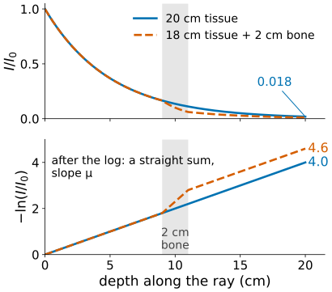
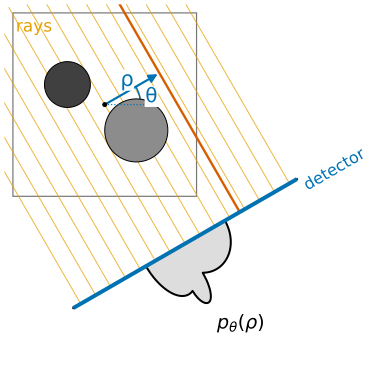
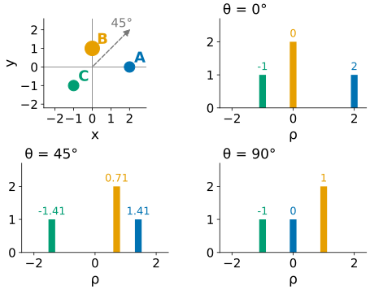
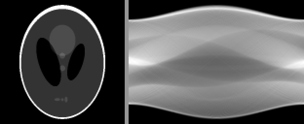
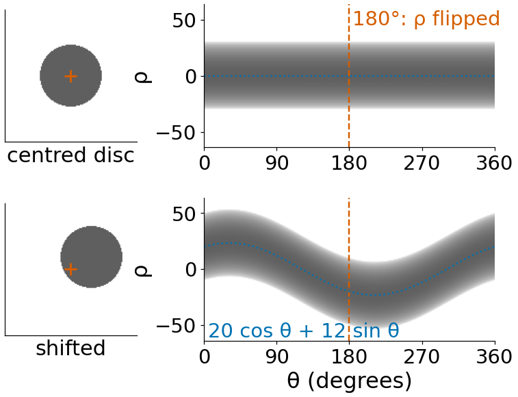
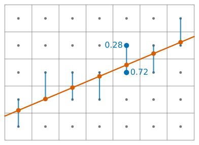
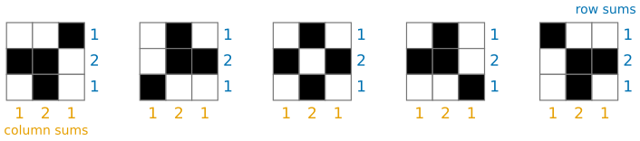

## About this lecture

An X-ray image overlays everything the beam passed through: ribs, heart and spine end up on top of each other. **Computed tomography** (CT) gets a clean slice instead. The idea of the day: take many X-ray profiles from all around the object, then undo the overlaying.

- What an X-ray detector measures: a **line integral** of the attenuation.
- Lines described by an angle and a distance, $(\theta, \rho)$.
- A **projection** = all parallel line integrals at one angle; stacked over angles they form the **sinogram**.
- A point becomes a **sinusoid**; shifts, sums and the 180° symmetry of sinograms.

This unit is about the measurement. The next three invert it: back-projection, filtered back-projection, and reconstruction as a linear system.

*Slides titled **The math** give the formulas and proofs; the ideas are complete without them.*

::: notes
Day plan: radon (this unit), backprojection, fbp, algebraic-recon. If the Hough day ([Hough lines](../hough-lines/lec.qmd), day 21) was taken first, the (ρ, θ) slide is a recall: the Hough day draws the same sinusoids by voting, this day integrates grey values along lines and then inverts. Open with a real chest X-ray and a CT slice if you have licensed images at hand (none are bundled with the course); the question "how does CT get a slice?" carries the day.
:::

## What the detector measures

:::: {.columns}
::: {.column width="56%"}
A narrow beam of $I_0$ photons crosses the body; $I$ arrive at the detector.

- Every centimetre of material removes a **fixed fraction** of the photons that reach it. That fraction per cm is the **attenuation coefficient** $\mu$: higher for bone than for soft tissue, about 0.2 cm⁻¹ for water-like tissue.
- Fractions multiply along the path: through 20 cm of tissue with $\mu = 0.2$ cm⁻¹, $I/I_0 = e^{-4} \approx 0.018$. Under 2 % of the photons get through.
- Taking $-\ln(I/I_0)$ turns the product into a **sum**: $-\ln(I/I_0) = \mu_1 \Delta s + \mu_2 \Delta s + \dots$, the **sum of $\mu$ along the ray** (times the step). In the limit: a **line integral**.
:::
::: {.column width="44%"}
{width="100%"}
:::
::::

So after a logarithm, each detector reading is "how much stuff lies on this line". That number is what CT reconstructs from.

## The math: Beer–Lambert {.math}

Along the ray (arc length $s$) the beam loses photons in proportion to how many there are and to the local attenuation:

$$\frac{dI}{ds} = -\mu(s)\,I(s) \quad\Longrightarrow\quad I = I_0 \exp\Big(-\int_{\text{ray}} \mu(s)\,ds\Big), \qquad -\ln\frac{I}{I_0} = \int_{\text{ray}} \mu(s)\,ds.$$

- Assumes a **monochromatic** beam (one photon energy). Real tubes emit a spectrum; low energies are absorbed first ("beam hardening"), which bends this straight line slightly.
- Two layers: 18 cm of tissue ($\mu = 0.2$) and 2 cm of bone ($\mu = 0.5$): $-\ln(I/I_0) = 3.6 + 1.0 = 4.6$, $I/I_0 = e^{-4.6} = 0.010$. The order of the layers does not matter: a sum.

## Other machines that measure line integrals

The rest of the day only needs "each measurement = a line integral". The same mathematics serves

- **electron tomography**: a thin specimen tilted in the microscope; each image is a projection of the specimen's density;
- **PET and SPECT**: a radioactive tracer emits photons; detectors count the emissions along lines (no logarithm: the counts themselves are the sums);
- **optical projection tomography**: cleared embryos or organs imaged with visible light from many angles.

Volume rendering (the 3D graphics day, [volume rendering](../volrender/lec.qmd)) computes projections of a known volume *to look at it*; tomography does the opposite: it has the projections and wants the volume.

## Lines as $(\theta, \rho)$

:::: {.columns}
::: {.column width="58%"}
Coordinates: origin at the **image centre**, $x$ right, $y$ **up**, angles counter-clockwise.

- A line is the set of points with $x\cos\theta + y\sin\theta = \rho$.
- $\theta \in [0°, 180°)$: the direction of the line's **normal**; $\rho$: the **signed distance** of the line from the centre.
- $\theta = 0°$: vertical lines $x = \rho$. $\theta = 90°$: horizontal lines $y = \rho$.
- The same convention as the Hough day ([Hough lines](../hough-lines/lec.qmd); there: lines found by voting; here: grey values summed along lines).

A **projection** at angle $\theta$ is the profile $p_\theta(\rho)$: the line integrals of all parallel lines, one per detector bin. At $\theta = 0°$ the rays run vertically and $p_0$ is the **column sums** of the image; at $90°$ it is the **row sums**.
:::
::: {.column width="42%"}
{width="100%"}
:::
::::

## Three points by hand

Point masses $A = (2, 0)$ with mass 1, $B = (0, 1)$ with mass 2, $C = (-1, -1)$ with mass 1. A point lands at $\rho = x\cos\theta + y\sin\theta$.

:::: {.columns}
::: {.column width="45%"}
| $\theta$ | $A$ | $B$ | $C$ |
|---|---|---|---|
| 0° | 2 | 0 | −1 |
| 45° | 1.41 | 0.71 | −1.41 |
| 90° | 0 | 1 | −1 |

Each projection is three bars at these $\rho$, with heights 1, 2, 1. Every projection sums to **4**, the total mass: nothing gets lost, it only moves.
:::
::: {.column width="55%"}
{width="90%"}
:::
::::

::: notes
Exercise B2 asks for exactly this, with bar plots. In the demo the preset "three points by hand" uses 16 pixels per unit, so A sits at ρ = 32 px at 0°.
:::

## Try it: projections and the sinogram

```{=html}
<link rel="stylesheet" href="../demos/dist/demo.css">
<div data-demo="radonproj" data-preset="hand"></div>
<script src="../demos/dist/radonproj.js"></script>
```

::: notes
Left: the object, the rays of the current angle (yellow, arrow = beam direction) and the detector (blue bar); the coloured dots on the detector are where each point lands. Middle: the projection. Right: the sinogram filling in up to the current angle, with each point's sinusoid drawn over it. Tour: "three points by hand" at 45°: read ρ in the readout (22.6, 11.3, −22.6 px = 1.41, 0.71, −1.41 units). Press +45° to 90°. Then play from 0°. "The centre does not move": the point at the centre is a flat line. "Shepp–Logan sinogram", "a real image". Click into the image to add points: each new point is a new sinusoid.
:::

## The sinogram

Stack the projections side by side: $\theta$ across, $\rho$ up. This picture is the **sinogram**: it is all the scanner measures.

- A **point** at radius $r$ and direction $\varphi$ traces $\rho = r\cos(\theta - \varphi)$: a **sinusoid**, hence the name.
- **Amplitude** = distance from the centre; **phase** = the point's direction: the curve peaks at $\theta = \varphi$.
- The **centre** of rotation is the only point that stays put: a flat line at $\rho = 0$.
- Where two sinusoids **cross**, the two points lie on the same ray: they hide behind each other at that angle. $A$ and $B$ cross at $\theta = 63.4°$.

{width="70%"}

## Four properties of every sinogram

:::: {.columns}
::: {.column width="50%"}
- **Linearity**: the sinogram of two objects is the sum of their sinograms. Overlapping sinusoids add.
- **Shift**: moving the object by $\mathbf t = (t_x, t_y)$ moves every point's curve by $t_x\cos\theta + t_y\sin\theta$: the sinogram is bent by a sinusoid, it does not just slide.
- **Symmetry**: the ray $(\theta + 180°, \rho)$ is the ray $(\theta, -\rho)$ walked the other way, so $p_{\theta + 180°}(\rho) = p_\theta(-\rho)$. Half a turn is enough for parallel beams.
- **Mass**: every projection sums to the same number, the total of the image.
:::
::: {.column width="50%"}
{width="100%"}
:::
::::

A real sinogram that breaks one of these tells you something went wrong in the scanner: a moving patient, a wrong centre of rotation, a dead detector element.

## The math: the Radon transform {.math}

$$\mathcal R f(\rho, \theta) = \iint f(x, y)\,\delta(x\cos\theta + y\sin\theta - \rho)\,dx\,dy = \int f(\rho\,\mathbf n_\theta + s\,\mathbf n_\theta^\perp)\,ds,$$

with $\mathbf n_\theta = (\cos\theta, \sin\theta)$, $\mathbf n_\theta^\perp = (-\sin\theta, \cos\theta)$ (Radon, 1917).

- Linear: $\mathcal R(af + bg) = a\,\mathcal R f + b\,\mathcal R g$.
- Shift: $f(\mathbf x - \mathbf t) \mapsto \mathcal R f(\rho - \mathbf t\cdot\mathbf n_\theta, \theta)$ (substitute $\mathbf x = \mathbf x' + \mathbf t$).
- Symmetry: $\mathcal R f(-\rho, \theta + \pi) = \mathcal R f(\rho, \theta)$, since $\mathbf n_{\theta + \pi} = -\mathbf n_\theta$.
- Mass: $\int \mathcal R f(\rho, \theta)\,d\rho = \iint f\,dx\,dy$ for every $\theta$ (the change of variables $(\rho, s)$ is a rotation).
- Uniform disc of radius $R$, value $\mu$: $\mathcal R f(\rho, \theta) = 2\mu\sqrt{R^2 - \rho^2}$ for $|\rho| \le R$ (the chord length). An ellipse has a closed form too, which is why test phantoms are built from ellipses: their sinograms are exact.

## On a pixel grid

:::: {.columns}
::: {.column width="55%"}
A computer image is a grid of numbers, not a function. To integrate along a ray we walk along it and read the image **between** pixel centres by linear interpolation (the [images unit](../images/lec.qmd)'s **bilinear** interpolation, in one direction).

- One detector bin per pixel width, rays through the bin centres.
- Rays steeper than 45° take one sample per image row, the others one per column; each sample is weighted by the path length per row or column.
- The result is close to the exact integral: for the demo's Shepp–Logan phantom the RMS difference from its exact sinogram is 1.4 % of the largest value.
- Only what lies inside the circle seen at every angle is measured at every angle: the demos keep objects inside that **field of view**.
:::
::: {.column width="45%"}
{width="100%"}
:::
::::

## Can you tell which image it was?

Two projections of a $3 \times 3$ binary image: row sums $(1, 2, 1)$ and column sums $(1, 2, 1)$.

{width="88%"}

**Five** different binary images have exactly these sums. Two projections do not determine the image; swapping a $2 \times 2$ checkerboard pattern inside it changes no row or column sum.

More angles add more equations and remove ambiguity. How many are enough, and how to turn the numbers back into an image, is the subject of the rest of the day.

## Summary

- After $-\ln(I/I_0)$, an X-ray measurement is a **line integral** of the attenuation $\mu$ (Beer–Lambert).
- Lines are $(\theta, \rho)$: normal direction and signed distance from the centre.
- A **projection** collects the parallel line integrals at one angle; the **sinogram** stacks them over $\theta \in [0°, 180°)$.
- A point traces a **sinusoid** $\rho = r\cos(\theta - \varphi)$; sinograms are **linear**, **shift** by a sinusoid, are **symmetric** after 180°, and every projection has the same **total**.
- Two projections leave many images possible: reconstruction needs many angles.
