## About this lecture

The [graph-cut day](../graphcut-seg/lec.qmd) built a pixel graph with contrast weights and cut it with seeds. Today the **same graph and the same seeds**, but a different question: not "where is the cheapest cut?" but "**how likely** is each pixel to belong to each seed?" (Grady, 2006).

- A **random walk** from a pixel, and the probability that it reaches an object seed first.
- The same numbers as **voltages** in a resistor network, and as the **smoothest** function that matches the seeds: one sparse linear system.
- Labels and **uncertainty** from probabilities; more than two labels.
- What it guarantees, where it **fails**, and how it compares with a **graph cut**.

*Slides titled **The math** give the formulas and proofs; the ideas are complete without them.*

::: notes
Notation of the day: affinity w_pq (large = similar) for graph cuts and the walker, dissimilarity d_pq (large = different) for spanning trees and watershed. The weights are those of graphcut-seg: w = exp(−(I_p − I_q)²/2σ²).
:::

## Recall: the pixel graph and the Laplacian

:::: {.columns}
::: {.column width="58%"}
From the [graph-cut unit](../graphcut-seg/lec.qmd): one node per pixel, an edge between neighbours with **contrast weight**
$$w_{pq} = \exp\!\big(-(I_p - I_q)^2/2\sigma^2\big),$$
strong (thick) inside regions, weak across image edges.

From the [normalized-cut unit](../ncut/lec.qmd): for values $x_p$ on the nodes,
$$\tfrac12\textstyle\sum_{p,q} w_{pq}(x_p - x_q)^2 = \mathbf x^\top L\,\mathbf x$$
is small when strongly linked neighbours have similar values. Normalized cuts minimised it **without seeds** and needed an eigenvector. With **seeds** fixed at 1 and 0 it becomes a **linear system**.
:::
::: {.column width="42%"}
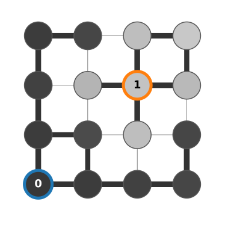{fig-alt="A 4 by 4 pixel graph. Circles are pixels with their grey level as fill; lines between neighbours are thick where the two grey levels are similar and thin across the edge between the bright and dark pixels. One bright pixel is an object seed (orange ring, value 1), one dark pixel a background seed (blue ring, value 0)." width="100%"}
:::
::::

## The question the walker answers

:::: {.columns}
::: {.column width="52%"}
Drop a **random walker** on an unlabelled pixel. At each step it moves to a neighbour, chosen with probability proportional to the edge weight: it rarely crosses an image edge.

The pixel's value: the **probability that the walker reaches an object seed before a background seed**.

Right: 20 walks from the red square (yellow paths, first 400 steps). 13 end on the object seed (orange), 7 on a background seed (blue): an estimate of 0.65. The exact value is **0.80**; with 20 walks the estimate is still rough (±0.09).
:::
::: {.column width="48%"}
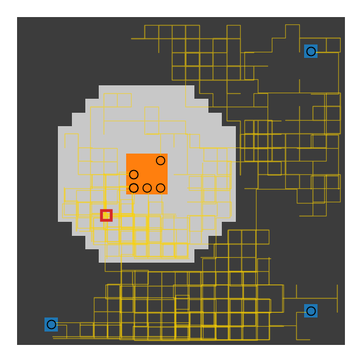{fig-alt="A 24 by 24 image with a bright disc on a dark background. Twenty random-walk paths in yellow start from a pixel inside the disc near its edge; most stay inside the disc and end on the orange object seed in its centre, some cross the rim and end on one of three blue background seeds in the corners." width="92%"}
:::
::::

## Nobody simulates it

Where does the walker go first? To neighbour $q$ with probability $w_{pq}/d_p$ ($d_p$ = sum of the weights at $p$). From there it has the probability of $q$. So:

- the probability at a pixel is the **weighted average of its neighbours' probabilities**;
- at object seeds it is 1, at background seeds 0.

A function that equals the weighted average of its neighbours everywhere except at the seeds is called **harmonic**. Finding it is **one sparse linear system**: one equation per unlabelled pixel, with about five non-zeros (the pixel and its four neighbours).

A worked case with one free pixel $x$, joined to an object seed with $w = 3$ and to two background seeds with $w = 1$ each:
$$x = \frac{3\cdot 1 + 1\cdot 0 + 1\cdot 0}{3 + 1 + 1} = \frac35 .$$

## The electrical picture

:::: {.columns}
::: {.column width="50%"}
Make every edge a **resistor** with conductance $w_{pq}$ (resistance $1/w_{pq}$). Put the object seeds at 1 V and the background seeds at 0 V. Kirchhoff's current law at a free node says exactly "voltage = weighted average of the neighbours": **the probability is the voltage**.

On a chain the current is the same through every resistor, so the voltage **drops in proportion to resistance**.

Five nodes, weights 1, 1, 0.25, 1: resistances 1, 1, 4, 1, total 7. Voltages $1, \tfrac67, \tfrac57, \tfrac17, 0$. The weak link (an image edge) takes $\tfrac47$ of the drop, and the 0.5 crossing lies inside it.
:::
::: {.column width="50%"}
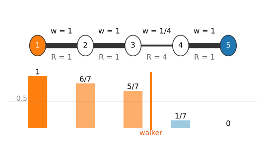{fig-alt="A chain of five nodes; node 1 is the object seed (orange), node 5 the background seed (blue). Edge weights 1, 1, 1/4, 1 with resistances 1, 1, 4, 1. Bars show the voltages 1, 6/7, 5/7, 1/7, 0; the orange tick where they cross 0.5 lies in the weak edge between nodes 3 and 4." width="100%"}
:::
::::

## The math: the Dirichlet problem on a graph {.math}

Minimise $E(\mathbf x) = \tfrac12\sum_{p,q} w_{pq}(x_p - x_q)^2 = \mathbf x^\top L\,\mathbf x$ (each edge once in the sum over edges: $\sum_{(p,q)} w_{pq}(x_p - x_q)^2$), with $L = D - W$, and $\mathbf x_M$ fixed at the marked (seed) nodes.

Order the nodes as marked, unmarked: $L = \begin{pmatrix} L_M & B \\ B^\top & L_U\end{pmatrix}$, so
$$E = \mathbf x_M^\top L_M\mathbf x_M + 2\,\mathbf x_U^\top B^\top\mathbf x_M + \mathbf x_U^\top L_U\mathbf x_U .$$
Setting the gradient with respect to $\mathbf x_U$ to zero:
$$L_U\,\mathbf x_U = -B^\top\mathbf x_M .$$
Row $p$ reads $d_p x_p - \sum_{q \in U} w_{pq}x_q = \sum_{q \in M} w_{pq}x_q$, i.e. $d_p x_p = \sum_q w_{pq} x_q$: the neighbour average. $E$ is convex, so this stationary point is the minimum.

## The math: three readings, one solution {.math}

- **Hitting probabilities.** Let $P_p$ = probability that the walk from $p$ hits an object seed before a background seed. Conditioning on the first step: $P_p = \sum_q \frac{w_{pq}}{d_p}P_q$ for free $p$, $P = 1$ on object seeds, $0$ on background seeds. The same equations.
- **Voltages.** Current $w_{pq}(x_p - x_q)$ through each edge; Kirchhoff's current law at a free node, $\sum_q w_{pq}(x_p - x_q) = 0$, is the same equation again.
- **Uniqueness.** If every connected component of the graph contains a seed, $L_U$ is **positive definite** (a seedless component would leave its constant free: $L_U$ singular). Then the system has exactly one solution, so all three readings agree.

## From probabilities to labels

:::: {.columns}
::: {.column width="45%"}
- **Label** = the seed class with the highest probability; with two labels, threshold at 0.5.
- The probability map is **uncertainty for free**: values near 0.5 show where the result is weakly decided and another seed would help.

Right: three strokes on the micrograph (one object, three background). The 0.5 contour follows the nuclear envelope; the map is pale (unsure) in the cytoplasm far from all seeds, deep red only inside the nucleus.
:::
::: {.column width="55%"}
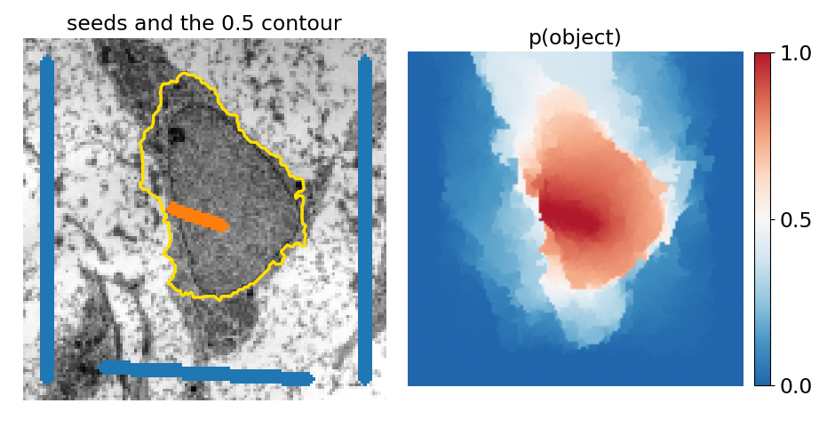{fig-alt="Left: the micrograph (128 by 128) with an orange object stroke inside the nucleus and blue background strokes along three image borders; the yellow 0.5 contour runs along the nuclear envelope. Right: the probability of object as a diverging map, red inside the nucleus, white near 0.5 in parts of the cytoplasm, blue near the background strokes. Micrograph: Robert M. Hunt, CC BY 3.0, via Wikimedia Commons." width="100%"}
:::
::::

## Try it: the random walker on a chain

```{=html}
<link rel="stylesheet" href="../demos/dist/demo.css">
<div data-demo="walker1d" data-preset="hand"></div>
<script src="../demos/dist/walker1d.js"></script>
```

::: notes
Nodes are clicked to cycle free → object seed → background seed; edges are clicked and their conductance set with the slider. Tour: "by hand (a)": voltages 1, 0.857, 0.714, 0.143, 0; 57% of the drop is in the 0.25 edge. "equal weights": a straight ramp. "averaging converges": press averaging sweep several times; each free node takes the weighted mean of its neighbours (Gauss–Seidel), the bars creep to the solution; the weak edge slows it down. "walkers estimate the voltage": 200 walks from node 3; press walkers again on other nodes. "two weak edges": the walker crosses 0.5 between nodes 3 and 4, the min cut is the 0.2 edge (next slide).
:::

## More than two labels

:::: {.columns}
::: {.column width="45%"}
With $K$ seed labels, solve one system per label: seeds of that label at 1, all other seeds at 0. The $K$ probabilities **sum to 1** at every pixel, so $K - 1$ systems are enough.

Right: object seed (orange), a second object (green) and background (blue). The two discs touch with a **weak boundary** (grey levels 180 and 160, noise 10): the walker shares the contact zone between their seeds, with an orange-to-green blend across the waist.
:::
::: {.column width="55%"}
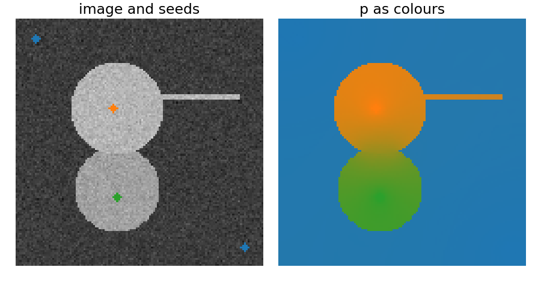{fig-alt="Left: a synthetic image with an upper disc with a thin arm, a lower disc touching it, and four small seeds: orange in the upper disc, green in the lower disc, blue in two corners. Right: the three probabilities as colours: the upper disc and its arm orange, the lower disc green, the background blue, and a gradual orange-to-green transition where the discs touch." width="100%"}
:::
::::

## The math: maximum principle and K labels {.math}

- **Maximum principle.** A harmonic function on a connected graph has no strict interior maximum or minimum: a free node is a weighted average of its neighbours, so it cannot exceed all of them. Hence every free value lies between the smallest and largest seed value: $0 \le x_p \le 1$.
- **No islands.** Let $S$ be a connected component of $\{p : x_p > 0.5\}$ without an object seed; all its nodes are free. Let $m$ be the largest value in $S$ and $T$ the nodes where it is reached. A node of $T$ is a weighted average of neighbours that are all $\le m$ (those outside $S$ are $\le 0.5$), so all its neighbours equal $m$ and lie in $T$. Then $T$ is a whole connected component of the graph made only of free nodes; but every component contains a seed. Every object region touches an object seed.
- **K labels.** $L_U X = -B^\top M$ with one column per label ($M$: indicator columns of the seed labels). The rows of $M$ sum to 1, so $X\mathbf 1$ solves $L_U\mathbf y = -B^\top\mathbf 1$, which the constant $\mathbf y = \mathbf 1$ also solves ($L\mathbf 1 = 0$). By uniqueness $X\mathbf 1 = \mathbf 1$: the probabilities sum to 1.

## What the walker guarantees

- **Probabilities between 0 and 1**, and every object region touches an object seed: **no islands** without a seed (the maximum principle).
- **One unique answer**: the energy is a convex quadratic, there are no local minima (unlike the [snakes](../snakes/lec.qmd) of a later day).
- **Exact**, like the graph cut, but **soft**: real values, not a hard 0/1 labelling.
- It needs only **edges**: there is no model of the intensities inside the regions. That is both its strength (any grey levels work) and its main weakness (next slides).

## Failure 1: the seed position matters

:::: {.columns}
::: {.column width="50%"}
Seven nodes, weights 0.2, 1, 1, 1, 1, 0.25 (resistances 5, 1, 1, 1, 1, 4, total 13).

- **Top**: seeds at the ends. Voltages $1, \tfrac{8}{13}, \tfrac{7}{13}, \dots, \tfrac{4}{13}, 0$: the walker's boundary is between nodes 3 and 4, on a **strong** edge. The graph cut takes the cheapest edge, 0.2, and keeps only node 1.
- **Bottom**: the object seed moved to node 3. Nodes 1–2 hang off it at 1; the remaining resistances 1, 1, 1, 4 give $\tfrac67, \tfrac57, \tfrac47$: now the walker crosses 0.5 in the 0.25 edge, where the cut also is.

The 0.5 crossing sits where **half the total resistance** between the seeds is reached.
:::
::: {.column width="50%"}
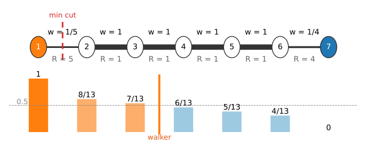{fig-alt="Chain of seven nodes with seeds at nodes 1 and 7: bars 1, 8/13, 7/13, 6/13, 5/13, 4/13, 0; the walker's 0.5 tick lies between nodes 3 and 4; a red dashed min-cut mark lies on the first edge (w = 1/5)." width="100%"}

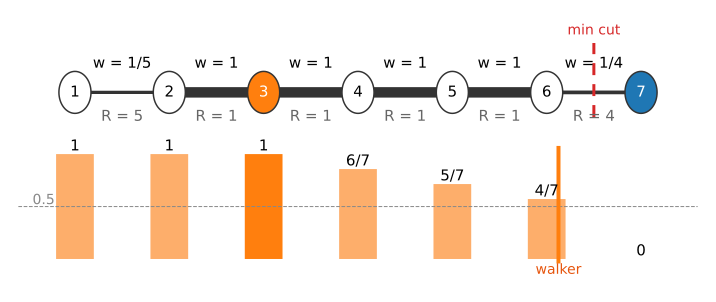{fig-alt="The same chain with the object seed at node 3: bars 1, 1, 1, 6/7, 5/7, 4/7, 0; the walker's tick and the red min-cut mark both lie in the last edge (w = 1/4)." width="100%"}
:::
::::

## Failure 2: far from all seeds

:::: {.columns}
::: {.column width="50%"}
In a large region without edges, the walker's answer is decided by **geometry**: how close the pixel is to each seed, not by the image.

Right: no edges at all ($\sigma = \infty$), one tiny seed in each corner. Along the diagonal the probability falls quickly near each seed and is close to **0.5 over most of the image**: a large unmarked region is decided only weakly, and the boundary falls in the middle.

Fix: more seeds, or seeds spread over the region (strokes rather than clicks).
:::
::: {.column width="50%"}
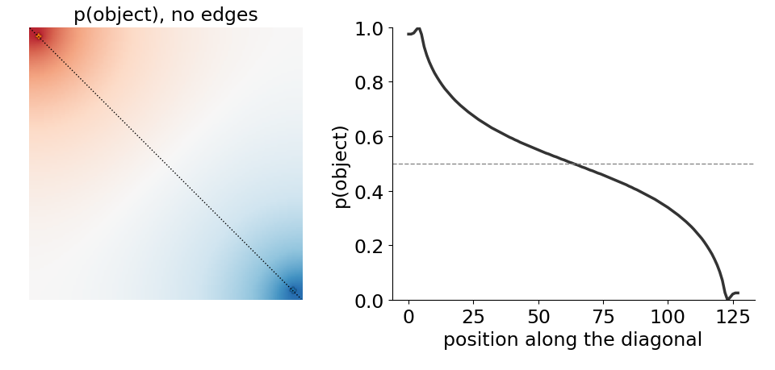{fig-alt="Left: probability map of a 128 by 128 image without edges, seeds in the top-left (object) and bottom-right (background) corners: red only near the first corner, blue only near the other, pale over most of the image. Right: the probability along the diagonal: 1 at the object seed, a steep drop to about 0.75, a slow decline through 0.5 in the middle, then a steep drop to 0 at the background seed." width="100%"}
:::
::::

## Failures 3 and 4: no edge, and the choice of σ

:::: {.columns}
::: {.column width="56%"}
**No edge between two brightnesses.** Left half 80, right half 170, joined by a smooth ramp: no edge anywhere. Seeds at $x = 6$ and $x = 86$. The walker crosses 0.5 at $x \approx 45$, between the seeds, not at the true split ($x = 64$).

**σ.** Too small: noise differences already make weak links, the walker is trapped near its seeds and the map is patchy. Too large: real edges are no longer weak links. As for the graph cut, σ should be larger than the noise differences and smaller than the edge contrast.
:::
::: {.column width="44%"}
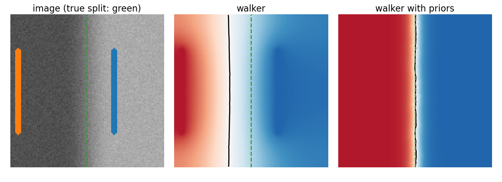{fig-alt="Three panels. The image: dark left half, bright right half, gradual ramp in the middle; true split at x = 64 marked green; orange seed line at x = 6, blue at x = 86. The walker's probability map with its 0.5 contour (black) at about x = 45, left of the green line. With priors, the 0.5 contour lies on the green line at x = 64." width="100%"}
:::
::::

## The random walker with priors

Add a per-pixel pull towards each class from an **intensity model**: the histograms of the seed pixels give, at every grey level, the probability of each class (the data term of the [segmentation-energy unit](../seg-energy/lec.qmd)).

- Minimise $\sum w_{pq}(x_p - x_q)^2 + \lambda\sum_p (x_p - \text{prior}_p)^2$: the same linear system with an **extra diagonal** $\lambda$.
- In the figure on the previous slide (right panel): with $\lambda = 0.05$ the boundary moves to $x = 63.5$, the true split.
- For those who took the Ising day: this is the [quadratic smoothing](../gmrf/lec.qmd) system $(I + \lambda L)\mathbf x = \mathbf y$ in another form, with seeds added.
- The price: the walker can now produce regions without seeds (an object of the right brightness far away), exactly like thresholding.

## The math: priors and the solver {.math}

- **Priors** (Grady 2005, with class probabilities normalised to sum to 1): for each label $k$,
$$(L_U + \lambda I)\,\mathbf x^k_U = \lambda\,\boldsymbol\pi^k_U - B^\top\mathbf m^k .$$
Summing over $k$: $(L_U + \lambda I)\sum_k\mathbf x^k = \lambda\mathbf 1 - B^\top\mathbf 1 = (L_U + \lambda I)\mathbf 1$, so the probabilities still sum to 1. With no seeds at all this is $(I + L/\lambda)\mathbf x = \boldsymbol\pi$, the [quadratic smoothing](../gmrf/lec.qmd) of the Ising day.
- **Conjugate gradients.** $L_U$ is symmetric positive definite and sparse; CG needs one multiplication by $L_U$ (a 5-point stencil) per step. The number of steps grows with the condition number, which grows with the contrast of the weights ($w$ from $1$ down to $10^{-4}$) and with the image size. A Jacobi (diagonal) preconditioner and a warm start from the previous solution help; multigrid would help more.

## Random walker vs graph cut

:::: {.columns}
::: {.column width="56%"}
| | graph cut | random walker |
|---|---|---|
| weights | $w_{pq}$ | the same $w_{pq}$ |
| minimises | **sum** of cut weights | **sum of squared** differences |
| labels | hard 0/1 | soft probabilities |
| exact? | yes (max-flow) | yes (linear system) |
| islands | possible with a data term | never (max. principle) |
| typical bias | shrinking: short boundaries | seed position, far regions |

On clean, strong edges both give the same answer (right: the same seeds, seeds only for the cut). They differ on weak edges and near small seeds; the [watershed as a spanning forest](../ws-msf/lec.qmd) is the third member of the family.
:::
::: {.column width="44%"}
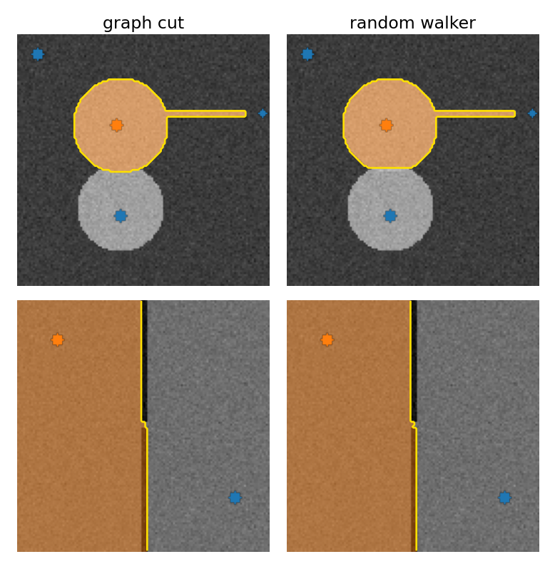{fig-alt="A 2 by 2 grid: columns graph cut and random walker, rows two synthetic scenes (a disc with a thin arm above a second disc; two halves separated by a dark wall with a small gap). With the same seeds, both methods give the same segmentation in both scenes: the upper disc with its arm, and the left half with the boundary along the wall and straight through the gap." width="88%"}
:::
::::

## Try it: painting seeds

```{=html}
<link rel="stylesheet" href="../demos/dist/demo.css">
<div data-demo="randwalk" data-preset="clicks"></div>
<script src="../demos/dist/randwalk.js"></script>
```

::: notes
The system is solved a little per frame (CG), so the map visibly converges; after each stroke it restarts from the previous solution. Tour: "two clicks": click the right panel anywhere to see 30 walks and the probability. "three labels": the contact zone between the discs is shared. "weak boundary": seeds on both sides of a wall with a gap; the walker closes the gap with a short boundary. "seeds far away": no edges, fading to 0.5. "no edge between two brightnesses" then "… priors fix it". "σ too small": the map breaks up into patches near the seeds. "micrograph": paint more background on the cytoplasm and watch the uncertainty view.
:::

## Cost, and where it is used

:::: {.columns}
::: {.column width="50%"}
- A sparse symmetric positive-definite system with one unknown per unlabelled pixel and about five non-zeros per row; solved iteratively.
- On the $128 \times 128$ scene with two seeds: about 700–1300 CG steps to a residual of $10^{-5}$ (right; fewer at larger σ). A new stroke starts from the previous solution.
- 3D stacks: the same system with six neighbours.
- Seeds need not be clicks: they can come from a detector (one seed per nucleus) or from a coarse first segmentation.

Image libraries ship it as "random walker segmentation".
:::
::: {.column width="50%"}
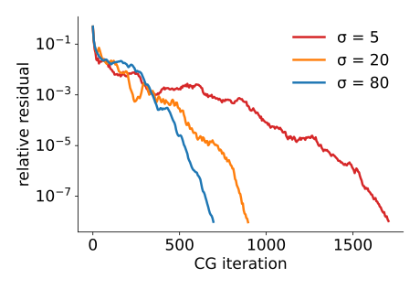{fig-alt="Relative residual of conjugate gradients against iteration, log scale, for σ = 5, 20 and 80 on the 128 by 128 scene: all fall from 1 to below 1e-7; σ = 5 is slowest (about 1300 steps to 1e-5), σ = 80 fastest (about 530)." width="100%"}
:::
::::

## Summary

- The random walker labels each pixel by the **probability** that a walk from it reaches each seed first; equivalently a **voltage**, or the **smoothest** function matching the seeds.
- Computing it: **one sparse linear system** per label, $L_U\mathbf x_U = -B^\top\mathbf x_M$; on a chain, voltage drops in proportion to resistance.
- Guarantees: values in $[0, 1]$, **no seedless islands**, a unique exact answer, **uncertainty** for free.
- Failures: **seed position** decides the boundary in weakly separated regions, far regions **fade** to 0.5, regions without an edge are not separated (fix: **priors**), σ must sit between noise and edge contrast.
- Graph cut = **sum**, walker = **squares**; next: the spanning-tree tools and the **maximum**.

## Where this leads

- [Spanning trees: single linkage and Felzenszwalb–Huttenlocher](../mst-seg/lec.qmd): grouping without seeds or energies.
- [Watershed as a minimum spanning forest](../ws-msf/lec.qmd): the same seeds with a **max** instead of squares, and all three methods side by side.
- [Superpixels](../superpixels/lec.qmd): run the walker on a few hundred superpixels instead of 65 536 pixels.
