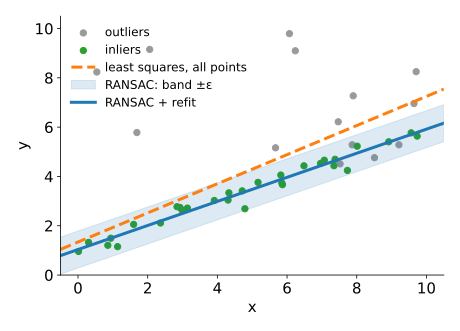

## About this lecture

The Hough transform finds a model by **voting** into a grid over its parameters. That needs a grid, and the grid grows with every parameter. RANSAC (Fischler & Bolles, 1981) does the opposite: **guess a model from a few points and check how many others agree**.

- Why least squares fails with **outliers**.
- The RANSAC loop: **minimal sample**, exact fit, count **inliers**, keep the best, **refit**.
- **How many guesses** are needed: a formula with the inlier fraction.
- Choosing $\varepsilon$, several models, and the randomised Hough transform as a bridge.
- **Voting or guessing?** When to use which.

*Slides titled **The math** give the formulas and proofs; the ideas are complete without them.*

::: notes
Last unit of the Hough day. Needs: the line unit's normal form; least squares from linear algebra (recalled in one line); PCA from the pca unit for the total-least-squares refit (math slide). All random choices in the demo come from a fixed seed (slider), so a run can be repeated.
:::

## Least squares and outliers

Fit a line to points of which 30 % are **outliers** (points that do not belong to the line at all):

{width="55%" fig-align="center"}

- Least squares minimises the **sum of squared distances**. An outlier 30 px away costs as much as 900 points 1 px away: a few outliers **pull** the line towards them (orange, dashed).
- The Hough transform solves this by voting: outliers vote, but for scattered bins. It needs a grid in parameter space.
- Another idea: **guess and check**.

## RANSAC: guess and check

Repeat $N$ times:

1. Pick a **minimal sample** at random: as few points as determine the model. 2 for a line, 3 for a circle.
2. **Fit** the model exactly through them.
3. Count the points within a distance $\varepsilon$ of the model: the **inliers**.
4. Keep the model with the **most** inliers so far.

At the end, **refit** by least squares on the inliers of the best model only.

A sample of two points that are both on the line gives (nearly) the right line, and then many points agree. A sample that contains an outlier gives a wrong line that few points agree with.

## Try it: RANSAC step by step

```{=html}
<link rel="stylesheet" href="../demos/dist/demo.css">
<div data-demo="ransac" data-preset="seventeen"></div>
<script src="../demos/dist/ransac.js"></script>
```

::: notes
60 points, half of them on a line (θ = 63°, ρ = 58), seeded. Press "restart", then "one sample" repeatedly: the red points are the sample, the red band ±ε (2 px), the bars the inlier count of each sample, the blue step line the best so far. Seed 1: samples 2 and 3 are all-inlier (29 inliers each), sample 14 (30 inliers) becomes the best. "run all": refit on its 31 inliers (29 of them true), θ = 63.4°, ρ = 58.1; least squares on all points (orange) gives θ = 75.8°. Right: the chance of at least one all-inlier sample, 99 % after 17 samples for w = 0.5, s = 2. Change the seed to see other runs: with seed 4 the very first sample is a good one.
:::

## Refit on the inliers

The best sample's model goes exactly through two (or three) points, which are noisy. The final model should use **all** the inliers:

- Take the inliers of the best model.
- Fit by least squares to them only: now there are no outliers to pull it away.
- Optionally recount the inliers of the refitted model, and refit once more.

For a line, the natural least-squares fit measures **perpendicular** distances (the same distance as the inlier test), not vertical ones: the line through the centroid along the direction of largest spread, which is PCA of the inlier points (the PCA unit).

## The math: least-squares refits {.math}

- **Line, total least squares**: minimise $\sum_i (\mathbf n^\top \mathbf p_i - \rho)^2$ over unit normals $\mathbf n$ and $\rho$. Setting the derivative in $\rho$ to zero gives $\rho = \mathbf n^\top \bar{\mathbf p}$ (the line passes through the centroid). What is left is $\mathbf n^\top S\,\mathbf n$ with the scatter matrix $S = \sum_i (\mathbf p_i - \bar{\mathbf p})(\mathbf p_i - \bar{\mathbf p})^\top$; its minimum over unit $\mathbf n$ is the **eigenvector of the smaller eigenvalue** ([PCA](../pca/lec.qmd)). The result is the line unit's $(\theta, \rho)$, with $\mathbf n = (\cos\theta, \sin\theta)$.
- **Circle, algebraic fit**: $(x - a)^2 + (y - b)^2 = r^2$ is $x^2 + y^2 = 2ax + 2by + c$ with $c = r^2 - a^2 - b^2$, **linear** in $(a, b, c)$. Stack one row $(2x_i, 2y_i, 1)$ per point, solve the $3 \times 3$ normal equations, then $r = \sqrt{c + a^2 + b^2}$.
- **Robust variants**: MSAC scores a model by $\sum_i \min(d_i^2, \varepsilon^2)$ instead of the inlier count, so that among models with equal counts the one closer to its inliers wins.

## How many guesses?

Let $w$ be the fraction of inliers and $s$ the sample size.

- One random point is an inlier with probability $w$; a whole sample of $s$ points with probability $w^s$.
- $w = 0.5$, $s = 2$: one sample in 4 is all-inlier. $s = 3$: one in 8.
- After $N$ samples, the chance that **at least one** was all-inlier is $1 - (1 - w^s)^N$.
- For 99 %:

| inlier fraction $w$ | sample size $s$ | samples $N$ |
|---|---|---|
| 0.5 | 2 (line) | 17 |
| 0.5 | 3 (circle) | 35 |
| 0.2 | 2 (line) | 113 |
| 0.3 | 3 (circle) | 169 |

$N$ does **not** depend on the number of points; it explodes when $w$ is small or $s$ is large.

## The math: the number of iterations {.math}

Samples are drawn independently (with replacement between samples). A sample is all-inlier with probability $w^s$ (for many points; without replacement inside a sample it is slightly less, e.g. $\tfrac{20}{100}\cdot\tfrac{19}{99}$ instead of $0.2^2$). The probability that **none** of $N$ samples is all-inlier is $(1 - w^s)^N$. Requiring it to be at most $1 - p$:

$$(1 - w^s)^N \le 1 - p \quad\Longleftrightarrow\quad N \ge \frac{\log(1 - p)}{\log(1 - w^s)}.$$

$w = 0.5$, $s = 2$, $p = 0.99$: $\log 0.01 / \log 0.75 = 16.0$, so $N = 17$. For small $w^s$, $\log(1 - w^s) \approx -w^s$ and $N \approx 4.6 / w^s$: halving $w$ multiplies $N$ by $2^s$. In practice $w$ is unknown: start pessimistic and lower $N$ each time a better model shows a larger inlier fraction (adaptive RANSAC).

## Choosing ε, and several models

- **$\varepsilon$ too small**: true points with a little noise fall outside the band; the counts are low and noisy, and the best model is decided by chance. Rule of thumb: 2 to 3 times the noise of the inliers.
- **$\varepsilon$ too large**: outliers count as inliers, and **two nearby lines** merge into one model between them. (Demo: "ε too large".)
- **Not enough iterations**: no all-inlier sample, and the best model is a chance alignment of outliers.
- **Several models** in the data: RANSAC finds the one with most inliers. **Sequential RANSAC**: remove its inliers and run again. The Hough transform finds all of them in one pass.

## Randomised and probabilistic Hough

Two bridges between voting and guessing:

- **Randomised Hough transform** (Xu, Oja & Kultanen, 1990): pick a minimal sample, fit the model, and cast **one vote** for that parameter value. The accumulator is **sparse** (a list of the cells that got votes), so it works for more parameters than a full grid.
- **Probabilistic Hough transform** (Kiryati, Eldar & Bruckstein, 1991; progressive version: Matas, Galambos & Kittler, 2000): vote with a **random subset** of the edge points and stop as soon as a peak is clearly above the rest; remove the points of that line and continue. Image libraries call this "probabilistic Hough" and return line segments.

## Voting or guessing?

| | Hough (voting) | RANSAC (hypothesise and verify) |
|---|---|---|
| parameters | grid grows as $n^d$: fine for 2–3 | no grid: fine for 6, 8, … |
| many instances | all at once, one peak each | one at a time (sequential) |
| outlier fraction | copes with very high fractions | $N$ explodes as $w^s \to 0$ |
| precision | limited by the bins | continuous, refit on inliers |
| result | deterministic | random (fix the seed to repeat) |

## Try it: 80 % outliers

```{=html}
<link rel="stylesheet" href="../demos/dist/demo.css">
<div data-demo="ransac" data-preset="eighty"></div>
<script src="../demos/dist/ransac.js"></script>
```

::: notes
100 points, 20 on the line, 80 outliers. With 17 iterations (enough for w = 0.5) the chance of an all-inlier sample is only 50 %; with seed 1 none of the 17 samples is all-inlier, and the "best" model is a chance alignment of 10 points (4 of them true). The Hough accumulator of the same points (purple, dotted) has its peak at θ = 63°, ρ = 58.2 with 22 votes: the true line. Raise the iterations to 113, the 99 % value: with seed 1 the best model now appears at iteration 18 (22 inliers; its sample is an inlier plus an outlier that happens to lie 0.87 px from the line). The two all-inlier samples (91 and 93) consist of points close together, so their lines are poorly determined (8 and 7 inliers). The refit gives θ = 62.1°, ρ = 58.7, with 24 inliers, 18 of them true.
:::

## Where RANSAC is standard

- **Fitting a transform between two images** from matched feature points (registration, panoramas, stitching): an affine transform has 6 parameters (3 point pairs), a homography 8 (4 pairs). A grid over 6 or 8 parameters is hopeless; RANSAC with a few hundred samples is routine. This application belongs to the planned Motion elective, after the FFT registration day.
- **Two-view geometry** (the fundamental matrix from 7 or 8 point pairs) in reconstructing 3D from images.
- **Geometric primitives** in 3D point clouds: planes (3 points), spheres, cylinders.
- Whenever a few gross errors would ruin a least-squares fit.

## Summary

- Least squares is **pulled by outliers**: one far point outweighs many near ones.
- RANSAC: **minimal sample** → exact fit → count **inliers** within $\varepsilon$ → keep the best → **refit** on its inliers.
- Iterations for success probability $p$: $N = \log(1 - p)/\log(1 - w^s)$: 17 for a line at 50 % inliers, 113 at 20 %.
- $\varepsilon$ about 2–3 × the noise; too large merges nearby models; sequential RANSAC for several models.
- **Voting** wins with few parameters, many instances and huge outlier fractions; **guessing** wins with many parameters.
