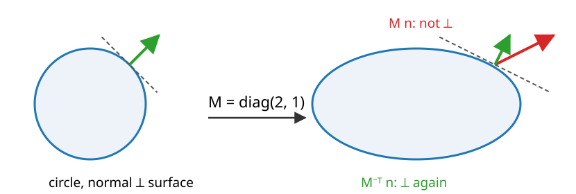
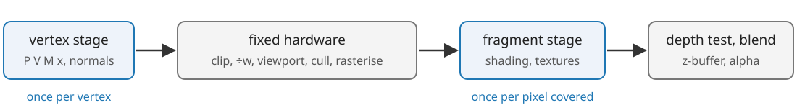

## About this lecture

Last unit: every vertex gets a pixel position and a depth. Now the triangles in between.

- **Rasterisation**: which pixel centres lie inside a triangle (edge functions).
- **Barycentric coordinates**: interpolating colours, depths, normals across a triangle; and why perspective needs a correction.
- **The z-buffer**: which surface is in front; why depth precision is uneven.
- **Shading**: Lambert, Phong, Blinn–Phong; flat, Gouraud or per pixel; why normals transform with $M^{-\top}$.

Slides titled **The math** give the formulas and proofs; the ideas are complete without them.

::: notes
Second unit of the 3D graphics day. Both demos are drawn by a software rasteriser written for the course (the same algorithm a GPU runs in hardware), so every step can be inspected.
:::

## Which pixels does a triangle cover?

After the viewport transform a triangle is three points $\mathbf a, \mathbf b, \mathbf c$ in pixel coordinates (with a depth each). A pixel is drawn if its **centre** lies inside.

The test, for each edge: on which side of the line $\mathbf a \to \mathbf b$ is the pixel centre $\mathbf p$?

$$E_{ab}(\mathbf p) = (b_x - a_x)(p_y - a_y) - (b_y - a_y)(p_x - a_x)$$

- $E_{ab} > 0$: $\mathbf p$ is to the **left** of $\mathbf a \to \mathbf b$; $< 0$: to the right; $= 0$: on the line.
- For a counter-clockwise triangle, **inside = all three edge functions positive**.
- $E$ is **linear** in $\mathbf p$: one pixel to the right changes it by a constant. And every pixel is tested independently: thousands of pixels at once, which is why GPUs are fast at this (Pineda, 1988).

## The math: edge functions are areas {.math}

$E_{ab}(\mathbf p)$ is the $2\times2$ determinant $\det[\mathbf b - \mathbf a,\ \mathbf p - \mathbf a]$: **twice the signed area** of the triangle $\mathbf a, \mathbf b, \mathbf p$ (positive when counter-clockwise).

Linear: $E_{ab}(\mathbf p + (1, 0)) = E_{ab}(\mathbf p) - (b_y - a_y)$ and $E_{ab}(\mathbf p + (0, 1)) = E_{ab}(\mathbf p) + (b_x - a_x)$: a rasteriser walks along a row with one addition per edge.

The three edge functions at $\mathbf p$ split the triangle into three sub-triangles:

$$E_{bc}(\mathbf p) + E_{ca}(\mathbf p) + E_{ab}(\mathbf p) = E_{ab}(\mathbf c) = 2\,\text{area}(\mathbf a, \mathbf b, \mathbf c),$$

so their ratios to the whole area are the **barycentric coordinates** (next slide). Example: $\mathbf a = (1, 1)$, $\mathbf b = (7, 2)$, $\mathbf c = (3, 6)$ has $E_{ab}(\mathbf c) = 28$; at $\mathbf p = (4.5, 3.5)$ the three values are $4, 12.5, 11.5$, summing to 28.

## Barycentric coordinates: interpolation from areas

$$b_a = \frac{E_{bc}(\mathbf p)}{E_{ab}(\mathbf c)}, \qquad b_b = \frac{E_{ca}(\mathbf p)}{E_{ab}(\mathbf c)}, \qquad b_c = \frac{E_{ab}(\mathbf p)}{E_{ab}(\mathbf c)}, \qquad b_a + b_b + b_c = 1.$$

- $b_a$ is the share of the area of the sub-triangle **opposite** $\mathbf a$: 1 at $\mathbf a$, 0 on the far edge.
- Any value given at the vertices (colour, depth, normal, texture coordinate) is interpolated as $f(\mathbf p) = b_a f_a + b_b f_b + b_c f_c$.
- Inside the triangle all three are positive (the inside test again).
- The same idea as **bilinear interpolation** (*images* unit): weights from areas that sum to one. A square split into two triangles is interpolated differently: there is a crease along the diagonal.

Example: at $\mathbf p = (4.5, 3.5)$ in the triangle above, $(b_a, b_b, b_c) = (0.143, 0.446, 0.411)$; with depths 0.2, 0.6, 0.4 at the corners the pixel gets depth 0.461.

## Try it: a rasteriser, pixel by pixel

```{=html}
<link rel="stylesheet" href="../demos/dist/demo.css">
<div data-demo="raster" data-preset="one"></div>
<script src="../demos/dist/raster.js"></script>
```

::: notes
The grid is 32 × 24 pixels, y up, pixel centres at the dots. "one triangle": 437 pixel visits (the bounding box), 178 drawn. Press "start", then "next pixel": the readout gives the three edge functions, inside or outside, the barycentric coordinates and the depth test. Click a pixel, e.g. (10, 10): E = 166.5, 57, 132.5, barycentrics 0.468, 0.160, 0.372. Switch the view to "barycentrics" (the RGB colours are the weights) and to "edge function E_ab" (a linear ramp, zero on the edge). Drag a vertex. Then "a shared edge" (16 × 12): no pixel is drawn twice; untick "top-left rule": 4 pixels on the diagonal are now covered by both. "flipped winding is culled": the right triangle is clockwise and disappears with back-face culling.
:::

## Shared edges and back faces

- **Shared edges**: a pixel centre exactly on the edge between two triangles must be drawn **once**, not twice (double blending) and not zero times (a crack). The **top-left rule**: it belongs to the triangle for which the edge is a "top" or "left" edge.
- **Back-face culling**: after projection, a triangle seen from behind has the opposite winding: its area $E_{ab}(\mathbf c)$ is negative. For a closed, consistently wound mesh these triangles are hidden anyway, so they are skipped: about half the work saved.
- A mesh with **inconsistent winding** (previous unit) gets holes when culling is on.

## The z-buffer

Several triangles can cover the same pixel. Which one is in front?

- Keep a second image, the **depth buffer** (z-buffer, Catmull 1974), one depth per pixel, initially "far".
- For each covered pixel: interpolate the triangle's depth; draw the pixel only if it is **nearer** than the stored depth, and store the new depth.
- The result does not depend on the drawing order (for opaque surfaces), and intersecting triangles come out right, pixel by pixel.
- **Transparency breaks it**: a half-transparent surface must be blended with what is behind it, so order matters again (compositing: the texture and volume units).
- Two surfaces at (almost) the same depth flicker between each other: **z-fighting**.

## Depth precision is uneven

Depth after the projection is $z_\text{ndc} = A + B/z$ (previous unit): it changes fast near the camera, slowly far away.

- The depth buffer stores it with a fixed number of bits (24-bit integers, or 32-bit floats: see the *floating-point* unit). Equal steps of $z_\text{ndc}$ are tiny steps in distance near the camera and **large** steps far away.
- The **near plane** decides how much is wasted: with $n = 0.01$ and $f = 100$, half of the depth range is used up within 0.02 units of the camera; with $n = 1$, within 2 units.
- Two surfaces at distances 50 and 51: with $n = 0.01$ they are **0.26** steps of a 16-bit buffer apart (same stored value: z-fighting); with $n = 1$, 26 steps.
- Rule: push the near plane out as far as you can; the far plane matters much less.

## The math: depth resolution {.math}

With $z_\text{ndc} = A - B/d$ in terms of the distance $d = -z > 0$ and $B = 2fn/(f - n)$:

$$\frac{dz_\text{ndc}}{dd} = \frac{B}{d^2} \quad\Longrightarrow\quad \Delta d \approx \frac{d^2}{B}\,\Delta z_\text{ndc} \approx \frac{d^2}{2n}\,\Delta z_\text{ndc} \quad (f \gg n).$$

A buffer with $k$ bits has $\Delta z_\text{ndc} = 2/(2^k - 1)$. The smallest separable distance grows with $d^2$ and shrinks only with $n$: ten times larger $n$ gives ten times finer depth everywhere; $f$ hardly matters.

Example: $n = 0.01$, $f = 100$: $z_\text{ndc}(50) = 0.9998000$ and $z_\text{ndc}(51) = 0.9998078$, a difference of $7.8\cdot10^{-6}$, while a 16-bit step is $3.1\cdot10^{-5}$.

## Perspective-correct interpolation

Barycentric weights measured **on the screen** are not the weights **in 3D**: the far half of a receding triangle is squeezed into fewer pixels.

- Interpolating a texture coordinate with screen weights bends straight lines: a receding checkerboard made of two triangles kinks along the diagonal.
- The fix: on the screen, $1/w$ and $f/w$ (attribute divided by $w$) **are** linear. Interpolate both, then divide:
$$f = \frac{b_a f_a/w_a + b_b f_b/w_b + b_c f_c/w_c}{b_a/w_a + b_b/w_b + b_c/w_c}.$$
- Example: an edge from $w = 1$ ($u = 0$) to $w = 3$ ($u = 1$). At the screen midpoint: affine gives $u = 0.5$; correct is $\tfrac{0.5\cdot0 + 0.5\cdot\frac13}{0.5 + 0.5\cdot\frac13} = 0.25$.
- Orthographic views ($w = 1$) need no correction; depth $z_\text{ndc}$ itself is already linear on the screen.

## The math: why $1/w$ is linear on the screen {.math}

A triangle lies in a plane $\alpha x + \beta y + \gamma z = \delta$ in view space ($\delta \ne 0$ unless the plane passes through the eye). A point on it projects to $x_s = x/w$, $y_s = y/w$ with $w = -z$. Divide the plane equation by $w$:

$$\alpha x_s + \beta y_s - \gamma = \frac{\delta}{w} \quad\Longrightarrow\quad \frac1w = \frac{\alpha x_s + \beta y_s - \gamma}{\delta}:$$

affine in the screen coordinates. An attribute that is affine in 3D, $f = \mathbf g\cdot\mathbf x + h$, gives $f/w = \mathbf g\cdot(x_s, y_s, -1) + h/w$: also affine on the screen. So screen-space barycentrics interpolate $1/w$ and $f/w$ exactly, and their ratio is $f$.

## Try it: affine vs perspective-correct, and depth precision

```{=html}
<link rel="stylesheet" href="../demos/dist/demo.css">
<div data-demo="raster" data-preset="perspective"></div>
<script src="../demos/dist/raster.js"></script>
```

::: notes
"affine vs perspective-correct": a floor seen in perspective, two triangles with a checkerboard texture. With "perspective-correct" off the checks bend at the diagonal; tick it and they are straight. View "barycentrics" shows the screen weights vs the 3D weights. Then "near plane 0.01 vs 1": two triangles at distances 8–9 and 8.5, depth buffer of 14 bits. With n = 0.01 the orange triangle is visible on 119 pixels instead of 61: the wrong surface wins on 58 pixels, in a jagged band; set n to 1: correct. The small plot shows z_ndc(d) with the vertex depths: with n = 0.01 all of them are near 1.
:::

## Clipping and jagged edges

- **Clipping**: a triangle that crosses the near plane is cut there in clip space, before the divide (vertices behind the camera have $w < 0$). The cut polygon is drawn as a fan of triangles. The other sides of the view need no clipping: pixels outside the screen are simply never visited.
- **Edge aliasing**: one sample (the centre) per pixel makes edges staircase-like and lets thin triangles vanish between centres. **Multisampling** tests several points per pixel and averages coverage (the sampling of the *Fourier* unit).

## Shading: how bright is a surface?

A light from direction $\mathbf l$, a surface with unit normal $\mathbf n$, the eye in direction $\mathbf v$ (all unit vectors pointing away from the surface):

- **Lambert** (matte): brightness $k_d \max(0, \mathbf n\cdot\mathbf l)$. A tilted roof catches less light: the light falling on it is spread over a larger area, by the factor $\cos\theta = \mathbf n\cdot\mathbf l$.
- **Ambient** $k_a$: a constant for all the light bounced around by the scene (a crude stand-in).
- **Specular** (shiny): a highlight where the mirror direction of the light points at the eye. **Phong**: $k_s \max(0, \mathbf r\cdot\mathbf v)^s$; **Blinn–Phong**: $k_s \max(0, \mathbf n\cdot\mathbf h)^s$ with the **half vector** $\mathbf h$ between $\mathbf l$ and $\mathbf v$. The **shininess** $s$ makes the highlight small and sharp.
- Physically based shading (energy conservation, measured materials) refines this; not covered.

## The math: Phong and Blinn–Phong {.math}

Mirror direction and half vector:

$$\mathbf r = 2(\mathbf n\cdot\mathbf l)\,\mathbf n - \mathbf l, \qquad \mathbf h = \frac{\mathbf l + \mathbf v}{\lVert \mathbf l + \mathbf v\rVert}.$$

$\mathbf r\cdot\mathbf v = 1$ exactly when $\mathbf h = \mathbf n$: both models peak in the mirror configuration. Away from it, the angle between $\mathbf n$ and $\mathbf h$ is about half the angle between $\mathbf r$ and $\mathbf v$, so Blinn–Phong's highlight is wider for the same $s$ (roughly $s_\text{Phong} \approx s_\text{Blinn}/4$ gives similar highlights).

Example: $\mathbf n = (0, 0, 1)$, $\mathbf v = (0, 0, 1)$, $\mathbf l = (1, 0, 1)/\sqrt2$, $k_a = 0.1$, $k_d = 0.8$, $k_s = 0.5$, $s = 20$. Diffuse: $0.1 + 0.8\cdot0.707 = 0.666$. Phong: $\mathbf r\cdot\mathbf v = 0.707$, $0.5\cdot0.707^{20} = 0.0005$. Blinn–Phong: $\mathbf n\cdot\mathbf h = \cos 22.5° = 0.924$, $0.5\cdot0.924^{20} = 0.103$.

## Where to evaluate the lighting

- **Flat**: once per triangle, with the face normal. Facets are visible; right for a cut gem, wrong for a sphere.
- **Gouraud** (1971): at the vertices, with **vertex normals**; the colours are interpolated across the triangle. Cheap, smooth, but a highlight that falls **inside** a triangle is missed (and highlights look star-shaped).
- **Per pixel** (Phong 1975): interpolate the **normal**, renormalise, light every pixel. What GPUs do today.
- **Vertex normals** of a mesh: the area-weighted average of the normals of the faces around the vertex (the sum of the un-normalised cross products), unless the mesh has a known exact normal (a sphere) or a crease that should stay sharp.

## Try it: shading

```{=html}
<link rel="stylesheet" href="../demos/dist/demo.css">
<div data-demo="shading" data-preset="gouraud"></div>
<script src="../demos/dist/shading.js"></script>
```

::: notes
Drawn by the same software rasteriser, 360 × 360. "Gouraud misses the highlight": a level-1 icosphere (80 triangles), light from the left so that the mirror point is the centre of a triangle: with Gouraud there is no highlight at all (every vertex gets a specular term below 0.001); switch to "per pixel": a bright spot. "facets vs smooth": the low-poly gem, flat, with the normals drawn. "squashed sphere: wrong normals": squash 0.4, normals by M: the lighting looks wrong (normals off by up to 46.4°); switch to M⁻ᵀ. "Phong vs Blinn–Phong at grazing light": the light almost from the side; Phong's highlight is cut off and small, Blinn–Phong's is wider for the same shininess.
:::

## Transforming normals

{width=70%}

A normal is defined by being **perpendicular** to the surface. Under a rotation or a uniform scale, $M\mathbf n$ stays perpendicular. Under a **non-uniform** scale it does not: squash a circle into an ellipse, and $M\mathbf n$ leans the wrong way.

The right transform is $M^{-\top}$ (the inverse transpose), applied to the normal and then renormalised. For a rotation $M^{-\top} = M$; for $\mathrm{diag}(2, 1, 1)$ it is $\mathrm{diag}(\tfrac12, 1, 1)$.

## The math: why the inverse transpose {.math}

A tangent $\mathbf t$ (a direction along the surface) transforms like any direction: $\mathbf t' = M\mathbf t$. The normal must satisfy $\mathbf n^\top\mathbf t = 0$ before and $\mathbf n'^\top\mathbf t' = 0$ after, for every tangent. Try $\mathbf n' = G\mathbf n$:

$$\mathbf n'^\top\mathbf t' = \mathbf n^\top G^\top M\,\mathbf t = 0 \text{ for all } \mathbf t \perp \mathbf n \quad\Longleftarrow\quad G^\top M = I \quad\Longleftrightarrow\quad G = M^{-\top}.$$

Example: $M = \mathrm{diag}(2, 1, 1)$, the plane $x + y = 1$ with $\mathbf n = (1, 1, 0)$ and tangent $\mathbf t = (1, -1, 0)$. $M\mathbf t = (2, -1, 0)$; $M\mathbf n = (2, 1, 0)$ gives $M\mathbf n\cdot M\mathbf t = 3 \ne 0$; $M^{-\top}\mathbf n = (\tfrac12, 1, 0)$ gives $1 - 1 = 0$.

(Only the $3\times3$ part matters: normals are directions, $w = 0$. Any scalar multiple of $M^{-\top}$ works, since the normal is renormalised.)

## The GPU pipeline, conceptually

{width=100%}

- **Vertex stage** (a small program per vertex): $P V M\mathbf x$, normals by $M^{-\top}$, per-vertex lighting for Gouraud.
- **Fixed hardware**: clipping, divide by $w$, viewport, culling, rasterisation (edge functions, barycentrics, perspective correction).
- **Fragment stage** (a small program per covered pixel): per-pixel lighting, texture reads (next unit).
- **Output**: the depth test against the z-buffer, then writing or **blending** (transparency) into the image.

## Summary

- **Edge functions** (twice signed areas) decide which pixel centres are inside; the **top-left rule** settles shared edges; negative area = back face, culled.
- **Barycentric coordinates** = area ratios; they interpolate any vertex attribute.
- **Perspective-correct**: interpolate $f/w$ and $1/w$, then divide.
- **z-buffer**: draw a pixel only if it is nearer. Depth $A + B/z$ is crowded near the camera: keep the **near plane** far out.
- **Lambert** $\mathbf n\cdot\mathbf l$; **Phong**/**Blinn–Phong** highlights; lighting per face, per vertex (Gouraud) or per pixel.
- Normals transform with $M^{-\top}$.
