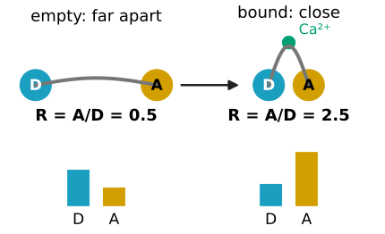
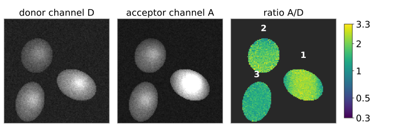
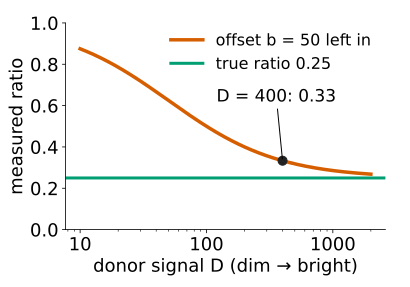
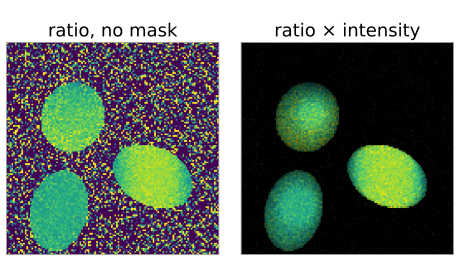
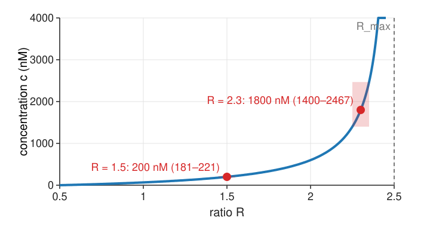
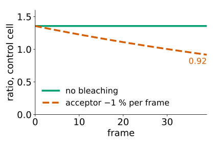
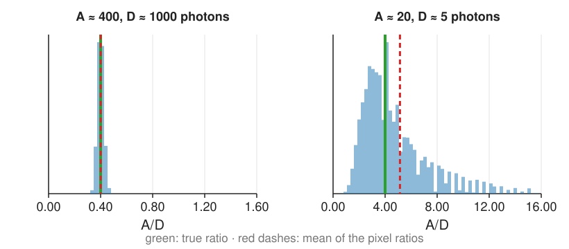

## About this lecture

The most common FRET measurement is the simplest: the **ratio** of two channels of a **biosensor** that carries donor and acceptor on one chain. Dividing cancels a lot, but not everything, and a ratio of noisy counts has its own statistics.

- Biosensors, and why a ratio cancels concentration, thickness and illumination.
- **Background before dividing**, masks, and how to display a ratio.
- **Calibrating** a ratio to a concentration, and why values near the top are unreliable.
- Time-lapse pitfalls: bleaching, motion.
- **The noise of a ratio**: which channel dominates, bias, heavy tails, ratio of sums against mean of ratios, binning first.
- The day's checklist of pitfalls.

*Slides titled **The math** give the formulas and proofs; the ideas are complete without them.*

::: notes
This unit owns noise propagation through ratios and differences of images (delta method, ratio bias, heavy tails) for the course; the evaluation day may recall it. The general noise model (Poisson, read noise) is owned by cameranoise.
:::

## Biosensors

:::: {.columns}
::: {.column width="58%"}
- One protein chain carries a **donor**, an **acceptor** and a sensing domain in between.
- Binding a calcium ion, being phosphorylated, or feeling a force changes the chain's **shape**: the distance (or orientation) between the dyes changes, and so does $E$.
- More FRET: the donor dims, the acceptor brightens. The **ratio** $R = I_A/I_D$ (acceptor over donor channel, both under donor excitation) goes up.
- Donor and acceptor come **1:1** on one chain, so no three-image correction is needed to compare cells: the ratio reports $E$ (plus a constant bleed-through floor). Two separate molecules need [unit 2](../sensitised-emission/lec.qmd).
- **Single-dye ratio sensors** (a dye whose spectrum shifts with pH or an ion: two excitation or emission bands) use exactly the same arithmetic.
:::
::: {.column width="42%"}
{fig-alt="Cartoon of a biosensor. Empty: donor and acceptor far apart on one chain, donor channel bar high, acceptor bar low, ratio 0.5. With calcium bound the chain folds, the dyes come close, the donor bar drops and the acceptor bar rises: ratio 2.5." width="100%"}
:::
::::

## Why a ratio

Either channel alone depends on how much sensor is in the pixel: **concentration**, cell **thickness**, **illumination** and **focus**. A thick region looks "active" just by being bright.

These all **multiply both channels** by the same factor $k$:

$$\frac{k\,I_A}{k\,I_D} = \frac{I_A}{I_D} .$$

The ratio keeps only what differs between the channels: the sensor's state. The same reason ratios are used for gain-independent measurements ([intensity features](../intensity-features/lec.qmd)).

{fig-alt="Frame 20 of the demo's time-lapse. Donor and acceptor channels are brightest where cells are thick, cell 1 brightest of all. In the ratio image (log colour scale 0.3 to 3.3) the thickness is gone: the control cell 3 is uniform, cell 2 shows its steady gradient, and cell 1 a band of high ratio where the concentration wave is." width="76%" fig-align="center"}

## Background before dividing

An **offset** $b$ (camera offset, background light, autofluorescence) does **not** cancel:

$$\frac{A + b}{D + b} \ne \frac{A}{D}, \qquad \text{e.g. } \frac{100 + 50}{400 + 50} = 0.33 \text{ instead of } 0.25 .$$

The ratio is pulled towards 1, more in dim pixels. Subtract the background in **both** channels first (restated from [intensity features](../intensity-features/lec.qmd)).

:::: {.columns}
::: {.column width="60%"}
- Outside the cell both channels are background: after subtraction, a ratio of two noise values around 0. It explodes or turns negative. **Mask** first, with a threshold on the sum of the channels ([thresholding](../otsu/lec.qmd)).
- **Bleed-through** of the donor into the acceptor channel adds $d$ to every ratio: it shifts the lowest ratio $R_\text{min}$ up but does not change the shape of the response. Calibration (below) absorbs it.
:::
::: {.column width="40%"}
{fig-alt="Measured ratio with an offset of 50 left in, against the donor signal on a log axis, for a true ratio of 0.25. Dim pixels read nearly 0.9; at D = 400 the ratio is 0.33; only very bright pixels approach 0.25." width="100%"}
:::
::::

## Displaying a ratio

:::: {.columns}
::: {.column width="55%"}
- A plain ratio map gives a dim, noisy pixel the same visual weight as a bright, reliable one.
- **Intensity-modulated display**: colour (hue) from the ratio, **lightness** from the intensity. Dim pixels fade to black, the unreliable background disappears without a hard mask.
- Use a colour map whose lightness changes monotonically ([colour display](../colour-display/lec.qmd)) and show the colour bar with the ratio values; a log scale treats doubling and halving alike.
:::
::: {.column width="45%"}
{fig-alt="The same ratio frame twice, without a mask. Plain ratio: the background is a carpet of extreme colours. Ratio times intensity: the background is black and the cells keep their ratio colours, darker where they are thin." width="100%"}
:::
::::

## Try it: ratio images

```{=html}
<link rel="stylesheet" href="../demos/dist/demo.css">
<div data-demo="ratioimage" data-preset="lies" data-presets="lies cancels nobg nomask imd" data-compact></div>
<script src="../demos/dist/ratioimage.js"></script>
```

::: notes
Three cells, 40 frames: a wave of high concentration crosses cell 1 (right, the thickest and brightest: mean donor 130 photons per pixel), cell 2 (top left, thin: 66) holds a steady gradient, cell 3 (bottom left, 94) is a constant control at 150 nM (true R = 1.357). Sensor Rmin 0.5, Rmax 2.5, Kd 200 nM. Tour: "intensity lies": the donor intensity says nothing about the sensor; the bright nucleus regions are thickness. "The ratio cancels thickness": uniform cells; the wave crossing cell 1 (press play). Region 1 at frame 20: R = 2.33; region 2: 1.36. "Forgot the background" (offset 40): region 1 at frame 20 drops to 2.13 and the control to 1.30: pulled towards 1. "No mask": the background becomes a carpet of extreme values (half of the background pixels negative). "Intensity-modulated display": the background goes dark without a mask.
:::

## Calibration: from ratio to concentration

{width="52%" fig-align="center"}

A single binding site with dissociation constant $K_d$; the ratio goes from $R_\text{min}$ (empty) to $R_\text{max}$ (saturated):

$$c = K_d\,\frac{R - R_\text{min}}{R_\text{max} - R}$$

$K_d = 200$ nM, $R_\text{min} = 0.5$, $R_\text{max} = 2.5$: $R = 1.5$ → 200 nM; $2.3$ → 1800 nM; $2.4$ → 3800 nM. An error of ±0.05 in $R$ is ±20 nM at 1.5 but 1400–2470 nM at 2.3. Near $R_\text{max}$ the sensor is **saturated**: use one with a larger $K_d$. The dynamic range $R_\text{max}/R_\text{min}$ (here 5) measures the sensor's quality.

## The math: the calibration curve {.math}

Fraction of sensors bound for a single site: $\theta = c/(c + K_d)$. If the ratio is linear in $\theta$ (equal brightness of both states in the denominator channel; the general form has an extra factor for it):

$$R = R_\text{min} + (R_\text{max} - R_\text{min})\,\theta \;\Rightarrow\; \theta = \frac{R - R_\text{min}}{R_\text{max} - R_\text{min}},\quad c = K_d\frac{\theta}{1 - \theta} = K_d\,\frac{R - R_\text{min}}{R_\text{max} - R}.$$

Its slope

$$\frac{dc}{dR} = K_d\,\frac{R_\text{max} - R_\text{min}}{(R_\text{max} - R)^2}$$

is 400 nM per unit $R$ at $R = 1.5$, 10 000 at 2.3, 40 000 at 2.4: it diverges at $R_\text{max}$.

## Time-lapse pitfalls

:::: {.columns}
::: {.column width="58%"}
- The two fluorophores **bleach at different rates**: the ratio drifts down (or up) over time without any biology. Correct with a no-stimulus control, or fit and remove the drift.
- Channels taken **one after the other** while the cell moves: edge artefacts at the leading and trailing edge. Image both channels simultaneously, or align ([FFT registration](../phasecorr/lec.qmd)).
- **pH and temperature** change the dyes' brightness: calibrate under the same conditions.
- Channel **misregistration** (chromatic shift): a one-pixel shift makes a bright and a dark rim at every edge.
:::
::: {.column width="42%"}
{fig-alt="Ratio of the demo's constant control cell over 40 frames. Without bleaching it stays at 1.36. With the acceptor bleaching 1 per cent per frame it drifts down to 0.92, with no change in the biology." width="100%"}
:::
::::

## The noise of a ratio

{width="66%" fig-align="center"}

With photon counts (variance = mean, [camera noise](../cameranoise/lec.qmd)):

$$\mathrm{CV}(R)^2 \approx \frac{1}{N_A} + \frac{1}{N_D}$$

- 100 and 400 photons: $\sqrt{0.01 + 0.0025} = 11\,\%$ per pixel. The **dimmer channel dominates**: make it brighter first.
- Binning 4 × 4 (16 × the photons): 2.8 %.
- Left: 400/1000 photons, a narrow, symmetric histogram. Right: 20/5 photons: skewed, with a long right tail, and the mean of the pixel ratios is 28 % too high.

## The math: the delta method {.math}

Expand $g(A, D) = A/D$ around the means $\mu_A, \mu_D$ to second order:

$$\frac{A}{D} \approx \frac{\mu_A}{\mu_D}\Big(1 + \frac{\delta A}{\mu_A} - \frac{\delta D}{\mu_D} + \frac{\delta D^2}{\mu_D^2} - \frac{\delta A\,\delta D}{\mu_A\mu_D}\Big).$$

- Variance (first-order terms): $\operatorname{Var}(R) \approx \Big(\dfrac{\mu_A}{\mu_D}\Big)^2\Big[\dfrac{\sigma_A^2}{\mu_A^2} + \dfrac{\sigma_D^2}{\mu_D^2} - \dfrac{2\operatorname{Cov}(A, D)}{\mu_A\mu_D}\Big]$; Poisson: $\mathrm{CV}^2 = 1/\mu_A + 1/\mu_D$.
- Mean (second-order terms): $\operatorname{E}[R] \approx \dfrac{\mu_A}{\mu_D}\Big(1 + \dfrac{\sigma_D^2}{\mu_D^2} - \dfrac{\operatorname{Cov}(A, D)}{\mu_A\mu_D}\Big)$: biased **upwards** by $\mathrm{CV}_D^2$ ($1/\mu_D$ for photons).
- **Positive covariance reduces** the ratio's noise: a flicker of the lamp multiplies both channels, which is why ratioing removes it.
- Summing $m$ pixels multiplies the counts by $m$ and divides $\mathrm{CV}^2$ by $m$.
- Extreme case: the ratio of two independent zero-mean Gaussians is a **Cauchy** variable, with no mean and no variance: background pixels without a mask.

## Ratios: bias, tails and the right average

- **Bias**: $\operatorname{E}[A/D] > \operatorname{E}[A]/\operatorname{E}[D]$, by about $1/N_D$ (10 % at $N_D = 10$ photons).
- **Heavy tails**: when $D$ can be near 0, single pixels give huge ratios.
- **Log ratio**: a doubling and a halving are equally far from 1, and $\log R$ is closer to Gaussian: plot log ratios.
- For a region, **divide the sums** (ratio of sums), do not average the pixel ratios: the mean of ratios gives dim pixels the same weight as bright ones and inherits their bias. (The same choice as the slope through the origin against the mean of ratios in the [crosstalk exercise](../crosstalk/exercise.qmd).)
- **Bin or smooth both channels** with the same linear filter **before** dividing (allowed, [denoise](../denoise/lec.qmd)); do not median-filter the ratio image afterwards without saying so.
- The same propagation explains [unit 2](../sensitised-emission/lec.qmd) ($F_c$ is a difference: variances add) and [unit 3](../acceptor-bleach/lec.qmd) ($E = 1 - P/Q$).

## Try it: the noise of a ratio

```{=html}
<link rel="stylesheet" href="../demos/dist/demo.css">
<div data-demo="rationoise" data-preset="dim" data-presets="bright dim log sums flicker" data-compact></div>
<script src="../demos/dist/rationoise.js"></script>
```

::: notes
20 000 seeded pairs of Poisson counts. "Dim denominator": N_A = 20, N_D = 5: mean of pixel ratios 5.15 against the true 4 (+28.8 %; the second-order formula predicts +20 %, it is only an approximation at 5 photons); 152 draws with D = 0; observed CV 73 % against 50 % predicted. Ratio of sums over regions of 16: 4.06. Binning 4: mean of ratios +5.7 %, binning 16: +1.4 %. "Log ratio is symmetric": the histogram of log(A/D) is much more symmetric. "Shared flicker cancels": each channel varies by 20 %, the ratio's CV stays at 6.5 % (6.4 % without flicker). "Low FRET": the difference tab, Fc = 20 with sd 20.8.
:::

## The day's checklist

What a reviewer of a FRET image analysis will ask:

- **Background** subtracted in every channel; no **saturated** pixels.
- **Bleed-through** and **cross-excitation** coefficients from controls taken with the same settings.
- **Controls**: donor only, acceptor only, no-FRET, a positive construct; acceptor-only for photoconversion.
- Channels **aligned**; **bleaching** checked and corrected.
- **Expression level** comparable (bystander FRET).
- **Apparent** $E$ ($fE$) reported as such; $\kappa^2$ discussed before any distance.
- Ratios as **ratio of sums** over regions; **masks** for the background; noise estimated.

## Summary

- A single-chain **biosensor** reports its state as the ratio $R = I_A/I_D$, which cancels concentration, thickness and illumination.
- Subtract the **background** in both channels before dividing; **mask** the background; show ratios with an **intensity-modulated** display.
- **Calibration** $c = K_d (R - R_\text{min})/(R_\text{max} - R)$ explodes near $R_\text{max}$.
- Bleaching of one dye and motion between channels create ratio changes without biology.
- Noise: $\mathrm{CV}^2 \approx 1/N_A + 1/N_D$ (the dimmer channel dominates); ratios of dim counts are **biased** upwards and **heavy-tailed**.
- For a region use the **ratio of sums**; bin or smooth both channels before dividing; plot log ratios.
