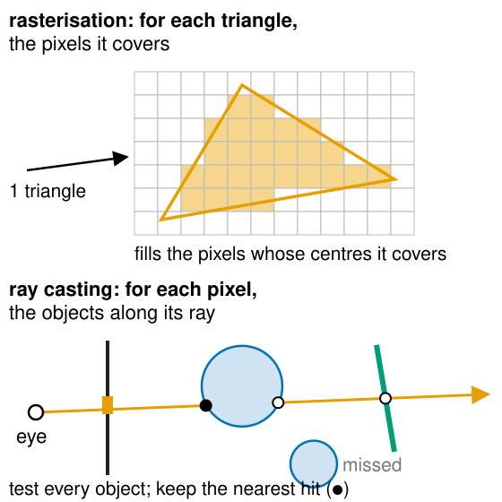
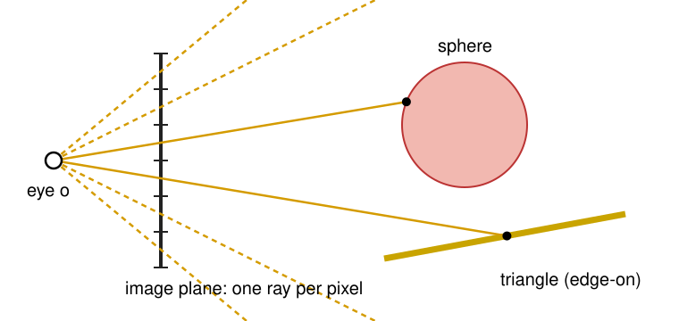
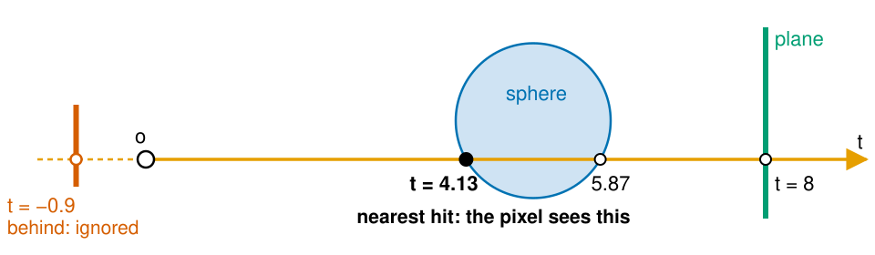
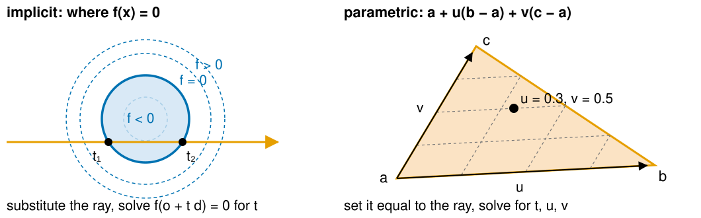
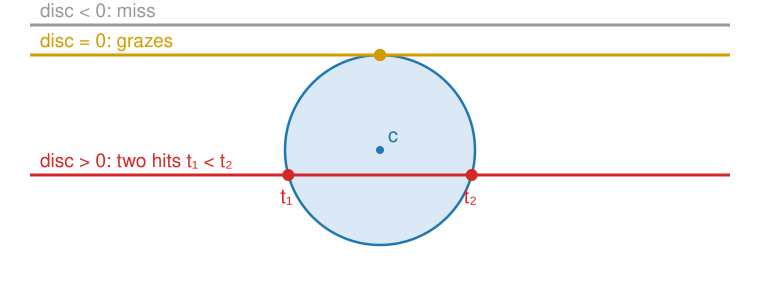
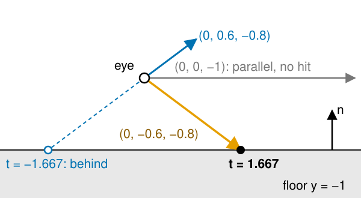
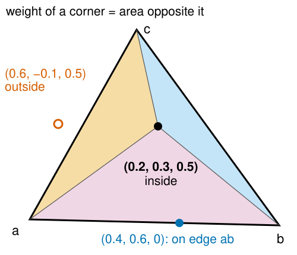
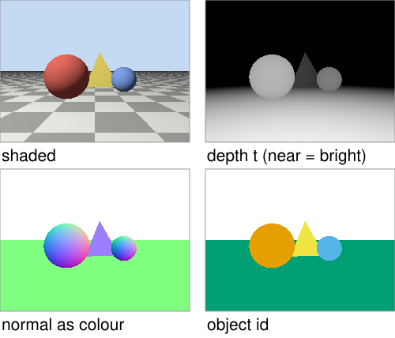

## About this lecture

The 3D graphics day drew a scene by sending every triangle to the pixels it covers. Today we go the other way: from every pixel, send a ray into the scene and ask what it hits. This is **ray casting**, the first step of ray tracing.

- A pixel is a **ray** from the eye: building it from the camera.
- The **nearest hit** along the ray decides what the pixel sees.
- Where a ray meets a **sphere** (a quadratic), a **plane** (one division) and a **triangle** (barycentric coordinates).
- The **normal** at the hit, and shading.
- Why it is slow: every pixel tests every object.

*Slides titled **The math** give the formulas and proofs; the ideas are complete without them.*

::: notes
This unit owns ray–primitive intersection for the course; the 3D graphics day used rays through a volume (volrender) and the barycentric coordinates of the rasteriser, both recalled here in one slide each. Notation: rays r(t) = o + t d with t the distance when d is a unit vector; normals n are unit vectors; barycentric coordinates (b_a, b_b, b_c). Camera conventions as on the 3D graphics day: the camera looks down −z, field of view is vertical.
:::

## Recall: a pixel is a ray

:::: {.columns}
::: {.column width="56%"}
From [Meshes, coordinate spaces and projection](../pipeline3d/lec.qmd): run the camera chain backwards, and a pixel is not a point but a **ray** from the eye through the pixel. Every point on that ray lands on the same pixel.

From [From triangles to shaded pixels](../rasterise/lec.qmd): the rasteriser asks *"which pixels does this triangle cover?"* and keeps the nearest one in the z-buffer.

| | outer loop | inner loop |
|---|---|---|
| rasterisation | for each triangle | for each pixel it covers |
| **ray casting** | **for each pixel** | **for each object** |
:::
::: {.column width="44%"}
{width="100%" fig-alt="Top: a triangle drawn over a grid of pixels; the pixels whose centres lie inside it are filled. Bottom: a ray from the eye through one pixel of the image plane passes a disc, a slanted segment and misses a second disc; the first hit on the disc is marked as the nearest."}
:::
::::

**The same two loops, swapped.** Both find the same nearest surface for every pixel. What differs is what else each can ask cheaply: a ray can be sent anywhere, so shadows, mirrors and glass come almost for free (next unit).

## Camera rays

{width="70%" fig-align="center"}

- The eye $\mathbf o$ sits at the centre of projection; the image plane is at distance 1 in front of it.
- Pixel $(i, j)$ of a $W \times H$ image: aim at its **centre** $(i + \tfrac12, j + \tfrac12)$, mapped to $[-1, 1]$ across the image.
- The field of view sets how wide the image plane is: with a vertical field of view of 90°, the image plane reaches from $-1$ to $+1$ vertically (and $\pm W/H$ horizontally).
- Example: a $4 \times 2$ image, 90°: pixel $(1, 0)$ looks along $(-0.5,\ 0.5,\ -1)$, up and to the left.

An **orthographic** camera sends **parallel** rays (all along $-z$) from points spread over the image plane, as the volume renderer did.

## The math: the ray through a pixel {.math}

With pixel centre $(i + \tfrac12, j + \tfrac12)$, rows counted from the top:

$$x_n = \frac{2(i + \tfrac12)}{W} - 1, \qquad y_n = 1 - \frac{2(j + \tfrac12)}{H}, \qquad \mathbf d = \operatorname{normalize}\!\Big(x_n \tan\tfrac{\varphi}{2}\,\tfrac{W}{H}\ \mathbf r + y_n \tan\tfrac{\varphi}{2}\ \mathbf u + \mathbf f\Big)$$

- $\mathbf r, \mathbf u, \mathbf f$: the camera's right, up and forward vectors (the look-at basis of the 3D graphics day); $\varphi$ the vertical field of view.
- Camera at the origin looking down $-z$: $\mathbf r = (1, 0, 0)$, $\mathbf u = (0, 1, 0)$, $\mathbf f = (0, 0, -1)$.
- Same thing as $(PV)^{-1}$ applied to the pixel at two depths: that is how the volume renderer built its rays.
- $4 \times 2$, $\varphi = 90°$, pixel $(1, 0)$: $x_n = -0.25$, $y_n = 0.5$, $\mathbf d \propto (-0.5, 0.5, -1)$, unit $(-0.408, 0.408, -0.816)$.

## The ray, and the nearest hit

$$\mathbf r(t) = \mathbf o + t\,\mathbf d, \qquad t > 0$$

- With a unit direction, $t$ is the **distance** from the eye. Negative $t$ is behind the camera: not seen.
- A hit with an object is a value of $t$. Each object may give zero, one or two values.
- The pixel sees the **smallest positive $t$** over all objects: the **nearest hit**. This is ray casting's z-buffer.
- What we need at the hit: which object, the point $\mathbf p = \mathbf o + t\mathbf d$, the **normal** there, and the surface's colour.

{.nostretch width="72%" fig-align="center" fig-alt="A ray from the eye o along the t axis. An object behind the eye at t = −0.9 is ignored. The ray enters a sphere at t = 4.13 and leaves at 5.87, and meets a plane at t = 8. The smallest positive t, 4.13, is the nearest hit."}

Recall [Seeing voxels](../volrender/lec.qmd): one ray per pixel through a volume, sampling and compositing all along it. Same rays; now they stop at the first **surface**.

## Two ways to describe a surface

- **Implicit**: the points where $f(\mathbf x) = 0$. A sphere is $\lVert\mathbf x - \mathbf c\rVert^2 - r^2 = 0$, a plane $(\mathbf x - \mathbf p_0)\cdot\mathbf n = 0$. **Substitute the ray** and solve for $t$: one equation in one unknown.
- **Parametric**: points written as a formula of parameters. A triangle with corners $\mathbf a, \mathbf b, \mathbf c$ is $\mathbf a + u(\mathbf b - \mathbf a) + v(\mathbf c - \mathbf a)$, $u, v \ge 0$, $u + v \le 1$. **Set it equal to the ray** and solve for $t, u, v$: three equations in three unknowns.

{.nostretch width="84%" fig-align="center" fig-alt="Left: a circle as the zero contour of f, with dashed contours f < 0 inside and f > 0 outside; a ray crosses f = 0 at t1 and t2. Right: a triangle with corners a, b, c, a grid of lines of constant u and v, and the ray's hit at u = 0.3, v = 0.5."}

The level-set day stored curves implicitly too ([Curves as level sets](../implicit/lec.qmd)): "where is $f = 0$?" is the same question.

## A sphere: a line through a circle

{width="58%" fig-align="center"}

Substituting the ray into the sphere gives a **quadratic** in $t$. Its discriminant tells the story:

- negative: the ray **misses**; zero: it **grazes**; positive: it enters at $t_1$ and leaves at $t_2$.
- Take the **smaller positive** root. Both negative: the sphere is behind the eye. $t_1 < 0 < t_2$: the eye is **inside** (inside a glass ball, say), and the ray hits at $t_2$.
- Normal at the hit: $(\mathbf p - \mathbf c)/r$, pointing outwards.

## The math: the sphere quadratic {.math}

$\lVert\mathbf o + t\mathbf d - \mathbf c\rVert^2 = r^2$ with a unit $\mathbf d$, and $b' = \mathbf d\cdot(\mathbf o - \mathbf c)$, $k = \lVert\mathbf o - \mathbf c\rVert^2 - r^2$:

$$t^2 + 2b't + k = 0, \qquad t = -b' \pm \sqrt{b'^2 - k}.$$

- Example: $\mathbf o = \mathbf 0$, $\mathbf d = (0, 0, -1)$, $\mathbf c = (0.5, 0, -5)$, $r = 1$: $b' = -5$, $k = 24.25$, $b'^2 - k = 0.75$, $t = 5 \mp 0.866 = 4.134,\ 5.866$.
- **Cancellation** (recall [Floating point](../floatingpoint/lec.qmd)): far from a big sphere, $b'^2 \gg k$ and $-b' - \sqrt{b'^2 - k}$ subtracts two nearly equal numbers. With $b' = -10^4$, $k = 1$ in float32: $b'^2 - 1$ rounds to $10^8$ (floats near $10^8$ are 8 apart), so the small root comes out as $0$ instead of $5 \cdot 10^{-5}$.
- **Stable form**: compute the large root without cancellation, $q = -(b' + \operatorname{sign}(b')\sqrt{b'^2 - k})$, then the other from the product of the roots (Vieta): $t_1 t_2 = k$, so $t = k/q$.

## A plane: one division

:::: {.columns}
::: {.column width="54%"}
- The ray meets the plane through $\mathbf p_0$ with normal $\mathbf n$ at one value of $t$, unless it runs **parallel** to the plane ($\mathbf d \cdot \mathbf n = 0$: no hit, or the ray lies in the plane).
- Example: floor $y = -1$, eye at the origin. Looking straight ahead, $\mathbf d = (0, 0, -1)$: parallel, never reaches the floor. Looking down, $\mathbf d = (0, -0.6, -0.8)$: hits at $t = 1.667$, the point $(0, -1, -1.333)$.
- A negative $t$: the plane is behind the eye (the floor seen when looking up: no hit).
- Normal: $\mathbf n$ everywhere.
:::
::: {.column width="46%"}
{width="100%" fig-alt="Side view of the eye one unit above the floor y = −1. The ray straight ahead, (0, 0, −1), runs parallel to the floor and never hits. The ray (0, −0.6, −0.8) hits the floor at t = 1.667. The ray (0, 0.6, −0.8) points up; its line meets the floor only behind the eye, at t = −1.667: no hit."}
:::
::::

## The math: the plane {.math}

$$(\mathbf o + t\mathbf d - \mathbf p_0)\cdot\mathbf n = 0 \quad\Longrightarrow\quad t = \frac{(\mathbf p_0 - \mathbf o)\cdot\mathbf n}{\mathbf d\cdot\mathbf n}.$$

- One dot product in the numerator, one in the denominator, one division.
- $\mathbf d\cdot\mathbf n = 0$: division by zero; in floating point the result is $\pm\infty$ (or NaN if the ray lies in the plane), which the "smallest positive $t$" rule simply ignores.
- The sign of $\mathbf d \cdot \mathbf n$ says from which side the ray arrives: negative = from the side $\mathbf n$ points to (the front).

## A triangle: barycentric coordinates

:::: {.columns}
::: {.column width="58%"}
Recall [From triangles to shaded pixels](../rasterise/lec.qmd): a point in a triangle has **barycentric coordinates** $(b_a, b_b, b_c)$, weights from areas that sum to 1; all three $\ge 0$ means inside.

- The ray meets the triangle's **plane** at one point.
- Compute that point's barycentric coordinates. **Inside** iff all three are $\ge 0$.
- The same weights interpolate the **vertex normals** (smooth shading) and colours at the hit.
- Example: $(0.2, 0.3, 0.5)$ inside; $(0.6, -0.1, 0.5)$ outside (beyond the edge opposite $\mathbf b$); $(0.4, 0.6, 0)$ on the edge $\mathbf a\mathbf b$.
:::
::: {.column width="42%"}
{width="100%" fig-alt="Triangle a, b, c with the point (0.2, 0.3, 0.5) inside; lines to the corners split the triangle into three coloured parts whose areas are the weights of the opposite corners. The point (0.6, −0.1, 0.5) lies outside beyond edge ac; (0.4, 0.6, 0) lies on edge ab."}
:::
::::

## The math: ray–triangle as a 3 × 3 system {.math}

$\mathbf o + t\mathbf d = \mathbf a + u\,\mathbf e_1 + v\,\mathbf e_2$ with $\mathbf e_1 = \mathbf b - \mathbf a$, $\mathbf e_2 = \mathbf c - \mathbf a$:

$$\begin{bmatrix} -\mathbf d & \mathbf e_1 & \mathbf e_2 \end{bmatrix}\begin{bmatrix} t \\ u \\ v\end{bmatrix} = \mathbf o - \mathbf a, \qquad (b_a, b_b, b_c) = (1 - u - v,\ u,\ v).$$

- **Cramer's rule**: each unknown is a ratio of two determinants, and a $3\times3$ determinant is a scalar triple product, a signed **volume**: $\det[\mathbf x\ \mathbf y\ \mathbf z] = \mathbf x \cdot (\mathbf y \times \mathbf z)$. The Möller–Trumbore algorithm (1997) evaluates exactly these with two cross products.
- $\det \approx 0$: the ray is parallel to the triangle's plane. The **sign** of $\det$ says which side was hit: a back-face test for free.
- Hit iff $u \ge 0$, $v \ge 0$, $u + v \le 1$ and $t > 0$.

## The math: ray-cast barycentrics are perspective-correct {.math}

- The rasteriser interpolates on the **screen**, where perspective has squeezed distant parts. Its $(b_a, b_b, b_c)$ from screen areas are wrong for 3D attributes; the fix was to interpolate $f/w$ and $1/w$ and divide.
- The ray finds the **3D point** $\mathbf p = \mathbf a + u\mathbf e_1 + v\mathbf e_2$ itself. So $(1 - u - v, u, v)$ are the barycentric coordinates **in 3D**: exactly what the $1/w$ correction recovers.
- A ray caster never needs the correction (the demo's test file checks the two agree to $10^{-6}$ on random triangles).

## Normals and shading at the hit

:::: {.columns}
::: {.column width="58%"}
- Sphere: $(\mathbf p - \mathbf c)/r$. Plane: $\mathbf n$. Triangle: the face normal $\mathbf e_1 \times \mathbf e_2$, normalised, or the vertex normals blended with the barycentric weights.
- If the ray hits the **back** of a surface, flip the normal towards the eye.
- Shading as on the 3D graphics day: Lambert's $\max(0, \mathbf n\cdot\mathbf l)$ times the albedo, optionally Blinn–Phong highlights. Nothing new about shading yet; light that bounces is unit 4.
- Other per-pixel outputs come for free: the **depth** $t$, the **normal** as a colour, the **object id**. Images like these are what the denoiser of unit 4 uses as guides.
:::
::: {.column width="42%"}
{width="100%" fig-alt="The demo's scene (red sphere, blue sphere, yellow triangle on a checkered ground) ray cast four ways: Lambert-shaded colour, depth t with near points bright, the normal as a colour, and the object id as a flat colour per object."}
:::
::::

## Try it: a step-through ray caster

```{=html}
<link rel="stylesheet" href="../demos/dist/demo.css">
<div data-demo="raystep" data-depth="0" data-preset="one"></div>
<script src="../demos/dist/raystep.js"></script>
```

::: notes
Left: the image on a coarse grid; "next pixel" traces one ray, "next row", "all". Middle: the top view (x–z plane) with the camera C, the image plane, the inspected ray and every candidate hit (filled: a real hit in front; hollow: outside the triangle; red: behind the eye). Readout: the discriminant and roots for each sphere, t for the plane, t, u, v for the triangle. Tour: "one sphere" (16 × 12, 192 rays, 192 tests): step a few pixels; the centre pixel (8, 6) gives disc 0.051, t = 5.81 and 6.26: a ray close to grazing. "A ray that misses": pixel (2, 2), discriminant −13.3. "Sphere behind the camera": camera dragged to z = −3; pixel (16, 12) gives roots −2.30 and −0.70, both negative: not seen; the ground is seen instead. "Eye inside the sphere": roots −0.80 and 0.80; the inside of the ball fills the view. "The triangle: barycentrics": barycentric view, pixel (34, 25): u = 0.35, v = 0.33, inside. "Orthographic": parallel rays; the ground (horizontal) is never hit by a ray along −z. "Count the tests": 64 × 48 = 3072 rays, 4 objects, 12288 tests.
:::

## Why it is slow

Every pixel tests every object:

$$\text{tests} = \text{pixels} \times \text{objects}.$$

- 640 × 480 pixels, 5000 triangles: $1.5 \cdot 10^9$ tests for one image.
- 1920 × 1080 pixels, a mesh of $10^6$ triangles: $2 \cdot 10^{12}$ tests, for one ray per pixel, per frame.
- Most of these tests miss. Unit 3 ([Tracing fast](../bvh/lec.qmd)) skips whole groups of objects at once with boxes around them, and gets to roughly $\log_2(\text{objects})$ tests per ray.
- A third way to find the hit, for shapes stored as signed distance fields (level sets): **sphere tracing**, marching along the ray in steps as long as the distance to the nearest surface.

## Summary

- Ray casting: **for each pixel, for each object**; the rasteriser's two loops swapped, same visible surfaces.
- A camera ray goes from the eye through the **pixel centre**; $\mathbf r(t) = \mathbf o + t\mathbf d$, and the pixel sees the **smallest positive $t$**.
- **Sphere**: a quadratic; discriminant = miss, graze or two hits; compute it in the stable way. **Plane**: one division; parallel = no hit. **Triangle**: hit the plane, inside iff the **barycentric coordinates** are all $\ge 0$; they also interpolate normals and colours.
- At the hit: the point, the **normal**, then shading as on the 3D graphics day.
- Cost: pixels × objects. Next: shadows, mirrors and glass by sending more rays.
