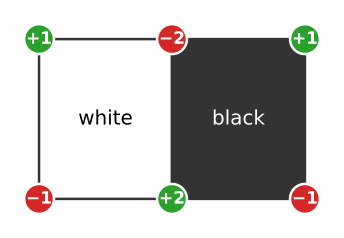
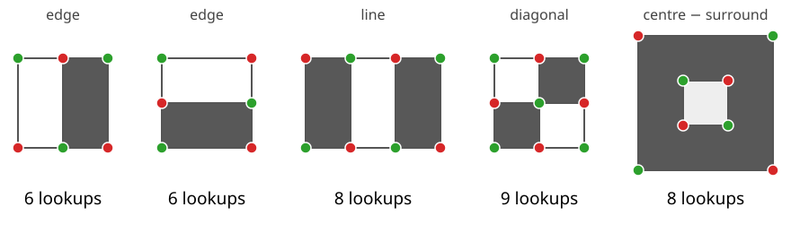
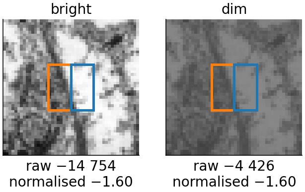
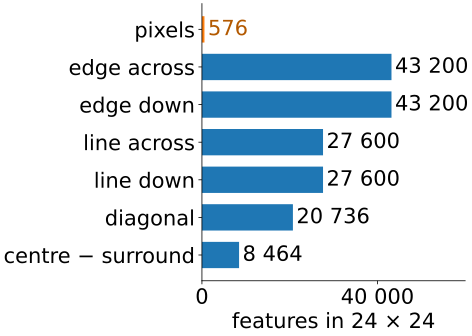
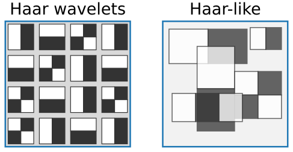
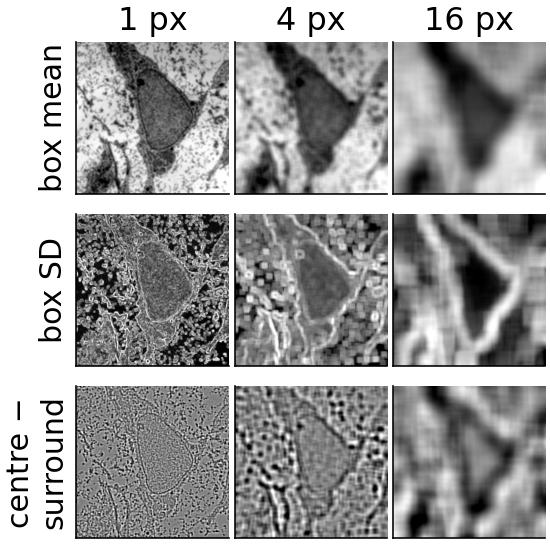

## About this lecture

What simple numbers describe "what is around this pixel" or "what is in this window", and are cheap enough to compute **millions** of times?

- **Haar-like features**: the sum over one rectangle minus the sum over its neighbour. Edges, lines, diagonals, blobs.
- Each costs **6 to 9 table lookups**, whatever its size.
- The **pool** of all such features in a small window is huge, far larger than the number of pixels.
- Their relation to the **Haar wavelets**, and why detection does not need a basis.
- The **box group** of a pixel **feature stack**: every scale at the same cost.

*Slides titled **The math** give the formulas and proofs; the ideas are complete without them.*

::: notes
Builds on the integral image (unit 1) and the local SD (unit 2). The feature stack, the painting loop and the classifier belong to the random forests day; here only the box group and "why large boxes are free". The next unit selects a few of these features with boosting.
:::

## A feature from two rectangles

:::: {.columns}
::: {.column width="62%"}
Place two equal rectangles side by side and take **sum(white) − sum(black)**.

- On a **flat** region: 0. On a **vertical edge** (dark left, bright right): large and negative; mirrored: positive.
- It is a **box-smoothed derivative**: like the Sobel kernel of the filtering unit, but of any size.
- With the integral image the two sums cost 4 lookups each, but they **share two corners**: **6 lookups** in all.
:::
::: {.column width="38%"}
{width="100%" fig-alt="Two equal rectangles side by side, white and black, with the table entries read at their six corners: +1, −2, +1 on top and −1, +2, −1 at the bottom. The two middle corners are shared, so their coefficients add up."}
:::
::::

A cartoon face: the band of the **eyes** is darker than the band of the **cheeks** below. A two-rectangle feature over both bands gives a strongly negative number on almost every face, whatever the person looks like.

## The templates

{width="92%"}

- **Edge** (two rectangles, across or down): 6 lookups. **Line** (three rectangles; the centre counts twice so that a flat region gives 0): 8. **Diagonal** (four rectangles): 9. **Centre − surround** (a box minus the mean of a larger box): 8.
- Any **position**, any **width and height**: the cost stays the same.

## Try it: features on an image

```{=html}
<link rel="stylesheet" href="../demos/dist/demo.css">
<div data-demo="haarexplore" data-preset="eyes"></div>
<script src="../demos/dist/haarexplore.js"></script>
```

::: notes
Drag the template (inside: move; yellow handle: resize). Dots: the table entries read, green + and red −, numbered; the readout lists the coefficients (shared corners get 2 or −2). Tour: "eyes are darker than cheeks": a 90 × 30 two-rectangle feature, response −13 230 (−9.8 per pixel), 6 lookups instead of 2700 pixels. Drag it down to the mouth: the sign changes. "eyes darker than the bridge of the nose": three rectangles, 8 lookups. "vertical edge on a cell boundary", with the response at every position: red and blue lines follow the membranes. "centre − surround": red blobs at cells about as large as the centre box.
:::

## Normalising for lighting

:::: {.columns}
::: {.column width="58%"}
The raw response grows with the **contrast** of the image: a face in dim light gives a smaller number than the same face in bright light.

- Divide by the **standard deviation** of the window (from the two tables of unit 2): the response no longer depends on contrast.
- Subtracting the mean is not needed: every template has weights that sum to zero, so adding a constant to the image changes nothing.
- Dividing by the **area** of one rectangle makes features of different sizes comparable (a difference of **mean** grey levels).
:::
::: {.column width="42%"}
{width="100%" fig-alt="The same patch of the micrograph, bright and dim (contrast times 0.3 plus 60). An edge feature of two 8 × 16 rectangles over a membrane: raw response −14 754 bright and −4 426 dim; divided by the area and the window SD both give −1.60."}

[Edge feature, two 8 × 16 rectangles; dim = 0.3 × bright + 60. Micrograph: Robert M. Hunt, CC BY 3.0, via Wikimedia Commons.]{style="font-size: 0.7em; color: #666"}
:::
::::

## The pool is huge

:::: {.columns}
::: {.column width="58%"}
A detector looks at a $24 \times 24$ window. How many features can we place in it?

- One template type, e.g. the edge across with rectangles of width $w$ and height $h$: it covers $2w \times h$ pixels and fits at $(24 - 2w + 1)(24 - h + 1)$ positions. Summed over all $w, h$: **43 200**.
- All five classic types: **162 336** features. Our six types: 170 800.
- A $24 \times 24$ window has 576 pixels: the pool is about **280 times larger**. It is **overcomplete**: far more features than needed to describe the window.
- Each costs 6–9 lookups. Which few are worth computing? The next unit lets **boosting** choose.
:::
::: {.column width="42%"}
{width="100%" fig-alt="Bar chart of the number of features in a 24 × 24 window: edge across and edge down 43 200 each, line across and line down 27 600 each, diagonal 20 736, centre − surround 8 464, against 576 pixels."}
:::
::::

## The math: features as inner products {.math}

A rectangle feature is an inner product with a piecewise-constant mask:
$$f = \langle w, I\rangle = \sum_{x,y} w(x,y)\, I(x,y), \qquad w \in \{-1, 0, 1\} \text{ (or } 2, -\tfrac19\text{)}, \quad \textstyle\sum w = 0.$$
Zero sum: $\langle w, I + c\rangle = \langle w, I\rangle$, so constant offsets do not matter; normalising by the window SD removes the contrast.

Lookups = the number of **distinct corners** with a non-zero coefficient: each rectangle adds $+1, -1, -1, +1$ (times its weight) at its corners; shared corners add up.

Pool size for a template of $a \times b$ cells in a $W \times H$ window:
$$\sum_{w=1}^{\lfloor W/a\rfloor}\ \sum_{h=1}^{\lfloor H/b\rfloor} (W - aw + 1)(H - bh + 1).$$
For the edge across ($a = 2, b = 1$) in $24 \times 24$: $(23 + 21 + \dots + 1)(24 + 23 + \dots + 1) = 144 \cdot 300 = 43\,200$.

## The math: an edge feature on a ramp {.math}

Let $I(x, y) = ax + b$ (a ramp of slope $a$). An edge feature with two $w \times h$ rectangles, left minus right:

Each pixel on the right is $aw$ brighter than its partner on the left, and there are $wh$ pairs:
$$f = \text{sum(left)} - \text{sum(right)} = -a\,w^2 h.$$
Divided by the rectangle area $wh$: $-aw$, the slope times the distance between the two rectangle centres. The edge feature measures the **gradient**, smoothed over a box: a box version of the Gaussian derivative of the edges day.

## Rectangle features and Haar wavelets

:::: {.columns}
::: {.column width="62%"}
The 2D **Haar wavelets** (wavelets elective) are also differences of rectangle sums: one level of the Haar transform gives the edge features across and down (H and V) and the diagonal one (D), plus the mean (LL).
:::
::: {.column width="38%"}
{width="100%" fig-alt="Left: Haar wavelets of one level tile the window on a fixed grid of 2 × 2 blocks, without overlap. Right: Haar-like features of any size at any position, overlapping."}
:::
::::

| | Haar wavelet transform | Haar-like features |
|---|---|---|
| sizes, positions | powers of two, on a fixed grid | every size, every position |
| number | as many as pixels | hundreds of times more |
| structure | orthonormal **basis**: invertible | **overcomplete**: no inverse |
| purpose | represent and reconstruct (compression) | **discriminate** (detection) |

A detector does not need to rebuild the image, only to tell faces from background: it can afford a redundant, overcomplete set and pick the useful features.

## Feature stacks for pixel classification

Recalled from the **random forests day**: a pixel classifier gets a **feature vector for every pixel**, a stack of filtered images at several scales (Gaussian smoothing, derivatives, …).

::::: {.columns}
:::: {.column width="64%"}
This day adds the **box group**, each from the tables of $I$ and $I^2$:

- **box mean** and **box standard deviation** (texture), scales 1, 2, 4, 8, 16 px;
- **centre − surround**: mean of a box minus the mean of a box twice as large; a blob detector, the box version of the difference of Gaussians (edges day);
- **edge features** across and down: box-smoothed derivatives.

With the integral image **every scale costs the same**: large context is free. Gaussian stacks are the usual choice; box stacks are their fast approximation (repeated boxes ≈ Gaussian, unit 2).
::::
:::: {.column width="36%"}
{width="100%" fig-alt="Box mean, box standard deviation and centre − surround of the micrograph at scales 1, 4 and 16 pixels. At 16 px the SD map outlines the nucleus as a dark region surrounded by bright textured cytoplasm."}

[Micrograph: Robert M. Hunt, CC BY 3.0, via Wikimedia Commons.]{style="font-size: 0.7em; color: #666"}
::::
:::::

## Try it: a box feature stack

```{=html}
<div data-demo="haarexplore" data-mode="stack" data-preset="nucleus"></div>
<script src="../demos/dist/haarexplore.js"></script>
```

::: notes
Thumbnails: 5 feature types × 5 scales of the micrograph. Paint class A (orange) and B (blue); the scatter plot shows any two features (click a thumbnail: x, red frame; tick y and click: y, green frame) and a threshold on x. Preset "nucleus or cytoplasm?": with the box mean at 4 px the classes overlap (best single threshold 82 %); click the box SD at 16 px: 99 %. The nucleus is uniformly fine-grained, the cytoplasm has membranes and vesicles: texture at a large scale separates them. That large-scale feature cost the same as the small one. "inspect": click a pixel to see its 25-number feature vector. No classifier here: day 14 trains a forest on such vectors; the next unit trains a boosted one on rectangle features.
:::

## Summary

- A **rectangle feature** is a difference of rectangle sums: edges (6 lookups), lines (8), diagonals (9), centre − surround (8), at **any size and position**.
- Divide by the window's **standard deviation** to remove contrast; the weights sum to zero, so offsets do not matter.
- The **pool** in a $24 \times 24$ window has about **160 000** features: overcomplete; something must choose.
- Haar wavelets are a dyadic, orthonormal subset; Haar-like features drop the basis property because detection needs **discrimination**, not reconstruction.
- The **box group** of a feature stack gets every scale at the same cost. (Per-object intensity and texture features: the measurements day.)
