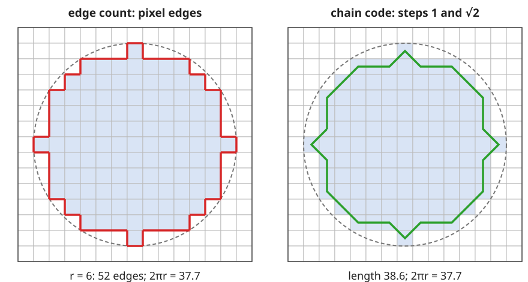
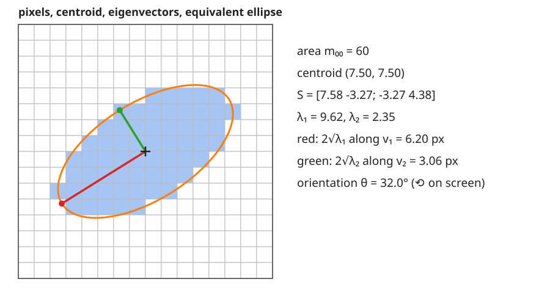

## About this lecture

The last unit turned a mask into a label image. Now we measure each object: one **row per label**, one **column per property**.

- **Area, centroid, bounding box**: sums over the pixels of the object.
- **Perimeter**: three ways to count it, and why the simplest one is 27 % too long at any resolution.
- **Second moments**: the covariance matrix of the pixel coordinates, its eigenvectors (orientation) and the **equivalent ellipse**: PCA of one object.
- The **Euler number**: objects minus holes, counted from 2 × 2 patterns without labelling.

*Slides titled **The math** give the formulas and proofs; the ideas are complete without them.*

::: notes
Coordinates: x = column (right), y = row (down), pixel centres at integers. Angles are given counter-clockwise as seen on the screen (the course convention). PCA is recalled from the pca/ unit of day 1, not re-taught. The covariance is divided by n, as in pca/.
:::

## One scan, one row per object

Everything on this slide is a **sum over the pixels** $\Omega_k$ of object $k$, so a single raster scan computes it for all labels at once.

- **Area** $A$ = number of pixels (times the pixel area for µm²).
- **Centroid** $(\bar x, \bar y)$ = mean pixel position: the balance point of the object.
- **Bounding box**: smallest and largest $x$ and $y$. **Extent** = area / box area (1 for an axis-aligned rectangle, $\pi/4$ for a disc).
- **Touches the border**: box reaches the image edge (truncated object, see the last unit of the day).

| label | area | $\bar x$ | $\bar y$ | extent | … |
|---|---|---|---|---|---|
| 1 | 690 | 31.50 | 31.50 | … | |
| 2 | … | … | … | … | |

## The math: moments {.math}

**Raw moments** of object $\Omega$: $\quad m_{pq} = \sum_{(x,y)\in\Omega} x^p y^q.$

- $m_{00} = A$, centroid $\bar x = m_{10}/m_{00}$, $\bar y = m_{01}/m_{00}$.
- **Central moments** $\mu_{pq} = \sum_{\Omega} (x - \bar x)^p (y - \bar y)^q$ do not change when the object is moved.
- From the raw moments, without a second scan: $\mu_{20} = m_{20} - m_{10}^2/m_{00}$, $\mu_{11} = m_{11} - m_{10} m_{01}/m_{00}$, $\mu_{02} = m_{02} - m_{01}^2/m_{00}$.
- These are the integrals $\iint x^p y^q \, dx\,dy$ over the shape, turned into sums with one sample per pixel.

## Perimeter: three estimates

{width="75%"}

- **Edge count** (left): pixel edges between object and background. A staircase is as long as its two legs, so a digital disc gets about $8r$ instead of $2\pi r$: **27 % too long, at every resolution**.
- **Chain code** (right): walk the boundary pixel centres with steps 1 and $\sqrt 2$: a few per cent off, depending on the direction.
- **Crofton**: count crossings of the boundary with lines in 4 directions: within about 1 % for large objects. (Better step weights, or a sub-pixel contour, also work.)

## The math: where $4/\pi$ comes from {.math}

A boundary segment of length $\ell$ at angle $\varphi$ is replaced by a staircase of $\ell|\cos\varphi|$ horizontal and $\ell|\sin\varphi|$ vertical pixel edges. For a closed convex curve all directions occur equally, so

$$\frac{P_{\text{edges}}}{P} = \frac{1}{2\pi}\int_0^{2\pi} \big(|\cos\varphi| + |\sin\varphi|\big)\,d\varphi = \frac{4}{\pi} \approx 1.273.$$

Finer pixels make the staircase finer but not shorter: the error does not go away.

**Cauchy–Crofton**: $P = \tfrac12 \int_0^\pi \int n(\theta, s)\,ds\,d\theta$, with $n$ the number of crossings of the line at angle $\theta$ and offset $s$. With rows, columns and both diagonals (spacing 1 and $1/\sqrt2$):
$P \approx \tfrac{\pi}{8}\big(n_0 + n_{90} + (n_{45} + n_{135})/\sqrt2\big)$.

## Second moments: an object is a cloud of points

Recall from the PCA unit (day 1): for a cloud of points, the **covariance matrix** $S$ holds the spreads; it is symmetric, its eigenvalues $\lambda_1 \ge \lambda_2 \ge 0$ (descending) are the variances along its orthogonal eigenvectors, the **principal axes**.

The pixels of an object are a cloud of points $(x, y)$:

$$S = \frac{1}{A}\begin{pmatrix}\mu_{20} & \mu_{11}\\ \mu_{11} & \mu_{02}\end{pmatrix}.$$

- $\mathbf v_1$: the direction in which the object is longest (the **orientation**); $\mathbf v_2$ perpendicular to it.
- $\sqrt{\lambda_1}$, $\sqrt{\lambda_2}$: the spread of the pixels along these axes.

## The equivalent ellipse

{width="80%"}

The ellipse with the **same** area, centroid and second moments as the object: semi-axes $a = 2\sqrt{\lambda_1}$, $b = 2\sqrt{\lambda_2}$ along $\mathbf v_1$, $\mathbf v_2$.

- **Eccentricity** $\sqrt{1 - \lambda_2/\lambda_1}$: 0 for a disc, near 1 for a rod. **Elongation** $\sqrt{\lambda_1/\lambda_2}$ = ratio of the axes.
- Major and minor **axis length** $4\sqrt{\lambda_1}$, $4\sqrt{\lambda_2}$.

## The math: orientation and the ellipse {.math}

**Orientation.** For $S = \begin{pmatrix} a & b \\ b & c\end{pmatrix}$ the eigenvalues are $\lambda_{1,2} = \frac{a + c}{2} \pm \sqrt{\big(\frac{a-c}{2}\big)^2 + b^2}$, and $\mathbf v_1 = (\cos\theta, \sin\theta)$ with

$$\theta = \tfrac12 \operatorname{atan2}(2b,\ a - c) = \tfrac12\operatorname{atan2}(2\mu_{11}, \mu_{20} - \mu_{02})$$

(from $\tan 2\theta = 2b/(a - c)$, the condition that the off-diagonal entry vanishes after rotating by $\theta$). With $y$ pointing down, $\theta$ turns from $x$ towards $y$, i.e. clockwise on screen; the orientation counter-clockwise on screen is $-\theta$.

**Ellipse.** A solid ellipse with semi-axes $a, b$ has variance $\frac{1}{\pi ab}\iint u^2 = a^2/4$ along its major axis. So matching $\lambda_1 = a^2/4$ gives $a = 2\sqrt{\lambda_1}$. Check with a disc of radius $r$: $\lambda = r^2/4$, $a = r$.

## Try it: moments of a shape

```{=html}
<link rel="stylesheet" href="../demos/dist/demo.css">
<div data-demo="moments" data-preset="ellipse" data-presets="ellipse,square,L,ring,two,disc" data-shapectl="off"></div>
<script src="../demos/dist/moments.js"></script>
```

::: notes
The shape (a polygon) is digitised on the pixel grid; the slider sets the pixel size. Overlays: centroid, box, the equivalent ellipse (orange), v1 (red, length 2√λ1) and v2 (green). The table compares the digitised values with the exact values of the outline. Tour: "rotate the ellipse": λ1 = 121.25, λ2 = 24.88, θ = 28.8°; drag the shape around: nothing changes but the centroid. On the exercise page you can rotate in 15° steps: S changes completely, λ1 and λ2 stay (120.5, 25.3), θ follows. "a square": λ1 = λ2: no orientation. "the L": the ellipse is not the shape. "a ring": Euler number 0. "a digital disc": the edge count stays at 1.27 × the true perimeter at every pixel size (plot).
:::

## What the moments do and do not tell

- **Rotation** of the object rotates the eigenvectors and leaves the eigenvalues unchanged: $S = Q\Lambda Q^\top$ becomes $(RQ)\Lambda(RQ)^\top$. Area, eigenvalues, eccentricity: rotation **invariant**.
- **Equal eigenvalues** (a disc, but also a square, a regular hexagon, a plus sign): every direction is a principal axis. The orientation is undefined, and noisy for nearly round objects: do not report it.
- The ellipse is a **summary**, not the shape: an L, a ring and a solid ellipse can share it.
- Invariants, in one line each: central moments (translation), normalised moments $\mu_{pq}/m_{00}^{1+(p+q)/2}$ (scale), eigenvalues and Hu's seven invariants (rotation). Higher moments and invariants: the moments elective.

## The Euler number

**Euler number** $E$ = number of objects − number of holes (objects 8-connected, holes 4-connected).

- A disc: 1; a ring: 0; the digit 8: −1; two discs: 2.
- Counted by labelling: the objects, and the background components that do not touch the border (or via fill holes from the morphology day).
- **Surprise**: $E$ is **local**. Count the $2 \times 2$ windows with exactly one object pixel ($Q_1$), with three ($Q_3$), and the diagonal pairs ($Q_D$): $E = (Q_1 - Q_3 - 2Q_D)/4$. One scan, no labelling (Gray, 1971).
- Thinning (skeleton elective) must keep $E$: it may not cut objects or open holes. In 3D, $E$ = objects − tunnels + cavities.

## The math: why the bit-quads count $E$ {.math}

Think of each object pixel as a closed unit square, and count corners ($V$), edges ($E_d$) and squares ($F$) of the union: Euler's formula $\chi = V - E_d + F$ gives objects − holes.

- Each $2\times2$ window is centred on one grid corner. A corner belongs to the union if any of its 4 squares is in the object; its contribution to $V - E_d + F$ depends only on the window: $+\frac14$ for $Q_1$, $0$ for $Q_2$ and $Q_4$, $-\frac14$ for $Q_3$.
- A diagonal pair $Q_D$ is the ambiguous case: with 8-connected objects the two squares are joined at the corner ($-\frac12$); with 4-connected objects they are not ($+\frac12$).
- Sum over all windows (pad with background): $E_8 = \tfrac14(Q_1 - Q_3 - 2Q_D)$, $E_4 = \tfrac14(Q_1 - Q_3 + 2Q_D)$.

## Summary

- One scan gives a **row per object**: area, centroid, box, extent, raw and central moments.
- **Perimeter** depends on the estimator: edge count $\approx 4/\pi$ too long at any resolution; chain code a few %; Crofton $\approx 1\,\%$.
- $S$ = covariance of the pixel coordinates: **PCA of one object**. Eigenvectors: orientation; eigenvalues: spread; **equivalent ellipse** with semi-axes $2\sqrt{\lambda_i}$.
- Rotation changes $S$, not $\lambda_1, \lambda_2$; with $\lambda_1 = \lambda_2$ there is no orientation.
- **Euler number** = objects − holes, from 2 × 2 patterns.
- Next unit: shape beyond moments (convex hull, Feret diameters, form factor).
