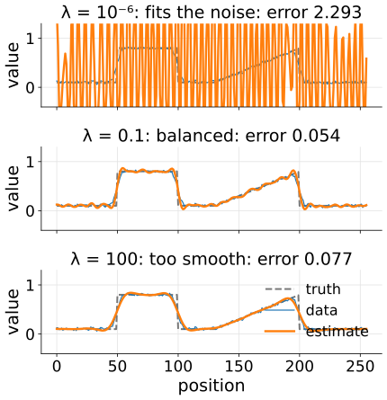
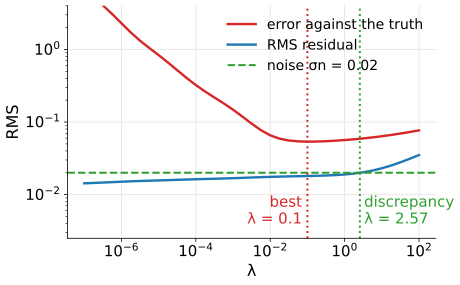
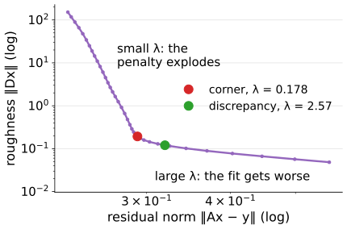
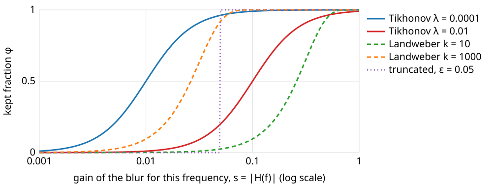
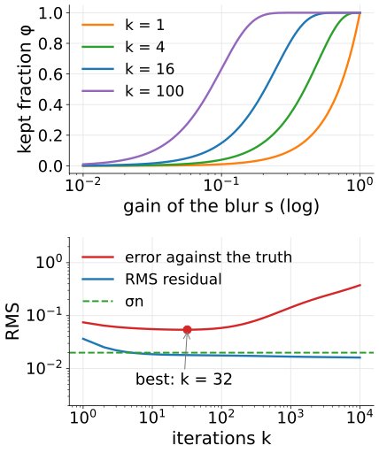
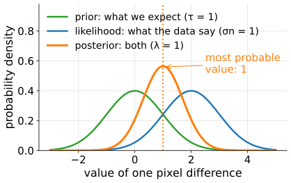

## About this lecture

Every restoration of the last unit had one number to choose. This unit is the general lesson behind them, taught once for the whole course.

- The pattern: **fit the data + λ · look like what we expect**.
- **What the penalty can say**: small, smooth, never negative, piecewise constant, sparse.
- **Choosing λ**: the discrepancy principle, the L-curve, a test image with known truth.
- **Filter factors**: every linear method keeps a fraction of each frequency.
- **Stopping an iteration early** regularises too: the number of iterations plays the role of λ.
- A probabilistic reading: the most probable object.

*Slides titled **The math** give the formulas and proofs; the ideas are complete without them.*

::: notes
This day owns regularisation of inverse problems with continuous unknowns (course map). Later days recall it: the graph-cut day's segmentation energy (data + λ · smoothness over labels), tomography (iterative reconstruction, early stopping), spectral unmixing, and the days on Markov random fields (total variation) and wavelets (sparsity). The demo is 1D so that every λ is instant and the curves are exact: 256 samples, Gaussian blur σ = 3, noise σn = 0.02, fixed seed.
:::

## The pattern

Every restoration so far minimised

$$\underbrace{\text{misfit}(x, \text{data})}_{\text{how the image was made}} \;+\; \lambda \cdot \underbrace{\text{penalty}(x)}_{\text{what we know about the object}}$$

:::: {.columns}
::: {.column width="58%"}
- The **data term** encodes the forward model (blur) and the noise: it is small when the blurred estimate looks like the data.
- The **penalty** encodes prior knowledge: it is small for objects we find plausible.
- **λ** says how much we trust each: λ = 0 trusts only the data (the inverse filter); λ → ∞ only the prior.
- The same pattern returns on the graph-cut day (each pixel takes one of two labels instead of a grey value; [segmentation as energy](../seg-energy/lec.qmd)), in tomography ([iterative reconstruction](../algebraic-recon/lec.qmd)) and in the later days.
:::
::: {.column width="42%"}
{width="82%"}
:::
::::

## What the penalty can say

| Penalty | prefers | keeps | destroys |
|---|---|---|---|
| **energy** $\sum x_i^2$ | small values | shapes | the mean (shrinks everything) |
| **roughness** $\sum (x_{i-1} - 2x_i + x_{i+1})^2$ | smooth | ramps, the mean | steps (rounded), narrow peaks |
| **non-negativity** $x \ge 0$ | photons are not negative | everything positive | the dips and ripples below 0 |
| **total variation** $\sum \lvert x_{i+1} - x_i\rvert$ | piecewise constant | sharp steps | ramps (staircases), small bright spots (shrunk) |
| **sparsity** in a basis | few non-zero coefficients | what the basis describes well | what it does not |

- Non-negativity is a **constraint**, not a penalty: forbidden, not just expensive.
- TV pays for the **size** of a jump, not its square, so one sharp step costs no more than a gentle ramp of the same height (owner: the Ising/MRF day, [quadratic smoothing and total variation](../gmrf/lec.qmd)). Sparsity: first in [wavelet shrinkage](../shrinkage/lec.qmd), in general on the [sparse representations day](../sparsity/lec.qmd).
- The prior is a modelling choice. Where the data are weak, it is the prior you see.

## Try it: what the penalty does

```{=html}
<link rel="stylesheet" href="../demos/dist/demo.css">
<div data-demo="regpath" data-preset="mean" data-presets="mean,tvstep,tvpeak,nonneg"></div>
<script src="../demos/dist/regpath.js"></script>
```

::: notes
Top left: truth (dashed), data (thin blue), estimate (red). Tour: "roughness keeps the mean, energy shrinks it": energy penalty, λ = 0.3: mean 0.256 against 0.331 in the truth (factor 1/1.3); switch the penalty to roughness: mean 0.333. "TV keeps the step, staircases the ramp" (λ = 0.01): the step is flat at 0.80 and sharp; the ramp comes out in small flat steps; error 0.0219 against 0.0537 for the best roughness λ. "TV shrinks the narrow peak" (profile with close peaks, λ = 0.02): the narrow peak (true height 1.0) comes out at 0.31. "Non-negativity removes the dips": roughness λ = 1e-4 alone dips to −1.16 (error 0.323); with x ≥ 0 the minimum is 0 and the error 0.109. TV is computed iteratively (reweighted least squares), so its curves fill in after a moment.
:::

## Choosing λ

The question every student asks. Four answers:

- **By eye**: common, not reproducible. Fine for a figure, not for a measurement.
- **Discrepancy principle**: the residual (data − blurred estimate) should be **as large as the noise**, not smaller. A smaller residual means the estimate is fitting the noise. Needs the noise level σn (camera noise unit: offset frames, flat regions).
- **L-curve**: plot the size of the residual against the size of the penalty for many λ, both on log axes. Pick the **corner**. Needs no σn, but the corner can be vague.
- **Known truth**: a test image (beads, phantom) with the same microscope and noise; choose λ with the smallest error. The honest benchmark, if the test resembles the real data.

One line: generalised cross-validation (leave each pixel out, predict it) also exists; not taught here.

## The discrepancy principle in numbers

An image of 256 × 256 pixels with noise σn = 2 grey levels.

:::: {.columns}
::: {.column width="52%"}
- The noise alone has root-mean-square 2, so the residual of a good estimate should have RMS ≈ 2: squared norm $\approx 65\,536 \times 4 = 262\,144$.
- λ too small: the estimate follows the noise and the RMS residual drops below 2.
- λ too large: the estimate is too smooth to explain the data, and the residual grows above 2, now containing image structure.
- The residual grows steadily with λ, so there is exactly one λ with RMS residual = σn.
:::
::: {.column width="48%"}
{width="100%"}
:::
::::

In the demo (1D, σn = 0.02): RMS residual 0.0151 at λ = 10⁻⁶, 0.0180 at 0.1, 0.0189 at 1, 0.0231 at 10: the discrepancy λ is about 2.6.

## The L-curve

For each λ compute the residual norm $\rho = \|A\hat x_\lambda - g\|$ and the penalty $\eta = \|D\hat x_\lambda\|$; plot $\eta$ against $\rho$ on log–log axes.

:::: {.columns}
::: {.column width="52%"}
- **Small λ** (top left): the penalty explodes (noise is fitted) for almost no gain in fit: a **vertical** branch.
- **Large λ** (bottom right): the fit gets worse for almost no gain in smoothness: a **horizontal** branch.
- The **corner** between them balances the two. Here: the point closest to the lower left corner of the plot (after scaling both log axes to the same length).
:::
::: {.column width="48%"}
{width="100%"}
:::
::::

## The math: choosing λ {.math}

**Discrepancy principle** (Morozov): choose λ with $\|A\hat{\mathbf x}_\lambda - \mathbf y\|^2 = N\sigma_n^2$ ($N$ data values). For Tikhonov, in the SVD basis (next slides) the residual is $\sum_i \big(\tfrac{\lambda}{s_i^2 + \lambda}\big)^2 (\mathbf u_i^\top\mathbf y)^2$, which increases with λ: one root, found by bisection on $\log\lambda$.

**L-curve** (Hansen): the parametric curve $\big(\log\|A\hat{\mathbf x}_\lambda - \mathbf y\|,\ \log\|D\hat{\mathbf x}_\lambda\|\big)$. Its corner is defined as the point of **maximal curvature**

$$\kappa = \frac{\rho'\eta'' - \rho''\eta'}{(\rho'^2 + \eta'^2)^{3/2}} \quad (\text{derivatives of the logs with respect to } \log\lambda).$$

On sampled curves from iterative solvers (TV, non-negativity), which wiggle, the curvature is unreliable; the point nearest the lower-left corner of the normalised plot is a robust stand-in (used in the demo).

## Try it: choosing λ

```{=html}
<link rel="stylesheet" href="../demos/dist/demo.css">
<div data-demo="regpath" data-preset="disc" data-presets="small,large,disc,corner,disagree"></div>
<script src="../demos/dist/regpath.js"></script>
```

::: notes
Step-and-ramp profile, roughness penalty. Bottom right: error against the truth (orange) and RMS residual (blue) for 37 values of λ; dashed green: σn; dotted lines: discrepancy λ (green) and L-curve corner (orange). Tour: "λ too small" (10⁻⁶): error 2.29, the estimate is wild; residual 0.0151, below σn: it fits the noise. "λ too large" (100): smooth, rounded steps; error 0.0767, residual 0.0351, above σn. "Discrepancy principle": λ = 2.57, error 0.0588. "L-curve corner": λ = 0.178, error 0.0539; the best λ on the path is 0.1 (error 0.0537). Both rules are close to the best error here, the discrepancy principle a little on the smooth side. "The two rules disagree": correlated noise (neighbouring samples related): the discrepancy λ jumps to 11.7 (error 0.0651), the corner gives 0.056 (error 0.0611), the best is 0.316 (error 0.0586). The discrepancy principle assumes white noise.
:::

## Filter factors

Every linear restoration keeps a **fraction** φ of each frequency (or, in general, of each singular direction of the blur), then divides by the blur's gain $s$ there.

{width="80%"}

- Inverse: φ = 1 everywhere. Truncated: φ = 1 or 0. Tikhonov: $\varphi = s^2/(s^2 + \lambda)$, a smooth step at $s^2 \approx \lambda$.
- **Regularisation = choosing this curve.** Numbers, λ = 0.01: $s = 1$ keeps 0.99, $s = 0.5$ keeps 0.96, $s = 0.1$ keeps 0.5.

## The math: filter factors {.math}

Write the blur by its singular value decomposition $A = U\Sigma V^\top$ (singular values $s_i$, singular vectors $\mathbf u_i$, $\mathbf v_i$). The inverse is $\mathbf x = \sum_i \frac{\mathbf u_i^\top\mathbf y}{s_i}\mathbf v_i$. Any linear restoration is

$$\hat{\mathbf x} = \sum_i \varphi_i\,\frac{\mathbf u_i^\top\mathbf y}{s_i}\,\mathbf v_i ,$$

with inverse $\varphi_i = 1$, truncated SVD $\varphi_i \in \{0, 1\}$, Tikhonov (energy) $\varphi_i = \dfrac{s_i^2}{s_i^2 + \lambda}$.

- With $\mathbf y = A\mathbf x + \mathbf n$, term $i$ carries the noise $\varphi_i\,n_i/s_i$ ($n_i = \mathbf u_i^\top\mathbf n$): small $s_i$ amplifies, small $\varphi_i$ suppresses.
- For a circular blur the $\mathbf v_i$ are the Fourier waves and $s_i = |H(f)|$: filter factors are gains per frequency, as in the last unit.
- Tikhonov's $\varphi$ follows from the normal equations: $(A^\top A + \lambda I)\mathbf x = A^\top\mathbf y$ gives, in the SVD basis, $(s_i^2 + \lambda)\,x_i = s_i\,(\mathbf u_i^\top\mathbf y)$.

## Stopping early regularises

:::: {.columns}
::: {.column width="60%"}
An iterative method that starts from a flat (zero) image and improves the fit step by step:

- picks up the **strong** frequencies (large $s$) first, the **weak** ones (small $s$, noisy) last;
- after $k$ steps it acts like a filter whose roll-off moves to smaller $s$ as $k$ grows: **the number of iterations plays the role of λ** (roughly $\lambda \approx 1/k$);
- the error against the truth first **falls**, then **rises** again (**semi-convergence**), while the data fit keeps improving.

The simplest such method, **Landweber**: blur the estimate, subtract it from the data, blur the difference back (with the mirrored PSF), add it to the estimate. Filter factors $1 - (1 - s^2)^k$:

- $s = 0.5$: $k = 1, 4, 16$ keep 0.25, 0.68, 0.99.
- $s = 0.1$: $k = 16$ keeps 0.15; $k = 100$ keeps 0.63. Weak frequencies need many iterations, which is why stopping early regularises.
:::
::: {.column width="40%"}
{width="92%"}
:::
::::

## The math: early stopping {.math}

Landweber: $\mathbf x_{k+1} = \mathbf x_k + \omega A^\top(\mathbf y - A\mathbf x_k)$, $\mathbf x_0 = 0$, $0 < \omega < 2/s_{\max}^2$. In the SVD basis each component evolves alone: with $c_i = \mathbf u_i^\top\mathbf y$,

$$x_{k+1,i} = (1 - \omega s_i^2)\,x_{k,i} + \omega s_i c_i \quad\Rightarrow\quad x_{k,i} = \big(1 - (1 - \omega s_i^2)^k\big)\frac{c_i}{s_i}.$$

So $\varphi_i^{(k)} = 1 - (1 - \omega s_i^2)^k$. For small $\omega s_i^2$, $(1 - \omega s_i^2)^k \approx e^{-k\omega s_i^2}$, which falls from 1 to 0 around $s_i^2 \approx 1/(k\omega)$: like Tikhonov with $\lambda \approx 1/(\omega k)$.

## Try it: iterations as λ

```{=html}
<link rel="stylesheet" href="../demos/dist/demo.css">
<div data-demo="regpath" data-preset="iter" data-presets="iter,disc"></div>
<script src="../demos/dist/regpath.js"></script>
```

::: notes
"Restore by: stopping after k iterations" (Landweber, from zero). Top right shows the filter factors: as k grows the red step moves right to left across the frequencies. Bottom right: error (orange) falls to its minimum at k = 32 (0.0542), then rises: 0.0586 at k = 100, 0.143 at 1000, 0.375 at 10 000. The residual (blue) keeps falling. The discrepancy rule (first k with residual ≤ σn) stops at k = 6, early but safe. Tick "non-negative steps": the iterate stays ≥ 0 and the late iterations are less wild.
:::

## A probabilistic reading

- **Data term** = how likely are these data if this were the object (the noise model: Gaussian noise gives squared differences).
- **Penalty** = how likely is this object before we look (the **prior**: smooth objects are likely, wild ones unlikely).

:::: {.columns}
::: {.column width="52%"}
- Minimising data term + λ · penalty finds the **most probable object** given both (the maximum a posteriori, MAP, estimate).
- λ is the ratio of how much we trust the data to how much we trust the prior: more noise → larger λ.
- Modern deep learning (day 39, [diffusion](../diffusion/lec.qmd)) replaces the hand-made prior by one learned from many images; [diffusion models](../diffusion-inverse/lec.qmd) (day 41) use it to solve inverse problems.
:::
::: {.column width="48%"}
{width="100%"}
:::
::::

## The math: MAP {.math}

Gaussian noise $\mathbf y = A\mathbf x + \mathbf n$, $\mathbf n \sim \mathcal N(0, \sigma_n^2 I)$, and a Gaussian prior $D\mathbf x \sim \mathcal N(0, \tau^2 I)$:

$$-\log p(\mathbf x \mid \mathbf y) = \frac{1}{2\sigma_n^2}\|A\mathbf x - \mathbf y\|^2 + \frac{1}{2\tau^2}\|D\mathbf x\|^2 + \text{const}.$$

Multiplying by $2\sigma_n^2$: Tikhonov with $\lambda = \sigma_n^2/\tau^2$. More noise or a tighter prior → larger λ.

- A Laplace prior $p \propto e^{-|t|/b}$ on the differences gives the total-variation penalty; on coefficients in a basis, the $\ell^1$ (sparsity) penalty.
- Poisson noise instead of Gaussian changes the data term to $\sum_i (A\mathbf x)_i - y_i\log(A\mathbf x)_i$: the [next unit](../richardson-lucy/lec.qmd).

## Summary

- Restoration = **data term + λ · penalty**; the penalty is what we know about the object, λ how much we trust it.
- Penalties: **energy** (shrinks the mean), **roughness** (smooth, keeps the mean), **non-negativity** (a constraint), **TV** (keeps steps, staircases ramps, shrinks spots), **sparsity**.
- **Choosing λ**: discrepancy (residual = noise level, needs σn, assumes white noise), **L-curve** corner (no σn, can be vague), **known truth** on a test image.
- **Filter factors**: every linear method keeps a fraction $\varphi$ of each frequency; Tikhonov $s^2/(s^2 + \lambda)$.
- **Early stopping** regularises: Landweber's factors $1 - (1 - s^2)^k$; the error is U-shaped in $k$ (semi-convergence).
- MAP reading: λ = noise variance / prior variance.
