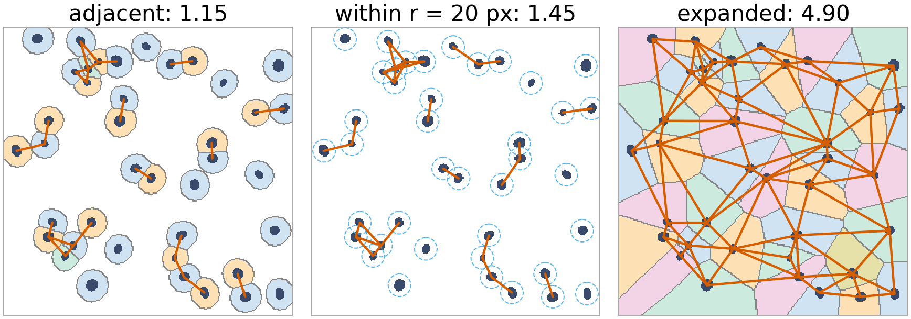
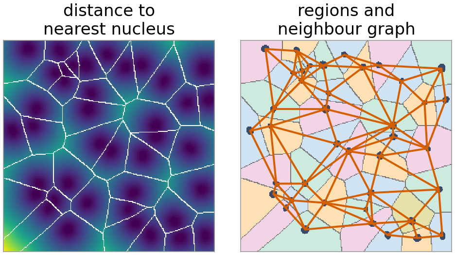
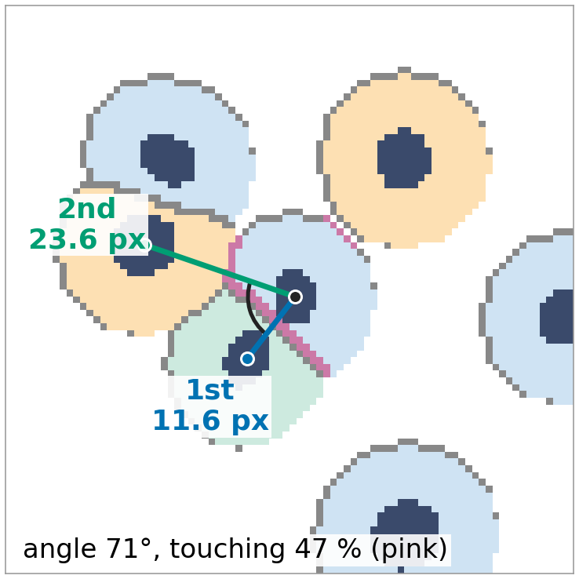
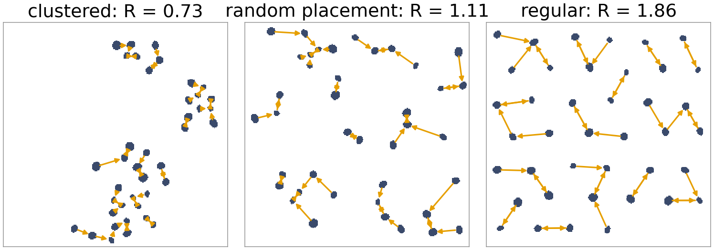
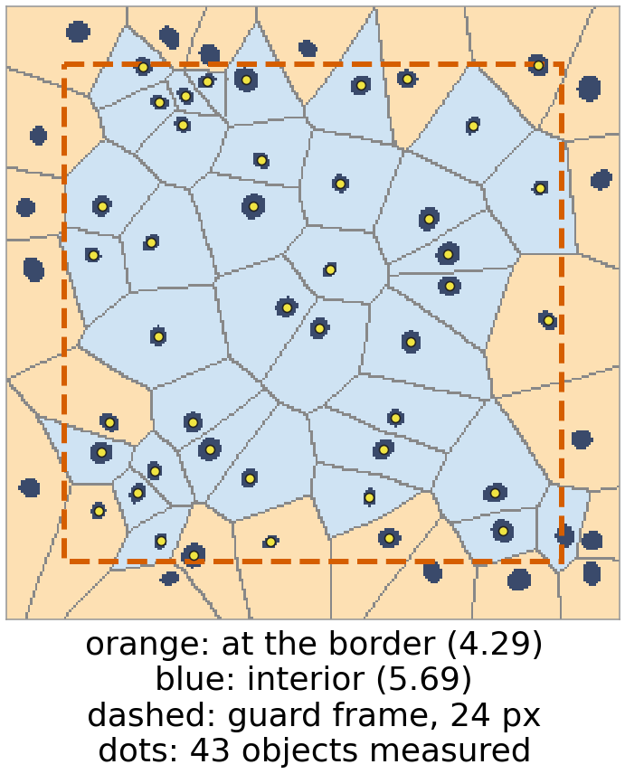
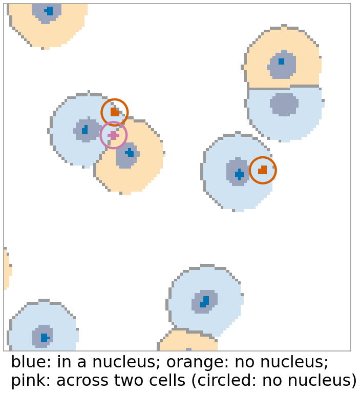
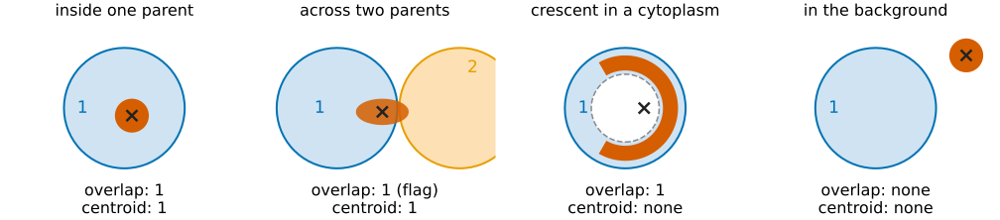
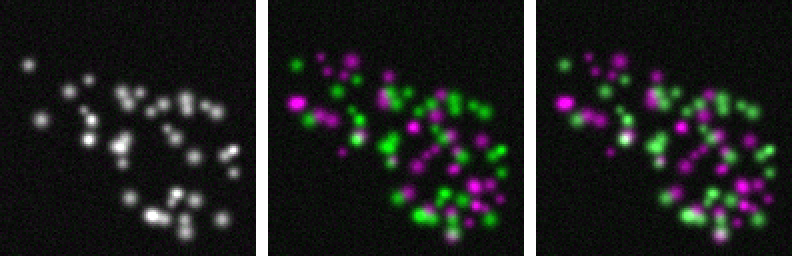

## About this lecture

So far every column described one object on its own. Many questions are about **relations**: how crowded is a cell, which nucleus does a spot belong to, are the cells clustered?

- Three definitions of **neighbour**, three different answers.
- Per object: **number of neighbours**, **percent touching**, first and second **closest**, the **angle** between them.
- Population: the **nearest-neighbour distance** against a random pattern (Clark–Evans), and the **border** problem.
- **Parents and children**: spots in nuclei, nuclei in cells; assignment by **overlap** or by **centroid**, and the cases in between.

*Slides titled **The math** give the formulas and proofs; the ideas are complete without them.*

::: notes
Third unit of the measurements day. Two kinds of "between" measurements: between objects (this unit) and between channels (one recall slide; colocalisation is taught on its own day, starting with `coloc/`). Both need a rule for which pixels or objects are paired, and both are easy to over-interpret. Region adjacency was met on the labelling day; the distance transform and its feature transform are the morphology day's.
:::

## Who is my neighbour?

Three common definitions, applied to the same 40 nuclei (demo, random placement):

- **Adjacent**: the segmented objects share a boundary (4- or 8-neighbouring pixels). Here the cell bodies, grown 9 px from the nuclei: **1.15** neighbours on average.
- **Within distance $r$**: the closest pixels of the two objects are at most $r$ apart. Nuclei, $r = 10$ px: **0.45**; $r = 20$: 1.45; $r = 30$: 2.45.
- **Expand until adjacent**: grow every object into the background until it meets another, so the whole image is divided among them. **4.90**.

{width="76%" fig-align="center" fig-alt="The same 40 randomly placed nuclei three times, with neighbour pairs joined by orange lines. Left: cell bodies grown 9 px from the nuclei; only touching bodies are neighbours, mean 1.15. Middle: nuclei within 20 px of each other, mean 1.45. Right: every nucleus expanded until it meets another, tiling the image; mean 4.90 neighbours."}

The answer is a property of the **definition** as much as of the cells. Report it with the number.

## Expand until adjacent

:::: {.columns}
::: {.column width="50%"}
Give every background pixel to the **nearest object** (the distance transform of the [morphology day](../morph-openclose/lec.qmd), keeping which object was nearest):

- The result tiles the image: a **Voronoi tessellation** of the objects. The boundaries are the midlines between objects, the same picture as the watershed of the distance transform ([watershed day](../ws-distance/lec.qmd)).
- Neighbours = objects whose regions touch. Every object gets some, however far apart the objects are.
- In the interior of a large random pattern the average is close to **6** (demo: 5.62 for interior objects).
- Cheap to compute: one exact distance transform with nearest-object labels.
:::
::: {.column width="50%"}
{width="100%" fig-alt="Left: the distance from every background pixel to the nearest of the 40 nuclei, dark near the nuclei and bright far away, with the region boundaries in white; they run along the ridges of the distance map, midway between neighbouring nuclei. Right: the same regions in tints, with the neighbour graph joining nuclei whose regions touch."}
:::
::::

## The math: Voronoi neighbours {.math}

The region of object $k$: $V_k = \{\mathbf x : d(\mathbf x, O_k) \le d(\mathbf x, O_j)\ \forall j\}$, with $d(\mathbf x, O) = \min_{\mathbf y \in O} \lVert \mathbf x - \mathbf y \rVert$.

- The feature transform gives, for every pixel, its nearest object pixel $\mathbf y^*(\mathbf x)$, and the label at $\mathbf y^*$ is the region. Same cost as the distance transform.
- For **points** as objects, the regions are convex polygons and the neighbour graph is the **Delaunay triangulation**, a planar graph. Euler's formula $V - E + F = 2$ with every face a triangle gives $E \le 3V - 6$, so the **mean degree** $2E/V < 6$.
- Regions at the image border are cut off, so border objects have fewer neighbours: a bias towards lower counts.

## Per-object relation columns

:::: {.columns}
::: {.column width="60%"}
| column | meaning |
|---|---|
| number of neighbours | for the chosen definition |
| percent touching | share of the object's boundary pixels that touch another object |
| first, second closest | label and centroid distance of the two nearest objects |
| angle between neighbours | angle at the object between the directions to those two |

Percent touching tells a cell in a dense sheet (close to 100 %) from one with a free edge. Distances are between **centroids** here; boundary-to-boundary distances are another choice.

The **neighbour graph**: objects as nodes, neighbours as edges. It was the region adjacency graph on the [labelling day](../label-measure/lec.qmd); the [graph cuts day](../maxflow/lec.qmd) uses graphs of pixels the same way.
:::
::: {.column width="40%"}
{width="100%" fig-alt="A close-up of one cell from the demo population. Lines join its nucleus centroid to the closest nucleus, 11.6 px away, and the second closest, 23.6 px away; an arc marks the angle of 71 degrees between them. The part of its cell-body boundary that touches other cells is pink: 47 percent of its boundary pixels."}
:::
::::

## Clustered, random or regular?

Compare the mean **nearest-neighbour distance** $\bar d$ with what a random (Poisson) pattern of the same density would give: the **Clark–Evans ratio**

$$R = \frac{\bar d_{\text{observed}}}{\bar d_{\text{random}}}, \qquad \bar d_{\text{random}} = \frac{0.5}{\sqrt{\rho}},\ \rho = \frac{\text{number of objects}}{\text{area}}.$$

- $R < 1$: **clustered**; $R \approx 1$: random; $R > 1$: **regular** (cells avoid each other).
- Demo (40 nuclei in 256 × 256 px, $\bar d_{\text{random}} = 20.2$ px): clustered **0.73**, random placement **1.11**, regular **1.86**.
- Why 1.11 and not 1: nuclei cannot overlap, so very short distances never occur. Real objects are never exactly Poisson.
- Whole distance distributions, edge corrections and tests: the [spatial statistics day](../point-patterns/lec.qmd) (day 19).

{width="60%" fig-align="center" fig-alt="Three patterns of 40 nuclei in 256 × 256 px, each nucleus with an orange arrow to its nearest neighbour. Clustered: short arrows inside a few groups, R = 0.73. Random placement: mixed lengths, R = 1.11. Regular: nuclei spread on a jittered grid with arrows of similar length, R = 1.86."}

## The math: the Poisson nearest neighbour {.math}

Points scattered independently with density $\rho$: the number in a disc of radius $r$ is Poisson with mean $\rho\pi r^2$.

- $P(D > r) = P(\text{no other point within } r) = e^{-\rho \pi r^2}$, so the density of the nearest-neighbour distance is $f(r) = 2\pi\rho r\, e^{-\rho\pi r^2}$ (the curve in the demo).
- $E[D] = \int_0^\infty P(D > r)\,dr = \int_0^\infty e^{-\rho\pi r^2} dr = \dfrac{1}{2\sqrt\rho}$.
- For $n$ points the standard error of $\bar d$ is $\approx 0.26136/\sqrt{n\rho}$, which gives a z-test for $R = 1$ (Clark & Evans, 1954).
- Edge effect: near the border the true nearest neighbour may be outside the image, so observed distances are too long and $R$ is biased upwards.

## Try it: neighbours

```{=html}
<link rel="stylesheet" href="../demos/dist/demo.css">
<div data-demo="neighbours" data-preset="adjacent"></div>
<script src="../demos/dist/neighbours.js"></script>
```

::: notes
Tour: "adjacent vs expanded": the readout gives all three means at once (1.15, 0.45, 4.90). Switch the definition and watch the graph. "within r": move r from 2 to 30; the mean goes 0 → 2.45. "clustered" (R = 0.73) and "regular" (R = 1.86): the NN histogram moves left or right of the dashed Poisson curve. In the regular pattern the grown cells never touch: 0 adjacent neighbours, 4.8 by expansion. Click a cell to see its row.
:::

## Objects at the image border

:::: {.columns}
::: {.column width="58%"}
Objects near the edge have **fewer** neighbours (part of their surroundings is not in the image), and their nearest neighbour may be outside.

- Demo (60 nuclei, expansion): interior objects 5.69 neighbours, objects whose region touches the border 4.29.
- **Remove** border objects before measuring: their neighbours lose a neighbour, and the new outer layer is biased instead.
- **Guard zone**: measure only objects whose centroid is at least $g$ from the border, but let all objects count as neighbours. Unbiased, at the cost of fewer measured objects (43 of 60 here, mean 5.63).

The same idea as the unbiased counting frame of the [labelling day](../label-measure/lec.qmd): decide which objects are **measured** separately from which ones **exist**.
:::
::: {.column width="42%"}
{width="100%" fig-alt="60 nuclei expanded until adjacent. Regions that reach the image border are orange (4.29 neighbours on average), interior regions blue (5.69). A dashed frame 24 px inside the border is the guard zone; yellow dots mark the 43 objects whose centroid lies inside it and that are measured."}
:::
::::

## Parents and children

:::: {.columns}
::: {.column width="62%"}
Objects of one kind inside objects of another: spots in nuclei, nuclei in cells, cytoplasm = cell minus nucleus.

- **Parent of a child** = the parent label with the **largest overlap**, or the label at the child's **centroid**.
- Per parent: **child count** ("spots per nucleus"), the mean or sum of a child feature, distances of children to the parent's centre or edge (normalised as in the radial rings of the [first unit](../intensity-features/lec.qmd)).
- Explicit cases: children **outside** any parent (spots in the cytoplasm when the parents are nuclei), children **across two parents**.
- **Overlap** of two objects A and B: the share of A inside B, the share of B inside A, and the Jaccard index $|A\cap B|/|A \cup B|$ (the [thresholding day](../seg-eval/lec.qmd)). Matching objects of two segmentations by overlap is the [evaluation day](../object-eval/lec.qmd).
:::
::: {.column width="38%"}
{width="100%" fig-alt="A close-up of the demo's cells with nuclei and small spots. Spots inside a nucleus are blue. Two spots lie in the cytoplasm, outside every nucleus (orange, circled), and one lies on the boundary between two touching cells (pink, circled)."}
:::
::::

## Overlap or centroid? {.smaller}

| child | overlap rule | centroid rule |
|---|---|---|
| entirely inside one parent | that parent | that parent |
| mostly in parent 1, a little in parent 2 | parent 1 (flag: touches 2) | parent 1 if the centroid is in it |
| crescent around the edge of a parent | the parent | **none**: the centroid falls outside |
| in the background | none | none |

{width="80%" fig-align="center" fig-alt="Four schematic children (red) with their centroid marked by a cross. Inside one parent: both rules give parent 1. Across two parents, mostly in 1: overlap gives 1 (flag), centroid gives 1. A crescent in a cytoplasm (cell minus nucleus) hugging the nucleus: overlap gives 1, but the centroid falls in the nucleus, outside the parent, so the centroid rule gives none. In the background: none for both."}

Demo (40 nuclei, 50 spots): with nuclei as parents, 5 spots have no parent (4 in the cytoplasm, 1 between two cells). With **cells** as parents, every spot has one, and one spot lies across two cells (63 % in one of them).

## The math: assignment {.math}

Child $c$ with pixels $C$, parents $P_1, \dots, P_m$:

$$\text{overlap rule: } \operatorname{parent}(c) = \arg\max_k |C \cap P_k| \ (\text{none if all are } 0), \qquad \text{centroid rule: } \operatorname{parent}(c) = L_P(\operatorname{round}(\bar{\mathbf x}_C)).$$

- Overlap fraction $|C \cap P_k|/|C|$: flag children below, say, 0.5, or with two non-zero overlaps.
- Both rules need **one pass** over the pixels: accumulate $|C \cap P_k|$ in a sparse table indexed by (child, parent).
- Child count per parent = number of children assigned to it; per-parent aggregates (mean child intensity, total child area) are sums over the same table.

## Two channels: colocalisation

{width="48%" fig-align="center"}

Two proteins in two channels: are they in the same place? **White in the merge is not evidence**: it depends on each channel's display range, on bleed-through (right panel) and on the resolution.

- The **scatter plot** of the two channels (one point per pixel) is the picture; Pearson's $r$ and Manders' M1/M2 summarise it, and they need a **region** (inside the cells) and **thresholds**.
- **Object-based** colocalisation is the parent–child relation of this unit: the share of spots of A whose centroid lies in an object of B, or within a distance of a B spot.
- Taught in the colocalisation day (day 44, Part VIII): [coefficients](../coloc/lec.qmd), [chance and tests](../coloc-null/lec.qmd), [objects and distances](../coloc-objects/lec.qmd), [confounds](../coloc-confounds/lec.qmd).

## Catalogue: relation columns

| column | unit | depends on |
|---|---|---|
| number of neighbours | – | definition (adjacent / within $r$ / expanded), connectivity |
| percent touching | % | the segmentation's boundaries |
| first and second closest distance | px (µm) | centroids or boundaries |
| angle between neighbours | ° | |
| parent label, child count | – | overlap or centroid rule |
| overlap fraction, Jaccard | – | |
| Clark–Evans $R$ (per image) | – | density, border handling |

Object-level colocalisation (the share of spots of one channel whose centroid lies in an object of the other) is the same parent–child relation; the [colocalisation day](../coloc/lec.qmd) does colocalisation pixel by pixel.

## Summary

- "Number of neighbours" depends on the **definition**: adjacent boundaries, closest pixels within $r$, or expansion until adjacent (a Voronoi tessellation, about 6 neighbours inside a random pattern).
- **Percent touching**, the **closest** objects and the **angle** between them are per-object relation columns.
- **Clark–Evans** $R$ compares the mean nearest-neighbour distance with a random pattern: $< 1$ clustered, $> 1$ regular.
- **Border** objects lose neighbours: use a guard zone, not removal.
- **Children** get a parent by largest overlap or by centroid; count, aggregate, and flag the children outside or across parents.
