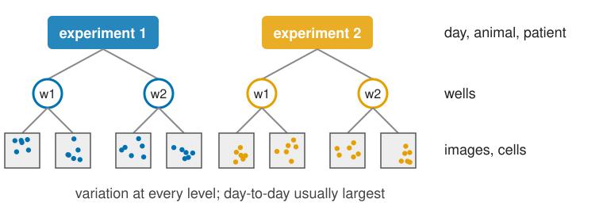
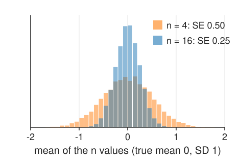
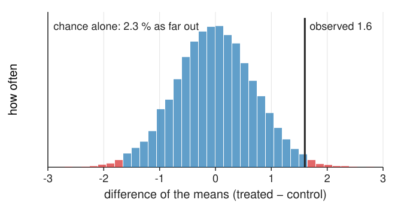
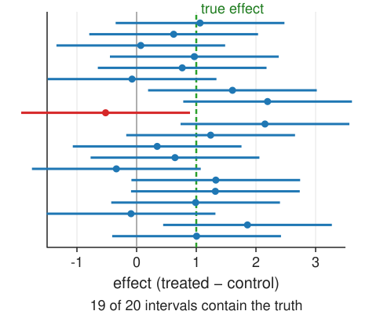
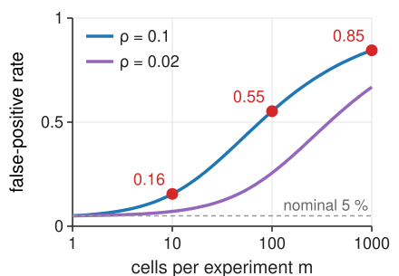
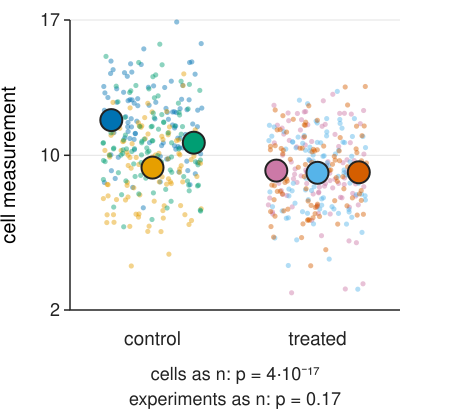
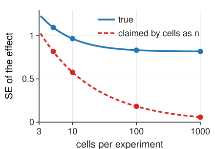
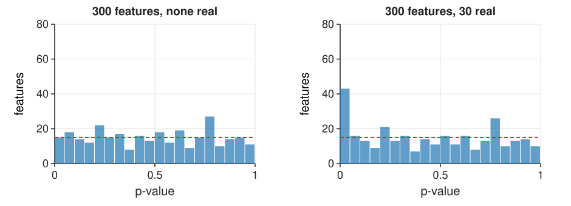
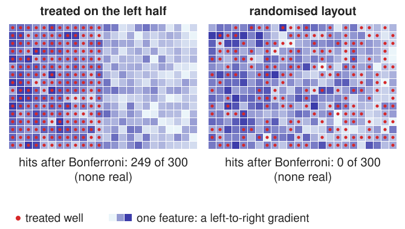

## About this lecture

Image analysis turns images into measurements: areas, intensities, counts, hundreds of features per cell. The usual question behind them: **does a treatment change a feature?**

- The new statistics, by simulation: **standard error**, **p-value**, **confidence interval**.
- The **unit of replication**, and **pseudoreplication**: why 1000 cells from one dish are one replicate.
- Do it right: **aggregate per experiment**, **paired** designs, the **SuperPlot**.
- **Effect sizes** with confidence intervals; **multiple comparisons** across many features.
- **Batch and plate effects**, and designs that are confounded beyond repair.

*Slides titled **The math** give the formulas and proofs; the ideas are complete without them.*

## The data are hierarchical {.nostretch}

A typical imaging experiment:

**cells** within **images** within **wells** within **experiments** (days, animals, patients)

{fig-alt="A tree: two experiments, each with two wells, each with two images holding cells coloured by experiment. Variation exists at every level; day-to-day is usually the largest." width=72% fig-align="center"}

- Variation exists at every level: cells differ, fields differ, wells differ, and **days differ**: a new batch of cells, medium, stain, a refocused microscope.
- The **day-to-day** variation is usually the largest, and it is shared by every cell measured that day.
- Treatment and control are compared within this hierarchy. Which differences count as evidence?

## A mean wobbles: the standard error

:::: {.columns}
::: {.column width="56%"}
Measure $n$ values with spread SD and take their mean. Repeat the whole experiment: the mean comes out a little different each time.

- The wobble of the mean is its **standard error**: $\text{SE} = \text{SD}/\sqrt n$. Four times as many values halve it.
- This holds for **independent** values. If they share a common deviation (the same day), it does not shrink below that shared part.

The difference of two means (treated − control) has $\text{SE} = \sqrt{\text{SE}_1^2 + \text{SE}_2^2}$.
:::
::: {.column width="44%"}
{fig-alt="Histograms of 10000 simulated means of values with SD 1: means of 4 values spread with SE 0.50 (orange), means of 16 values with SE 0.25 (blue), half as wide." width=100%}
:::
::::

## The p-value, by simulation

Suppose the treatment does **nothing**. How often would chance alone give a difference **at least as large** as the one observed?

{width=62%}

Four experiments per condition, experiment means with SD 1: the difference of the two means wobbles with SE 0.71. An observed difference of 1.6 or more (either sign) comes up in **2.3 %** of the simulated null experiments: $p = 0.023$.

A small p says "chance alone rarely does this". It says nothing about how large or important the effect is.

## The confidence interval

:::: {.columns}
::: {.column width="58%"}
**Estimate ± 2 SE** is a 95 % **confidence interval**: the range of true effects compatible with the data.

- Observed 1.6 with SE 0.71: about 0.2 to 3.0. The effect is probably positive, but could be small or large.
- The interval excludes 0 exactly when $p < 0.05$ (roughly); but it also shows the **size** and the **uncertainty** of the effect.
- With few replicates the factor 2 is too small: it grows to 2.78 for 5 values and 4.30 for 3 (math slide).
:::
::: {.column width="42%"}
{fig-alt="Twenty repeated experiments with true effect 1 (green dashed line) and SE 0.71: each estimate with its interval ± 2 SE. Nineteen intervals contain the true effect; one (red) misses it." width=100%}
:::
::::

## The math: t statistic and t-distribution {.math}

One sample $x_1, \dots, x_n$ with mean $\bar x$ and sample SD $s$: $\text{SE} = s/\sqrt n$ and

$$t = \frac{\bar x - \mu_0}{s / \sqrt n}.$$

If the $x_i$ are independent and normal with mean $\mu_0$, $t$ follows Student's **t-distribution** with $n - 1$ degrees of freedom: like the standard normal, but with heavier tails, because $s$ is itself estimated from few values. 95 % interval: $\bar x \pm t_{0.975,\,n-1}\, s/\sqrt n$, with $t_{0.975}$ = 4.30 (2 df), 2.78 (4 df), 2.07 (22 df), 1.96 ($\infty$).

Two groups (Welch): $t = (\bar y - \bar x)/\sqrt{s_x^2/n_x + s_y^2/n_y}$, degrees of freedom from the Welch–Satterthwaite formula. Paired data: a one-sample test on the differences $d_i = y_i - x_i$.

## The unit of replication

The **unit of replication** is the level at which the treatment was applied **independently**: the experiment, the animal, the well if wells were treated separately. **Not the cell.**

- 1000 cells from one dish are 1000 measurements of **one** replicate: they share the dish, the day, the stain.
- Treating cells as $n$ (**pseudoreplication**) makes the SE far too small, and p-values tiny even when there is no effect.
- In the demo below (3 experiments per condition, 100 cells each, day-to-day SD 1, cell-to-cell SD 2, **no effect**), the cells-as-$n$ test gives $p < 0.05$ in **69 %** of repeated experiments, instead of 5 %.

## The math: the two-level model {.math}

$y_{ec} = \mu + \tau\,T_e + u_e + \varepsilon_{ec}$ for cell $c$ of experiment $e$, with $u_e \sim N(0, \sigma_u^2)$ (day) and $\varepsilon_{ec} \sim N(0, \sigma^2)$ (cell), all independent.

Mean of the $m$ cells of experiment $e$: $\text{Var}(\bar y_e) = \sigma_u^2 + \sigma^2/m$. Mean of all $E\,m$ cells of a condition:

$$\text{Var}(\bar y) = \frac{\sigma_u^2}{E} + \frac{\sigma^2}{E\,m}, \quad\text{while cells-as-}n \text{ assumes } \frac{\sigma_u^2 + \sigma^2}{E\,m}.$$

Ratio $= 1 + (m - 1)\rho$, the **design effect**, with the intra-class correlation $\rho = \sigma_u^2/(\sigma_u^2 + \sigma^2)$. Effective number of cells: $n_{\text{eff}} = E\,m/(1 + (m-1)\rho) \to E/\rho$ as $m \to \infty$. More cells cannot beat the number of experiments.

## The math: how often cells-as-$n$ is fooled {.math}

:::: {.columns}
::: {.column width="58%"}
Under no effect, the cells-as-$n$ statistic $z = (\bar y_1 - \bar y_0)/\sqrt{2(\sigma_u^2 + \sigma^2)/(Em)}$ is normal with mean 0 but variance $1 + (m-1)\rho$, not 1. It rejects when $|z| > 1.96$:

$$P(\text{false positive}) = 2\,\Phi\!\left(-\frac{1.96}{\sqrt{1 + (m - 1)\rho}}\right).$$

$\rho = 0.1$: $m = 10$: 0.16; $m = 100$: $\sqrt{10.9} = 3.30$, $2\Phi(-0.59) = 0.55$; $m = 1000$: 0.85. (Large-$E$ approximation; with few experiments the t-test version behaves alike, as the demo shows.)
:::
::: {.column width="42%"}
{fig-alt="False-positive rate of the cells-as-n test against the number of cells per experiment (log axis), for intra-class correlation 0.1 and 0.02. For ρ = 0.1: 0.16 at 10 cells, 0.55 at 100, 0.85 at 1000; the nominal 0.05 is dashed." width=100%}
:::
::::

## Do it right

:::: {.columns}
::: {.column width="58%"}
- **Aggregate per replicate**: one number per experiment (mean or median of its cells), and test those $E$ numbers. Correct false-positive rate, and the effect is unchanged.
- **Pair** the design: control and treated in **every** experiment, compare within each. The day-to-day variation cancels; often far more power.
- **Mixed-effects models** do the same with all cells kept (a pointer: they model $u_e$ explicitly).
- Show it as a **SuperPlot**: cells as small dots coloured by experiment, experiment means as big markers, the statistics on the big markers.
:::
::: {.column width="42%"}
{fig-alt="A SuperPlot of simulated data with no treatment effect: 100 cells per experiment as small dots, coloured by experiment, 3 experiments per condition; the experiment means as large markers. Cells as n give p = 4·10⁻¹⁷; the experiment means give p = 0.17." width=100%}
:::
::::

## Try it: cells, experiments, pairs

```{=html}
<link rel="stylesheet" href="../demos/dist/demo.css">
<div data-demo="pseudorep" data-preset="cells" data-panels="superplot,ci,controls"></div>
<script src="../demos/dist/pseudorep.js"></script>
```

::: notes
Tour: "1000 cells, no effect" (3 experiments per condition, independent): cells as n: effect 0.65, p = 2.6e-31; experiments as n: same estimate, CI −2.27 to 3.57, p = 0.49. Over 1000 repetitions (exercise page): cells-as-n rejects in 89 %, experiments-as-n in 4 %. "More cells does not help" (true effect 1): power of the correct analysis 12.5 % with 1000 cells. "More experiments does": 10 experiments of 20 cells: 46 %. "Paired design wins": paired p = 0.023, unpaired means p = 0.43; power 84 % vs 14 %. "Confounded with the day": no treatment effect, but all treated experiments in a later batch shifted by 1.5: estimate 2.53, even the experiment-level test gives p = 0.029.
:::

## More cells or more experiments?

:::: {.columns}
::: {.column width="58%"}
The SE of the effect, with experiments as the unit, against the number of cells per experiment (3 experiments per condition, day-to-day SD 1, cell-to-cell SD 2):

| cells per experiment | 5 | 10 | 100 | 1000 |
|---|---|---|---|---|
| true SE | 1.10 | 0.97 | 0.83 | 0.82 |
| claimed by cells as $n$ | 0.82 | 0.58 | 0.18 | 0.06 |

- Beyond a few dozen cells the true SE **flattens out** at $\sigma_u\sqrt{2/E}$: the day-to-day variation dominates.
- More **experiments** shrink it like $1/\sqrt E$. A paired design removes $\sigma_u$ altogether.
- Cells-as-$n$ claims an SE that keeps shrinking: ever smaller p-values for the same evidence.
:::
::: {.column width="42%"}
{fig-alt="SE of the effect against cells per experiment (log axis): the true SE (blue) flattens at 0.82; the SE claimed by cells as n (red dashed) keeps falling, to 0.06 at 1000 cells." width=100%}
:::
::::

## The math: pairing removes the day {.math}

Paired design: both conditions in each experiment $e$. Difference of the experiment means:

$$D_e = \bar y_{e,T} - \bar y_{e,C} = \tau + (u_e - u_e) + (\bar\varepsilon_{e,T} - \bar\varepsilon_{e,C}), \qquad \text{Var}(D_e) = \frac{2\sigma^2}{m}.$$

The day effect $u_e$ cancels. Unpaired comparison of experiment means: $\text{Var} = 2(\sigma_u^2 + \sigma^2/m)$ per pair of experiments. Pairing wins whenever $\sigma_u^2 > 0$; it loses a little only through the degrees of freedom ($E - 1$ instead of $2E - 2$) when $\sigma_u$ is close to 0, or if the pairing is not real (control and treated not sharing the day).

## Effect size and confidence interval first

"Treated cells were significantly larger (p < 0.0001, n = 2400)" says nothing useful:

- How much larger? "**12 % larger** (95 % CI 4 to 20 %)" says what matters.
- What is $n$? "n = 4 independent experiments, 600 cells each" names the unit of replication.
- p < 0.0001 with 2400 cells as $n$ is pseudoreplication; with enough cells any tiny difference becomes "significant".

For comparing features with different units, a **standardised effect**: the difference divided by the SD (of experiment means, or of cells, say which).

## Many features: multiple comparisons

Image-based profiling measures hundreds of features. Test 300 features with no real effect at $\alpha = 0.05$: about **15 "hits"** by chance.

{width=80%}

- Under no effect, p-values are **uniform**: a flat histogram (left: 15 below 0.05, all false). Real effects add a spike near 0 (right: 30 real features).
- **Bonferroni**: test each at $\alpha/m$. Controls the chance of **any** false hit. Strict: left 0 hits; right 13 hits, all real.
- **Benjamini–Hochberg** (BH): controls the **fraction** of false hits among the hits (the false discovery rate). Right: 24 hits, 2 of them false.
- Picking the best-looking feature after the fact is the same mistake as tuning on the test set.

## The math: Bonferroni and Benjamini–Hochberg {.math}

$m$ tests, all null, independent, level $\alpha$: $P(\text{at least one false hit}) = 1 - (1 - \alpha)^m$: 0.64 for $m = 20$, 0.99996 for $m = 200$.

**Bonferroni.** Reject when $p_i \le \alpha/m$. By the union bound, without any independence assumption:
$$P\Big(\bigcup_{i \text{ null}} \{p_i \le \alpha/m\}\Big) \le \sum_{i \text{ null}} \frac{\alpha}{m} \le \alpha.$$

**Benjamini–Hochberg** at level $q$: sort $p_{(1)} \le \dots \le p_{(m)}$; find the **largest** $k$ with $p_{(k)} \le k\,q/m$; reject the $k$ smallest. Then $E[\text{false hits}/\max(\text{hits}, 1)] \le q$ (for independent or positively dependent tests; stated without proof). Example: 0.001, 0.004, 0.012, 0.02, 0.03, 0.2, … with $m = 10$: lines 0.005, 0.010, 0.015, 0.020, 0.025: $k = 4$.

## Try it: many features on a plate

```{=html}
<link rel="stylesheet" href="../demos/dist/demo.css">
<div data-demo="featurescan" data-preset="confounded" data-panels="plate,rank,controls"></div>
<script src="../demos/dist/featurescan.js"></script>
```

::: notes
A 384-well plate, 300 features. Tour: "300 null features": 15 uncorrected hits, Bonferroni and BH 0. "10 % real": uncorrected 43 (14 false), Bonferroni 13 (all real), BH 24 (2 false). "gradient + treated on the left": a left-to-right gradient, treated wells on the left half: 281 of 300 features "significant" at 0.05, 249 even after Bonferroni, none of them real. The plate map of the smallest-p feature shows the gradient. "Randomised layout": the same gradient, random layout: no hits after correction (37 uncorrected).
:::

## Batch and plate effects

:::: {.columns}
::: {.column width="50%"}
Day, plate, row and column, the **edge wells** (evaporation), the order of imaging (focus drift, bleaching): all change the measurements.

- If **all controls** are on day 1 and **all treated** on day 2, the treatment effect is **confounded** with the day: no statistics can separate them. More cells, more wells, any test: it stays an experiment about days.
- The cures are in the **design**: every batch contains every condition; **randomise** the plate layout; controls on **every** plate; image in a randomised or balanced order.
- Then normalise against the controls of each plate (the measurements day shows how) and analyse per plate or per experiment.
:::
::: {.column width="50%"}
{fig-alt="Two 384-well plate maps of one feature with a left-to-right gradient; red dots mark treated wells. Left: treated wells on the left half: 249 of 300 features are hits after Bonferroni, none real. Right: randomised layout: 0 hits." width=100%}
:::
::::

## A reporting checklist

1. $n$ at every level (experiments, wells, images, cells), and which one is the **unit of replication**.
2. How values were **aggregated** (mean or median per well, per experiment).
3. **Effect size with a confidence interval**, not only a p-value.
4. **Correction** for multiple testing, and how many features were tested.
5. The **design**: pairing, randomisation, plate layout, batches.
6. How the image analysis was **validated**: the split (the leakage unit), who annotated (the agreement unit).
7. Images and analysis parameters available.

## Summary

- Standard error = the wobble of an estimate; **p-value** = how often chance alone gives a result this extreme; **95 % CI** ≈ estimate ± 2 SE.
- The **unit of replication** is the independently treated unit (experiment, animal, well), not the cell. **Cells as $n$** gives false positives far above 5 %.
- **Aggregate per replicate**, or **pair** the design; show a **SuperPlot**. More experiments help, more cells hardly.
- Report **effect sizes with CIs**.
- Many features: about $\alpha m$ false hits; correct with **Bonferroni** (any false hit) or **Benjamini–Hochberg** (false discovery rate).
- **Batch and plate effects** confounded with the treatment cannot be fixed afterwards: randomise and balance the design.
