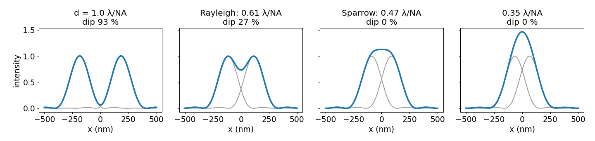
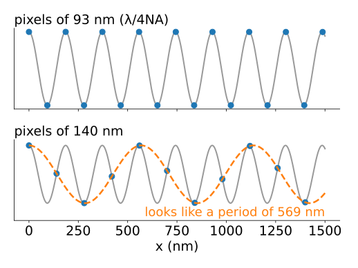
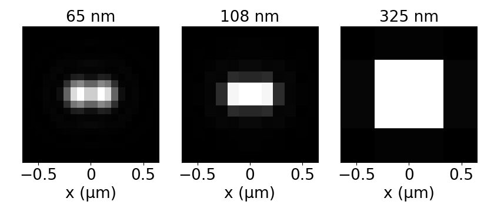
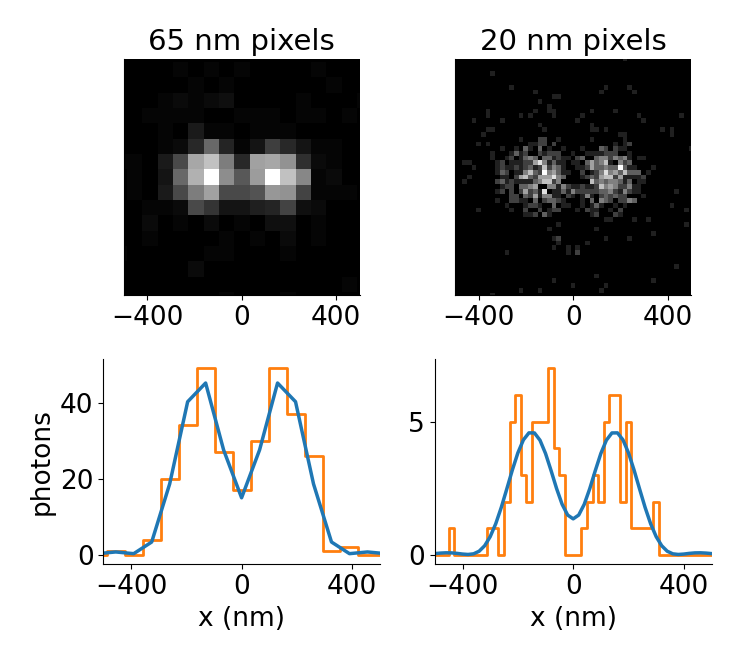
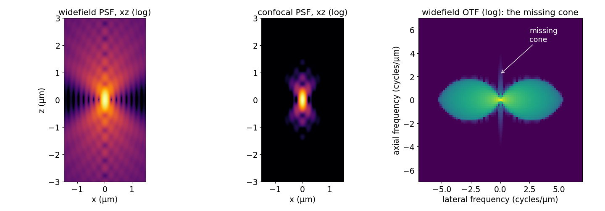
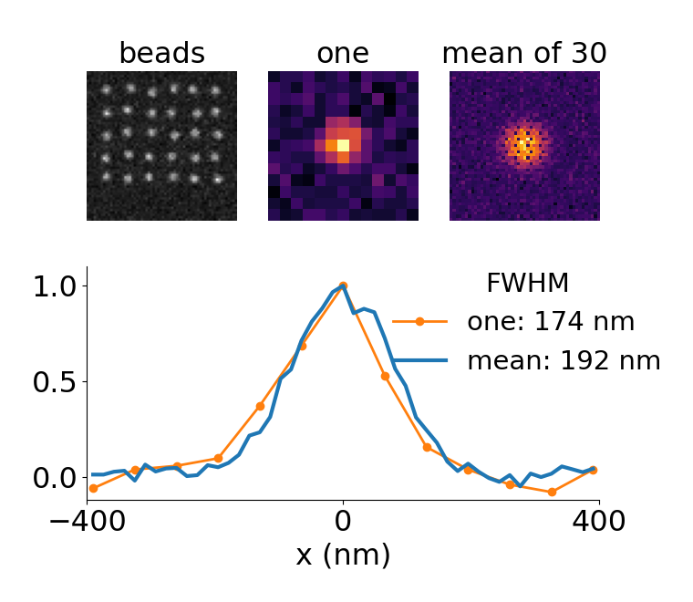

## About this lecture

Last unit: the optics pass nothing above $2\mathrm{NA}/\lambda$. Now the practical consequences:

- When are two points **resolved**? Rayleigh, Sparrow, and why **noise** decides in practice.
- How large may a **pixel** be? **Nyquist** for a microscope: $\Delta x \le \lambda/4\mathrm{NA}$.
- In **3D** the PSF is **longer along the optical axis**; widefield images have a **missing cone**.
- How to **measure** a PSF from beads, and what limits the measurement.

*Slides titled **The math** give the formulas and proofs; the ideas are complete without them.*

::: notes
Second unit of the image formation day. Recalls: Nyquist "two samples per cycle" and aliasing (frequency unit, day 1), shot noise and read noise (camera noise unit, day 3). Numbers use λ = 520 nm (green) unless stated. The demo "resolve" has three modes: two points, axial, beads.
:::

## Two points

Move two equal points closer together: the dip between their peaks shrinks, then vanishes.

{width="100%"}

- **Rayleigh**: the peak of one point on the first dark ring of the other, $d = 0.61\lambda/\mathrm{NA}$. The dip is **26 %**.
- **Sparrow**: the dip just vanishes, $d = 0.47\lambda/\mathrm{NA}$ (176 nm at NA 1.4).
- Resolution is a **convention**. In practice **noise** decides: a 26 % dip on top of 2 photons per pixel is invisible.

## The math: Rayleigh and Sparrow {.math}

Two equal points at $\pm d/2$, profile through both: $I(x) = h(x - d/2) + h(x + d/2)$.

- **Rayleigh**: $h$ is the Airy pattern $[2J_1(v)/v]^2$ with $v = 2\pi\mathrm{NA}\,r/\lambda$; put $d$ on its first zero, $v = 3.832$. At the midpoint each point contributes $h$ at $v = 1.916$: $[2J_1(1.916)/1.916]^2 = 0.367$, so $I(0) = 0.735$ against a peak of about 1: a dip of $1 - 0.735 = 26\,\%$.
- **Sparrow**: the midpoint changes from a maximum to a minimum when its curvature changes sign:
$$I''(0) = 2h''(d/2) = 0.$$
The two profiles add up flat at the midpoint exactly when $d/2$ is at the inflection point of $h$.
- Gaussian PSF $h \propto e^{-x^2/2\sigma^2}$: $h'' = 0$ at $x = \sigma$, so Sparrow is $d = 2\sigma$. With $\sigma = 0.21\lambda/\mathrm{NA}$: $0.42\lambda/\mathrm{NA}$. For the Airy pattern, solved numerically: $0.47\lambda/\mathrm{NA}$.

## Try it: two points on pixels

```{=html}
<link rel="stylesheet" href="../demos/dist/demo.css">
<div data-demo="resolve" data-preset="rayleigh"></div>
<script src="../demos/dist/resolve.js"></script>
```

::: notes
Two points imaged by an ideal lens (NA 1.4, 520 nm) on a 2 × 1 µm field. Blue: the optical image (no pixels, no noise); red: the pixel values along the line through both points. Tour: "Rayleigh" (227 nm, 40 nm pixels): dip 26.8 % in the optical image, 25.6 % in the pixels. "Sparrow" (176 nm): no dip. "Rayleigh, 20 photons" (65 nm pixels, noise on): about 2 photons in the peak pixel; the pixel profile is noise, the dip can be anything. Raise the photons to 2000: the dip comes back (23 %). Change λ to 650 nm at d = 227 nm: the dip drops to 0.6 %; at 450 nm it is 51 %.
:::

## Recall: two samples per cycle

From the frequency unit: a signal must be sampled at least **twice per period** of its finest component; faster patterns **alias** to false slow ones. That slide already said: *the optics of a microscope should match the pixel size.* Now we can say how.

:::: {.columns}
::: {.column width="52%"}
- The optics deliver **nothing above** $2\mathrm{NA}/\lambda$: the image is band-limited.
- Two samples per period of the finest component: pixel $\Delta x \le \dfrac{1}{2}\cdot\dfrac{\lambda}{2\mathrm{NA}} = \dfrac{\lambda}{4\mathrm{NA}}$. **Nyquist for a microscope.**
- The pixel that counts is the pixel **in the sample plane**: camera pixel ÷ magnification.
:::
::: {.column width="48%"}
{width="100%"}
:::
::::

## Nyquist in numbers

Camera with 6.5 µm pixels, λ = 520 nm:

| objective | pixel in the sample | Nyquist $\lambda/4\mathrm{NA}$ | verdict |
|---|---|---|---|
| 100× / 1.4 | 65 nm | 93 nm | fine (3.5 pixels across the Rayleigh distance) |
| 60× / 1.4 | 108 nm | 93 nm | slightly undersampled (1.2×) |
| 20× / 0.75 | 325 nm | 173 nm | undersampled by 1.9× |
| 10× / 0.3 | 650 nm | 433 nm | undersampled by 1.5× |

:::: {.columns}
::: {.column width="50%"}
- **Undersampled**: fine periodic structure **aliases** (false stripes, moiré), and the camera, not the lens, sets the resolution.
- Low-magnification objectives are often undersampled on purpose: a large field of view matters more there.
:::
::: {.column width="50%"}
{width="100%"}
:::
::::

## The math: Nyquist from the OTF support {.math}

The image is $g = f \ast h$, so $G = FH$ and $G(\mathbf k) = 0$ wherever $H(\mathbf k) = 0$: the image is **band-limited** to $|\mathbf k| \le k_c = 2\mathrm{NA}/\lambda$.

- Sampling theorem: a band-limited function is determined by samples with spacing $\Delta x \le 1/(2k_c) = \lambda/(4\mathrm{NA})$ (per axis).
- Along the optical axis, the widefield OTF extends to $k_z = \dfrac{n}{\lambda}(1 - \cos\alpha)$, with $\sin\alpha = \mathrm{NA}/n$. So
$$\Delta z \le \frac{\lambda}{2n(1 - \cos\alpha)}.$$
NA 1.4 in oil ($n = 1.518$): $\cos\alpha = 0.386$, $\Delta z \le 279$ nm. NA 0.8 in air: 650 nm.
- For small NA, $1 - \cos\alpha \approx \mathrm{NA}^2/2n^2$, so $\Delta z \le n\lambda/\mathrm{NA}^2$.

## Oversampling is not free

:::: {.columns}
::: {.column width="55%"}
Smaller pixels than Nyquist add no detail (the optics deliver none), but they cost:

- The **same photons** are spread over **more pixels**: fewer photons per pixel, a noisier pixel (shot noise $\sqrt N$, plus **read noise per pixel**; recall the camera noise unit).
- Larger files, slower acquisition, and more **bleaching** per useful piece of information.

Example (demo): two points 300 nm apart, 500 photons each. With 65 nm pixels the peak pixel holds about 50 photons (noise ±14 %); with 20 nm pixels about 6.5 photons (±39 %).

The usual compromise: **2–3 pixels across the Rayleigh distance**. Deconvolution (next day) needs at least Nyquist.
:::
::: {.column width="45%"}
{width="100%"}
:::
::::

## The PSF in 3D

{width="100%"}

- The PSF is **elongated** along the optical axis $z$. NA 1.4: FWHM 191 nm across, 515 nm along (2.7×); NA 0.8 in air: 335 nm and 1.17 µm (3.5×).
- Rule of thumb for the axial extent: $2n\lambda/\mathrm{NA}^2$ (for small NA; at NA 1.4 the exact value, 0.56 µm, is smaller than the rule's 0.8 µm).
- **Widefield**: every plane carries the **same total light**; out-of-focus light is spread, not removed. The OTF has a **missing cone**: no optical sectioning.
- **Confocal**: a pinhole rejects out-of-focus light; PSF ≈ (excitation PSF) × (detection PSF): narrower, and the cone is filled.

## Try it: the axial PSF

```{=html}
<link rel="stylesheet" href="../demos/dist/demo.css">
<div data-demo="resolve" data-mode="axial" data-preset="na14"></div>
<script src="../demos/dist/resolve.js"></script>
```

::: notes
xz slice of the PSF of an ideal lens (scalar model), computed from the pupil one plane at a time; right panel: the same PSF as a stack with planes every Δz. Tour: "NA 1.4": lateral FWHM 191 nm, axial 515 nm (2.7×), axial Nyquist 279 nm, z-step 200 nm is fine. "Z-step too large" (1 µm): the planes miss the focus region; the red dots skip the peak. "Out-of-focus light (log)": the hourglass: light from one point reaches every plane. "Confocal": lateral 138 nm, axial 369 nm, and the hourglass is gone. "NA 0.5 (air)": 535 nm and 3.4 µm (6.4×).
:::

## Measuring a PSF from beads {.smaller}

:::: {.columns}
::: {.column width="60%"}
Image **sub-resolution fluorescent beads** (100 nm or smaller), then:

1. subtract the **background** (camera offset, autofluorescence);
2. find each bead's centre with **sub-pixel** accuracy (e.g. its centroid);
3. shift every bead to a common centre and **average** many of them;
4. normalise to sum 1. Report the **FWHM**.

What limits it:

- **Bead size**: the image is PSF ∗ bead. A bead of diameter $D$ widens the measured PSF roughly like an extra blur of FWHM $0.53D$: $\text{FWHM}_\text{meas}^2 \approx \text{FWHM}_\text{PSF}^2 + (0.53D)^2$.
- **Noise**: averaging $N$ beads reduces it by $\sqrt N$. **Background** left in widens the PSF. **Pixels** coarser than Nyquist blur the average.
- **Measured vs computed**: the measured PSF contains the real aberrations of your microscope (often asymmetric along $z$); a computed one is noise-free but idealised.
:::
::: {.column width="40%"}
{width="100%"}
:::
::::

## The math: averaging beads {.math}

- Bead $i$ gives $b_i = h + e_i$ after centring, with independent noise of variance $\sigma^2$ per pixel. The mean $\bar b = h + \tfrac1N\sum e_i$ has noise variance $\sigma^2/N$: standard deviation $\sigma/\sqrt N$. 30 beads: $1/\sqrt{30} = 0.18$ of one bead's noise.
- A bead is a uniform sphere of radius $R$; seen from above, its brightness is the projected thickness $\propto \sqrt{R^2 - r^2}$. The image is PSF ∗ projection.
- **Variances add** under convolution (for any normalised, centred profiles). Along $x$, a uniform sphere has variance $R^2/5$. A Gaussian with that variance has FWHM $2.355\,R/\sqrt5 = 0.53D$. Treating the PSF as Gaussian too:
$$\text{FWHM}_\text{meas}^2 \approx \text{FWHM}_\text{PSF}^2 + (0.53\,D)^2.$$
- A 100 nm bead and a 191 nm PSF: $\sqrt{191^2 + 53^2} = 198$ nm (+4 %). A 200 nm bead: 218 nm (+14 %).

## Try it: beads

```{=html}
<link rel="stylesheet" href="../demos/dist/demo.css">
<div data-demo="resolve" data-mode="beads" data-preset="one"></div>
<script src="../demos/dist/resolve.js"></script>
```

::: notes
Simulated bead slide: 30 beads of 40 nm, NA 1.4, 520 nm, 65 nm pixels, 500 photons per bead, background 10 photons per pixel, seeded Poisson noise. "True PSF" = a point as these pixels record it (FWHM 195 nm; the optical Airy FWHM is 191 nm). Tour: "one bead, noisy": 204 nm (+4.6 %), lumpy. Slide the number of beads: it scatters between 188 and 206 nm up to 5 beads, then settles: 30 beads give 194 nm. "Forgot the background": 223 nm (+14.3 %), a pedestal under the curve. "Beads too large" (200 nm beads, 2000 photons): 215 nm.
:::

## Summary

- **Rayleigh** $0.61\lambda/\mathrm{NA}$ (26 % dip), **Sparrow** $0.47\lambda/\mathrm{NA}$ (no dip): conventions. With few photons, noise decides.
- **Nyquist for a microscope**: pixel in the sample plane $\le \lambda/4\mathrm{NA}$ (93 nm at NA 1.4, 520 nm). Undersampling aliases; oversampling costs photons per pixel.
- **3D**: the PSF is about 3–6× longer along $z$ than across; axial Nyquist $\lambda/2n(1 - \cos\alpha)$. Widefield has a **missing cone**; confocal removes out-of-focus light.
- **Beads**: background subtraction, sub-pixel centring, averaging ($\sqrt N$), normalisation. Bead size adds about $(0.53D)^2$ to the squared FWHM.
