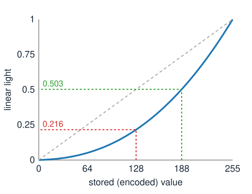

## Goal

By the end of this exercise you should be able to:

- decode and encode sRGB values, and explain why blurring, resizing and averaging belong in **linear light**,
- build the **RGB → XYZ matrix** of a display from its primaries and white point,
- compute luminance, luma and **Y′CbCr**, and the saving of chroma subsampling,
- correct a colour cast with a **diagonal matrix** (white balance), and say when it fails.

Do the pen-and-paper part first, then the demos. Questions marked *(math)* are for those who want the derivations; the concept questions do not depend on them.

## Background

| Idea | What it means |
|---|---|
| sRGB decoding | code $C \in [0, 1]$ → light: $C/12.92$ for $C \le 0.04045$, else $((C + 0.055)/1.055)^{2.4}$ |
| Linear light | values proportional to light; sums and averages of light are meaningful |
| RGB → XYZ | $\mathbf{XYZ} = M\,\mathbf{rgb}_\text{lin}$; columns of $M$ = XYZ of the primaries; $M(1,1,1)^\top$ = white |
| Luminance | $Y = 0.2126R + 0.7152G + 0.0722B$ on linear sRGB |
| Luma | $Y' = 0.299R' + 0.587G' + 0.114B'$ on encoded values |
| Y′CbCr (JPEG) | $C_b = 128 + 0.564(B' - Y')$, $C_r = 128 + 0.713(R' - Y')$, on codes 0–255 |
| White balance | $\mathbf c' = D\mathbf c$, $D$ diagonal, scales the estimated white to white; on linear values |

{width="55%"}

## By hand

**B1.** (a) Decode the 8-bit codes 0, 128, 188 and 255 to linear light (divide by 255 first).
(b) A pixel is the average of a black and a white pixel. What code do you get by averaging the codes? By averaging the light and encoding the result?
(c) An image is darkened to half its light. What happens to a pixel with code 200? Is the new code 100?

**B2.** A toy display has primaries with chromaticities R $(0.6, 0.3)$, G $(0.3, 0.6)$, B $(0.2, 0.1)$ and the white point $(1/3, 1/3)$ (equal energy: $X = Y = Z = 1$).
(a) Write the vectors $\mathbf p_k = (x_k/y_k,\; 1,\; (1 - x_k - y_k)/y_k)$ of the three primaries.
(b) Find the scales $s_R, s_G, s_B$ such that $s_R\mathbf p_R + s_G\mathbf p_G + s_B\mathbf p_B = (1, 1, 1)$.
(c) Write the matrix $M$. Check that each row sums to 1. What are this display's luminance weights?

**B3.** Compute $Y'$, $C_b$ and $C_r$ (codes 0–255) of (a) pure red $(255, 0, 0)$, (b) mid-grey $(128, 128, 128)$. What happens to $C_r$ of red in 8 bits?

**B4.** A $1920 \times 1080$ image is stored with 8 bits per value. How many bytes does it take as RGB (or Y′CbCr 4:4:4)? With 4:2:0 chroma subsampling? With the luma subsampled 2 × 2 instead, and full chroma?

**B5.** A photo under a light bulb has linear channel means $(\bar R, \bar G, \bar B) = (0.30, 0.20, 0.10)$.
(a) Grey world: find the gains $(g_R, g_G, g_B)$ that make the three means equal to $\bar G$.
(b) Correct the pixel $(0.45, 0.30, 0.08)$.
(c) Someone applies the same gains to the stored codes instead. Give one reason why the result is wrong.

**B6.** The isoluminant test image: letters with linear $(R, G, B) = (0.841, 0, 0)$ on a background $(0, 0.25, 0)$.
(a) Compute the luminance of both.
(b) Encode both colours to codes (use: $0.841 \to 236$, $0.25 \to 137$). Compute luma and the channel mean of the codes for both. Which greyscale shows the letters?

::: {.callout-note collapse="true" title="Solutions"}
**B1.** (a) $0 \to 0$; $128/255 = 0.502 \to 0.216$; $188/255 = 0.737 \to 0.503$; $255 \to 1$.
(b) Averaging codes: $127.5$, about 128, which is 21.4 % of white's light. Averaging light: $0.5$, encoded $1.055 \cdot 0.5^{1/2.4} - 0.055 = 0.735$, code **188**. The naive average is far too dark.
(c) Code 200 is light $0.578$; half of that is $0.289$, which encodes to code **146**, not 100. Code 100 would be only 12.7 % of white, a darkening to less than a quarter of the light.

**B2.** (a) $\mathbf p_R = (2, 1, 1/3)$, $\mathbf p_G = (0.5, 1, 1/6)$, $\mathbf p_B = (2, 1, 7)$.
(b) Solving the $3 \times 3$ system gives $s_R = 13/60 = 0.217$, $s_G = 2/3 = 0.667$, $s_B = 7/60 = 0.117$. Check, middle row: $0.217 + 0.667 + 0.117 = 1$.
(c) $M = \begin{pmatrix} 0.433 & 0.333 & 0.233 \\ 0.217 & 0.667 & 0.117 \\ 0.072 & 0.111 & 0.817 \end{pmatrix}$, columns $s_k\mathbf p_k$. Each row sums to 1 because $M(1,1,1)^\top$ is the white $(1, 1, 1)$. The luminance weights are the middle row: $0.217, 0.667, 0.117$.

**B3.** (a) $Y' = 0.299 \cdot 255 = 76.2$; $C_b = 128 + 0.564(0 - 76.2) = 85.0$; $C_r = 128 + 0.713(255 - 76.2) = 255.5$. In 8 bits it is clipped to 255 (the coefficients are rounded; the exact standard gives 255.5 too, and encoders clip).
(b) $Y' = 128$, and $B' - Y' = R' - Y' = 0$: $C_b = C_r = 128$. Every grey sits at the centre of the chroma plane.

**B4.** RGB: $1920 \cdot 1080 \cdot 3 = 6\,220\,800$ bytes. 4:2:0: luma $2\,073\,600$ plus two chroma planes of $960 \cdot 540 = 518\,400$ each: $3\,110\,400$ bytes, half. Luma subsampled instead: $518\,400 + 2 \cdot 2\,073\,600 = 4\,665\,600$ bytes; it saves less and looks far worse.

**B5.** (a) $g = (0.20/0.30,\; 1,\; 0.20/0.10) = (0.667, 1, 2)$.
(b) $(0.45 \cdot 0.667,\; 0.30,\; 0.08 \cdot 2) = (0.30, 0.30, 0.16)$.
(c) The lamp multiplied the **light** by a factor per channel; codes are a power-law function of light, so multiplying codes by $g$ multiplies the light by about $g^{2.2}$ for midtones and by other factors near black: the cast is removed for one brightness only. (Also, grey world itself assumes an average grey scene.)

**B6.** (a) Letters: $0.2126 \cdot 0.841 = 0.179$. Background: $0.7152 \cdot 0.25 = 0.179$. Equal: the luminance image is uniform, the letters vanish.
(b) Codes: letters $(236, 0, 0)$, background $(0, 137, 0)$. Luma: $0.299 \cdot 236 = 70.6$ against $0.587 \cdot 137 = 80.4$: low contrast but visible. Channel mean: $78.7$ against $45.7$: the letters are clearly brighter. The mean (or the R channel alone) shows them.
:::

### Math questions

**B7.** *(math)* For a display with primary vectors $\mathbf p_k$ (middle entry 1) and white $\mathbf w$ with $Y_w = 1$, let $M = P\operatorname{diag}(\mathbf s)$ with $P\mathbf s = \mathbf w$. Show that $M(1,1,1)^\top = \mathbf w$ and that the middle row of $M$ is $\mathbf s^\top$, so the luminance weights sum to 1.

**B8.** *(math)* Let $d(C)$ be the sRGB decoding function on $[0, 1]$. Show that $d$ is convex (above the knee it is a power 2.4 of an affine function). Use Jensen's inequality to show that for any set of codes, $d(\text{mean of codes}) \le \text{mean of } d(\text{codes})$: averaging codes never gives more light than averaging the light, and gives less unless all codes are equal.

**B9.** *(math)* White balance by a full matrix: given $n$ chart colours $\mathbf c_i$ (columns of $C$, $3 \times n$) and their targets $\mathbf t_i$ (columns of $T$), show that $M = TC^\top(CC^\top)^{-1}$ minimises $\sum_i \|M\mathbf c_i - \mathbf t_i\|^2$. When is $CC^\top$ invertible?

::: {.callout-note collapse="true" title="Solutions (math)"}
**B7.** $M(1,1,1)^\top = P\operatorname{diag}(\mathbf s)(1,1,1)^\top = P\mathbf s = \mathbf w$. Entry $(2, k)$ of $M$ is $(\mathbf p_k)_2\,s_k = s_k$. The luminance weights sum to $\sum_k s_k = (M(1,1,1)^\top)_2 = Y_w = 1$.

**B8.** For $C > 0.04045$, $d(C) = ((C + 0.055)/1.055)^{2.4}$ has $d''(C) = 2.4 \cdot 1.4\,(C + 0.055)^{0.4}/1.055^{2.4} > 0$; below the knee $d$ is linear, and at the knee the slope does not drop ($1/12.92 = 0.0774$ on the left, $2.4 \cdot (0.09545/1.055)^{1.4}/1.055 = 0.0787$ on the right), so $d$ is convex on $[0, 1]$. Jensen: $d(\frac1n\sum C_i) \le \frac1n\sum d(C_i)$, with equality for a strictly convex part only if all $C_i$ are equal. Black and white: $d(0.5) = 0.214 < 0.5$.

**B9.** $E(M) = \|MC - T\|_F^2 = \operatorname{tr}\big((MC - T)(MC - T)^\top\big)$. Its gradient with respect to $M$ is $2(MC - T)C^\top$; setting it to zero gives $MCC^\top = TC^\top$, so $M = TC^\top(CC^\top)^{-1}$. $E$ is a convex quadratic in $M$, so this stationary point is the minimum. $CC^\top$ ($3 \times 3$) is invertible iff $C$ has rank 3: the chart colours must not all lie in one plane through the origin (e.g. not only greys, not only two hues).
:::

## Explore: blur in linear light {#explore}

The same operation is done twice: on the stored codes ("on encoded values") and as decode → operate → encode ("in linear light"). Operations: a Gaussian blur with standard deviation $\sigma$, or block-average downsampling by 2 or 4 (shown at the original size). The plot shows a profile along the dashed row (click or drag on an image to move it): the R′, G′ or B′ code, or the code of the luminance. The readout gives the mean luminance (light) of the input and both results. *Show linear values directly* puts the linear values on the screen without encoding.

```{=html}
<link rel="stylesheet" href="../demos/dist/demo.css">
<div data-demo="gammablur" data-preset="stripes"></div>
<script src="../demos/dist/gammablur.js"></script>
```

**G1.** Preset **black + white = 128 or 188?** What value do the blurred stripes get on codes, and in linear light? Compare with B1. Look at the input from a distance (or squint): which of the two uniform grey patches on the right matches the stripes on your screen?

**G2.** In the same preset, how much of the image's light does the blur on codes lose, and how much does the linear-light blur lose?

**G3.** Preset **red meets green: the dark seam**. Describe the border in the two results. Look at the luminance profile: how dark does the seam get on codes, compared with the red and green squares?

**G4.** Preset **blurred lights lose their glow**. What happens to the small bright lights on codes? How much light is lost? Then try **downsample ×4** on the same image.

**G5.** Preset **downsampling darkens fine detail** (thin lines, ×4). How much darker is the result on codes? Why does the *red/green checker* with **downsample ×2** show no difference at all?

**G6.** Tick **show linear values directly**. Why does everything look too dark and too contrasty?

::: {.callout-note collapse="true" title="Solutions"}
**G1.** 128 on codes and 188 in linear light, as in B1. On a screen that follows sRGB, the stripes match the lower patch (188), not the upper one (128). (A projector or a mis-set screen may not follow sRGB; that is why the numbers are shown.)

**G2.** The mean luminance drops from 0.4297 to 0.2883 on codes (−32.9 %); in linear light it is 0.4316 (+0.5 %, an effect of the mirrored border at the edge of the stripes). The blur in linear light keeps the light, as a blur of light must.

**G3.** On codes the border becomes a dark, muddy olive band (codes about 111, 144, 0 at the border); in linear light it is a bright yellow transition (176, 198, 0). The luminance profile on codes dips to 107, darker than both the red (127) and the green (220); in linear light it never goes below 127.

**G4.** On codes the lights become small and dim: the largest R′ code drops from 255 to 127 (in linear light 168), and the image loses 62.8 % of its light (linear light: +0.3 %). Downsampling ×4 on codes loses 30.6 %, in linear light nothing.

**G5.** On codes the mean luminance falls from 0.1645 to 0.0511 (−69.0 %); in linear light it stays 0.1645. With the checker and ×2 the blocks never mix two colours (the 32-pixel squares are aligned with the 2 × 2 blocks), so both methods average equal values: the error appears only where different values are mixed.

**G6.** The linear values are written to the screen, which then decodes them a second time: every value is darkened by the transfer curve once more (code 0.5 shows as 21.6 % of white). This is why linear data, e.g. from a camera's raw file or a microscope, must be encoded (or shown with a display transfer) to look natural.
:::

## Explore: colour as a matrix {#explore-matrix}

The input image (synthetic), the three output channels as grey images, and the recombined result. **Y′CbCr**: the channels Y′, Cb, Cr (128 = mid-grey); subsample the chroma or the luma by 2, 4 or 8 (one value per block) and rebuild R′G′B′; the readout gives the bytes per pixel and the mean colour difference ΔE\*ab to the input (about 2 is just noticeable). **Greyscale**: weights for R, G, B (normalised to sum 1) on linear or on encoded values; the readout gives the mean grey of the two classes. **Any matrix**: a $3 \times 3$ matrix plus an offset on linear RGB (edit the cells), with the pixels pushed outside $[0, 1]$ shown in white.

```{=html}
<link rel="stylesheet" href="../demos/dist/demo.css">
<div data-demo="colourmatrix" data-preset="ycc"></div>
<script src="../demos/dist/colourmatrix.js"></script>
```

**M1.** Preset **Y′CbCr channels**. Which channel carries the shapes and the shading? What do Cb and Cr show for the grey card and the table?

**M2.** **Subsample chroma by 4**, then **subsample luma by 4**. Which looks worse? Compare the mean ΔE\*ab of the two. Does ΔE\*ab capture what you see?

**M3.** **The isoluminant test** (greyscale). Check B6 with the luminance, luma, mean and "G only" buttons. Which greyscale would you use to find the letters?

**M4.** **Stained tissue: best single channel**. Compare the contrast between nuclei and the rest (the two mean greys) for G only, the channel mean, R only and luminance. Which single channel is best, and why?

**M5.** **sRGB → XYZ** (any matrix). What are the row sums, and what do they mean? Then **P3 → sRGB: out of gamut**: what share of the pixels falls outside $[0, 1]$, and which objects are they?

::: {.callout-note collapse="true" title="Solutions"}
**M1.** Y′ carries the shapes, the shading and the shadow: it looks like a black-and-white photo. Cb and Cr are flat mid-grey (128) on the grey card and nearly so on the table; they are bright or dark only on coloured objects (Cr bright on the red apple, Cb dark on the yellow fruit, bright on the blue cup), and the shadow hardly shows in them.

**M2.** Luma ÷4 looks clearly worse (blocky edges everywhere), chroma ÷4 is hard to tell from the input. Yet the mean ΔE\*ab is 2.18 for chroma ÷4 and only 1.87 for luma ÷4. A mean colour difference does not weigh errors the way the eye does: the eye is much more sensitive to errors in fine brightness detail (edges) than to colour bleeding across them. Bytes per pixel: 1.125 with chroma ÷4.

**M3.** Luminance: letters and background both 117.3: the letters vanish. Luma: 70.6 against 80.4 (faint). Mean: 78.8 against 45.7. G only: 0 against 137 (the strongest contrast). To find the letters, use G only (or R only, or the mean), not luminance.

**M4.** G only: nuclei 88.2, rest 171.7 (difference 83.5). Mean: 139.1 against 217.3 (78.2). R only: 141.5 against 241.2 (99.7). Luminance: 112.6 against 195.4 (82.8). Here the R channel separates best: hematoxylin absorbs red strongly while eosin hardly does, so the nuclei are dark in R and the pink stroma bright. Note that the nuclei are also darker than the stroma in G, but the eosin-stained stroma is darker there too.

**M5.** Row sums 0.9505, 1.0001, 1.0888: the XYZ of the white R = G = B = 1, i.e. D65 (the middle row sums to 1: white has luminance 1). P3 → sRGB: 2507 of 16 384 pixels (15.3 %) end up outside $[0, 1]$: the saturated red apple, green leaf, yellow fruit and blue cup. Read as P3 colours they are more saturated than sRGB can show.
:::

## Explore: white balance {#explore-wb}

A chart of 24 patches with known (synthetic) reflectance spectra, rendered under a lamp (top left: *as captured*), corrected (middle), and the truth: the same chart under daylight. The lamp's spectrum is shown below. **Estimate the white** by grey world, white patch, a grey card (click a patch of the captured chart) or skip the estimate and fit a full 3 × 3 matrix to the chart. **Diagonal scaling applied to**: encoded sRGB, linear RGB, cones (von Kries) or the Bradford basis. The readout gives the mean ΔE\*ab over the patches against the truth (exposure is matched, so it measures the colour error; about 2 is just noticeable).

```{=html}
<link rel="stylesheet" href="../demos/dist/demo.css">
<div data-demo="whitebalance" data-preset="tungsten"></div>
<script src="../demos/dist/whitebalance.js"></script>
```

**W1.** Preset **tungsten 2800 K** (no correction). What is the mean ΔE\*ab? Now choose **grey card** (the third grey of the bottom row is selected) with **cones (von Kries)**, then **Bradford**, **linear RGB** and **encoded sRGB**. Rank the four.

**W2.** Preset **grey world works**. Compare grey world with the grey card in the same basis. Why does grey world do almost as well on this chart?

**W3.** Preset **grey world in a forest**. What colour cast does the correction produce, and what is the mean ΔE\*ab? Choose **white patch**: better or worse? Why?

**W4.** Preset **white patch fooled by a highlight**. What does the white patch estimate as "white"? Compare with the same setting without the highlight, and with the grey card.

**W5.** Preset **narrow-band LED: no diagonal fixes it**. How good is the best diagonal (try the bases)? And the 3 × 3 fit? Why can no correction be perfect here?

**W6.** Choose the grey card with Bradford and move the blackbody temperature: 2000, 4000, 6500 and 10 000 K. Where is the correction easiest, and why?

::: {.callout-note collapse="true" title="Solutions"}
**W1.** No correction: 44.08. Grey card: Bradford 5.31 < cones 7.61 < linear RGB 11.20 < encoded sRGB 14.99. Scaling codes is the worst (B5c); among the linear bases, the sharper, more cone-like channels work best.

**W2.** Grey world (cones): 9.01, grey card (cones): 7.61. The chart contains many different hues and a row of greys, so its average is close to grey and the grey-world estimate of the white (0.330, 0.157, 0.036) is close to the grey card's direction (0.360, 0.159, 0.042).

**W3.** The leaves turn grey and the bark and sky magenta-pink: mean ΔE\*ab 22.62 (worst patch 46.85). The forest's average is green, and grey world removes it. The white patch (a white flower is in the scene) gives 6.08: the brightest values really are a white surface here.

**W4.** It takes the clipped highlight as white: estimate (1.000, 1.000, 0.352) instead of about (0.90, 0.40, 0.12); mean ΔE\*ab 24.61. Without the highlight the white patch gives 8.19; the grey card gives 7.61 with or without it. A clipped highlight reads "white" whatever the lamp's colour.

**W5.** Grey card: 10.62 with cones, 10.36 with Bradford (no correction: 12.81). The 3 × 3 fit: 4.66, with the worst patch at 13.67. Three narrow peaks sample each reflectance at only three wavelengths, and surfaces with different spectra between the peaks collapse onto the same responses (and vice versa): the information is lost before any $3 \times 3$ correction, diagonal or not. This is metameric failure on a large scale.

**W6.** Mean ΔE\*ab with grey card and Bradford: 9.06 at 2000 K, 2.47 at 4000 K, 0.71 at 6500 K, 2.16 at 10 000 K. At 6500 K the lamp is close to daylight (the reference), so little correction is needed and the diagonal model's error is small; the further the lamp from daylight, the more the broad, overlapping channels break the diagonal model.
:::

## Where this leads

Linear light and $3 \times 3$ matrices are the toolkit for the rest of the day. The next unit asks which space makes a colour **segmentation** easy: HSV (hue as an angle) and CIELAB (distances that match perception). Brightfield stains absorb rather than add light; in optical density they add up again, and separating them is the subject of the **spectral unmixing** elective.
