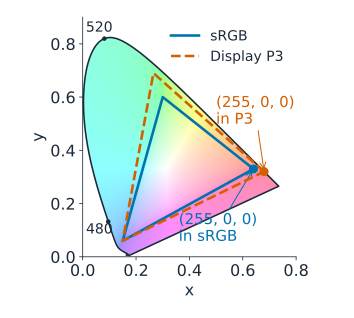
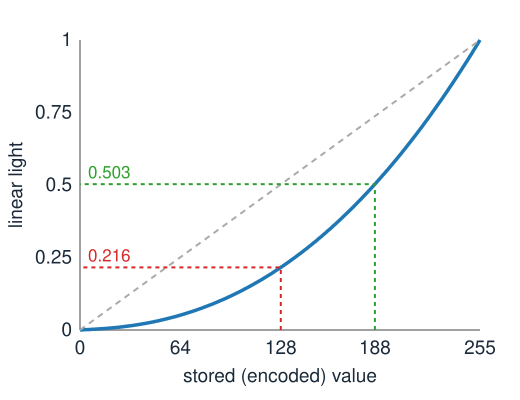
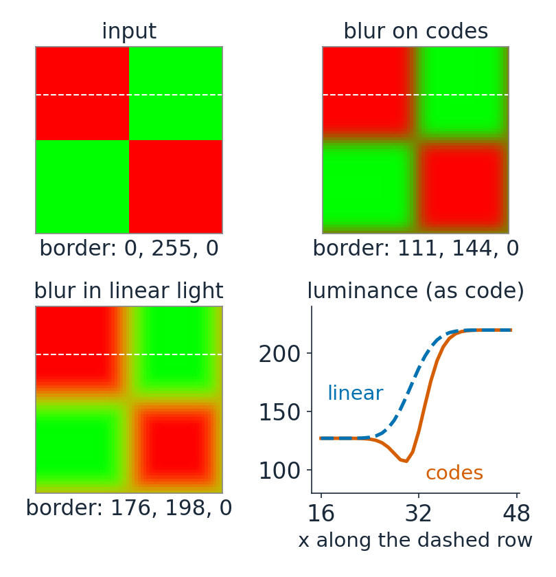
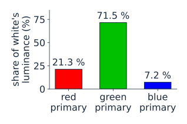
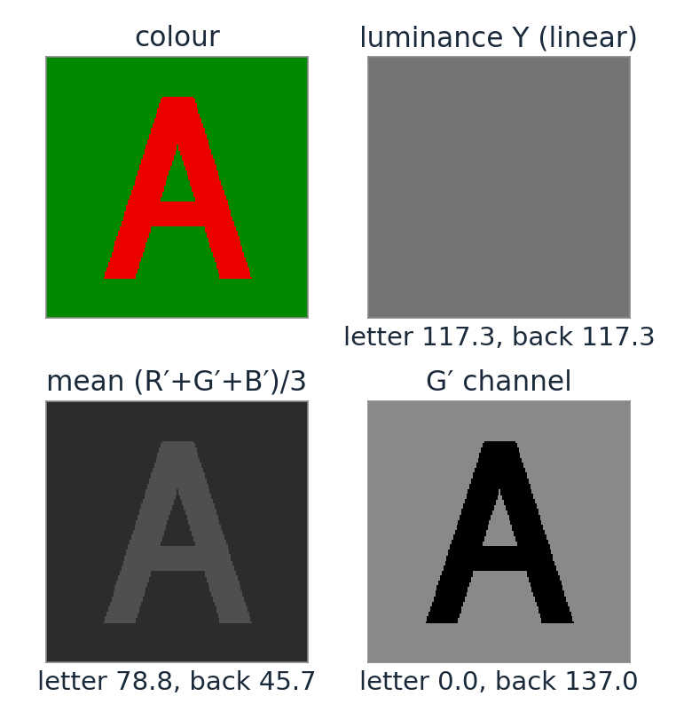
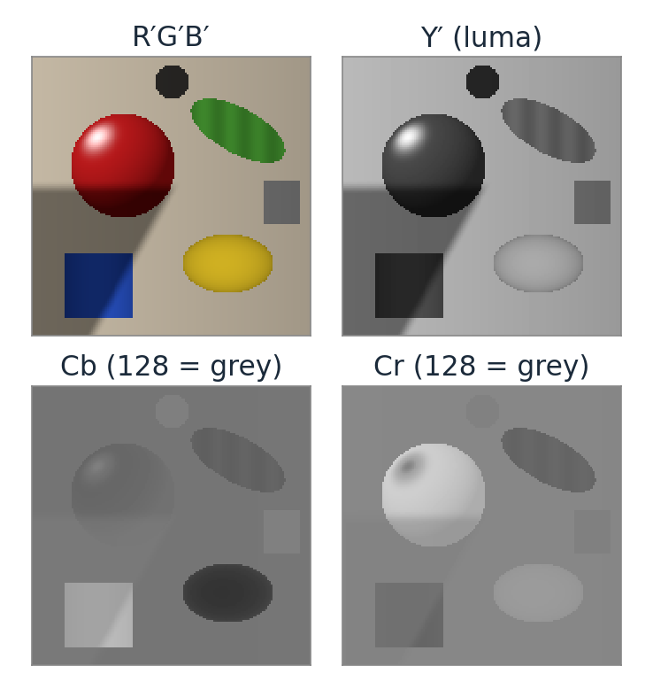
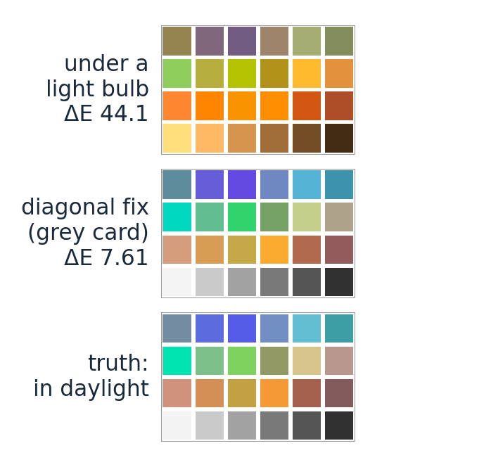
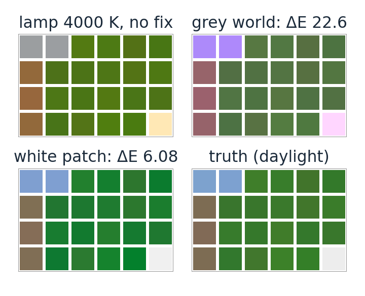

## About this lecture

Last unit: colour is three numbers, a linear map of a spectrum. Today: what the three numbers **in an RGB file** are.

- RGB is a **device** space: "full red" means *this display's* red.
- Stored values are **gamma-encoded**: not proportional to light. Blurring, resizing and averaging must be done on **linear** values.
- Changing colour space is a **3 × 3 matrix**: RGB → XYZ, → luminance, → Y′CbCr (with chroma subsampling).
- **White balance**: undoing the lamp with a **diagonal** matrix, and when that fails.

*Slides titled **The math** give the formulas and proofs; the ideas are complete without them.*

::: notes
Recall from the bit-depth day (highbit/): an 8-bit photograph stores sRGB codes, not light. Today explains why those codes exist. Everything here is linear algebra on 3-vectors, except the transfer curve, a function of one variable.
:::

## RGB is a device space

:::: {.columns}
::: {.column width="56%"}
"(255, 0, 0)" means: **full drive of this display's red primary**. Without knowing the primaries and the white, it is not a colour.

- **sRGB** fixes everything: the three primaries (the triangle of the last unit), the white point **D65**, and a **transfer curve** from stored values to light.
- An untagged 8-bit image, a web page and the browser canvas are assumed to be sRGB.
- A wide-gamut photo (Display P3) with the same numbers is a **different, more saturated** colour.
- A camera's raw data and a microscope's detector are **linear** and in the **camera's own** RGB: each sensor has its own three curves.
:::
::: {.column width="44%"}
{width="100%" fig-alt="Chromaticity diagram with the sRGB triangle and the larger Display P3 triangle; the code (255, 0, 0) is the red corner of each, two different reds."}
:::
::::

## Gamma encoding

:::: {.columns}
::: {.column width="48%"}
{width="100%"}
:::
::: {.column width="52%"}
The stored value is **not** proportional to the light. The display decodes it with a curve close to a power 2.4.

- **Why**: perceived lightness is roughly the cube root of light. Equal steps of stored value are roughly equal **visible** steps, so 8 bits suffice without banding in the darks.
- Stored **128** is only **21.6 %** of white's light. Half of white's light is stored as **188**.
- JPEG photos are **encoded**; raw camera data and microscope images are **linear**.
:::
::::

## The math: the sRGB transfer function {.math}

Stored value $C \in [0, 1]$ (the 8-bit code divided by 255), linear light $C_\text{lin} \in [0, 1]$:

$$C_\text{lin} = \begin{cases} C / 12.92, & C \le 0.04045 \\[2pt] \left(\dfrac{C + 0.055}{1.055}\right)^{2.4}, & C > 0.04045 \end{cases} \qquad C = \begin{cases} 12.92\,C_\text{lin}, & C_\text{lin} \le 0.0031308 \\[2pt] 1.055\,C_\text{lin}^{1/2.4} - 0.055, & \text{else.} \end{cases}$$

- A short straight piece near black (no infinite slope at 0), then a power 2.4 with an offset. Overall it is close to a pure power 2.2.
- $128/255 = 0.502 \to 0.216$; $188/255 = 0.737 \to 0.503$; $C_\text{lin} = 0.5 \to C = 0.735$, code 187.5.
- Decode with a 256-entry lookup table; encode by the formula (or a finer table).

## Why it matters: light adds, codes do not

:::: {.columns}
::: {.column width="56%"}
Blur, resampling, averaging and mixing **add up light**. Done on encoded values they are wrong:

- **Black + white**: the average of 0 and 255 is 128 in codes, but the average **light** is 0.5, code **188**. A fine black/white stripe pattern looks like 188 from a distance, not 128.
- **Blurred highlights** lose their glow; small bright lights shrink and dim.
- **Red meets green**: blurring on codes gives a **dark, muddy** seam (codes 111, 144, 0 at the border instead of 176, 198, 0).
- **Downsampling** fine bright detail on a dark background **darkens** the image.
:::
::: {.column width="44%"}
{width="100%" fig-alt="A red and green checkerboard blurred twice. Blurred on the stored codes, the border between red and green becomes a dark muddy seam, codes 111, 144, 0; blurred in linear light it stays bright, codes 176, 198, 0. A plot of the luminance along a row shows the dip on codes."}
:::
::::

Rule: **decode → operate → encode**. In quantitative work, never measure intensities on gamma-encoded exports.

## Try it: blur in linear light

```{=html}
<link rel="stylesheet" href="../demos/dist/demo.css">
<div data-demo="gammablur" data-preset="stripes"></div>
<script src="../demos/dist/gammablur.js"></script>
```

::: notes
Same blur twice: on the stored codes (middle) and decode → blur → encode (right); the profile is along the dashed row. Tour: "black + white = 128 or 188?": the blurred stripes come out 128 (codes) and 188 (light). Squint at the input: which uniform patch matches the stripes? (On a well-behaved screen, the bottom one, 188; a projector may disagree.) Mean luminance: codes lose 32.9 %, linear keeps it. "red meets green": a dark seam on codes (luminance profile dips to 107, below both the red at 127 and the green at 220). "blurred lights": codes lose 62.8 % of the light. "downsampling ×4" on thin lines: −69.0 %.
:::

## Linear maps between colour spaces

In **linear** RGB a colour is a mix of the display's three primaries:

$$\text{colour} = R \cdot \text{(red primary)} + G \cdot \text{(green primary)} + B \cdot \text{(blue primary)}.$$

So XYZ is a **matrix** times linear RGB; for sRGB:

$$\begin{pmatrix} X \\ Y \\ Z \end{pmatrix} = \begin{pmatrix} 0.4124 & 0.3576 & 0.1805 \\ 0.2126 & 0.7152 & 0.0722 \\ 0.0193 & 0.1192 & 0.9505 \end{pmatrix} \begin{pmatrix} R \\ G \\ B \end{pmatrix}.$$

::: {.smaller}
:::: {.columns}
::: {.column width="60%"}
- **Columns**: the XYZ of each primary at full drive. **Middle row**: the **luminance** weights; green carries 72 % of the brightness, blue only 7 %.
- Display A → display B: $M_B^{-1}M_A$, a change of basis. Colours outside B's gamut get components $< 0$ or $> 1$: they must be **clipped** (or mapped inwards).
:::
::: {.column width="40%"}
{width="100%" fig-alt="Bar chart of the luminance of each sRGB primary at full drive as a share of white: red 21.3 %, green 71.5 %, blue 7.2 %."}
:::
::::
:::

## The math: the matrix from primaries and white point {.math}

Primary $k$ with chromaticity $(x_k, y_k)$ has XYZ proportional to $\mathbf p_k = (x_k/y_k,\; 1,\; (1 - x_k - y_k)/y_k)$. Unknown: its brightness $s_k$. Require that R = G = B = 1 gives the white $\mathbf w$ (with $Y_w = 1$):

$$M = \begin{pmatrix} \mathbf p_R & \mathbf p_G & \mathbf p_B \end{pmatrix}\operatorname{diag}(s_R, s_G, s_B), \qquad \begin{pmatrix} \mathbf p_R & \mathbf p_G & \mathbf p_B \end{pmatrix}\mathbf s = \mathbf w .$$

- One $3 \times 3$ linear system for the three scales; the scales are the middle row of $M$ (the luminance weights), since the middle entry of every $\mathbf p_k$ is 1.
- sRGB: primaries $(0.64, 0.33)$, $(0.30, 0.60)$, $(0.15, 0.06)$, white $(0.3127, 0.3290)$ give the matrix on the previous slide.
- The display-design demo of the last unit computes exactly this.

## Converting to grey is a choice

:::: {.columns}
::: {.column width="58%"}
One colour image, four greys:

- **Luminance** $Y = 0.2126R + 0.7152G + 0.0722B$ on **linear** RGB: the physically right brightness.
- **Luma** $Y' = 0.299R' + 0.587G' + 0.114B'$ on **encoded** values: the video standard, an approximation.
- **Channel mean** $(R + G + B)/3$: treats the eye as equally sensitive to blue. Simple, often wrong.
- **One channel**: often the best for analysis. In stained tissue or fluorescence, pick the channel with the **contrast** you need.

Test: red letters on a green background of **equal luminance** vanish in the luminance image but not in the mean. "Greyscale" is a projection, and you choose its direction.
:::
::: {.column width="42%"}
{width="100%" fig-alt="A red letter A on a green background of equal luminance, converted to grey four ways: in the luminance image letter and background are both 117.3 and the letter vanishes; the channel mean gives 78.8 against 45.7; the G channel shows the letter dark on light."}
:::
::::

## Opponent channels and Y′CbCr

:::: {.columns}
::: {.column width="58%"}
The visual system recodes the cone signals into one **brightness** and two **colour-difference** channels (red–green, blue–yellow), and it sees the colour differences with **less detail**.

**Y′CbCr** (JPEG, video) does the same with a matrix on encoded R′G′B′:

- **Y′**: luma; **Cb** ∝ B′ − Y′, **Cr** ∝ R′ − Y′, stored around 128.
- **Chroma subsampling** (4:2:0): keep Cb and Cr at half resolution in both directions. Half the data, almost invisible. Subsampling Y′ the same way is obvious.
- Same idea as the low-pass filtering in the Fourier unit: drop the detail the eye does not use.
:::
::: {.column width="42%"}
{width="100%" fig-alt="A synthetic scene of shaded fruit, a leaf and a blue cup, and its Y′, Cb and Cr channels: Y′ holds the shading and all the detail; Cb and Cr are mostly mid-grey, bright or dark only on the coloured objects."}
:::
::::

## The math: Y′CbCr as an affine map {.math}

$$\begin{pmatrix} Y' \\ C_b \\ C_r \end{pmatrix} = \begin{pmatrix} 0.299 & 0.587 & 0.114 \\ -0.1687 & -0.3313 & 0.5 \\ 0.5 & -0.4187 & -0.0813 \end{pmatrix}\begin{pmatrix} R' \\ G' \\ B' \end{pmatrix} + \begin{pmatrix} 0 \\ 128 \\ 128 \end{pmatrix}$$

- Rows 2 and 3 are (to rounding) $0.564\,(B' - Y')$ and $0.713\,(R' - Y')$: the coefficients of each row sum to zero, so every grey has $C_b = C_r = 128$.
- Invertible: decoding is the inverse matrix after removing the offset. 4:2:0 stores $1 + 2 \cdot \tfrac14 = 1.5$ values per pixel instead of 3.
- Because it acts on **encoded** values, Y′ is luma, not luminance.

## Try it: colour as a matrix

```{=html}
<link rel="stylesheet" href="../demos/dist/demo.css">
<div data-demo="colourmatrix" data-preset="chroma4"></div>
<script src="../demos/dist/colourmatrix.js"></script>
```

::: notes
Y′CbCr channels of the synthetic objects scene (Cb, Cr with 128 as mid-grey). Tour: "subsample chroma by 4": hard to see any change; mean ΔE*ab 2.18, at 1.125 bytes per pixel. "subsample luma by 4": blocky edges at once, although the mean ΔE is smaller (1.87): the eye is far more sensitive to brightness detail than mean ΔE suggests. Then "greyscale" → "the isoluminant test": luminance gives 117.3 for both letter and background; switch to mean (78.8 vs 45.7). "any matrix" → "P3 → sRGB": 15.3 % of the pixels fall outside [0, 1].
:::

## White balance: undoing the lamp

:::: {.columns}
::: {.column width="56%"}
The same white paper is orange under a light bulb and blue in shade; our eyes **adapt** and still call it white (**colour constancy**). A camera does not.

- Camera responses: $\mathbf c = A\,\operatorname{diag}(\text{lamp})\,\mathbf r$. We want the colours under a reference light (daylight, D65).
- **von Kries** (1902): scale each channel separately, $\mathbf c' = D\,\mathbf c$ with $D = \operatorname{diag}(w_\text{ref}/w)$, where $w$ is the response to a **white** under the current lamp. A **diagonal matrix**.
- Apply it to **linear** values: on encoded values a scaling of light is not a scaling of codes.
- Works best in a basis close to the cones (or "sharpened" cone-like channels, as in the Bradford transform).
:::
::: {.column width="44%"}
{width="100%" fig-alt="A chart of 24 coloured patches three times: under a light bulb everything is orange (mean colour error ΔE 44.1); after a diagonal correction from a grey card it is close to the truth (ΔE 7.61); the truth is the chart in daylight."}
:::
::::

::: notes
The charts are the white-balance demo's synthetic chart (presets "tungsten 2800 K", then grey card with the cone basis); ΔE*ab is the mean over the 24 patches.
:::

## Estimating the white

:::: {.columns}
::: {.column width="54%"}
The correction needs $w$, the camera's response to white under this lamp:

- **Grey world**: assume the scene averages to grey; $w$ = the mean of each channel. Fails when one colour dominates: a forest turns grey-magenta.
- **White patch** (max-RGB): assume the brightest values are white. Fails with a clipped highlight, which is "white" whatever the lamp.
- **A grey card** (or a known white area) in the image: the most reliable.
- In microscopy: the **blank-field** reference (light with no specimen) is a per-pixel white balance; the same idea as flat-field correction.
:::
::: {.column width="46%"}
{width="100%" fig-alt="A forest chart, mostly greens and browns, under a 4000 K lamp: grey world turns it magenta (mean ΔE 22.6), the white patch method gets close (ΔE 6.08), compared with the truth in daylight."}
:::
::::

## The math: diagonal in which basis? {.math}

Diagonal scaling in a basis given by an invertible $B$ (rows: XYZ → cone-like channels), written in linear RGB:

$$\mathbf c' = M_{\text{XYZ}\to\text{RGB}}\,B^{-1}\,\operatorname{diag}\!\left(\frac{B M\,\mathbf w_\text{ref}}{B M\,\mathbf w}\right) B\,M\,\mathbf c, \qquad M = M_{\text{RGB}\to\text{XYZ}} .$$

- $B = I$ (on RGB): the camera channels; $B$ = cone matrix: von Kries; $B$ = Bradford's "sharpened" matrix: narrower channels, usually the most accurate diagonal.
- Exact only if the lamp change acts diagonally in that basis, which needs narrow-band channels. Broad, overlapping sensitivities (and metameric failure) leave an error.
- With a known chart: fit a full $3 \times 3$ matrix by least squares, $\min_M \sum_i \|M\mathbf c_i - \mathbf t_i\|^2$, i.e. $M = TC^\top(CC^\top)^{-1}$.

## Try it: white balance

```{=html}
<link rel="stylesheet" href="../demos/dist/demo.css">
<div data-demo="whitebalance" data-preset="tungsten"></div>
<script src="../demos/dist/whitebalance.js"></script>
```

::: notes
A chart of 24 patches with known reflectance spectra (synthetic), rendered under the lamp; truth = the same chart under daylight. ΔE*ab ≈ 2 is just noticeable. Tour: "tungsten 2800 K": no correction, mean ΔE 44.1. Grey card (click the third grey), cones: 7.61; Bradford: 5.31; encoded: 14.99. "grey world in a forest": 22.6 (magenta cast); white patch there: 6.08. "white patch fooled by a highlight": 24.6. "narrow-band LED": grey card 10.6, and even the 3×3 fit leaves 4.66.
:::

## Forward pointer: stains absorb

Brightfield microscopy is different: **stains absorb** light. The transmitted light is $I = I_0 \cdot 10^{-(\text{absorbance})}$, a product, not a sum.

- Take the **optical density** $-\log_{10}(I/I_0)$ per channel: then two stains **add up** linearly again.
- Separating hematoxylin and eosin is then a $3 \times 3$ (or $3 \times 2$) linear problem: **the spectral unmixing elective** (stain unmixing).

## Summary

- RGB numbers are **device** values; sRGB fixes the primaries, the white and the **transfer curve**.
- Stored values are **gamma-encoded**: decode before blurring, resizing, averaging or measuring (128 + black/white: the light says 188).
- Colour spaces are related by **3 × 3 matrices**: RGB → XYZ (columns = primaries), luminance (its middle row), Y′CbCr (plus an offset; chroma can be subsampled).
- **White balance** is a diagonal matrix on linear values, best in a cone-like basis; estimate the white by grey world, white patch or a grey card, and know how each fails.
