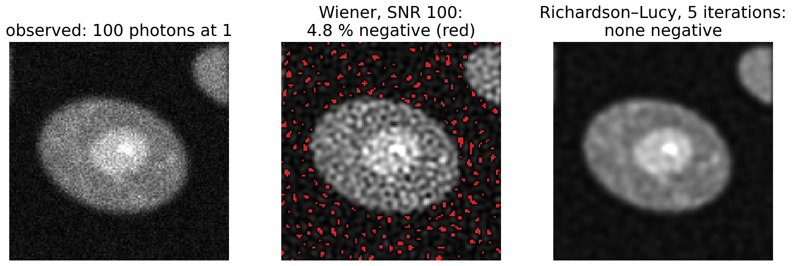
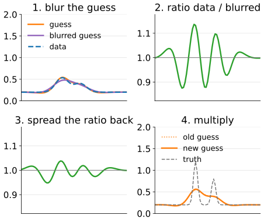
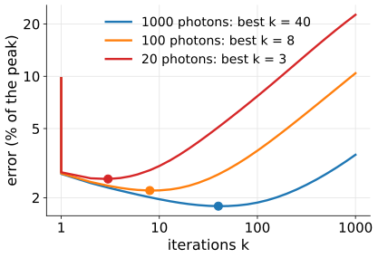
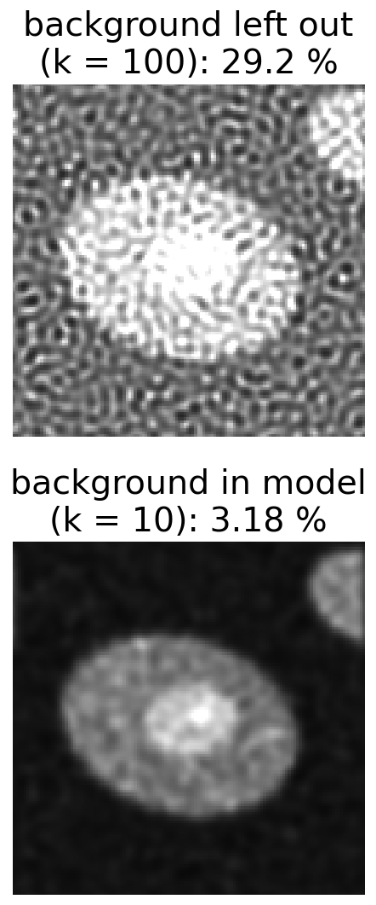
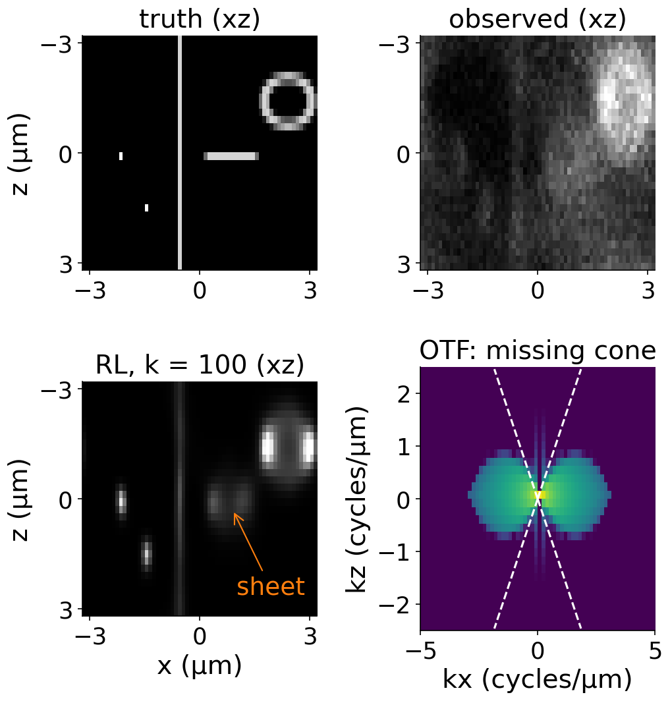
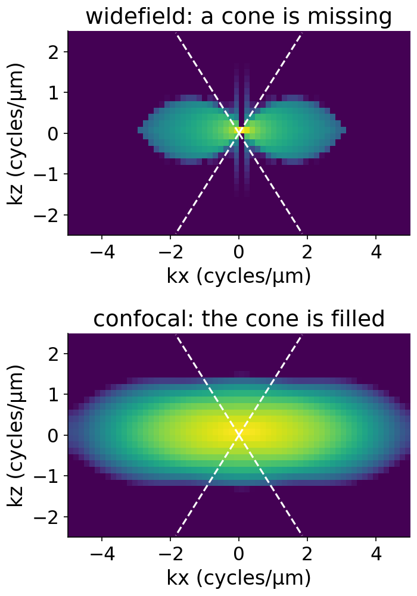
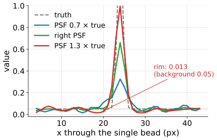
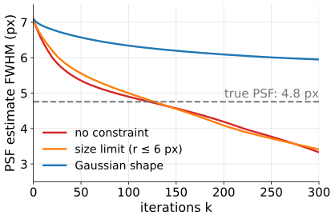
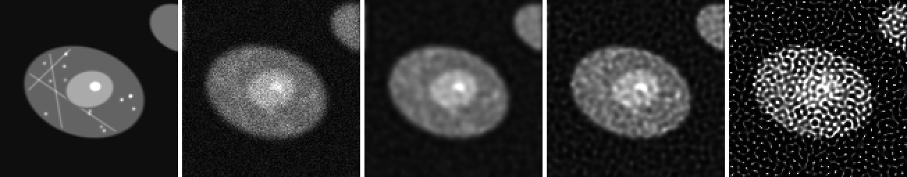

## About this lecture

Linear filters do not know that light is counted in photons. **Richardson–Lucy** (RL) does.

- The RL step in words, and by hand on four pixels.
- Why it suits photon counts: never negative, keeps the total light.
- The **number of iterations** is the regularisation parameter (semi-convergence).
- **3D** widefield and confocal stacks, and the **missing cone** that no method fills.
- The **PSF you use**: too narrow, too wide, and **blind** deconvolution.
- A catalogue of **artefacts**.

*Slides titled **The math** give the formulas and proofs; the ideas are complete without them.*

::: notes
Third unit of the deconvolution day. Recalls: the Poisson (shot) noise model and the camera offset (camera noise unit, day 3); the 3D PSF and the missing cone picture (image formation day); early stopping and filter factors (last unit). Notation: y = observed counts, x = estimate, h = PSF (sums to 1), b = background (counts per pixel), k = iteration.
:::

## Photons are counted

- A fluorescence image counts **photons** (after removing the camera offset): never negative, Poisson noise whose variance equals the mean (camera noise unit).
- Wiener and Tikhonov produce **negative** intensities next to bright objects (the last two units: up to 15 % of the pixels) and treat noise as equally large everywhere.
- We want a restoration that **keeps every pixel ≥ 0**, **keeps the total number of photons**, and **weights the data as Poisson counts**.

{width="80%"}

## Richardson–Lucy in words

Start from a **flat** guess (every pixel = the mean of the data). Then repeat:

:::: {.columns}
::: {.column width="50%"}
1. **Blur** the guess with the PSF: what the microscope would show if the guess were true.
2. **Compare** with the data, pixel by pixel, as a **ratio** data / blurred guess. Where the guess is too dim the ratio is above 1, where it is too bright below 1.
3. **Spread the ratio back** with the PSF (mirrored): each object pixel collects the ratios of the image pixels it contributes to.
4. **Multiply** the guess by it.

Every factor is positive, so the guess **stays non-negative**; and (with a PSF that sums to 1) the **total stays equal** to the total of the data.
:::
::: {.column width="50%"}
{width="92%"}
:::
::::

## One step by hand

1D, circular, 4 pixels. PSF $(0.25, 0.5, 0.25)$, data $\mathbf y = (1, 2, 1, 0)$, start $\mathbf x_0 = (1, 1, 1, 1)$.

| | pixel 1 | pixel 2 | pixel 3 | pixel 4 | sum |
|---|---|---|---|---|---|
| blurred $\mathbf x_0$ | 1 | 1 | 1 | 1 | 4 |
| ratio $\mathbf y$ / blurred | 1 | 2 | 1 | 0 | |
| ratio spread back | 1 | 1.5 | 1 | 0.5 | |
| $\mathbf x_1$ = $\mathbf x_0$ × spread | **1** | **1.5** | **1** | **0.5** | 4 |
| $\mathbf x_2$ (same again) | **0.9** | **1.95** | **0.9** | **0.25** | 4 |

Pixel 2: the ratio spread back is $0.25 \cdot 1 + 0.5 \cdot 2 + 0.25 \cdot 1 = 1.5$. Already sharper after two steps; the sum is 4 each time.

## The math: RL from the Poisson likelihood {.math}

Model: $y_i \sim \text{Poisson}\big((A\mathbf x)_i + b\big)$, $A$ = convolution with $h \ge 0$, $\sum h = 1$, so $A^\top\mathbf 1 = \mathbf 1$. Log-likelihood (dropping terms without $\mathbf x$):

$$\ell(\mathbf x) = \sum_i y_i \log\big((A\mathbf x)_i + b\big) - \big((A\mathbf x)_i + b\big).$$

Gradient: $\nabla\ell = A^\top\!\Big(\dfrac{\mathbf y}{A\mathbf x + b}\Big) - A^\top\mathbf 1$. At a maximum with $x_j > 0$: $A^\top\big(\mathbf y/(A\mathbf x + b)\big)_j = 1$. RL is the fixed-point iteration

$$x_j \leftarrow x_j \cdot \Big[A^\top\Big(\frac{\mathbf y}{A\mathbf x + b}\Big)\Big]_j .$$

- It is an **EM algorithm** (Shepp & Vardi 1982): the likelihood never decreases.
- Non-negative: a product of non-negative factors. Flux: $\sum_j x_j^{\text{new}} = \sum_i y_i\frac{(A\mathbf x)_i}{(A\mathbf x)_i + b}$, which is $\sum_i y_i$ for $b = 0$.

## Try it: RL step by step

```{=html}
<link rel="stylesheet" href="../demos/dist/demo.css">
<div data-demo="rlsteps" data-preset="semi" data-presets="nonoise,semi,fewer,speckle,wiener"></div>
<script src="../demos/dist/rlsteps.js"></script>
```

::: notes
Beads (a 1 : 4 pair, 6 px apart) next to an edge, Gaussian PSF σ = 2 px, Poisson noise with 100 photons at value 1 (the beads peak at 2.5). The iterations are computed in the background; the slider scrubs through ~30 snapshots. Tour: "no noise": the error keeps falling up to 1000 iterations (1.22 % of the peak), the misfit (Poisson deviance per pixel) drops to almost 0. "Noise: semi-convergence": best at k = 8 (2.20 %), then rising (10.4 % at 1000); the misfit settles near 1, the noise level. Best Wiener: 2.49 %. "Fewer photons" (20): best at k = 3 (2.56 %). "1000 iterations: speckles" on the cell phantom: 18.7 % error against 2.74 % at k = 5; the background breaks up into bright dots. "RL vs best Wiener" (phantom, 1000 photons): RL 2.18 % at k = 25, Wiener 2.31 %.
:::

## The number of iterations is λ

Recall from the [last unit](../regularise/lec.qmd): an iteration from a flat image fills in **strong (low) frequencies first** and **weak (high, noisy) ones last**. RL does the same.

:::: {.columns}
::: {.column width="56%"}
- **Semi-convergence**: the error against the truth falls, then rises; the data fit keeps improving.
- **Fewer photons → stop earlier**. In the demo (beads): best $k$ = 40 at 1000 photons, 8 at 100, 3 at 20.
- The misfit (Poisson deviance per pixel) reaches about 1 when the blurred estimate explains the data to the noise level: a discrepancy rule for RL.
- Alternatives to stopping: add a penalty (e.g. total variation; one line here, the Ising/MRF day owns TV: [quadratic smoothing and total variation](../gmrf/lec.qmd)).
- Tomography's MLEM ([Radon day](../algebraic-recon/lec.qmd)) is the same algorithm with the projector instead of the PSF.
:::
::: {.column width="44%"}
{width="100%"}
:::
::::

## The math: why stopping early regularises here too {.math}

Write $\mathbf x = \bar x(\mathbf 1 + \boldsymbol\delta)$ around the flat start $\bar x$, with small $\boldsymbol\delta$ and $b = 0$. Then $A\mathbf x = \bar x(\mathbf 1 + A\boldsymbol\delta)$ and

$$\frac{\mathbf y}{A\mathbf x} \approx \frac{\mathbf y}{\bar x}\big(\mathbf 1 - A\boldsymbol\delta\big), \qquad \mathbf x_{\text{new}} \approx \mathbf x + \mathbf x \cdot A^\top\Big(\frac{\mathbf y - A\mathbf x}{\bar x}\Big).$$

Near a flat image this is a Landweber step with $\omega \approx 1$ (in units of $\bar x$): $\mathbf x \leftarrow \mathbf x + A^\top(\mathbf y - A\mathbf x)$. Per frequency the $k$-th iterate keeps about $1 - (1 - |H(f)|^2)^k$ of the inverse: strong frequencies early, weak ones after about $1/|H|^2$ iterations.

## Offset and background

:::: {.columns}
::: {.column width="62%"}
- RL needs **counts**: subtract the camera **offset** first (camera noise unit) but keep the photon scale; a negative pixel breaks the Poisson model.
- Most images also have a **background**: out-of-focus haze, autofluorescence, a few photons per pixel everywhere.
- Put it in the model, $\mathbf y \approx A\mathbf x + b$. If $b$ is left out, RL must explain the background by the object, and it **sharpens the background into speckles** (the estimate is a sum of bright points).
- In the demo (cell phantom, 100 photons at 1, background 30 photons): forgetting $b$ gives at least 27.5 % error at every $k$; with $b$ in the model 3.18 % at $k$ = 10.
:::
::: {.column width="38%"}
{width="46%"}
:::
::::

## 3D: widefield stacks

Widefield 3D stacks are where deconvolution is most used. Recall ([image formation day](../resolution/lec.qmd)): the 3D PSF of a widefield microscope is **elongated in z**: an hourglass of out-of-focus light above and below each point, and its OTF has a **missing cone** around the $k_z$ axis.

:::: {.columns}
::: {.column width="56%"}
- **3D RL** with the 3D PSF puts out-of-focus light back where it came from: contrast and axial resolution improve a lot. A bead's axial FWHM in the demo: 1.48 µm blurred, 0.53 µm after 100 iterations.
- But the missing cone is **not filled**: a thin **horizontal sheet** (all its frequencies along $k_z$) stays smeared in z: 200 nm thick, 4.7 µm blurred, still 1.3 µm after 100 iterations.
- Vertical structures are restored better than horizontal ones.
:::
::: {.column width="44%"}
{width="80%"}
:::
::::

## The math: the missing cone {.math}

The amplitude PSF of a lens is the inverse Fourier transform of the **pupil**: a cap of the sphere $|\mathbf k| = n/\lambda$ with half-angle α ($\sin\alpha = \mathrm{NA}/n$). The intensity PSF is its squared magnitude, so the OTF is the **autocorrelation of the cap**: the set of differences $\mathbf k_1 - \mathbf k_2$ of two points on it.

- The differences fill a **torus-like** region in $(k_r, k_z)$: up to $k_r = 2\,\mathrm{NA}/\lambda$ laterally.
- Near the origin two nearby points on the cap differ in a direction **tangent** to the cap: at most at angle α to the $k_r$ axis. So for small $k_r$ only $|k_z| \lesssim k_r\tan\alpha$ is reached: a **cone** around the $k_z$ axis is missing.
- A horizontal sheet, uniform in $x$ and $y$, has only $k_r = 0$: of all its frequencies only $k_z = 0$ survives.
- Confocal: excitation PSF × detection PSF, so the OTF is the **convolution** of two widefield OTFs, which fills the cone.

## Try it: a 3D stack

```{=html}
<link rel="stylesheet" href="../demos/dist/demo.css">
<div data-demo="rlsteps" data-mode="xz" data-preset="bead" data-presets="wf,bead,sheet,confocal,zstep"></div>
<script src="../demos/dist/rlsteps.js"></script>
```

::: notes
64 × 32 × 32 voxels, 100 nm laterally, 200 nm between planes, NA 0.8 in air, 1000 photons at value 1. Top row: xz slices (drawn to scale), bottom: xy at the middle plane. Right: the OTF magnitude at ky = 0 (log), with the missing cone dashed; then axial profiles. 3D RL costs about 20 ms per iteration here, so 200 iterations take a few seconds. Tour: "widefield" (k = 0): blur above and below every object. "RL restores the bead in z": bead axial FWHM 1476 nm blurred → 526 nm at k = 100 (444 at 200). "The sheet stays smeared": 200 nm thick; 4666 nm blurred, 1345 at k = 100, 1111 at 200. "Confocal": bead 854 → 233 nm, sheet 921 → 282 nm: the cone is filled. "z-steps too large" (800 nm): the bead only goes from 1178 to 808 nm; the stack under-samples the PSF in z.
:::

## Confocal, and depth

:::: {.columns}
::: {.column width="55%"}
- **Confocal**: the pinhole already rejects most out-of-focus light, and its OTF has **no missing cone**. Deconvolution gains less in contrast, but it works more reliably, and sheets are restored too.
- **Depth**: the 3D PSF must match the depth. Imaging into water with an oil lens (refractive index mismatch) makes the PSF **asymmetric** in z and **change with depth**. A PSF measured at the coverslip is wrong 30 µm deeper.
- Sampling: the z-step must resolve the PSF axially (Nyquist, image formation day); otherwise deconvolution has nothing to work with.
:::
::: {.column width="45%"}
{width="64%"}
:::
::::

## The PSF you use {.smaller}

| PSF used | result | looks |
|---|---|---|
| **too narrow** | leftover blur, under-restored | safe, but objects too large |
| right | best | |
| **too wide** | over-sharpening, **dark rims (halos)** around bright objects, ringing, objects **smaller** than they are | crisp, wrong |

:::: {.columns}
::: {.column width="55%"}

- **Measured** PSF (beads, image formation day, [resolution](../resolution/lec.qmd)): includes the real aberrations, but noisy and from one depth.
- **Computed** PSF: clean but ideal.
- Common compromise: fit a model PSF to measured beads.
- In the demo (beads, 1000 photons, $k$ = 100): the single bead's FWHM is 3.25 px with a PSF 30 % too narrow, 2.63 px with the right one, 2.57 px with one 30 % too wide (truth 1.45 px); the too-wide PSF digs a rim down to 0.013 around it (background 0.05).
:::
::: {.column width="45%"}
{width="100%"}
:::
::::

## Blind deconvolution {.smaller}

Estimate **object and PSF together**: alternate an RL step on the object (PSF fixed) with an RL step on the PSF (object fixed).

- Very **under-determined**: the trivial answer "PSF = a point, object = the blurred image" explains the data perfectly.
- So it needs **constraints**: PSF non-negative, sum 1, limited size, smooth, or a parametric shape (e.g. Gaussian with unknown width).
- Use it when no PSF can be measured (motion, unknown aberration); otherwise prefer a measured or computed PSF.

:::: {.columns}
::: {.column width="50%"}
- In the demo (start 50 % too wide, FWHM 7.1 px; true 4.8 px): unconstrained, the PSF width passes the true value near 100 iterations and keeps shrinking (3.3 px at 300). A size limit does not stop this; a Gaussian shape slows it (6.0 px at 300).
:::
::: {.column width="50%"}
{width="100%"}
:::
::::

## Try it: the PSF you use

```{=html}
<link rel="stylesheet" href="../demos/dist/demo.css">
<div data-demo="rlsteps" data-preset="wide" data-presets="wide,narrow,background,ringing,blind,blindgauss"></div>
<script src="../demos/dist/rlsteps.js"></script>
```

::: notes
Bottom right panel: the true PSF next to the one used (or the current blind estimate). Tour: "PSF too wide" (×1.3, 1000 photons, k = 100): dark rims around the beads; the peak ratio of the 1 : 4 pair is 9.1 instead of 4. "Too narrow" (×0.7): the beads stay round and wide. "Forgot the background": speckles in the background (up to 0.70 where the truth is 0.05) and the total flux of the estimate equals that of the data including the background. "Ringing at the edge" (Airy PSF, 10 000 photons, 1000 iterations): the profile dips to 0.03 just before the edge (background 0.05) and overshoots to 0.56 after it (true 0.50). "Blind": watch the PSF estimate shrink (readout: FWHM). "Blind with a Gaussian shape": slower drift. Blind steps cost three times more, so the run stops at 300 iterations.
:::

## Artefacts

{width="100%"}

- **Ringing**: ripples next to sharp edges and around bright objects.
- **Speckling**: noise turned into bright dots after many iterations (right image).
- **Halos**: dark rims from a PSF that is too wide.
- **Border** artefacts: the periodic FFT; pad and taper (unit 1).
- **Axial smearing** of horizontal structures in widefield 3D: the missing cone.

## Summary

- **Richardson–Lucy**: blur the guess, compare as a ratio, spread the ratio back, multiply. Never negative, keeps the photons, maximises the Poisson likelihood (EM).
- **Iterations = regularisation**: semi-convergence; fewer photons → stop earlier; a misfit of about 1 per pixel means the noise level is reached.
- Needs offset-corrected counts and a **background** term, or the background turns into speckles.
- **3D**: puts out-of-focus light back; restores beads and vertical structures, but the **missing cone** keeps horizontal sheets smeared. Confocal has no missing cone.
- **PSF too narrow**: leftover blur. **Too wide**: halos, ringing, objects too small. **Blind** estimation needs constraints and still drifts towards a point.
- Artefacts: ringing, speckles, halos, borders, axial smearing.
