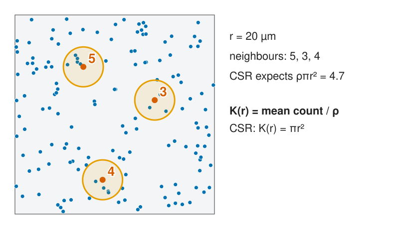
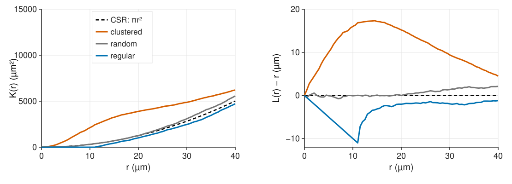
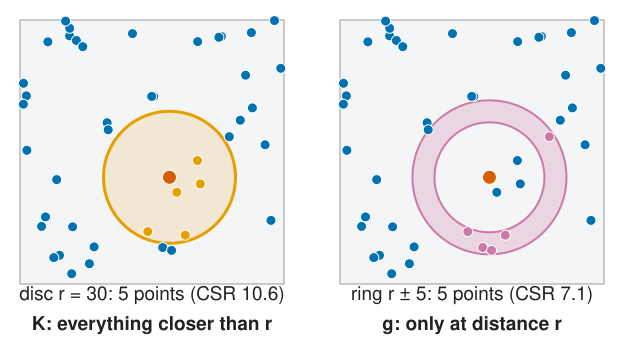
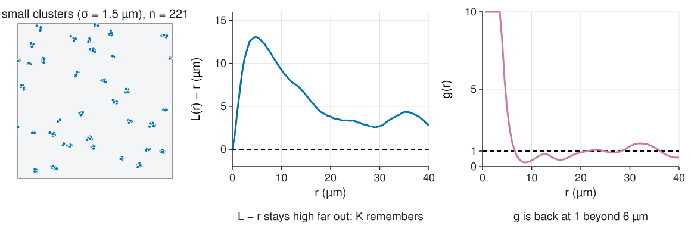
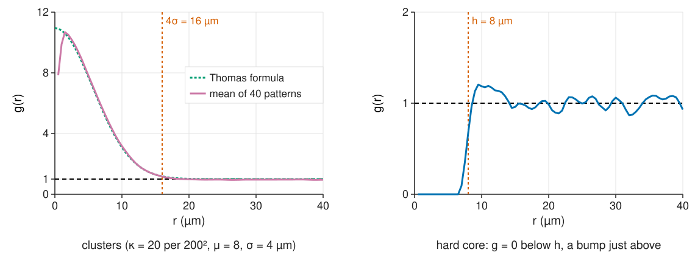
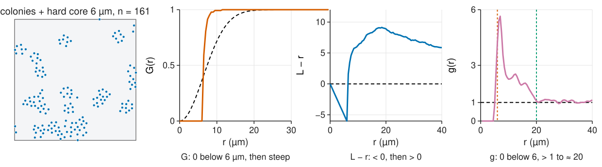
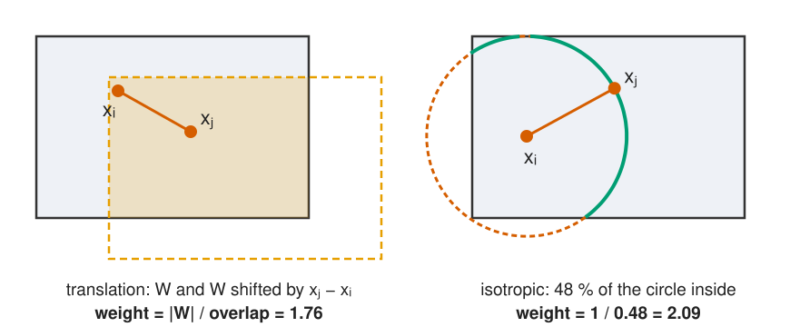
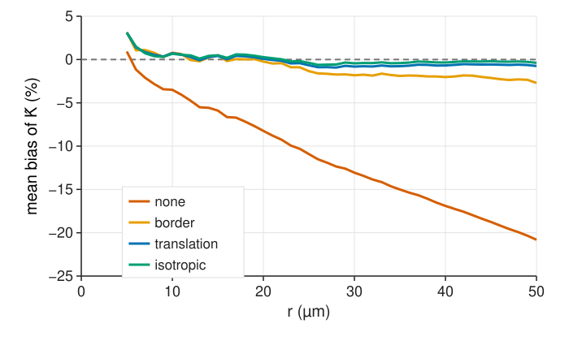

## About this lecture

G looks at the nearest neighbour only. Now we count **all** neighbours, at every distance.

- **Ripley's K**: how many neighbours within r, compared with CSR's $\pi r^2$.
- **L(r) − r**: the same, as a flat line for CSR.
- The **pair-correlation function g**: neighbours at distance r, in a thin ring.
- **Cumulative vs local**: why K remembers small scales and g does not.
- Reading **scales**: cluster size, hard-core distance, both at once.
- **Edge corrections** for pairs: border, translation, isotropic.

*Slides titled **The math** give the formulas and proofs; the ideas are complete without them.*

::: notes
Third unit of the spatial statistics day, the central one. Demo: ripleyk (same pattern source as csrplay and gfj). Window 200 × 200 µm unless said otherwise.
:::

## Count all neighbours

{width="80%" fig-align="center" fig-alt="150 random points; circles of radius 20 µm around three of them hold 5, 3 and 4 other points. CSR expects ρπr² = 4.7. Text: K(r) = mean count divided by ρ; under CSR K(r) = πr²."}

For each point, count the other points within $r$. Average over all points and divide by ρ: that is **K(r)**. Under CSR the expected count is $\rho\pi r^2$, so $K(r) = \pi r^2$.

## The math: the K function {.math}

$$\rho K(r) = E[\text{number of further points within } r \text{ of a typical point}].$$

- CSR: by Slivnyak the other points are Poisson(ρ), so $\rho K(r) = \rho\pi r^2$.
- Estimator, without edge correction:
$$\hat K(r) = \frac{|W|}{n(n - 1)}\sum_{i \ne j} [d_{ij} \le r],$$
  where $n(n-1)/|W|^2$ estimates $\rho^2$ and the sum counts ordered pairs closer than $r$.
- Units: µm². In 3D, $K(r) = \tfrac43\pi r^3$ under CSR (pointer: [3D volumes](../volumes3d/lec.qmd)).

## L(r) − r: a flat line for CSR

{width="100%" fig-alt="Left: K(r) for the clustered, random and regular patterns against the parabola πr²; the clustered curve lies well above, the regular one is zero up to 11 µm and then slightly below. Right: L(r) − r: random stays near 0, clustered rises to about 16 µm at 10 µm, regular falls to −10 at 11 µm and stays below 0."}

$L(r) = \sqrt{K(r)/\pi}$ turns the parabola into the straight line $L = r$. Plot **L(r) − r**: **0** random, **> 0** more neighbours than CSR at that distance (clustered), **< 0** fewer (regular). Taking the square root also roughly evens out the variance across r.

## The pair-correlation function g

:::: {.columns}
::: {.column width="50%"}
{width="100%" fig-alt="The same point with a disc of radius 30 µm (5 points inside, CSR expects 10.6) and a ring from 25 to 35 µm (5 points inside, CSR expects 7.1). K counts everything closer than r, g only what lies at distance r."}
:::
::: {.column width="50%"}
Count neighbours in a thin **ring** at distance r instead of a disc, and divide by what CSR gives in the same ring:

- **g = 1**: as many pairs at distance r as chance;
- **g > 1**: more pairs at that distance; **g < 1**: fewer;
- **g = 0**: impossible distances (a hard core).

g is the derivative of K, made dimensionless.
:::
::::

## The math: pair correlation {.math}

$$g(r) = \frac{K'(r)}{2\pi r} \qquad (\text{CSR: } K' = 2\pi r,\ g = 1).$$

- $\rho^2 g(r)$ is the density of pairs at distance $r$ (the second-order product density).
- Kernel estimator with a smoothing kernel $k_h$ of half-width $h$ (Epanechnikov):
$$\hat g(r) = \frac{|W|}{n(n - 1)}\sum_{i \ne j}\frac{w_{ij}\,k_h(r - d_{ij})}{2\pi d_{ij}}.$$
- $h$ is the bin width of a histogram of pair distances (recall the [histogram unit](../histogram/lec.qmd)): small h noisy, large h smears out sharp features (it also biases g near $r = 0$).

## Cumulative vs local

{width="100%" fig-alt="Left: 221 points in small tight clusters (σ = 1.5 µm). Middle: L(r) − r peaks at 13 µm near r = 5 µm and is still 2.7 µm at r = 30 µm. Right: g is very high below 4 µm and back near 1 beyond about 6 µm."}

K at $r$ contains **every** pair closer than $r$: a cluster scale of 3 µm keeps $L - r$ high at 30 µm ("K remembers"). g answers "at this distance" only. g is noisier (thin rings hold few pairs) and needs a bandwidth; K and L need none.

## Reading the scales

{width="100%" fig-alt="Left: g of a Thomas cluster process (σ = 4 µm): the mean of 40 patterns follows the formula, starting near 11, falling to 1 at about 16 µm (4σ, marked). Right: g of a hard-core pattern with h = 8 µm: 0 below 8 µm, a bump to about 1.2 just above, then 1."}

- **Clusters**: g starts high and falls to 1 at about the **cluster diameter** (≈ 4σ for Gaussian offspring). The height says how many extra neighbours a point has in its own cluster.
- **Hard core**: g = 0 below h, a **packing bump** just above, then 1.

## The math: the Thomas process {.math}

Two offspring of the same parent are each displaced by $N(0, \sigma^2 I)$, so their **difference** is $N(0, 2\sigma^2 I)$: its length $D$ has $P(D \le r) = 1 - e^{-r^2/4\sigma^2}$.

- A typical point has, besides the CSR neighbours of all other clusters ($\rho\pi r^2$), on average $\mu$ siblings, of which a fraction $P(D \le r)$ lies within $r$. With $\rho = \kappa\mu$:
$$K(r) = \pi r^2 + \frac{1 - e^{-r^2/4\sigma^2}}{\kappa}, \qquad g(r) = 1 + \frac{e^{-r^2/4\sigma^2}}{4\pi\kappa\sigma^2}.$$
- $g(0) - 1 = 1/(4\pi\kappa\sigma^2)$; at $r = 4\sigma$ the excess $g - 1$ has dropped to $e^{-4} \approx 2$ % of that value.
- Fitting κ and σ to $\hat K$ ("minimum contrast") estimates the cluster size and the points per cluster ($\mu = \rho/\kappa$).

## Two scales at once

{width="100%" fig-alt="Colonies of cells with a 6 µm hard core (161 points). G is 0 below 6 µm and then rises steeply, much faster than CSR. L − r is −5 at 5 µm and +9 at 20 µm. g is 0 below 6 µm, peaks at 5.7 just above, stays above 1 up to about 20 µm, then 1."}

Cells in colonies, each cell keeping a minimum distance (it has a size). g: **0 below the cell diameter, above 1 up to the colony size, 1 beyond**. The quadrats (unit 1) and G each see one of the two effects; g sees both.

## Try it: K, L and g

```{=html}
<link rel="stylesheet" href="../demos/dist/demo.css">
<div data-demo="ripleyk" data-preset="colonies"></div>
<script src="../demos/dist/ripleyk.js"></script>
```

::: notes
Left: the pattern with a probe point (red; click another point to move it): the orange disc of radius r (what K counts) and the green dashed ring r ± h (what g counts), with the counts and the CSR expectation in the readout. Tour: "colonies with a hard core" (h = 1.5, r = 4): g = 0 below 6 µm, 5.7 near 7 µm, 2.3 at 10, 1.1 at 20. "CSR: L − r ≈ 0": L − r stays within 2 µm of 0 out to 40 µm (−0.51 at 10 µm, −1.71 at 30). "Thomas: g falls to 1 at the cluster size" (229 points, σ = 4): ĝ(8) = 3.74, about 1 from 16 µm; the green dashed line is the formula (ĝ at small r is pulled down by the kernel). "K remembers small clusters" (σ = 1.5): L − r = 13 at 5 µm, still 2.7 at 30 µm, while g is back at 1 by 6 µm. "hard core": g = 0 below 8. "tight pairs": a sharp peak of g at 3 µm only.
:::

## Edge corrections for pairs

{width="90%" fig-align="center" fig-alt="Left: translation weight. The window W and a copy shifted by the vector from xi to xj; their overlap is shaded; weight = |W| / overlap = 1.76. Right: isotropic weight. A circle centred at xi through xj; 48 % of it lies inside the window (solid), the rest outside (dashed); weight = 1/0.48 = 2.09."}

A pair near the border is seen less often than one in the middle. Count it with a **weight** = 1 / (how likely such a pair was to be seen):

- **translation**: |W| / overlap of W with W shifted by $\mathbf x_j - \mathbf x_i$;
- **isotropic** (Ripley): 1 / fraction of the circle through $\mathbf x_j$ around $\mathbf x_i$ inside W;
- **border**: only centre points farther than r from the border (as for G).

## How large is the bias?

:::: {.columns}
::: {.column width="55%"}
{width="100%" fig-alt="Mean relative bias of K̂ over 200 random patterns of 100 points in a 200 × 200 µm window, for r from 5 to 50 µm. No correction: −8 % at 20 µm and −21 % at 50 µm. Border: within 3 %. Translation and isotropic: within 1 %."}
:::
::: {.column width="45%"}
200 CSR patterns of 100 points in 200 × 200 µm:

- **no correction**: −8 % at r = 20 µm (a tenth of the side), −21 % at 50 µm (a quarter): K biased **down**, the pattern looks **regular**;
- **translation, isotropic**: within 1 %;
- **border**: unbiased in principle, but noisier and here −3 % at 50 µm.

Use r up to about **a quarter of the shorter side** of the window; fix the range **before** looking (unit 4).
:::
::::

## The math: why the weights work {.math}

Translation-corrected estimator:

$$\hat K(r) = \frac{|W|}{n(n - 1)}\sum_{i \ne j}\frac{|W|}{|W \cap (W + \mathbf x_j - \mathbf x_i)|}\,[d_{ij} \le r].$$

- **Horvitz–Thompson argument**: for a stationary pattern a pair with difference vector $\mathbf v$ lands in $W$ with both points only if the first point lies in $W \cap (W - \mathbf v)$, which has area $|W \cap (W + \mathbf v)|$. Weighting each observed pair by $|W|$ / that area makes the expected sum equal to what a full window would give.
- For a rectangle $a \times b$: weight $= ab / ((a - |\Delta x|)(b - |\Delta y|))$.
- Isotropic weight: $2\pi d_{ij} / \text{length}(\partial b(\mathbf x_i, d_{ij}) \cap W)$; needs isotropy (no preferred direction).
- In a tissue mask the overlap areas come from one FFT autocorrelation of the mask (the set covariance).

## Try it: corrections

```{=html}
<link rel="stylesheet" href="../demos/dist/demo.css">
<div data-demo="ripleyk" data-preset="none"></div>
<script src="../demos/dist/ripleyk.js"></script>
```

::: notes
"no correction: looks regular": the same 150 random points as "CSR"; at r = 30 µm K̂ = 2209 against πr² = 2827, L − r = −3.5 (with translation: 2515, −1.7). Switch the corrections. Tab "bias of corrections": 50 CSR patterns with the same n in this window, mean relative bias of each correction; preset "corrections in a tissue mask" shows the same in an irregular window. "build your own pattern": click to add points, drag them, shift-click to remove; the probe count curve (thin red step line) is one point's contribution to K.
:::

## Where this leads

- **[Unit 4](../envelopes/lec.qmd)**: the curve differs from $\pi r^2$, but is that more than chance? Simulate CSR, compute the same curve, compare; and beware testing many r at once.
- **[Unit 5](../marked-patterns/lec.qmd)**: the cross-K between two cell types (the [object colocalisation unit](../coloc-objects/lec.qmd) used it for two-colour spots), and K for an uneven density.
- Fitting a cluster model (κ, σ) to $\hat K$ gives the cluster size directly; finding the clusters themselves is a clustering problem ([k-means](../kmeans/lec.qmd)).

## Summary

- **K(r)**: mean number of neighbours within r, divided by ρ; CSR: $\pi r^2$. **L − r**: 0 random, > 0 clustered, < 0 regular.
- **g(r)**: pairs at distance r relative to CSR; 1 random, > 1 more pairs, 0 impossible distances.
- K is **cumulative** (remembers small scales), g is **local** (but noisier, needs a bandwidth).
- Read **cluster size** where g returns to 1, the **hard core** where g leaves 0; a pattern can be regular and clustered at different scales.
- Without an **edge correction** K is biased down (−8 % at a tenth of the side, −21 % at a quarter); translation or isotropic weights fix it. Use r up to a quarter of the window.
