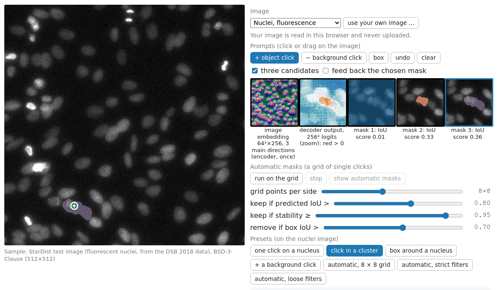
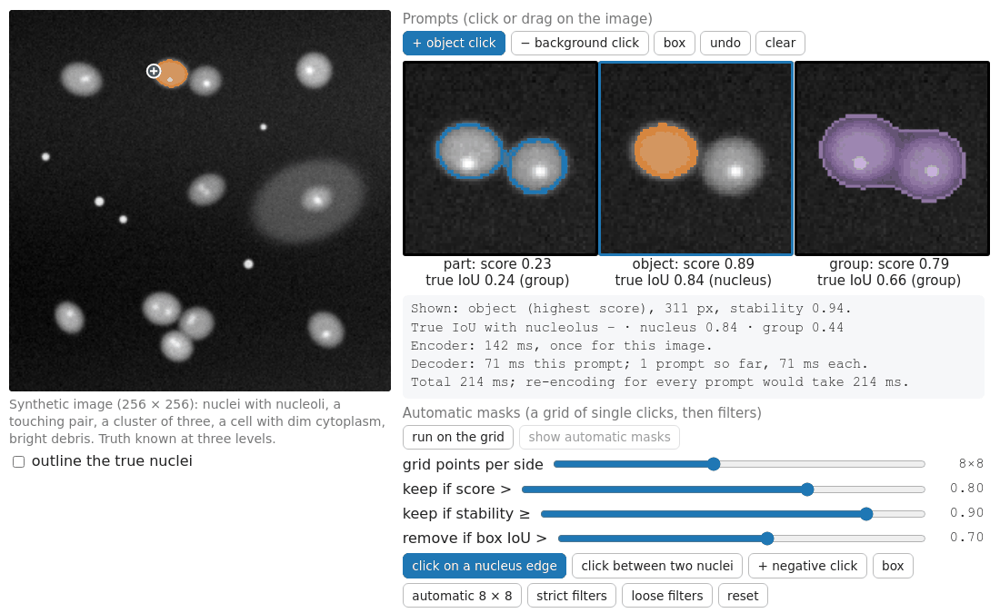

## Goal

By the end of this exercise you should be able to:

- explain why a promptable segmenter runs a **heavy encoder once** and a **light decoder per click**, and compute what that saves,
- choose among the **three candidate masks** of an ambiguous click, and pick the extra prompt that removes the ambiguity,
- compute and interpret the **stability score**, and follow a candidate through the filters of **automatic masks**,
- predict where the network fails by construction (small objects, objects it has no concept of, coarse grids) and find those failures on real images,
- *(math)* derive the stability score as an IoU, the cost of $m$ prompts, why a minimum-over-outputs loss makes the outputs specialise, and the attention cost of encoder and decoder.

Do the pen-and-paper part first, then the two demos. The real network takes about half a minute per image: **write your prediction down before you run it**.

## Background

| Idea | What it means |
|---|---|
| Image encoder | transformer on 16 × 16-pixel patches of the image resized to 1024²; output: embedding of 64 × 64 positions × 256 numbers; run **once per image** (26.6 s in the browser, one CPU core) |
| Prompt encoder + mask decoder | clicks (object / background), a box or an earlier mask → a few tokens → masks; run **per prompt** (0.42 s for three masks) |
| Three candidates | one click → three masks (roughly small, medium, large), each with a **predicted IoU** (the network's own quality estimate); single-mask mode returns the highest |
| Mask logits | 256 × 256 numbers per mask; bilinear resize to the image, threshold at 0 |
| Stability | area(logit > 1) / area(logit > −1): near 1 if the border is steep |
| Automatic masks | grid of single clicks (8 × 8 = 64 points → 192 candidates), keep predicted IoU > 0.8, stability ≥ 0.95, remove duplicates by box overlap > 0.7 (keep the higher score); 0.33 s per point |

## By hand

**B1.** A click on the edge of a nucleus that touches a neighbour returns three masks:

| | area | predicted IoU | what it covers |
|---|---|---|---|
| A | 120 px | 0.71 | a crescent at the edge |
| B | 410 px | 0.93 | the nucleus |
| C | 860 px | 0.88 | the nucleus and its neighbour |

(a) Which mask does single-mask mode return?
(b) Which do you want for counting nuclei, and which for measuring the area of the clump?
(c) Which second prompt makes B the unambiguous answer: a negative click on the neighbour, a negative click on empty background, or a box? Explain.

**B2.** Stability. Mask P has 380 pixels with logit > 1 and 430 with logit > −1; mask Q has 400 and 412.
(a) Compute both stability scores. Which passes a 0.95 filter?
(b) What does a low stability say about the mask's border? Give one image property that causes it.

**B3.** Costs, with the encoder at 26.6 s per image and the decoder at 0.42 s per click.
(a) Total time for 10 and for 40 clicks on one image with a cached embedding, and if the encoder were re-run for every click.
(b) Automatic masks at 0.33 s per point: how many points, candidates and seconds of decoder time for 8 × 8, 16 × 16 and 32 × 32 grids?

**B4.** Resolution. The image is resized to 1024 × 1024 and the embedding has 64 × 64 positions.
(a) How many pixels of the 1024² input does one position cover? How many pixels of a 512 × 512 image? Of an image 696 pixels wide?
(b) Predict what happens to nuclei 6 pixels across in a 512 × 512 image, with clicks and with automatic masks.

**B5.** Automatic masks on an image with 30 nuclei that together cover 15 % of the image, 8 × 8 grid.
(a) About how many grid points fall inside a nucleus? What does that imply for the number of nuclei found, whatever the filters?
(b) The same for 16 × 16. Which nuclei are still missed? What does the finer grid cost?

::: {.callout-note collapse="true" title="Solutions"}
**B1.** (a) The highest predicted IoU: B (0.93). (b) Counting: B, one nucleus per mask. Clump area: C. (c) A negative click on the neighbour, or a box around the nucleus. The negative click says "the neighbour is not part of it", which removes C; the box says how large the object is, which removes A and C. A negative click on empty background adds almost nothing: the background was already outside all three masks.

**B2.** (a) P: 380/430 = 0.88, fails. Q: 400/412 = 0.97, passes. (b) Many pixels near P's border have logits between −1 and 1: the network is unsure where the object ends, so a small change of threshold moves the border by about a pixel all round. Causes: a soft or low-contrast edge (out of focus, dim object), a touching neighbour, texture inside the object.

**B3.** (a) Cached: 26.6 + 10 × 0.42 = 30.8 s; 26.6 + 40 × 0.42 = 43.4 s. Re-encoding: 10 × 27.02 = 270 s; 40 × 27.02 = 1081 s. (b) 8 × 8: 64 points, 192 candidates, 21 s. 16 × 16: 256 points, 768 candidates, 84 s. 32 × 32: 1024 points, 3072 candidates, 338 s (5.6 minutes).

**B4.** (a) 1024/64 = 16 × 16 pixels of the input; 512/64 = 8 × 8 pixels of a 512² image; 696/64 = 10.9 pixels of the 696-wide image. (b) A 6-pixel nucleus spans 0.75 embedding positions: it has no position of its own, and its feature vector is mixed with the background and its neighbours. A click on it may still give a mask (the decoder also uses finer features of the early encoder layers), but the border is uncertain (low stability) and neighbours may merge. Automatic masks will mostly miss such nuclei: few grid points land on them, and their masks fail the stability filter.

**B5.** (a) 64 × 0.15 = 9.6, about 10 points. A nucleus can only be found if a grid point falls on it, so at most about 10 of the 30 nuclei (fewer: large nuclei catch two points, which become duplicates). (b) 256 × 0.15 = 38 points: on average more than one per nucleus, so most nuclei get a point, but small nuclei and nuclei between grid points are still missed (the spacing is 32 px in a 512 image). The decoder time grows 4×, from 21 s to 84 s, and most extra candidates are duplicates removed by NMS.
:::

### Math questions

**B6.** *(math)* For a logit map $\ell$ and $\delta > 0$, show that $|\{\ell > \delta\}| / |\{\ell > -\delta\}|$ is the IoU of the two thresholded masks and lies in $[0, 1]$. When is it exactly 1? For a round mask of radius $r$ whose logit falls with slope $s$ per pixel at the border, show that it is approximately $1 - 4\delta/(sr)$.

**B7.** *(math)* Compare the total time $T_\text{enc} + mT_\text{dec}$ with $m(T_\text{enc} + T_\text{dec})$. From which $m$ does caching pay? Find the speed-up $S(m)$, its limit, and the $m$ at which half the limit is reached; evaluate for $T_\text{enc} = 26.6$ s, $T_\text{dec} = 0.42$ s.

**B8.** *(math)* A click on a nucleus in a clump means the nucleus $A$ (410 px) with probability $1 - q$ and the clump $B \supset A$ (860 px) with probability $q = 0.4$. Use the per-pixel squared loss $\ell(\hat M, M) = \sum_p (\hat m_p - m_p)^2$, $\hat m_p \in [0, 1]$.
(a) Three outputs trained with the **average** loss $\tfrac13 \sum_j \ell(\hat M_j, M)$: find the best output, its expected loss, and what you get after thresholding at 0.5.
(b) The same with the **minimum** loss $\min_j \ell(\hat M_j, M)$: show that two outputs specialise.

**B9.** *(math)* Self-attention over $N$ tokens builds an $N \times N$ matrix; attention from $k$ prompt tokens to $N$ positions builds a $k \times N$ matrix. Compute both for $N = 64^2$ and $k = 6$, and their ratio. How large is the embedding that must be kept per image (in float32)?

::: {.callout-note collapse="true" title="Solutions (math)"}
**B6.** Let $A = \{\ell > \delta\}$, $B = \{\ell > -\delta\}$. If $\ell(p) > \delta$ then $\ell(p) > -\delta$, so $A \subseteq B$, hence $A \cap B = A$ and $A \cup B = B$: $\text{IoU}(A, B) = |A|/|B|$, which is in $[0, 1]$ because $|A| \le |B|$ (define it as 0 when $B$ is empty). It is 1 exactly when $A = B$, i.e. no pixel has $-\delta < \ell(p) \le \delta$. Round mask: the border at $\ell = 0$ is at radius $r$; $\ell = \pm\delta$ at $r \mp \delta/s$. Ratio $\left(\frac{r - \delta/s}{r + \delta/s}\right)^2 \approx (1 - 2\delta/(sr))^2 \approx 1 - 4\delta/(sr)$ for $\delta/s \ll r$. A smaller object (smaller $r$) needs a steeper border for the same stability.

**B7.** The difference is $(m - 1)T_\text{enc} \ge 0$: equal for $m = 1$, caching pays from the second prompt. $S(m) = \dfrac{m(T_\text{enc} + T_\text{dec})}{T_\text{enc} + mT_\text{dec}}$, increasing in $m$, with limit $\dfrac{T_\text{enc} + T_\text{dec}}{T_\text{dec}} = \dfrac{27.02}{0.42} = 64.3$. Half the limit: $\dfrac{m}{T_\text{enc} + mT_\text{dec}} = \dfrac{1}{2T_\text{dec}}$, so $mT_\text{dec} = T_\text{enc}$, $m = T_\text{enc}/T_\text{dec} = 63$ prompts. Values: $S(2) = 1.97$, $S(10) = 8.8$, $S(40) = 24.9$, $S(1000) = 60.5$.

**B8.** (a) The expected loss of one output is $\sum_p \mathbb E(\hat m_p - m_p)^2$, minimised pixel by pixel at $\hat m_p = P(m_p = 1)$: 1 on $A$, $q = 0.4$ on the 450 ring pixels of $B \setminus A$, 0 elsewhere. Expected loss $450 \cdot q(1 - q) = 450 \cdot 0.24 = 108$. All three outputs have the same minimiser: they are identical, a "nucleus with a 0.4 halo". Thresholded at 0.5 it is always $A$: the clump is never offered (for $q > 0.5$ it would always be $B$). (b) Outputs $\hat M_1 = A$, $\hat M_2 = B$ (and any $\hat M_3$) have $\min_j \ell = 0$ for both possible truths, so expected loss 0, the smallest possible. Gradient descent on the minimum only updates the output that is currently best for each example, so an output that is slightly closer to $A$ is pulled further towards $A$ and another towards $B$: they specialise.

**B9.** $N = 4096$: $N^2 = 16\,777\,216$ entries per attention matrix (per head and layer); $kN = 6 \cdot 4096 = 24\,576$; ratio $N/k = 683$. The encoder of the second version uses local windows in its early layers, which lowers its cost, but the decoder is still hundreds of times cheaper per layer. The embedding: $256 \cdot 64 \cdot 64 = 1\,048\,576$ numbers, 4 MB in float32, kept in memory for the whole session on that image.
:::

## Explore: the real network {#explore}

SAM 2.1 (smallest size, 39 million weights) running in your browser. The first load fetches 78 MB once (cached afterwards); every new image then runs the encoder for about half a minute. Sample images: fluorescent nuclei (StarDist test image, BSD-3-Clause), U2OS nuclei (BBBC039, CC0), cells (Cellpose demo images, BSD-3-Clause), histology and bright field (2018 Data Science Bowl, BBBC038, CC0). You can also load your own image; it is read locally and never uploaded.

```{=html}
<link rel="stylesheet" href="../demos/dist/demo.css">
<div data-demo="samnet" data-preset="click"></div>
<script src="../demos/dist/samnet.js"></script>
```

{fig-alt="Screenshot of the samnet demo: the fluorescent nuclei image with one click in a clump and the chosen mask; on the right the image embedding as colours, the decoder logits, and three candidate thumbnails with predicted IoU 0.01, 0.33 and 0.36; sliders for automatic masks and the preset buttons."}

**E1.** Load the *nuclei* image (it loads by itself). Note the encoder time in the readout. Look at the embedding thumbnail: which structures get different colours? How many embedding cells does one nucleus span?

**E2.** Preset *one click on a nucleus*: before looking, predict which of the three masks is largest and which is chosen. Then *click in a cluster*: predict the three granularities, then check. How do the scores differ between the two clicks?

**E3.** Preset *+ a background click*: does the ambiguity disappear? Now clear, click in the cluster again and put a "− background click" on the touching neighbour instead. Then preset *box around a nucleus*. Finally, on *one click on a nucleus*, tick "feed back the chosen mask": what changes?

**E4.** Click ten different nuclei. Compare the decoder time per click with the encoder time. How many clicks would cost as much as one encoder run?

**E5.** Preset *automatic, 8 × 8 grid* (about 25 s), then *strict* and *loose* (no re-run needed: the filters act on the stored candidates). Count the masks; find the background mask, clumps and parts. What do the colours of the grid points tell you?

**E6.** Failure hunt. Choose *histology*, *bright field* and *U2OS* in turn and run the automatic masks. Compare the masks with what a biologist would call the objects. Then click a few of the smallest U2OS nuclei by hand. Finally load an image of your own.

::: {.callout-note collapse="true" title="Solutions"}
Numbers measured with the same WebAssembly module and post-processing in node (`tools/figs/sam/measure_samnet.ts`); browser timings vary by a few percent.

**E1.** Encoder 26.6–27.8 s in the browser (27.4 s in node). Nuclei and background get clearly different colours (green background, red/purple nuclei); the saturated bright blobs look different again. A nucleus of about 30 pixels spans about 4 × 4 embedding cells (8 px each).

**E2.** *One click on a nucleus*: mask 1 is the whole image (258 586 px, score 0.003), mask 2 the nucleus (819 px, 0.867, chosen), mask 3 slightly larger (930 px, 0.764). *Click in a cluster*: whole image (0.010), 647 px of the clicked nucleus (0.332), 1512 px = the nucleus and its touching neighbour (0.358, chosen). Isolated nucleus: one confident answer; clump: all scores low, the network is unsure.

**E3.** Background click: scores 0.014 / 0.534 / 0.447, the chosen mask is now 483 px (part of the nucleus), but the clump mask (1407 px) is still offered: ambiguity reduced, not removed. Negative click on the neighbour (about (168, 448)): 0.011 / 0.640 / 0.364, chosen mask the single nucleus (522 px). Box: 0.484 (2182 px, spills out of the box) / 0.886 (1343 px) / 0.914 (1472 px): two confident, similar masks of the object in the box. Feeding back the chosen mask on the one-click preset: scores become 0.880 / 0.593 / 0.873 (956, 546, 839 px): with a mask prompt the first output is no longer the background.

**E4.** 0.35–0.49 s per click (node: 345–390 ms, mean 364 ms for ten clicks; 3.6 s for all ten), against about 27 s for the encoder: about 70 clicks cost one encoder run.

**E5.** Default: 192 candidates → 129 dropped for low predicted IoU → 18 unstable → 40 duplicates → 5 masks: 4 nuclei and the whole background (259 239 px). Strict (0.9 / 0.97): 2 masks (one nucleus and the background). Loose (0.6 / 0.7 / 0.95): 19 masks (297 to 1912 px plus the background), now including clumps and parts. White points produced a kept mask; most points are purple: their masks were duplicates, mostly of the background mask. With 64 points, most nuclei are never clicked.

**E6.** Measured with the default filters (F1 at IoU 0.5 against the annotated nuclei, computed by the script): *U2OS*: 13 masks for 95 nuclei (TP 13, FP 0, FN 82, F1 0.24): every mask is right, but 64 points hit only about 13 nuclei (nuclei cover 19.5 % of this image). *Histology*: 10 masks for 70 nuclei, one of them the whole image, F1 0.20; loose filters give F1 0.35 with 3 masks covering several nuclei. *Bright field*: 9 masks of 4 471 to 25 132 px: whole cells or groups of cells, none of the 98 annotated nuclei (median diameter 18 px, about one embedding cell of this 1024² image): F1 0. Clicking by hand is much better: one click on the centre of each U2OS nucleus gives 94 of 95 masks with IoU ≥ 0.5, including all 7 nuclei smaller than 16 px across (the smallest is 10.9 px, one embedding cell at this image size: still enough). So on these images the automatic grid and the concept mismatch are the bigger problems; truly tiny objects (a few pixels) remain below the resolution.
:::

## Explore: a toy you can open up {#explore-promptmask}

The same architecture in miniature, on a synthetic image whose truth is known at three levels (nucleoli, nuclei, groups: touching nuclei or a cell with its cytoplasm). The "encoder" smooths the image at three scales and estimates the background, once. The "decoder" makes three candidates per click: **part** (pixels that look like the clicked one), **object** (brighter than halfway between the background and the brightest nearby pixel) and **group** (the same on the coarsest scale, at a lower level). Its **score** is only a proxy: the stability of the mask at ±2 logits. Under each candidate you see the score **and** its true IoU.

```{=html}
<link rel="stylesheet" href="../demos/dist/demo.css">
<div data-demo="promptmask" data-preset="edge"></div>
<script src="../demos/dist/promptmask.js"></script>
```

{fig-alt="Screenshot of the promptmask demo: the synthetic image with a click on the outer edge of the left nucleus of a touching pair; three candidates: part, a thin ring (score 0.23, true IoU 0.24); object, the nucleus (score 0.89, true IoU 0.84); group, the pair (score 0.79, true IoU 0.66); the cost readout and the automatic-mask sliders below."}

**E7.** Preset *click on a nucleus edge*: reproduce B1. Which candidate is the crescent (ring), the nucleus, the nucleus with its neighbour? Which does the highest score pick? Then *click between two nuclei* and *+ negative click*: what does the negative click remove? Read the stability in the readout and relate it to B2.

**E8.** When is the toy's score misleading? Click on the dim cytoplasm of the large cell, then run *automatic 8 × 8*, *strict filters* and *loose filters* and compare the F1 against the 11 true nuclei (tick "outline the true nuclei"). Read the cost panel: how do encoder and decoder times compare here?

::: {.callout-note collapse="true" title="Solutions"}
Readouts from `tools/figs/sam/promptmask_numbers.ts` (times from the browser vary).

**E7.** Edge click: part = a thin ring around both nuclei of the pair (178 px, score 0.23, true IoU 0.24 with the group), object = the clicked nucleus (311 px, score 0.89, true IoU 0.84), group = the touching pair (1086 px, score 0.79, true IoU 0.66). The highest score picks the nucleus, as single-mask mode would in B1. Between the nuclei: object = one of the two (true IoU 0.90), group = the pair (1146 px). With the negative click on the right nucleus the group shrinks to 740 px; the object is unchanged. The ring has stability 0.62 (its border is everywhere: unstable), the nucleus 0.94: as in B2, a steep border passes, a fuzzy one fails.

**E8.** The cytoplasm click gives the highest score in the whole demo (0.94) to a mask that is no nucleus at all (the cytoplasm ring, true IoU 0.98 with the cell, but there is no nucleus at the click): the score measures how clear the border is, not whether the mask is what you want. Automatic 8 × 8: default 15 masks, TP 8, FP 7, FN 3, F1 0.62; strict 5 masks, F1 0.25: the most stable masks are clumps, the cell and the pair, not single nuclei; loose 31 masks, F1 0.38 (many debris specks and background pieces). Debris is kept too: a bright speck has a perfectly sharp border. In the toy the score is itself a stability, so the stability filter almost never drops anything (0 drops at 0.9); in the real network the two are different. Costs: encoder about 140 ms once, decoder 10–70 ms per click: the ratio is much smaller than for the real network (27 s against 0.4 s), because this "encoder" is three blurs, not a transformer.
:::

## Where this leads

Promptable segmentation turns annotation into a conversation: click, correct with a negative click, accept. Combined with a detector (the [YOLO unit](../yolo/lec.qmd)), every box becomes a prompt and every detection a mask. For nuclei in your own microscopy images, the networks trained for that purpose ([StarDist](../stardist/lec.qmd), [Cellpose](../cellpose/lec.qmd)) usually win; the [next unit](../cellnets-compare/lec.qmd) compares all of them, and the classical pipeline, on the same annotated images. The classical relative of the click is the seed of graph-cut segmentation ([graph cuts](../graphcut-seg/exercise.qmd)), where the "decoder" is a minimum cut on an intensity model of this image alone.
