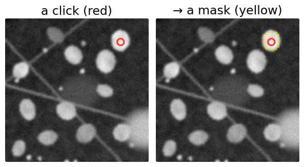
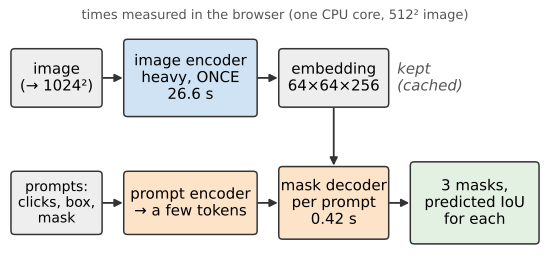
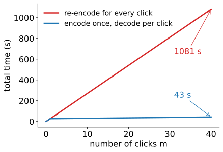
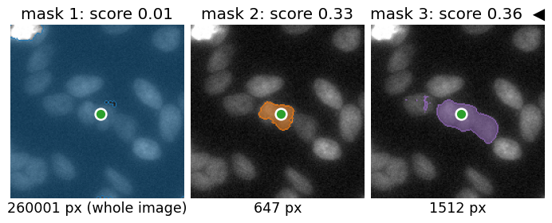
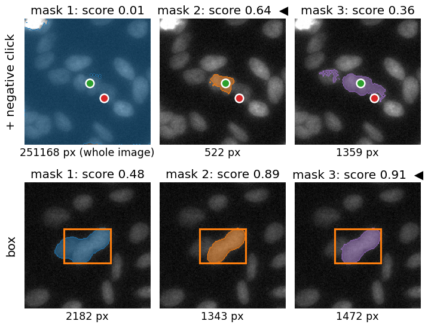
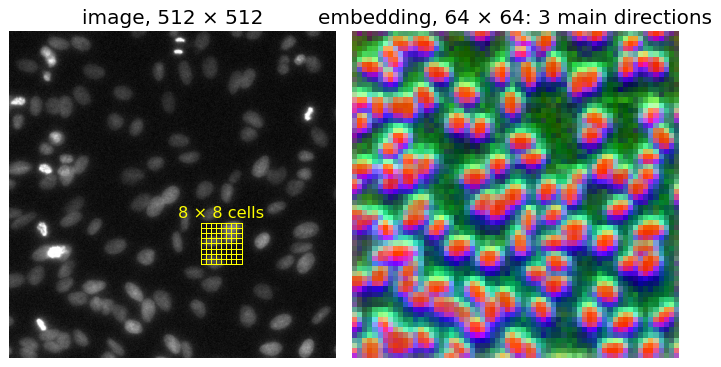
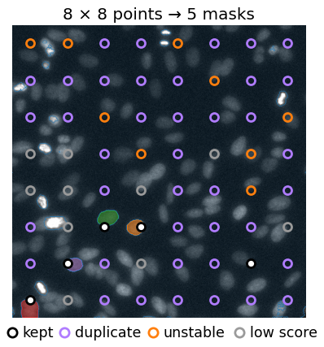
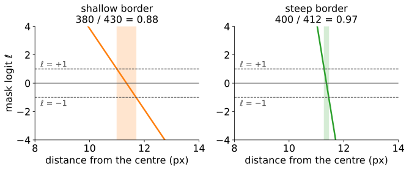
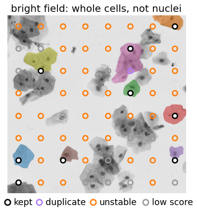
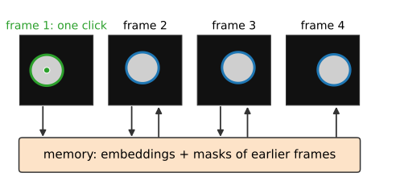

## About this lecture

StarDist, Cellpose and YOLO answer a fixed question: "where are the nuclei (or the objects of these classes)?". A **promptable segmenter** answers a different one: "what is the object **at this click**?". The family is called SAM ("segment anything"; Kirillov et al., 2023; second version with memory, Ravi et al., 2024).

- **Three parts**: a heavy image encoder run **once per image**, a light prompt encoder and mask decoder run **per click**.
- One click is **ambiguous**: three candidate masks, each with a **predicted IoU**.
- More prompts (a **negative click**, a **box**) remove the ambiguity.
- **Automatic masks**: a grid of clicks, then filters (score, **stability**, overlap).
- What it does **not** know: "a nucleus" is not one of its concepts.

*Slides titled **The math** give the formulas and proofs; the ideas are complete without them.*

::: notes
This unit owns promptable segmentation for the course (the [attention unit](../attention/lec.qmd) of the modern deep learning day has the one-slide miniature). Every number about the real network on these slides was measured with the same WebAssembly module the demo runs (SAM 2.1, smallest "tiny" size, 39 million weights), on one CPU core in the browser; the timings are in the demo's readout. Software packages with the same name implement this; nothing here depends on them.
:::

## Recall: a click becomes a mask

:::: {.columns}
::: {.column width="55%"}
From the [modern deep learning day](../attention/lec.qmd): compare every pixel's **embedding** with the clicked pixel's, keep what is similar, keep the connected piece that contains the click.

Today, the real network, and three questions:

- Why does a click take **half a second** when the image took **half a minute**?
- What should one click on a nucleus *mean*: the nucleus, a part of it, or its whole cluster?
- What happens when nobody clicks: "segment everything"?
:::
::: {.column width="45%"}
{fig-alt="The probe demo of the attention unit in click-prompt mode: a click on one bright nucleus and the mask from thresholding the embedding similarity: it covers that nucleus." width="100%"}
:::
::::

## Three parts: heavy once, light per click

:::: {.columns}
::: {.column width="42%"}
- **Image encoder**: a transformer on 16 × 16-pixel patches of the image resized to 1024 × 1024; pretrained, then trained on millions of masks. Output: an **embedding** of 64 × 64 positions × 256 numbers. Run **once per image**.
- **Prompt encoder**: clicks (labelled object or background), a box, or an earlier mask → a few **tokens**.
- **Mask decoder**: prompt tokens and the embedding attend to each other → masks. Run **per prompt**.
:::
::: {.column width="58%"}
{fig-alt="Block diagram: the image, resized to 1024 squared, goes through the heavy image encoder once (26.6 s in the browser) into an embedding of 64 by 64 by 256 that is kept. Prompts (clicks, box, mask) go through the prompt encoder into a few tokens; the mask decoder combines tokens and the cached embedding (0.42 s per prompt) into three masks with a predicted IoU each." width="100%"}
:::
::::

::: notes
Times measured in headless Chrome on one CPU core, 512 × 512 image: encoder 26.6 s, decoder (prompt encoder + mask decoder, three masks) 0.41–0.43 s. On a GPU both are a hundred times faster; the ratio is what matters. The 39 million weights are 78 MB as 16-bit numbers and are fetched once and cached by the browser.
:::

## Why it pays: encode once

:::: {.columns}
::: {.column width="45%"}
40 clicks on one image:

- encode once, decode per click: $26.6 + 40 \times 0.42 = 43$ s;
- re-encode for every click: $40 \times 27.0 = 1081$ s.

The expensive part depends only on the **image**; the cheap part depends on the **prompt**. Same idea as computing the random-forest feature stack once and only re-running the classifier when you paint.
:::
::: {.column width="55%"}
{fig-alt="Total time against the number of clicks, 0 to 40: re-encoding for every click grows by 27 s per click to 1081 s; encoding once starts at 26.6 s and grows by 0.42 s per click to 43 s." width="100%"}
:::
::::

## The math: cost of $m$ prompts {.math}

The encoder is a transformer on $N = 64^2 = 4096$ tokens: each self-attention layer builds an $N \times N$ matrix, cost $\propto N^2$ (attention unit). Done **once**.

The decoder attends from $k$ prompt tokens (a handful) to the $N$ image positions: cost $\propto kN$. Done **per prompt**.

$$T(m) = T_\text{enc} + m\,T_\text{dec} \quad\text{instead of}\quad m\,(T_\text{enc} + T_\text{dec}),$$

a speed-up $\dfrac{m(T_\text{enc} + T_\text{dec})}{T_\text{enc} + mT_\text{dec}} \to \dfrac{T_\text{enc} + T_\text{dec}}{T_\text{dec}} \approx 64$ for many prompts.

**Prompt points** enter as tokens: the coordinates are passed through sines and cosines of several frequencies (a positional encoding, as for the image patches), plus a learned vector for "object" or "background".

## One click is ambiguous

:::: {.columns}
::: {.column width="40%"}
A click inside a clump of nuclei. Did you mean this nucleus? A part of it? The clump?

The decoder does not guess one: it returns **three candidate masks** (roughly small, medium, large) and, for each, a **predicted IoU**: the network's own estimate of how good that mask is.

Here the scores are low (0.33, 0.36): the network itself says "unsure". Mask 1 is the whole background.
:::
::: {.column width="60%"}
{fig-alt="Real network, click in a clump of nuclei on the fluorescent nuclei image: mask 1 (score 0.01) covers almost the whole image, 260 001 pixels; mask 2 (score 0.33) is 647 pixels of the clicked nucleus; mask 3 (score 0.36, the highest) is 1512 pixels, the clicked nucleus and its touching neighbour." width="100%"}
:::
::::

::: notes
Image: StarDist test image (fluorescent nuclei, from the 2018 Data Science Bowl data), BSD-3-Clause. Same click, "single mask" mode (one output only): 1512 pixels, score 0.36. One click on an isolated nucleus (the demo's first preset) gives 0.003 (whole image), 0.867 (819 px, the nucleus) and 0.764 (930 px): the highest score is the nucleus, and the scores are high.
:::

## Which mask do you want?

The predicted IoU picks **one** by default (the highest), but the right choice depends on the **question**:

| Question | Mask |
|---|---|
| count nuclei | the single nucleus |
| area of the clump | the large one |
| texture inside a nucleus | possibly the small one |

- The scores are the network's **own** estimate. They are often right, but they are not an IoU with any truth: check them on annotated images ([evaluation day](../object-eval/lec.qmd)).
- When all three scores are low, the click is in a hard place. Add a prompt.

## The math: training with ambiguity {.math}

Training pairs: an image, a prompt, **one** true mask $M$ (an annotator meant something). Three outputs $\hat M_1, \hat M_2, \hat M_3$.

$$\mathcal L = \min_{j} \ \ell(\hat M_j, M) \;+\; \sum_j \big(\widehat{\text{IoU}}_j - \text{IoU}(\hat M_j, M)\big)^2 .$$

- Only the **best** output is pushed towards $M$. If the same click sometimes means the nucleus and sometimes the clump, one output learns each: the outputs **specialise** by size.
- An **average** loss $\tfrac13\sum_j \ell(\hat M_j, M)$ would push all three towards the *average* answer: a blurred in-between mask.
- The second term trains the **IoU head** to predict each output's true IoU with $M$: that is the score.

## More prompts remove ambiguity

:::: {.columns}
::: {.column width="40%"}
- **Negative click** on the neighbour: "not this". The chosen mask becomes the clicked nucleus (score 0.64).
- **Box**: the object fills the box. Scores 0.89 and 0.91 for the whole object.
- **Feed back the chosen mask** as a prompt, then click again to correct it: how annotation tools use it.

A negative click on empty **background** does almost nothing here: it removes no part of the clump.
:::
::: {.column width="60%"}
{fig-alt="Real network. Top: the click in the clump plus a negative click (red) on the touching neighbour: mask 2 (score 0.64, chosen) is 522 pixels of the clicked nucleus; mask 3 (1359 px) still reaches into the neighbour; mask 1 is the background. Bottom: a box around an elongated object: masks of 2182, 1343 and 1472 pixels with scores 0.48, 0.89 and 0.91." width="100%"}
:::
::::

::: notes
Measured: the demo's preset "+ a background click" puts the negative click on empty background at (120, 410); the three scores become 0.014, 0.534, 0.447, the chosen mask 483 px. A negative click on the neighbour (168, 448; not a preset, click it yourself) gives 0.011, 0.640, 0.364 and a chosen mask of 522 px. Feeding back the chosen mask on the one-click preset changes the scores from (0.003, 0.867, 0.764) to (0.880, 0.593, 0.873): with a mask as the prompt, the first output is no longer the background.
:::

## Try it: the real network

```{=html}
<link rel="stylesheet" href="../demos/dist/demo.css">
<div data-demo="samnet" data-preset="cluster"></div>
<script src="../demos/dist/samnet.js"></script>
```

::: notes
The network (2.4 MB module + 78 MB weights) loads once and is cached; the image encoder then runs about 27 s on one core (a progress line counts). Static view of this state: fig-samnet.png. Tour: preset "click in a cluster": three thumbnails with scores 0.01 / 0.33 / 0.36, decoder about 0.4 s. Click on the neighbour with "− background click": the chosen mask shrinks to one nucleus. "box around a nucleus": 0.48 / 0.89 / 0.91. Toggle "three candidates" off: one mask. The first thumbnail is the embedding (next slide), the second the decoder's 256 × 256 logits (red > 0). Then "automatic, 8 × 8 grid" (about 25 s): five masks, one of them the whole background; "loose" gives 19. Other images in the selector: U2OS nuclei, cells, histology, bright field; or your own image (read locally, never uploaded).
:::

## The embedding as a picture

:::: {.columns}
::: {.column width="45%"}
256 numbers per position: show the **three main directions** (principal components, recall the [PCA unit](../pca/lec.qmd)) as red, green, blue.

- Nuclei and background separate clearly: the encoder already "sees" objects.
- One position covers 16 × 16 pixels of the 1024² input: **8 × 8 pixels** of this 512² image.
- Objects much smaller than one cell of this grid are below the embedding's resolution; the decoder sharpens borders, but cannot invent an object the embedding blurred away.
:::
::: {.column width="55%"}
{fig-alt="Left: the 512 by 512 fluorescent nuclei image with an 8 by 8 grid of yellow cells drawn over one region, each cell 8 by 8 pixels. Right: the 64 by 64 embedding coloured by its first three principal components: nuclei red and purple blobs, background green; each nucleus spans a few embedding cells." width="100%"}
:::
::::

## The math: from logits to a mask {.math}

The decoder outputs, per candidate, a **logit** map $\ell$ on a $256 \times 256$ grid over the resized image (4 input pixels per cell; 2 pixels of a $512^2$ image).

- Restore: **bilinear** interpolation of $\ell$ to the image size (images unit), then threshold at 0: $M = \{p : \ell(p) > 0\}$.
- Resolution: features come from the $64 \times 64$ embedding (one position per 16 input pixels) plus higher-resolution features of the encoder's early layers; borders are sharper than 16 pixels, but objects of a few pixels have no position of their own.
- For an image of width $W$ resized to 1024: one embedding position covers $W/64$ original pixels (8 for $W = 512$, 10.9 for $W = 696$, 16 for $W = 1024$).

## Automatic masks: "segment everything"

:::: {.columns}
::: {.column width="45%"}
No prompts: click everywhere.

1. A grid of single clicks (8 × 8 = 64 points → 192 candidates).
2. Drop low **predicted IoU** (here: ≤ 0.8).
3. Drop **unstable** masks (next slide).
4. Drop **duplicates**: box overlap, keep the higher score (NMS, detection unit).

Nuclei image: 192 → 5 masks; one is the whole background. Pixels no mask covers stay unlabelled. Decoder time grows with the grid: 21 s (8 × 8), 84 s (16 × 16), 338 s (32 × 32).
:::
::: {.column width="55%"}
{fig-alt="Real network, automatic masks on the nuclei image: an 8 by 8 grid of points over the image; 5 points white (a kept mask), most purple (their masks were duplicates, mostly of the whole-background mask), some orange (unstable) and grey (low score). Four small coloured nucleus masks and a faint tint over the whole image." height="560px"}
:::
::::

::: notes
Measured fates of the 192 candidates (default filters: predicted IoU > 0.8, stability ≥ 0.95, box NMS 0.7): 129 dropped for a low score, 18 unstable, 40 duplicates, 5 kept (one of them the background, 259 239 px). Strict filters (0.9 / 0.97): 2 masks; loose (0.6 / 0.7 / 0.95): 19. Most grid points fall on background: with 8 × 8 points most nuclei are never clicked. The decoder costs about 0.33 s per point in the browser.
:::

## Stability: does the mask keep its shape?

:::: {.columns}
::: {.column width="42%"}
Threshold the same logit map at $+1$ and at $-1$ instead of 0:

$$\text{stability} = \frac{\text{area}(\ell > 1)}{\text{area}(\ell > -1)}.$$

- **Steep** border (the network is sure where the object ends): both masks almost equal, $400/412 = 0.97$: kept.
- **Shallow** border: $380/430 = 0.88$: dropped by a 0.95 filter. Its border is a guess.
:::
::: {.column width="58%"}
{fig-alt="Logit against distance from the centre of a round mask, with the thresholds plus one, zero and minus one. Left, shallow slope: the band between the two thresholds is 0.7 pixels wide; areas 380 and 430, stability 0.88. Right, steep slope: band 0.17 pixels; areas 400 and 412, stability 0.97." width="100%"}
:::
::::

## The math: stability is an IoU {.math}

Let $A = \{\ell > \delta\}$ and $B = \{\ell > -\delta\}$. Every pixel with $\ell > \delta$ also has $\ell > -\delta$: $A \subseteq B$. So

$$\text{IoU}(A, B) = \frac{|A \cap B|}{|A \cup B|} = \frac{|A|}{|B|} = \text{stability} \in [0, 1].$$

It is 1 exactly when no pixel has $-\delta < \ell \le \delta$: the logit jumps across the whole band at the border. With a logit slope $s$ per pixel at the border of a round mask of radius $r$, the band is $2\delta/s$ pixels wide and stability $\approx 1 - 4\delta/(s\,r)$: small objects need steeper borders to pass the same filter.

## Try it: a toy you can open up

```{=html}
<link rel="stylesheet" href="../demos/dist/demo.css">
<div data-demo="promptmask" data-preset="edge"></div>
<script src="../demos/dist/promptmask.js"></script>
```

::: notes
A toy with the same architecture, small enough to see through: the "encoder" smooths the image at three scales and estimates the background (once, about 140 ms); the "decoder" turns each click into three nested candidates (part: pixels that look like the clicked one; object: brighter than halfway to the brightest nearby pixel; group: the same on the coarsest scale), each a logit map. Its "score" is a proxy (stability at ±2 logits); the true IoU with the known nucleoli, nuclei and groups is printed underneath. Tour: "click on a nucleus edge": part 0.23 (a ring), object 0.89 with true IoU 0.84, group 0.79 (the touching pair). "click between two nuclei": object is one of the two (true IoU 0.90), group the pair. "+ negative click": the group shrinks from 1146 to 740 px. "box": object 0.82, true IoU 0.74. "automatic 8 × 8": 15 masks, F1 0.62 against the 11 nuclei; "strict filters": 5 masks, F1 0.25 (the most stable masks are clumps and the cell, not nuclei); "loose": 31 masks, F1 0.38. Click the cytoplasm of the big cell: the highest score of all (0.94) for a mask that is no nucleus.
:::

## What it does not know

:::: {.columns}
::: {.column width="45%"}
"A nucleus" is not a concept it was trained on; it was trained on **masks of anything**, mostly in photographs.

- Automatic masks contain **background regions, clumps and parts**; a click gives *a* mask, not a definition that is the same over 1000 images.
- **Domain shift**: bright field, right: it finds whole **cells** (the most "object-like" things), not the nuclei that were annotated: 0 of 98.
- **Small objects**: below the embedding's resolution, and rarely hit by a coarse grid.

Microscopy-tuned versions exist for this reason, and the newest Cellpose uses this encoder with its own flow decoder (the [Cellpose unit](../cellpose/lec.qmd)).
:::
::: {.column width="55%"}
{fig-alt="Real network, automatic masks (8 by 8 grid) on a bright-field image of cells: the nine kept masks cover whole cells or groups of cells; the small dark nuclei inside, which are the annotated objects, are not masks of their own. Most grid points are orange (unstable) or white (kept)." height="560px"}
:::
::::

::: notes
Measured on the sample images (default filters, 8 × 8 grid), F1 at IoU 0.5 against the annotated nuclei: U2OS nuclei 13 masks, F1 0.24 (13 found, 82 missed: most nuclei are never clicked by 64 points); histology 10 masks, F1 0.20; bright field 9 masks, F1 0.00 (the masks are cells, 4 471 to 25 132 px; nuclei have a median diameter of 18 px). With a human clicking: one click on the centre of each of the 95 U2OS nuclei gives 94 masks with IoU ≥ 0.5, including all 7 nuclei smaller than 16 px across. Bright-field image: 2018 Data Science Bowl (BBBC038), CC0.
:::

## Video and z-stacks: a memory

:::: {.columns}
::: {.column width="45%"}
The second version adds a **memory**: the embeddings and masks of earlier frames (or slices) are stored, and the decoder of the next frame attends to them too.

- One click in frame 1 → the object is followed through the stack.
- Fails when the object **leaves and comes back**, when two similar objects **cross**, or when a cell **divides** (which child is "the object"?).
- Tracking is its own topic: the [tracking day](../track-linking/lec.qmd).
:::
::: {.column width="55%"}
{fig-alt="Four frames of a movie with one round object moving slightly to the right. A click in frame 1 (green). Arrows from each frame down into a memory of embeddings and masks of earlier frames, and from the memory up into the next frame, whose object is outlined." width="100%"}
:::
::::

## Where this leads

- **Prompts from another method**: boxes from a detector (YOLO unit) → one mask per box: detection becomes instance segmentation.
- **Human in the loop**: click, correct with negative clicks, accept; a fast way to *make* training annotations for StarDist or Cellpose.
- **Classical counterpart**: the seeds of graph-cut segmentation ([graph-cut day](../graphcut-seg/lec.qmd)) are prompts too; there the "decoder" is a minimum cut on an intensity model of this image only.
- **Comparison** on the same annotated images with the [evaluation day](../object-eval/lec.qmd)'s matching: the [next unit](../cellnets-compare/lec.qmd).

## Summary

- **Promptable**: the question is "the object at this click", not "all objects of a class".
- **Heavy encoder once, light decoder per prompt**: 26.6 s + 0.42 s per click, a speed-up approaching 64 for many clicks.
- One click is **ambiguous**: three masks with a **predicted IoU** each; a negative click or a box removes the ambiguity.
- **Automatic masks**: grid of clicks + filters (score, **stability** = area(ℓ > 1)/area(ℓ > −1), box NMS); many points miss small objects.
- It knows **objects**, not **nuclei**: expect background regions, clumps, parts and whole cells; check against annotations.
