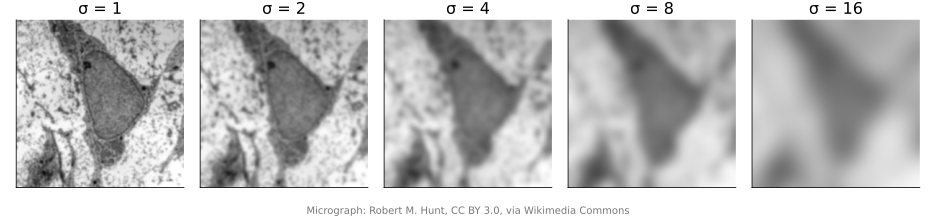
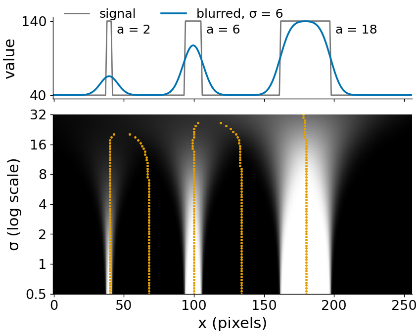
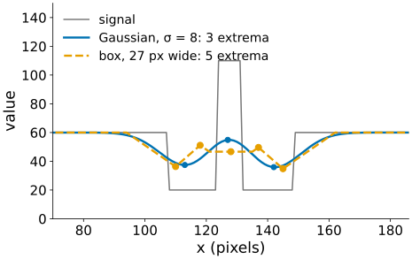
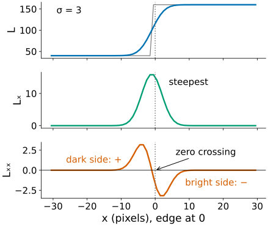
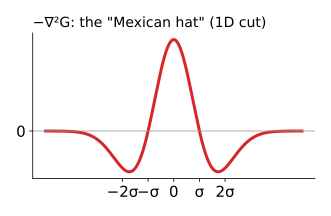
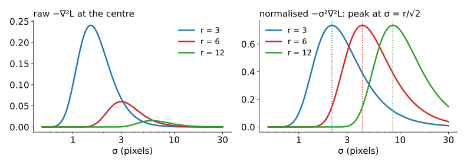
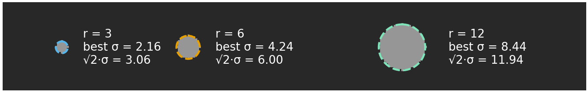
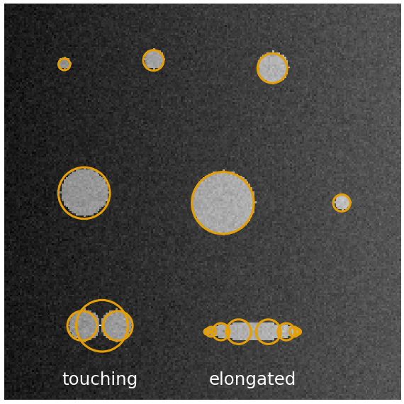
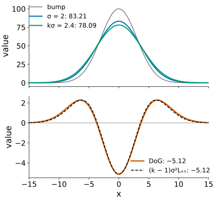
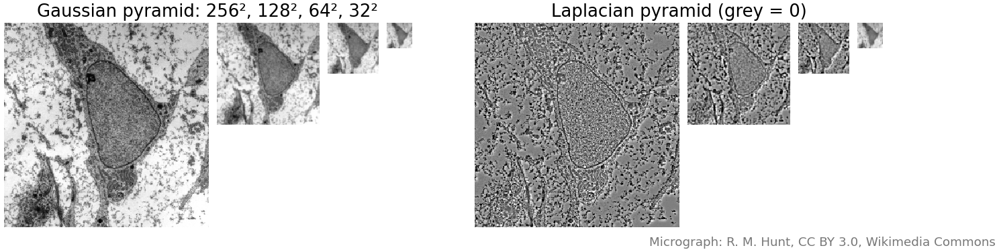

## About this lecture

Last unit: one σ for the whole image. But a nucleus is a blob at σ ≈ 10 pixels and texture at σ ≈ 1. Today: look at **all scales at once**.

- **Scale space**: the stack of all blurred versions of an image.
- Why the **Gaussian**: blurring removes structure, never invents it.
- **Second derivatives**: zero crossings mark edges; the **Laplacian of Gaussian** finds blobs.
- **Scale normalisation** (× σ²): each blob picks its own scale, and the scale gives its **size** (radius ≈ √2·σ).
- The **difference of Gaussians** and **image pyramids**: the cheap versions.

*Slides titled **The math** give the formulas and proofs; the ideas are complete without them.*

## Structures exist at a scale

{width="100%" fig-alt="The micrograph blurred at σ = 1, 2, 4, 8 and 16: texture and membranes disappear first, then granules and the nuclear envelope, until only the nucleus and the cell remain."}

- At σ = 1 we see texture and membranes; at σ = 4 the granules and the nuclear envelope; at σ = 16 only the nucleus and the cell as a whole.
- There is no single "right" σ for a whole image: each structure has its own.
- A leaf vein is an **edge** pair at a fine scale and a **line** at a coarser one.

## Scale space

:::: {.columns}
::: {.column width="54%"}
Compute the blurred image $L(x, y; \sigma) = G_\sigma * I$ for **every** σ: a stack, with σ as a third axis.

- For a 1D signal the stack is a 2D picture: position $x$ across, σ up (on a log scale, so each doubling of σ gets the same height).
- Follow a feature (a bump, an edge) as σ grows: it traces a **curve** in this picture, and the curve **ends** where the feature merges into a coarser one.
- Fine noise lives only at the bottom (small σ); a large structure survives up to large σ.
:::
::: {.column width="46%"}
{width="100%" fig-alt="Top: a 1D signal with three box bumps of half-widths 2, 6 and 18, and its blur at σ = 6. Below: the scale-space image, x across and σ up on a log scale from 0.5 to 32, with the extrema of the blurred signal as dots. Each bump traces a vertical curve that ends where it merges with a neighbouring dip; the narrow bump ends at a smaller σ than the wide one."}
:::
::::

The demo shows the stack of $L$, of the slope and of the curvature, with the features traced.

## Why the Gaussian?

:::: {.columns}
::: {.column width="54%"}
What we want from blurring: as σ grows, structure should only **disappear**, never **appear**.

- In 1D, Gaussian blurring never creates a new extremum (bump or dip) or a new zero crossing as σ grows. Curves in scale space end; they never start.
- Blurring by σ₁ and then by σ₂ is **one** blur by $\sqrt{\sigma_1^2 + \sigma_2^2}$: the scales form a chain, so any level can be computed from a finer one.
- Among smoothing kernels, the Gaussian is the **only** one with both properties (Babaud et al. 1986; Lindeberg).
- A **box** kernel of the same width can create new bumps: try it in the demo.
:::
::: {.column width="46%"}
{width="100%" fig-alt="A bright line inside a dark band, blurred at σ = 8. The Gaussian blur has 3 extrema, like the signal: two dips and one peak. A box blur of the same standard deviation (27 pixels wide) has 5: the line is split into two bumps with a dip between them."}
:::
::::

## The math: scale space as diffusion {.math}

- $L = G_\sigma * I$ solves the **heat equation** $\partial_t L = \tfrac12\nabla^2 L$ with "time" $t = \sigma^2$ and $L(\cdot, 0) = I$: blurring is heat flowing from bright to dark.
- **Semigroup**: in Fourier space a Gaussian is a Gaussian, $\widehat{G_\sigma}(\omega) = e^{-\sigma^2\omega^2/2}$, so

$$\widehat{G_{\sigma_1} * G_{\sigma_2}} = e^{-\sigma_1^2\omega^2/2}e^{-\sigma_2^2\omega^2/2} = e^{-(\sigma_1^2 + \sigma_2^2)\omega^2/2} \;\Rightarrow\; G_{\sigma_1} * G_{\sigma_2} = G_{\sqrt{\sigma_1^2 + \sigma_2^2}}.$$

- **Causality** (Koenderink 1984): by the heat equation, a local maximum can only decrease and a minimum only increase as $t$ grows, so in 1D extrema can merge and vanish but not be created.
- Honest note: in 2D, new local extrema **can** appear in rare configurations; the exact statement is about level sets (a weaker causality). It does not matter in practice.

## Try it: a 1D scale space

```{=html}
<link rel="stylesheet" href="../demos/dist/demo.css">
<div data-demo="scale1d" data-preset="bumps"></div>
<script src="../demos/dist/scale1d.js"></script>
```

::: notes
Top: the signal (three box bumps of half-widths 2, 6 and 18) and its blur. Middle: the scale-space image, x across, σ up from 0.5 to 32 (log); the dots trace the extrema of L. Bottom: the response at the clicked x against σ. Tour: "three bumps" (L): each bump's maximum survives up to a σ that grows with its width, then merges with the dip next to it. "Box kernel creates structure": the bright line in a dark band; at σ = 8 the box blur (27 pixels wide) splits the line into two bumps (5 extrema instead of 3); the Gaussian never does. "Noise lives at small σ": noise 10, L has 143 extrema at σ = 0.5, 45 at σ = 2, 18 at σ = 3.9. Then the curvature presets, which belong to the next slides.
:::

## Second derivatives and zero crossings

:::: {.columns}
::: {.column width="58%"}
The **Laplacian of Gaussian** (LoG) $\nabla^2 L = L_{xx} + L_{yy}$ (the Laplacian from the filtering unit, applied to the blurred image):

- At an edge it is **positive on the dark side** and **negative on the bright side**: it crosses zero exactly at the edge, where the slope is steepest.
- **Zero crossings** of the LoG are edges (Marr & Hildreth, 1980). They always form **closed** contours.
- Compared with Canny: no thresholds on a ridge and no thinning needed, but many weak spurious contours, and corners are badly rounded. Canny won for edges.
- The LoG is much better at something else: **blobs**.
:::
::: {.column width="42%"}
{width="100%" fig-alt="A step edge blurred with σ = 3 (top), its slope with a bump at the edge (middle), and its second derivative (bottom): positive on the dark side, negative on the bright side, crossing zero exactly at the edge."}
:::
::::

## Blobs: the Laplacian of Gaussian

:::: {.columns}
::: {.column width="58%"}
- A bright blob gives a strongly **negative** LoG at its centre (brightness curves down in every direction).
- We use $-\nabla^2 L$, so bright blobs are positive. As a kernel, $-\nabla^2 G_\sigma$ is the **"Mexican hat"**: a positive centre and a negative ring.
- The response is strongest when the hat's centre **fits** the blob: too small a σ sees only the flat inside, too large a σ averages the blob away.
- So the best σ tells us the **size** of the blob.
:::
::: {.column width="42%"}
{width="100%" fig-alt="A 1D cut through the Mexican hat −∇²G: a positive peak at the centre, crossing zero near ±σ, with negative lobes around ±2σ."}
:::
::::

## Why scale-normalise?

{width="88%" fig-align="center" fig-alt="LoG response at the centre of discs of radius 3, 6 and 12 against σ: raw, the small disc always wins; normalised by σ², each disc peaks at its own σ = r/√2."}

- Blurring flattens the image, so raw derivatives **shrink** as σ grows: the raw LoG always prefers small σ, and a large blob loses to a small one.
- Multiply by σ² (σ per derivative): this measures distances **in units of σ**, making scales comparable.
- Now each blob's response, plotted against σ, has a maximum at **its own** scale: **automatic scale selection** (Lindeberg).

## Size from scale

For a disc of radius $r$, the normalised LoG at its centre peaks at $\sigma = r/\sqrt2$.

- So a detection at scale σ is drawn as a circle of radius **$\sqrt2\,\sigma$**.
- Example: a blob detected at σ = 5 pixels has radius $\sqrt2 \cdot 5 = 7.1$ pixels; at 0.2 µm per pixel its diameter is $2 \cdot 7.1 \cdot 0.2 = 2.8$ µm.
- A Gaussian spot of width $s$ peaks at $\sigma = s$.
- 1D: a box of half-width $a$ peaks at $\sigma = a$ (the demo's three bumps: σ = 2, 6.14 and 17.67 on its grid of scales, for $a$ = 2, 6 and 18).

{width="100%" fig-alt="Discs of radius 3, 6 and 12 pixels with dashed circles of radius √2·σ drawn at the σ where the normalised LoG at the centre is largest: best σ = 2.16, 4.24 and 8.44, giving circles of radius 3.06, 6.00 and 11.94 that match the discs."}

## The math: normalisation and blob size {.math}

- **1D box** of half-width $a$, height 1: $L(x) = \Phi\!\big(\tfrac{x + a}{\sigma}\big) - \Phi\!\big(\tfrac{x - a}{\sigma}\big)$, so
  $\sigma^2 L_{xx}(0) = -2\,\tfrac{a}{\sigma}\,\varphi\!\big(\tfrac{a}{\sigma}\big) \propto -\tfrac{a}{\sigma}e^{-a^2/2\sigma^2}$, maximal in size where $\tfrac{d}{du}\big(u e^{-u^2/2}\big) = 0$: $u = a/\sigma = 1$.
- **2D disc** of radius $r$: by the divergence theorem, $\nabla^2 L(0) = \oint \nabla G_\sigma\cdot\mathbf n\,ds$ over the circle, so
  $$\sigma^2\nabla^2 L(0) = -\frac{r^2}{\sigma^2}\,e^{-r^2/2\sigma^2},\qquad \text{maximal in size at } r^2/\sigma^2 = 2,\; r = \sqrt2\,\sigma.$$
- **Gaussian blob** of width $s$: $\sigma^2\nabla^2 L(0) \propto -\sigma^2/(s^2 + \sigma^2)^2$, maximal at $\sigma = s$.
- Why exactly σ²: for derivatives of order $m$, normalise by $\sigma^{\gamma m}$; $\gamma = 1$ makes the response of a scaled copy of the image identical at the scaled σ (scale invariance). Other γ are used for ridges and edges (Lindeberg 1998); stated, not derived here.

## Detection: maxima in $(x, y, \sigma)$

:::: {.columns}
::: {.column width="60%"}
Compute $-\sigma^2\nabla^2 L$ for a range of σ (e.g. 16 levels from 1 to 16) and look for **local maxima in 3D**: larger than all 26 neighbours (8 in the same scale, 9 above, 9 below), and above a threshold. Draw each as a circle of radius $\sqrt2\,\sigma$.

What goes wrong:

- **Touching blobs**: one big blob or two small ones, depending on the scales.
- **Elongated blobs**: respond at their **width**, not their length; several small detections along them.
- **Edges** give weak responses along their sides (about a third of a blob's): a threshold, or the Hessian test of the next unit, rejects them.
- **Uneven background**: the LoG ignores constant and linear brightness changes, an advantage over thresholding.
:::
::: {.column width="40%"}
{width="100%" fig-alt="A synthetic image with bright discs of radii 3 to 16 on a background that brightens to the right, a touching pair and an elongated blob. Detections drawn as circles of radius √2·σ: every disc gets one circle of the right size; the touching pair gets two small circles and one big circle around both; the elongated blob gets a row of small circles along its length."}
:::
::::

## Try it: blobs over scales

```{=html}
<link rel="stylesheet" href="../demos/dist/demo.css">
<div data-demo="blobscale" data-preset="all" data-presets="one,raw,all,radius,touch,long,dog,pyramid"></div>
<script src="../demos/dist/blobscale.js"></script>
```

::: notes
256 × 256 synthetic: discs of radii 2–20, Gaussian spots, a touching pair, an elongated blob, uneven background, noise 6. The scale space (16 levels, σ = 1 … 16) is computed once; the σ slider only indexes it. Tour: "one σ finds one size" (σ = 4.39): 13 maxima, 8 of 15 blobs, all circles the same size. "All scales, normalised" (threshold 26): 28 detections, 14 of 15 blobs, circles of the right size; click the disc at (146, 30): its curve peaks at σ = 3.65, radius 5.2 (true 6). "Raw LoG": every detection sits at σ = 1; the big discs are missed. "Radius = √2·σ" with the truth: the r = 20 disc is found at σ = 13.3, radius 18.8. "Touching blobs": two circles at σ = 6.35 plus one big one around both (σ = 11.1). "Elongated blob": a row of small detections along it. "DoG matches LoG" (k = 1.2): almost the same result (21 detections, 13 of 15 blobs, against 28 and 14 for the LoG at threshold 26).
:::

## Difference of Gaussians

:::: {.columns}
::: {.column width="58%"}
Subtract two blurs: $\text{DoG} = G_{k\sigma} * I - G_\sigma * I$ (with $k$ = 1.2 to 1.6).

- It looks like (minus) a Mexican hat: a narrow positive centre minus a wider bump.
- $\text{DoG} \approx (k - 1)\,\sigma^2\,\nabla^2 L$: **already scale-normalised**.
- The blurs are needed anyway for scale space, so neighbouring levels give the DoG **for free**.
- Example (1D, a Gaussian bump of width 3 and height 100, σ = 2, k = 1.2): at the centre the two blurs are 83.21 and 78.09, DoG = −5.12; $(k - 1)\sigma^2 L_{xx} = 0.2 \cdot 4 \cdot (-6.40) = -5.12$.

Pointer: scale-invariant keypoints (SIFT, Lowe 2004) are DoG extrema in a pyramid, plus an orientation from the gradient.
:::
::: {.column width="42%"}
{width="100%" fig-alt="Top: a Gaussian bump of width 3 and height 100 blurred with σ = 2 (centre 83.21) and with kσ = 2.4 (centre 78.09). Bottom: their difference, the DoG, with centre −5.12, lies on top of (k − 1)σ² times the second derivative, also −5.12 at the centre."}
:::
::::

## The math: DoG ≈ LoG {.math}

The Gaussian satisfies the heat equation in the form $\partial_\sigma G_\sigma = \sigma\,\nabla^2 G_\sigma$ (check by differentiating $\frac{1}{2\pi\sigma^2}e^{-r^2/2\sigma^2}$). A finite difference in σ:

$$G_{k\sigma} - G_\sigma \approx (k\sigma - \sigma)\,\partial_\sigma G_\sigma = (k - 1)\,\sigma^2\,\nabla^2 G_\sigma.$$

- The factor σ² appears by itself: the DoG is the **normalised** LoG, up to the constant $k - 1$.
- The error is of order $(k - 1)^2$: for $k = 1.2$ a few percent, for $k = 1.6$ (Marr's choice) noticeably more, but the shape is the same.

## Image pyramids

After blurring by σ there is no detail finer than about σ: we can keep **fewer pixels**.

- **Gaussian pyramid**: blur, keep every second pixel in each direction, repeat. Each level has ¼ of the pixels of the one before: total $1 + \tfrac14 + \tfrac1{16} + \dots = \tfrac43$ of the image.
- Blur **before** downsampling, or fine detail **aliases** into false coarse patterns (recall the Fourier unit).
- **Laplacian pyramid**: each level minus the (upsampled) next level, a DoG; the coarsest level is kept as it is. Adding the levels back up gives the image **exactly**.
- Uses: coarse-to-fine search (registration, active shape models), fast large filters, image blending, mipmaps in computer graphics.

{width="100%" fig-alt="Left: a Gaussian pyramid of the micrograph, levels of 256, 128, 64 and 32 pixels square, each a blurred half-size copy. Right: the Laplacian pyramid, each level minus the upsampled next level: fine detail at the top level, coarser detail below, mostly near zero (grey); the last level is the small blurred image."}

## The math: the Laplacian pyramid is exact {.math}

Let $g_0 = I$, $g_{i+1} = \text{down}(G * g_i)$ and $l_i = g_i - \text{up}(g_{i+1})$ for $i < n$, $l_n = g_n$.

- Reconstruction from the top: $g_n = l_n$, and $g_i = l_i + \text{up}(g_{i+1})$ for $i = n-1, \dots, 0$.
- This is a **telescoping sum**: whatever $\text{up}$ and $\text{down}$ are, $g_0 = l_0 + \text{up}(l_1 + \text{up}(l_2 + \dots))$ holds exactly, because each $l_i$ was defined as the difference.
- The pyramid has $\tfrac43$ as many numbers as the image, but most $l_i$ values are near zero: the basis of early image compression (Burt & Adelson 1983).

## Where this leads

- **Hessian** (next unit): the LoG is the trace of the Hessian; its two eigenvalues tell a blob from a ridge, and reject edges.
- **Wavelets** (transforms elective): the Mexican hat is a wavelet; à trous spot detection.
- **Integral images** (detection elective): box filters as fast approximations of Gaussians and DoG.
- **Spot detection** in fluorescence images: LoG/DoG at a known spot size, then local maxima.

## Summary

- **Scale space**: all blurred versions $L(x, y; \sigma)$ at once. The Gaussian is the kernel that never creates structure; scales chain: $\sigma^2$ adds.
- **LoG**: zero crossings = edges (Marr–Hildreth); $-\nabla^2 L$ = blob detector (Mexican hat).
- **Normalise by σ²**, then each blob's response peaks at its own σ; **radius ≈ √2·σ**.
- Detect blobs as **maxima in (x, y, σ)**; watch touching, elongated blobs and edges.
- **DoG** ≈ (k − 1)·normalised LoG; **pyramids**: 4/3 of the pixels, Laplacian pyramid exactly invertible.
