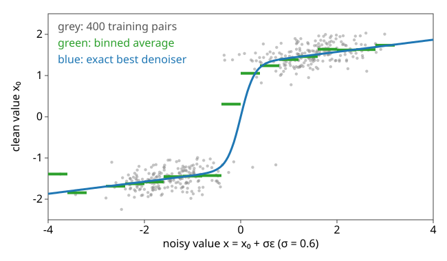

## Goal

By the end of this exercise you should be able to:

- convert between $\bar\alpha$, the **signal-to-noise ratio** and the **noise level σ**, and say which frequencies a noise level erases,
- give the **best denoiser** at one noise level: the Wiener gain for a Gaussian model, the conditional mean in general,
- explain why squared-error training on pairs we make ourselves (**denoising score matching**) learns the **score**,
- convert a predicted noise into a clean-image estimate and a score, and say where learned denoisers fail.

Do the pen-and-paper part first, then the demos. Questions marked *(math)* are for those who want the derivations; the concept questions do not depend on them.

## Background

| Idea | What it means |
|---|---|
| Noise level | $\mathbf x = \mathbf x_0 + \sigma\boldsymbol\varepsilon$; in the form of [the introduction](../diffusion/lec.qmd), $\sigma = \sqrt{(1-\bar\alpha)/\bar\alpha}$ |
| SNR | $\bar\alpha/(1-\bar\alpha) = 1/\sigma^2$; schedules are paths through the SNRs |
| Noise floor | white noise has the same power at every frequency; frequencies whose image power is below it are lost |
| Best denoiser | the conditional mean $\mathbb E[\mathbf x_0 \mid \mathbf x]$; for a Gaussian model, the Wiener gain $P/(P + \sigma^2)$ per frequency |
| Score | $\nabla\log p_\sigma(\mathbf x)$: the direction in which noisy data become more likely; $\mathbb E[\mathbf x_0\mid\mathbf x] = \mathbf x + \sigma^2\,\text{score}$ |
| Denoising score matching | squared-error regression of the clean image (or the noise) on the noisy one, over pairs we make ourselves |

{width=70%}

## By hand

**B1.** Three noise levels have $\bar\alpha = 0.8$, $0.5$ and $0.2$.
(a) Compute the SNR and the noise level σ of each.
(b) Which is the noisiest? What does σ = 2 mean in words, for data with standard deviation 1?

**B2.** An image model has power $P(f) = 1000/f^2$ at frequency $f$ (cycles per image). White noise at SNR $s$ has the same power $1/s$ at every frequency.
(a) Find the crossover frequency $f^{*}$ (power = noise floor) for SNR 1, 0.1 and 0.01.
(b) What does a tenfold drop in SNR do to $f^{*}$?
(c) Which part of an image does the forward process destroy first, and in which order does generation build it?

**B3.** Pixel values with mean 0 and variance 4 (assume Gaussian), noise level σ = 1.
(a) The best denoiser multiplies the noisy value by a number. Which?
(b) Repeat for σ = 2 and σ = 4. What happens to the multiplier as σ grows, and why is that sensible?

**B4.** Data: $x_0 = +1$ or $-1$, equally likely. Noise level σ = 1. Eight training pairs (noisy $x$, clean $x_0$):

| $x$ | −2.1 | −1.3 | −0.6 | −0.4 | 0.3 | 0.9 | 1.2 | 2.4 |
|---|---|---|---|---|---|---|---|---|
| $x_0$ | −1 | −1 | −1 | +1 | −1 | +1 | +1 | +1 |

(a) Average the clean values in the two bins $x < 0$ and $x \ge 0$.
(b) For this data the exact denoiser is $\mathbb E[x_0\mid x] = \tanh(x)$. Average $\tanh(x)$ over the four $x$ in each bin and compare with (a).
(c) Why is the bin average not exactly the curve, and what happens with 8 000 pairs?

**B5.** A network predicts the noise $\hat\varepsilon = -1$ at $x_t = 1$ with $\sqrt{\bar\alpha} = 0.8$ (so $\sqrt{1-\bar\alpha} = 0.6$). Compute the clean-image estimate $\hat x_0$, the score $-\hat\varepsilon/\sqrt{1-\bar\alpha}$, and the "velocity" $v = \sqrt{\bar\alpha}\,\hat\varepsilon - \sqrt{1-\bar\alpha}\,\hat x_0$.

**B6.** A denoiser was trained on images of cells, 95 % of one type and 5 % of a rare type.
(a) Where in the space of images are training pairs sparse?
(b) Why may the learned score near rare cells point towards the common type, although the exact score points towards the rare one?

::: {.callout-note collapse="true" title="Solutions"}
**B1.** (a) SNR $= \bar\alpha/(1-\bar\alpha)$: 4, 1, 0.25. σ $= 1/\sqrt{\text{SNR}}$: 0.5, 1, 2. (b) $\bar\alpha = 0.2$. σ = 2: the noisy image is the clean image plus noise twice as large (in standard deviation) as the data themselves.

**B2.** (a) $1000/f^2 = 1/s$ gives $f^{*} = \sqrt{1000\,s}$: 31.6, 10 and 3.2 cycles per image. (b) It divides $f^{*}$ by $\sqrt{10} = 3.16$. (c) The high frequencies (fine detail) drown first, the coarse layout last; generation reverses this: coarse layout first, fine detail last.

**B3.** (a) $4/(4 + 1) = 0.8$. (b) σ = 2: $4/8 = 0.5$; σ = 4: $4/20 = 0.2$. The multiplier falls towards 0: the noisier the measurement, the more the best guess stays at the mean of the data.

**B4.** (a) $x < 0$: $(-1 - 1 - 1 + 1)/4 = -0.5$. $x \ge 0$: $(-1 + 1 + 1 + 1)/4 = +0.5$. (b) $\tanh$ at −2.1, −1.3, −0.6, −0.4: −0.970, −0.862, −0.537, −0.380, mean −0.687. At 0.3, 0.9, 1.2, 2.4: 0.291, 0.716, 0.834, 0.984, mean 0.706. (c) Each bin has four random pairs: the label of a pair is a coin flip weighted by $P(+1\mid x) = (1 + \tanh x)/2$ (for $x = -0.4$: 0.31, and here it came up +1). With 8 000 pairs and narrow bins the bin averages converge to the curve: the average **is** the denoiser.

**B5.** $\hat x_0 = (1 - 0.6\cdot(-1))/0.8 = 2.0$. Score $= 1/0.6 = 1.67$. $v = 0.8\cdot(-1) - 0.6\cdot 2.0 = -2.0$.

**B6.** (a) Far from all cells (unlike any training image) and, at low noise, between the types; around the rare type there are 19 times fewer pairs than around the common one. (b) Squared error is an average over all pairs: errors on the rare 5 % cost little, so a network of limited size or training fits the common type first. Its score near rare cells is then the score of "mostly common cells", which points away from the rare ones; samples rarely end there (the rare blob of the introduction).
:::

### Math questions

**B7.** *(math)* Prove the denoising score matching identity: for any $\mathbf s_\theta$, $\mathbb E\|\mathbf s_\theta(\mathbf x) - \nabla\log p(\mathbf x\mid\mathbf x_0)\|^2 = \mathbb E\|\mathbf s_\theta(\mathbf x) - \nabla\log p_\sigma(\mathbf x)\|^2 + C$, with $C$ independent of $\theta$.

**B8.** *(math)* Derive the score of the forward kernel $p(\mathbf x_t \mid \mathbf x_0) = \mathcal N(\sqrt{\bar\alpha}\,\mathbf x_0, (1-\bar\alpha)I)$ and write it in terms of the noise $\boldsymbol\varepsilon$.

**B9.** *(math)* For $x_0 \sim \mathcal N(0, P)$ and $x = x_0 + \sigma\varepsilon$, show $\mathbb E[x_0 \mid x] = \frac{P}{P + \sigma^2}x$ (the Wiener gain), and check it with Tweedie's formula $\mathbb E[x_0\mid x] = x + \sigma^2\nabla\log p_\sigma(x)$.

**B10.** *(math)* Show $\|\boldsymbol\varepsilon - \hat{\boldsymbol\varepsilon}\|^2 = \text{SNR}\,\|\mathbf x_0 - \hat{\mathbf x}_0\|^2$ when $\hat{\mathbf x}_0$ is computed from $\hat{\boldsymbol\varepsilon}$. What does that mean for a loss on the noise, at high and at low SNR?

::: {.callout-note collapse="true" title="Solutions (math)"}
**B7.** Write $\mathbf g = \nabla\log p(\mathbf x\mid\mathbf x_0)$, $\mathbf h = \nabla\log p_\sigma(\mathbf x)$. Left: $\mathbb E\|\mathbf s_\theta\|^2 - 2\mathbb E[\mathbf s_\theta^\top\mathbf g] + \mathbb E\|\mathbf g\|^2$; right: $\mathbb E\|\mathbf s_\theta\|^2 - 2\mathbb E[\mathbf s_\theta^\top\mathbf h] + \mathbb E\|\mathbf h\|^2$. The first terms are equal (they depend on $\mathbf x$ only); the last terms do not involve θ. Cross term: $\mathbb E_{\mathbf x_0,\mathbf x}[\mathbf s_\theta(\mathbf x)^\top\mathbf g] = \iint \mathbf s_\theta(\mathbf x)^\top\nabla_{\mathbf x}p(\mathbf x\mid\mathbf x_0)\,p(\mathbf x_0)\,d\mathbf x_0\,d\mathbf x = \int\mathbf s_\theta^\top\nabla p_\sigma(\mathbf x)\,d\mathbf x = \mathbb E_{\mathbf x}[\mathbf s_\theta^\top\mathbf h]$, using $p\,\nabla\log p = \nabla p$ twice and $p_\sigma(\mathbf x) = \int p(\mathbf x\mid\mathbf x_0)p(\mathbf x_0)\,d\mathbf x_0$. So the two objectives differ by a constant and have the same minimiser.

**B8.** $\log p = -\|\mathbf x_t - \sqrt{\bar\alpha}\mathbf x_0\|^2/(2(1-\bar\alpha)) + \text{const}$, so $\nabla_{\mathbf x_t}\log p = -(\mathbf x_t - \sqrt{\bar\alpha}\mathbf x_0)/(1-\bar\alpha)$. With $\mathbf x_t - \sqrt{\bar\alpha}\mathbf x_0 = \sqrt{1-\bar\alpha}\,\boldsymbol\varepsilon$: $-\boldsymbol\varepsilon/\sqrt{1-\bar\alpha}$. Regressing the score on this target is regressing $-\hat{\boldsymbol\varepsilon}/\sqrt{1-\bar\alpha}$ on $-\boldsymbol\varepsilon/\sqrt{1-\bar\alpha}$: noise prediction.

**B9.** $(x_0, x)$ is jointly Gaussian with $\operatorname{Var}(x) = P + \sigma^2$, $\operatorname{Cov}(x_0, x) = P$; the conditional mean of a jointly Gaussian pair is $\frac{\operatorname{Cov}}{\operatorname{Var}}x = \frac{P}{P+\sigma^2}x$. Tweedie: $p_\sigma = \mathcal N(0, P + \sigma^2)$, $\nabla\log p_\sigma = -x/(P + \sigma^2)$, $x - \sigma^2x/(P + \sigma^2) = Px/(P + \sigma^2)$. Same.

**B10.** $\mathbf x_t = \sqrt{\bar\alpha}\mathbf x_0 + \sqrt{1-\bar\alpha}\boldsymbol\varepsilon = \sqrt{\bar\alpha}\hat{\mathbf x}_0 + \sqrt{1-\bar\alpha}\hat{\boldsymbol\varepsilon}$ (that is how $\hat{\mathbf x}_0$ is computed). Subtract: $\sqrt{1-\bar\alpha}(\boldsymbol\varepsilon - \hat{\boldsymbol\varepsilon}) = \sqrt{\bar\alpha}(\hat{\mathbf x}_0 - \mathbf x_0)$; square: $\|\boldsymbol\varepsilon - \hat{\boldsymbol\varepsilon}\|^2 = \frac{\bar\alpha}{1-\bar\alpha}\|\mathbf x_0 - \hat{\mathbf x}_0\|^2$. A loss on the noise weights clean-image errors by the SNR: heavily at low noise (high SNR), lightly at high noise. Numerical check: $\bar\alpha = 0.36$ (SNR 0.5625), clean error 0.4 → noise error $0.5625 \cdot 0.16 = 0.09$.
:::

## Explore: noise against the spectrum {#explore-noisespectrum}

A $128 \times 128$ image (a crop of the course micrograph, or synthetic nuclei), scaled to mean 0 and variance 1, plus white noise of level σ. Panels: the clean and the noisy image; the **Wiener denoiser** that knows only the image's own radially averaged power spectrum (the "Gaussian image model"); a **sample** of that Gaussian model (random phases with the same spectrum). Right: the radially averaged power spectrum with the noise floor (red) and the crossover (dashed), and the schedule $\bar\alpha(\tau)$ with the time at which this SNR is reached.

```{=html}
<link rel="stylesheet" href="../demos/dist/demo.css">
<div data-demo="noisespectrum" data-preset="fine"></div>
<script src="../demos/dist/noisespectrum.js"></script>
```

**N1.** Preset **fine detail goes first** (micrograph, SNR 10). Up to which frequency is the image above the noise floor? Lower the log-SNR to 0 and to −2.3. Read the crossover each time. Compare with B2.

**N2.** At SNR 1 (log-SNR 0), compare the mean squared error of the noisy image and of the Wiener estimate. What has the Wiener filter removed, and what has it kept?

**N3.** Preset **high noise: Wiener is a blur**. What is left in the Wiener estimate? Read τ on the cosine and on the linear schedule. Which schedule spends more of its time at such low SNR?

**N4.** Preset **a Gaussian prior knows the spectrum, not the cells**. Compare the sample of the Gaussian model with the clean nuclei, then press **resample**. What does the Gaussian model get right, and what does it miss? What does that say about the Wiener filter as a denoiser of real images?

::: {.callout-note collapse="true" title="Solutions"}
**N1.** At SNR 10 (log-SNR 2.3) the micrograph stays above the floor up to 60 cycles per image; at SNR 1: 20; at SNR 0.1 (log-SNR −2.3): 6. As in B2, each tenfold drop in SNR moves the crossover down by a factor of about 3 (60 → 20 → 6), here slightly irregularly because the spectrum is not an exact power law.

**N2.** Noisy: 1.005 (the noise variance, σ = 1); Wiener: 0.197. It removed the frequencies that are below the noise floor (above about 20 cycles per image: fine texture and noise alike) and kept the coarse structure: the nucleus, the envelope, the large dark regions.

**N3.** Only the coarsest layout (crossover 2 cycles per image at SNR 0.01): bright and dark halves, the outline of the nucleus as a smudge. τ = 0.94 on the cosine schedule and 0.68 on the linear one: the linear schedule reaches such low SNR much earlier and then stays there for the last third of its time; the cosine schedule spreads its time more evenly over the SNRs.

**N4.** It gets the **spectrum** right: the amount of coarse and fine variation, blob sizes on average. It misses everything that lives in the **phases**: there are no separate, round, bright nuclei with sharp edges on a flat background, only clouds. The Wiener filter is optimal for this Gaussian model; for real images the best denoiser (the conditional mean) knows more (edges, objects) and keeps sharper detail where the data allow.
:::

## Explore: pairs, averages and a learned network {#explore}

1D data from a mixture of Gaussians, so the best denoiser is exact. Top: the data density (grey) and the noised density $p_\sigma$ (blue). Middle: 400 training pairs (noisy value, target), the **binned average** (green), the **exact** best denoiser (blue) and a small **learned** network (red dashed; 2 → 32 → 32 → 1, trained offline by denoising score matching for 200, 2 000 or 20 000 steps; **train 500 more steps** continues in the browser). The target can be the clean value, the noise, or the score. Bottom: the score, exact and learned. Shaded: bins with fewer than 3 pairs.

```{=html}
<link rel="stylesheet" href="../demos/dist/demo.css">
<div data-demo="scorematch1d" data-preset="binned"></div>
<script src="../demos/dist/scorematch1d.js"></script>
```

**S1.** Preset **the binned average is the denoiser** (two narrow modes at ±1.5, σ = 0.6). Where does the green step line follow the blue curve, and where not? Read the mean denoising error of the exact denoiser.

**S2.** Preset **high noise: towards the mean** (σ = 2.5). What does the best denoiser do with a noisy value of 1.5? Explain with B3. Then preset **low noise: a staircase** (σ = 0.15): describe the curve, and count the sparse bins.

**S3.** Preset **under-trained: wrong far out** (wide + narrow modes, σ = 0.3, network after 200 steps). Where do learned and exact curves disagree? Switch to 2 000 and 20 000 steps. Where does the disagreement remain, and why?

**S4.** Preset **rare mode: the learned score** (5 % rare mode at 2.5, σ = 0.3, network after 2 000 steps). Compare the exact and the learned score between 2 and 3. Where would a sampler using the learned score send points that start near the rare mode? Switch to 20 000 steps.

**S5.** Preset **predict noise or clean: same curve**. Switch the target between clean, noise and score. What changes, and what stays the same? Check B5's conversion on one point of the curves.

**S6.** Choose **none** as network and press **train 500 more steps** a few times on the two narrow modes. Which part of the curve does the network get right first?

::: {.callout-note collapse="true" title="Solutions"}
**S1.** In the middle of each mode the steps sit on the curve; they deviate where bins hold few pairs (between the modes near 0, and in the shaded tails, 5 of the 20 bins have fewer than 3 pairs). Mean denoising error of the exact denoiser: 0.132; the 2 000-step network: 0.138.

**S2.** At σ = 2.5 the denoiser is nearly a straight line towards the data mean 0: a noisy 1.5 is mapped to 0.52 (B3: much noise, strong shrinkage; it cannot tell which mode the value came from). At σ = 0.15 the curve is a staircase: flat at −1.5 and +1.5, with a steep jump at 0: each noisy value is sent to its own mode. 12 of the 20 bins have fewer than 3 pairs; the denoising error is 0.016.

**S3.** They agree where the data are dense and disagree most in the right tail beyond the narrow mode: at $x = 3.5$ the exact denoiser gives 2.28, the 200-step network 3.25, the 2 000-step 2.73, the 20 000-step 2.62. More training fixes the middle (error 0.079 → 0.059 → 0.058 against 0.057 exact), but in the tail there are almost no pairs, so nothing tells the network what to do there.

**S4.** Exact: the score at $x = 2$ is +4.4 (towards the rare mode at 2.5), at $x = 3$ it is −4.4 (back towards it from the other side). Learned (2 000 steps): −1.45 and −1.70: it points left everywhere, towards the common mode. A sampler would move such points towards the common mode: the rare mode is under-generated. After 20 000 steps the learned score is +3.9 at $x = 2$ and −3.8 at $x = 3$: the rare mode is learned, late.

**S5.** The scatter and the axis change (clean value, noise $(x - x_0)/\sigma$, or $-(x - x_0)/\sigma^2$), but the curves carry the same information: each is computed from the same denoiser. On the noise target at σ = 0.6 the curve is $(x - \hat x_0)/\sigma$; at $x = 1.5$ (centre of a mode, $\hat x_0 = 1.5$) it is 0. Same conversions as B5.

**S6.** After 500 steps the plateaus inside the modes are already right (error at σ = 0.6: 0.138 against 0.132 exact; at σ = 0.15 the network maps −1.5 to −1.52). What lags is the steep jump **between** the modes at low noise: at σ = 0.15 and $x = 0.3$ the network gives 0.35 where the exact denoiser gives 0.62, and still 0.38 after 1 500 steps. Set the noise level slider to 0.15 to see it. The low-noise, between-mode detail is the hardest part.
:::

## Where this leads

The denoiser at every noise level is all a sampler needs. The next unit, [Samplers, steps, and judging the samples](../diffusion-sampling/lec.qmd), follows its arrows from noise to data, deterministically or with fresh noise, and asks how many steps that takes and how to judge the result.
