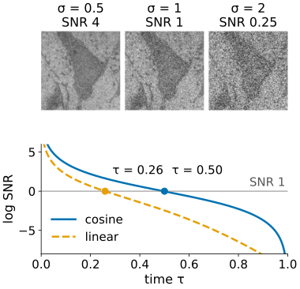
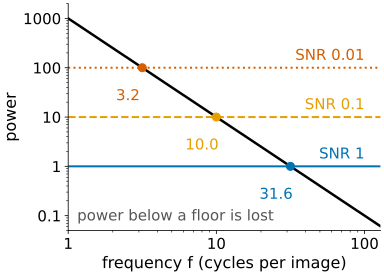
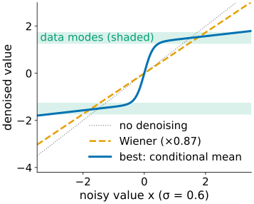
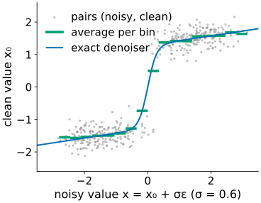
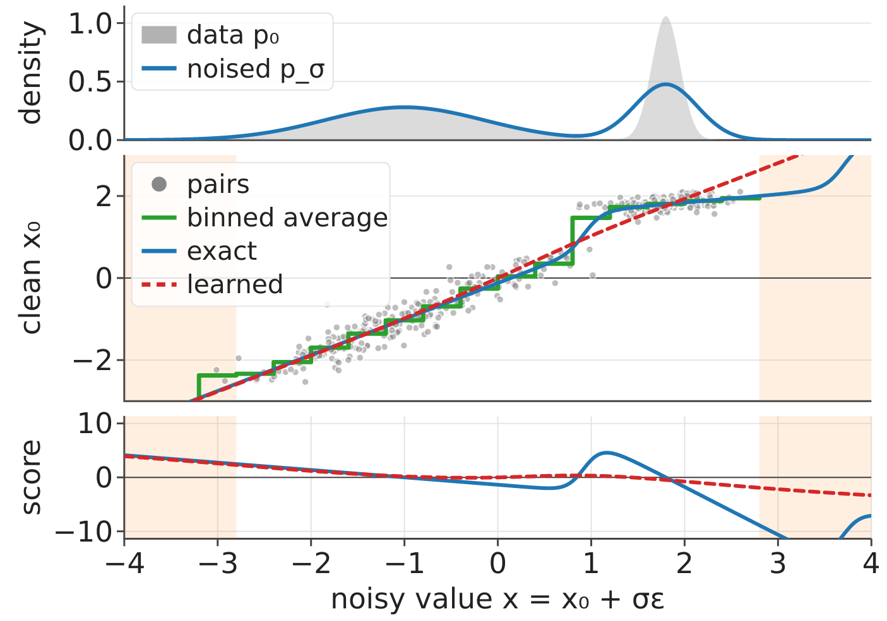

## About this lecture

*What exactly does a network learn when we teach it to remove noise?*

- A noise level is a **signal-to-noise ratio**; schedules differ in how long they stay at each one.
- Noise erases **fine detail first**, so generation paints **coarse first**.
- The best denoiser at one noise level: for a Gaussian image model it is the **Wiener filter**; in general the **average clean image** compatible with the noisy one.
- **Denoising score matching**: squared-error training on pairs we make ourselves gives the **score** of the noised data, without ever knowing the density of images.
- One network for all noise levels; three equivalent outputs (noise, clean image, score).

*Slides titled **The math** give the formulas and proofs; the ideas are complete without them.*

::: notes
This is the first unit of the elective day on diffusion models. It recalls the introduction in diffusion/ (day 18) and goes deeper; it does not repeat its forward formula or its sampling steps. Demos: diffusion2d (recall, unchanged), scorematch1d (pairs, binned average, exact and learned denoiser in 1D), noisespectrum (spectrum, noise floor, Wiener, Gaussian samples).
:::

## Recall: diffusion in one slide

From [Diffusion models and generated detail](../diffusion/lec.qmd): add noise until only noise is left ($\mathbf x_\tau = \sqrt{\bar\alpha}\,\mathbf x_0 + \sqrt{1-\bar\alpha}\,\boldsymbol\varepsilon$), train a network to **remove** it, and generate by denoising pure noise step by step. The best denoiser returns an **average** of the compatible clean images.

```{=html}
<link rel="stylesheet" href="../demos/dist/demo.css">
<div data-demo="diffusion2d" data-preset="forward"></div>
<script src="../demos/dist/diffusion2d.js"></script>
```

## A noise level is a signal-to-noise ratio

:::: {.columns}
::: {.column width="56%"}
Divide $\mathbf x_\tau$ by $\sqrt{\bar\alpha}$: the noisy image is **clean image + noise of size σ**, with

$$\text{SNR} = \frac{\bar\alpha}{1-\bar\alpha}, \qquad \sigma = \frac{1}{\sqrt{\text{SNR}}}.$$

- $\bar\alpha = 0.8, 0.5, 0.2$: SNR 4, 1, 0.25; σ = 0.5, 1, 2 (in units of the data). Recall SNR from [camera noise](../cameranoise/lec.qmd).
- From here on: "**noise level σ**", $\mathbf x = \mathbf x_0 + \sigma\boldsymbol\varepsilon$. Time and schedule only say **which σ when**.
- Two schedules (linear, cosine) are two paths through the same SNRs: on a **log-SNR** axis they differ only in how long they linger at each level. SNR 1 is reached at τ = 0.26 (linear) and τ = 0.50 (cosine).
:::
::: {.column width="44%"}
{fig-alt="Top: the micrograph (scaled to −1…1) plus noise of size σ = 0.5, 1 and 2 (SNR 4, 1, 0.25); the cell fades as σ grows. Bottom: log-SNR against time τ for the cosine schedule (solid) and the linear schedule (dashed); they cross SNR 1 (log SNR 0) at τ = 0.50 and τ = 0.26." width="100%"}
:::
::::

## What noise destroys first

:::: {.columns}
::: {.column width="56%"}
Image power falls with frequency (recall the power spectrum of [the Fourier unit](../fourier/lec.qmd)); white noise is **flat**. At each noise level, every frequency whose power lies below the **noise floor** is gone.

- So the forward process erases **fine detail first** and coarse layout last, and generation (the reverse) paints **coarse layout first**, fine detail last.
- Numbers: power $1000/f^2$, noise floor $1/\text{SNR}$. Crossover $f^{*} = \sqrt{1000\,\text{SNR}}$: SNR 1 → 31.6, 0.1 → 10, 0.01 → 3.2 cycles per image. Ten times less SNR: the crossover drops by $\sqrt{10}$.
:::
::: {.column width="44%"}
{fig-alt="Log-log plot of the image power 1000/f² against frequency, with flat noise floors for SNR 1, 0.1 and 0.01 (power 1, 10, 100). The power line crosses them at 31.6, 10 and 3.2 cycles per image; frequencies to the right of a crossing are below the floor and lost." width="100%"}
:::
::::

## Try it: noise against the spectrum

```{=html}
<link rel="stylesheet" href="../demos/dist/demo.css">
<div data-demo="noisespectrum" data-preset="fine"></div>
<script src="../demos/dist/noisespectrum.js"></script>
```

::: notes
Tour (numbers from the demo's code). "fine detail goes first", SNR 10 on the micrograph: power above the floor up to 60 cycles per image; the Wiener estimate already removes most of the noise (MSE 0.063 against 0.101). Slide the log-SNR to 0 (SNR 1): crossover 20; Wiener MSE 0.197 against 1.005 for the noisy image. "high noise" (SNR 0.01): crossover 2: the Wiener estimate is a blur with only the coarsest layout left. Schedule: SNR 1 is τ = 0.50 on the cosine schedule and 0.26 on the linear one. "a Gaussian prior knows the spectrum, not the cells": the sample of the Gaussian model has the right spectrum but looks like clouds, no nuclei.
:::

## The best denoiser at one noise level

:::: {.columns}
::: {.column width="55%"}
- **Gaussian image model** (only a power spectrum $P(f)$, random phases): the best denoiser is the **Wiener filter** of [the deconvolution day](../deconv/lec.qmd) with no blur: per frequency, multiply by $P/(P + \sigma^2)$: keep what lies above the noise floor, shrink what lies below.
- Example: data with variance 4, noise level σ = 1: multiply by $4/5 = 0.8$. At σ = 2: 0.5; σ = 4: 0.2. More noise, more shrinkage towards the mean.
- **Real images** are not Gaussian. The best denoiser (lowest squared error) is the **conditional mean**: the average of all clean images that could have produced this noisy one. Sharper than Wiener where the data say what is there, an average where they do not.
:::
::: {.column width="45%"}
{fig-alt="Denoised value against noisy value for data with two narrow modes at ±1.5 (sd 0.25), noise level σ = 0.6. The Wiener filter is a straight line with slope 0.87; the best denoiser (conditional mean) is an S-curve that sends each noisy value to its mode, flat near the modes and steep between them." width="100%"}
:::
::::

## The math: the optimal denoiser for a Gaussian prior {.math}

One frequency (or one pixel), $x_0 \sim \mathcal N(0, P)$, $x = x_0 + \sigma\varepsilon$. Jointly Gaussian, so

$$\mathbb E[x_0 \mid x] = \frac{\operatorname{Cov}(x_0, x)}{\operatorname{Var}(x)}\,x = \frac{P}{P + \sigma^2}\,x,$$

the Wiener gain. Tweedie gives the same: $p_\sigma = \mathcal N(0, P + \sigma^2)$, $\nabla\log p_\sigma(x) = -x/(P + \sigma^2)$ and

$$\mathbb E[x_0 \mid x] = x + \sigma^2\nabla\log p_\sigma(x) = x\Big(1 - \frac{\sigma^2}{P + \sigma^2}\Big) = \frac{P}{P+\sigma^2}x.$$

For a sum of independent frequencies the problem separates: the Wiener filter is the optimal denoiser of the Gaussian image model. Any squared-error minimiser is the conditional mean: $\mathbb E\|f(x) - x_0\|^2 = \mathbb E\|f(x) - \mathbb E[x_0\mid x]\|^2 + \text{const}$.

## Denoising score matching, intuition first

:::: {.columns}
::: {.column width="54%"}
1. Make training **pairs** ourselves: take a clean image, add noise we choose. The noise is the label.
2. Regress the clean image (or the noise) on the noisy one with **squared error**.
3. A squared-error learner converges to the **average target for each input**: the conditional mean $\mathbb E[\mathbf x_0 \mid \mathbf x]$.
4. That average is one step along the **score**, the direction in which noisy images become more likely: $\hat{\mathbf x}_0 = \mathbf x + \sigma^2 \times \text{score}$ (Tweedie).

We never need the density of images. The binned average of the pairs **is** the denoiser.
:::
::: {.column width="46%"}
{fig-alt="400 training pairs (noisy value, clean value) for data at ±1.5 with noise level σ = 0.6, the average clean value per bin of the noisy value (green steps) and the exact best denoiser (blue S-curve). The binned averages lie on the exact denoiser." width="100%"}
:::
::::

## Try it: pairs, averages and a learned network

```{=html}
<link rel="stylesheet" href="../demos/dist/demo.css">
<div data-demo="scorematch1d" data-preset="binned"></div>
<script src="../demos/dist/scorematch1d.js"></script>
```

::: notes
1D data: two narrow modes at ±1.5 (sd 0.25). Tour. "the binned average is the denoiser" (σ = 0.6): the green steps follow the blue exact curve; mean denoising error 0.132. "high noise" (σ = 2.5): the denoiser is almost a straight line towards the mean 0 (D(1.5) = 0.52). "low noise" (σ = 0.15): a staircase: each noisy value is sent to its own mode; error 0.016; 12 of 20 bins have fewer than 3 pairs. "under-trained" (wide + narrow, σ = 0.3, 200 steps): at x = 3.5 the exact denoiser says 2.28, the network 3.25; after 20 000 steps still 2.62: far from the data the pairs are sparse. "rare mode" (5 %, σ = 0.3, score, 2 000 steps): at x = 2 the exact score is +4.4 (towards the rare mode), the learned −1.5 (towards the main mode); after 20 000 steps +3.9. "predict noise or clean: same curve": switch the target buttons.
:::

## The math: denoising score matching {.math}

The forward kernel $p(\mathbf x \mid \mathbf x_0) = \mathcal N(\mathbf x_0, \sigma^2 I)$ has the score $\nabla_{\mathbf x}\log p(\mathbf x\mid\mathbf x_0) = -(\mathbf x - \mathbf x_0)/\sigma^2 = -\boldsymbol\varepsilon/\sigma$ (in the $\bar\alpha$ form: $-(\mathbf x_t - \sqrt{\bar\alpha}\,\mathbf x_0)/(1-\bar\alpha)$).

**Identity** (Vincent 2011): for any function $\mathbf s_\theta$,

$$\mathbb E\,\|\mathbf s_\theta(\mathbf x) - \nabla\log p(\mathbf x\mid\mathbf x_0)\|^2 = \mathbb E\,\|\mathbf s_\theta(\mathbf x) - \nabla\log p_\sigma(\mathbf x)\|^2 + C,$$

$C$ independent of $\theta$. Expand both squares: the $\|\mathbf s_\theta\|^2$ terms agree; the cross terms agree because

$$\mathbb E_{\mathbf x_0, \mathbf x}\big[\mathbf s_\theta(\mathbf x)^\top\nabla\log p(\mathbf x\mid\mathbf x_0)\big] = \int \mathbf s_\theta(\mathbf x)^\top \int \nabla_{\mathbf x} p(\mathbf x\mid\mathbf x_0)\,p(\mathbf x_0)\,d\mathbf x_0\,d\mathbf x = \int \mathbf s_\theta^\top\nabla p_\sigma\,d\mathbf x = \mathbb E_{\mathbf x}\big[\mathbf s_\theta^\top\nabla\log p_\sigma\big].$$

So regressing on the **known** conditional score has the same minimiser as regressing on the **unknown** score $\nabla\log p_\sigma$.

## One network for all noise levels

The noise level is an extra input. The network can output any of three things; converting is arithmetic.

| output | from the noise $\hat{\boldsymbol\varepsilon}$ |
|---|---|
| noise $\hat{\boldsymbol\varepsilon}$ | — |
| clean image $\hat{\mathbf x}_0$ | $(\mathbf x_t - \sqrt{1-\bar\alpha}\,\hat{\boldsymbol\varepsilon})/\sqrt{\bar\alpha}$ |
| score | $-\hat{\boldsymbol\varepsilon}/\sqrt{1-\bar\alpha}$ |

Example ($\sqrt{\bar\alpha} = 0.8$, $\sqrt{1-\bar\alpha} = 0.6$): $x_t = 1$, $\hat\varepsilon = -1$ → $\hat x_0 = (1 + 0.6)/0.8 = 2.0$, score $1/0.6 = 1.67$.

Which output is **trained** changes how errors at the different noise levels are weighted, not what the perfect network is. The usual network is a [U-Net](../unet/lec.qmd) with the noise level fed in.

## The math: parameterisations and weighting {.math}

With $\mathbf x_t = \sqrt{\bar\alpha}\,\mathbf x_0 + \sqrt{1-\bar\alpha}\,\boldsymbol\varepsilon$:

$$\hat{\mathbf x}_0 = \frac{\mathbf x_t - \sqrt{1-\bar\alpha}\,\hat{\boldsymbol\varepsilon}}{\sqrt{\bar\alpha}}, \quad \hat{\mathbf s} = -\frac{\hat{\boldsymbol\varepsilon}}{\sqrt{1-\bar\alpha}}, \quad \mathbf v = \sqrt{\bar\alpha}\,\boldsymbol\varepsilon - \sqrt{1-\bar\alpha}\,\mathbf x_0.$$

Errors: $\boldsymbol\varepsilon - \hat{\boldsymbol\varepsilon} = \frac{\sqrt{\bar\alpha}}{\sqrt{1-\bar\alpha}}(\hat{\mathbf x}_0 - \mathbf x_0)$, so

$$\|\boldsymbol\varepsilon - \hat{\boldsymbol\varepsilon}\|^2 = \text{SNR}\cdot\|\mathbf x_0 - \hat{\mathbf x}_0\|^2.$$

Training on the noise weights the low-noise levels (high SNR) heavily, compared with training on the clean image. Aside: the loss summed over noise levels with suitable weights is the ELBO of a [VAE](../vae/lec.qmd) whose encoder is the fixed noising process and whose latent is the pure-noise end.

## Where learned denoisers fail

:::: {.columns}
::: {.column width="45%"}
- **Far from the data** (and at low noise between modes): training pairs are sparse there, so the network has little to go on. The exact denoiser at $x = 3.5$ in the demo says 2.28, a network after 200 steps 3.25, after 20 000 steps still 2.62.
- **Rare modes** get little weight in a squared-error loss: after 2 000 steps the learned score at the rare mode points **away** from it, towards the common one (recall the rare blob of `diffusion2d`).
- High noise is easy (the answer is close to "the mean"); the hard part is the low-noise detail, where the binned average becomes a staircase.
:::
::: {.column width="55%"}
{fig-alt="Still of the scorematch1d demo, preset under-trained: data with a wide mode at −1 and a narrow one at 1.8, σ = 0.3. Middle: training pairs, binned average, exact denoiser (blue) and a network after 200 steps (red dashed); the shaded regions beyond ±2.8 have fewer than 3 pairs per bin, and there the network leaves the exact curve. Bottom: the same for the score." width="100%"}
:::
::::

## Summary

- Noise level = SNR; schedules are paths through the SNRs. In noise-level form: clean image + noise of size σ.
- White noise drowns the high frequencies first: generation goes **coarse to fine**.
- The best denoiser is the **conditional mean**; for a Gaussian image model it is the **Wiener filter**.
- Training a denoiser with squared error on pairs we make ourselves (**denoising score matching**) learns that mean, and so the **score**, without the density of images.
- Noise, clean image and score outputs are interchangeable; learned denoisers are weakest far from the data and on rare modes.
