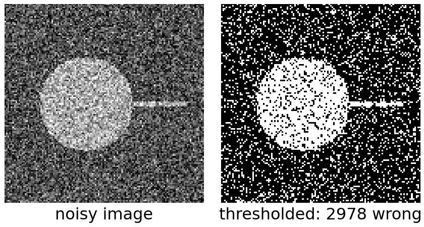
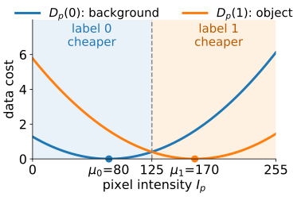
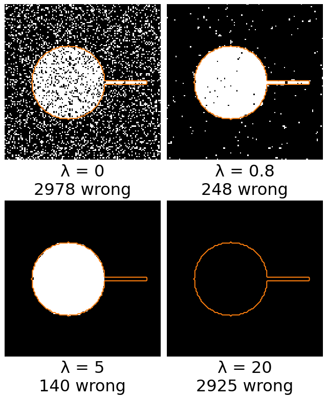
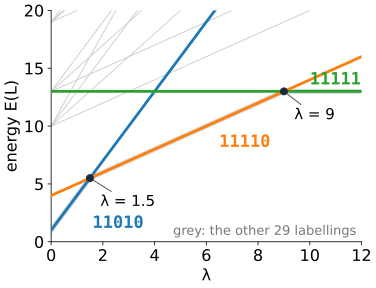
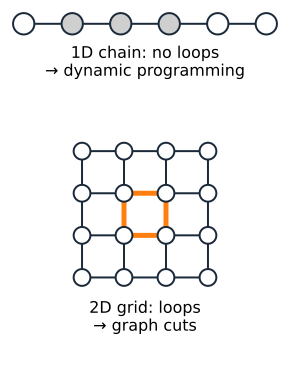
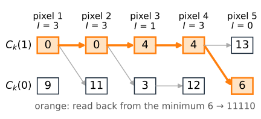

## About this lecture

**Segmentation**: decide for every pixel whether it belongs to the **object** or to the **background**.

- Recall **thresholding** (the [thresholding day](../histogram/lec.qmd)), and why noise breaks it.
- A segmentation as a **labelling** $L$, and a number $E(L)$ that says how good it is.
- Two terms: pixels should match an **intensity model**, and agree with their **neighbours**.
- One weight $\lambda$ trades the two off.
- On a 1D line the best labelling can be found **exactly** by dynamic programming. On an image we need more: graph cuts, the next units ([maximum flow](../maxflow/lec.qmd), [graph-cut segmentation](../graphcut-seg/lec.qmd)).

Slides titled **The math** give the formulas and proofs; the ideas are complete without them.

## Recall: thresholding and its noise specks

:::: {.columns}
::: {.column width="52%"}
**Thresholding** (the [thresholding day](../histogram/lec.qmd); choosing $\tau$: [Otsu](../otsu/lec.qmd)): every pixel brighter than a grey level $\tau$ is object, $L_p = 1$ if $I_p > \tau$, else $L_p = 0$.

- Each pixel is decided **on its own**. With noise the two histogram peaks overlap, and pixels in the overlap land on the wrong side: isolated **specks** of object in the background, **holes** in the object.
- Real objects are mostly **connected**: a pixel usually has the same label as its neighbours. Thresholding cannot use that; this lecture adds it.
:::
::: {.column width="48%"}
{width="100%"}
:::
::::

::: notes
One-slide recall: the histogram, threshold choice (Otsu, minimum error) and evaluation are taught on the thresholding day. Here only the failure matters, because it motivates the smoothness term. The demo's "λ = 0: threshold" preset shows the specks.
:::

## A labelling and its energy

A segmentation is a labelling $L = (L_1, \dots, L_n)$, $L_p \in \{0, 1\}$. Give each one a cost:

$$E(L) = \underbrace{\sum_p D_p(L_p)}_{\text{data term}} \;+\; \lambda \underbrace{\sum_{(p,q)\ \text{neighbours}} w_{pq}\,[L_p \neq L_q]}_{\text{smoothness term}}$$

- $D_p(\ell)$: the cost of giving pixel $p$ the label $\ell$, from its intensity.
- $[L_p \ne L_q]$ is 1 if the neighbours disagree, else 0. The sum **counts the boundary**: with $w_{pq} = 1$ it is the boundary length in pixel edges.
- $\lambda \ge 0$ sets how much a unit of boundary costs, in units of the data term.

The segmentation is the labelling with the **smallest** energy.

## The data term from an intensity model

:::: {.columns}
::: {.column width="55%"}
Model the intensities: background pixels are $\mathcal N(\mu_0, s^2)$, object pixels $\mathcal N(\mu_1, s^2)$. Take

$$D_p(\ell) = -\log P(I_p \mid \ell) = \frac{(I_p - \mu_\ell)^2}{2 s^2} + \text{const}.$$

- Likely intensities are cheap, unlikely ones expensive. The constant is the same for both labels, so it does not change which labelling wins.
- With $\lambda = 0$ every pixel takes its cheaper label: $L_p = 1$ exactly when $(I_p - \mu_1)^2 < (I_p - \mu_0)^2$, that is when $I_p > \tfrac12(\mu_0 + \mu_1)$.
- So **$\lambda = 0$ is thresholding**, at the grey level where the two Gaussians cross.

Other models (a histogram, unequal widths, colour) change only $D_p$, not the method.
:::
::: {.column width="45%"}
{width="100%"}
:::
::::

## The smoothness term

:::: {.columns}
::: {.column width="58%"}
$$\lambda \sum_{(p,q)} w_{pq}\,[L_p \neq L_q]$$

- An isolated wrong pixel has 4 disagreeing neighbours: flipping it saves $4\lambda$ of boundary and costs only its data difference $|D_p(1) - D_p(0)|$.
- **Small $\lambda$**: close to thresholding; noise survives.
- **Large $\lambda$**: boundaries are expensive; specks and holes vanish, but so do **thin real structures**, and corners get rounded.
- **Very large $\lambda$**: no boundary at all, so everything gets one label.

The weights $w_{pq}$ can depend on the image: make a boundary **cheap where the image has an edge** (next units).
:::
::: {.column width="42%"}
{width="88%"}
:::
::::

## A small example by hand

:::: {.columns}
::: {.column width="54%"}
A $1\times5$ image $I = (3, 3, 1, 3, 0)$, $\mu_0 = 0$, $\mu_1 = 3$, $D_p(\ell) = (I_p - \mu_\ell)^2$:

| pixel | 1 | 2 | 3 | 4 | 5 |
|---|---|---|---|---|---|
| $D_p(0)$ | 9 | 9 | 1 | 9 | 0 |
| $D_p(1)$ | 0 | 0 | 4 | 0 | 9 |

- Thresholding gives $L = 11010$: data $0 + 0 + 1 + 0 + 0 = 1$, **3** boundaries: $E = 1 + 3\lambda$.
- Filling the dark pixel, $L = 11110$: data $4$, **1** boundary: $E = 4 + \lambda$.
- The second wins when $4 + \lambda < 1 + 3\lambda$, i.e. $\lambda > 1.5$. Above $\lambda = 9$, all object ($E = 13$) wins.
:::
::: {.column width="46%"}
{width="100%"}
:::
::::

## Try it: a noisy line profile

```{=html}
<link rel="stylesheet" href="../demos/dist/demo.css">
<div data-demo="segchain" data-lambda="3"></div>
<script src="../demos/dist/segchain.js"></script>
```

::: notes
A line of 80 samples: a cell (bright) and a thin bright structure, 2 samples wide, on a dark background, with noise. Dashed lines: the two levels μ0 and μ1; dotted: the threshold halfway. The three strips are the true labels, thresholding, and the labelling with the smallest energy; black dots mark wrong samples. Tour: press "λ = 0: threshold", 3 wrong samples and 10 boundaries. Then "λ = 3": no wrong samples, 4 boundaries; point out that the data cost went UP (40.4 to 47.3) but the total went down. "Thin structure lost": at λ = 10 the 2-sample structure is gone, because keeping it costs 2 boundaries. "Too smooth": λ = 100, one boundary left. Finally move μ1 down to about 110: the threshold moves and errors return.
:::

## The math: the probabilistic view {.math}

Minimising $E$ is finding the **most probable** labelling (a *maximum a posteriori* estimate):

$$P(L \mid I) \;\propto\; P(I \mid L)\,P(L) \;\propto\; \exp\!\big(-E(L)\big)$$

- $P(I \mid L) = \prod_p P(I_p \mid L_p)$, the intensity model, gives the data term.
- $P(L) \propto \exp\!\big(-\lambda \sum w_{pq} [L_p \ne L_q]\big)$, a **prior** that prefers few boundaries. This is a *Markov random field*: each label depends directly only on its neighbours.
- Taking $-\log$ turns the product into the sum $E(L)$.

## How do we find the minimum?

:::: {.columns}
::: {.column width="60%"}
There are $2^n$ labellings. A $100\times100$ image has $2^{10000} \approx 10^{3010}$: trying them all is hopeless.

But the energy has structure: each term involves **one pixel** or **two neighbours**.

- On a **1D chain** (a line of pixels), that structure is enough for **dynamic programming**: walk along the line once, keeping for each pixel only the best energy so far for "this pixel object" and "this pixel background". Exact, and fast. (The [dynamic programming day](../dp-paths/lec.qmd) makes this a general tool.)
- On a **2D grid** the neighbours form loops, and dynamic programming no longer works.
- For two labels, $E$ can still be minimised **exactly**: as a **minimum cut** in a graph. That is the next two units.
:::
::: {.column width="40%"}
{width="100%"}
:::
::::

## The math: dynamic programming on a chain {.math}

On a chain, $E(L) = \sum_k D_k(L_k) + \lambda \sum_k [L_k \ne L_{k+1}]$. Let $C_k(\ell)$ be the **smallest energy of pixels $1..k$** with $L_k = \ell$:

$$C_1(\ell) = D_1(\ell), \qquad C_k(\ell) = D_k(\ell) + \min\big(C_{k-1}(\ell),\; C_{k-1}(1 - \ell) + \lambda\big).$$

- Fill a $2 \times n$ table from left to right, remembering which choice won.
- The minimum energy is $\min_\ell C_n(\ell)$; follow the remembered choices back to read off $L$.
- Example above, $\lambda = 2$ (below): $C(0) = 9, 11, 3, 12, 6$ and $C(1) = 0, 0, 4, 4, 13$. Minimum 6, labelling $11110$.

{width="52%" fig-align="center"}

This is the **Viterbi** algorithm; the demo uses exactly this.

## Summary

- Thresholding decides each pixel alone; noise gives specks and holes.
- Segmentation as **energy minimisation**: $E(L) = \sum_p D_p(L_p) + \lambda \sum w_{pq}[L_p \ne L_q]$.
- Data term $= -\log P(I_p \mid \ell)$; for two Gaussians, $\lambda = 0$ is thresholding at the crossing point.
- $\lambda$ trades fidelity for boundary length: too large removes thin structures, then everything.
- Exact minimisation: dynamic programming on a chain; on a grid, **graph cuts**, next.
