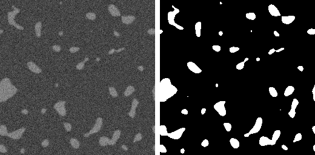
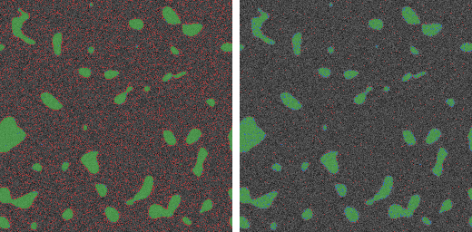
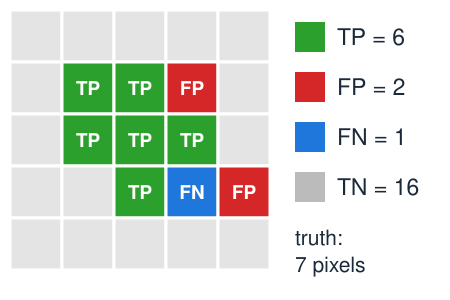
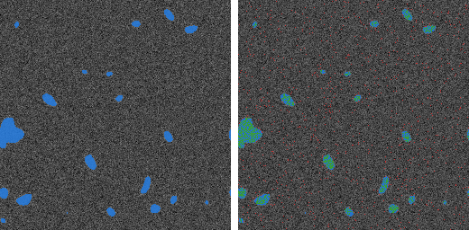
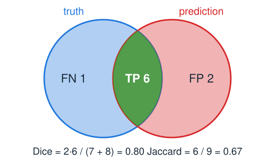
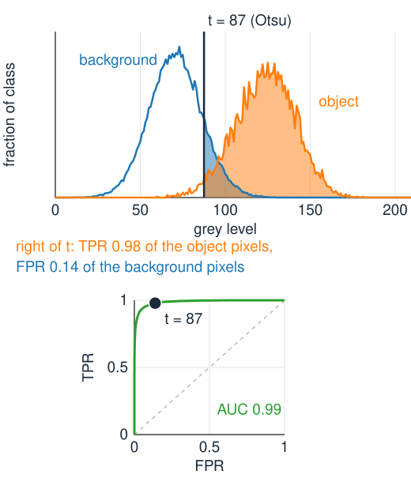
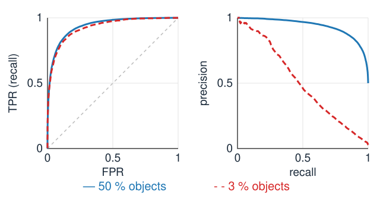
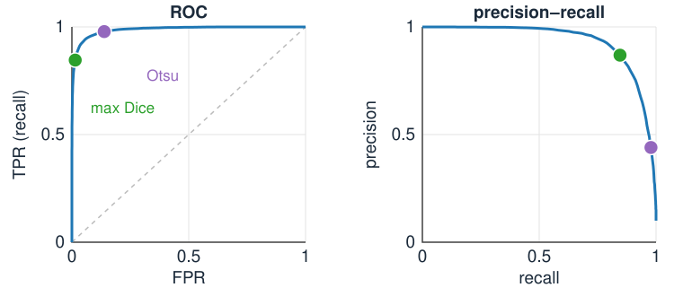
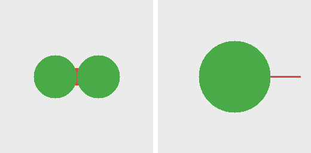

## About this lecture

Three units produced masks. Which one is **good**? Compare it, pixel by pixel, with the **ground truth**.

- The **confusion matrix**: true and false positives and negatives.
- **Precision**, **recall**, false-positive rate, and why **accuracy misleads** when objects are rare.
- **Dice** and **Jaccard**: one number for the overlap.
- Sweep the threshold: the **ROC** and **precision–recall** curves, computed from two histograms.
- Where on the curve to stand, and what pixel measures cannot see: **objects**.

*Slides titled **The math** give the formulas and proofs; the ideas are complete without them.*

::: notes
This unit is the course's owner of pixel-level evaluation (confusion matrix, Dice/Jaccard, ROC/PR). Object-level evaluation (matching objects by IoU, object F1, average precision, split and merge errors) is the evaluation day (day 37). The learning days reuse Dice, ROC and Dice as a loss.
:::

## Ground truth

{width="56%"}

The **ground truth** is the mask we trust: here a synthetic image (left) and the mask it was made from (right).

- **Synthetic** images: truth known exactly, by construction. Good for testing a method, but are they realistic?
- **Manual annotation** of real images: the truth is itself uncertain, mostly at **boundaries**. Two annotators disagree; one annotator on two days too.
- A one-pixel disagreement around a disc of radius 10 already gives an overlap score (Dice, below) of 0.905; for a radius-3 disc, 0.72. Small objects cannot be scored precisely.

## The confusion matrix

:::: {.columns}
::: {.column width="55%"}
Compare every pixel of the predicted mask with the truth:

| | predicted object | predicted background |
|---|---|---|
| **true object** | **TP** true positive | **FN** false negative (missed) |
| **true background** | **FP** false positive (false alarm) | **TN** true negative |

- Draw it on the image: TP green, FP red, FN blue, TN grey. The colours show **where** the errors are: at the boundaries, in the dim corner, as speckle.
- Four counts, adding up to the number of pixels. Every measure on the next slides is built from them.
:::
::: {.column width="45%"}
{fig-alt="The synthetic test image with 10 % objects, coloured by the four cases. Left, threshold 87: the objects are green but red false positives are scattered over the whole background. Right, threshold 105: few red pixels, and some blue misses at the object edges." width="100%"}

Left: $t = 87$ (Otsu): TP 6411, FP 8161, FN 142. Right: $t = 105$: TP 5543, FP 838, FN 1010.
:::
::::

## Rates from the four counts

:::: {.columns}
::: {.column width="60%"}
- **Precision** $= \frac{TP}{TP + FP}$: of what I called object, how much is object?
- **Recall** (sensitivity, true-positive rate, TPR) $= \frac{TP}{TP + FN}$: of the true object, how much did I find?
- **False-positive rate** (FPR) $= \frac{FP}{FP + TN}$: of the background, how much did I call object? (1 − specificity.)
- **Accuracy** $= \frac{TP + TN}{\text{all}}$.

By hand ($5 \times 5$ image, 7 object pixels): $TP = 6$, $FP = 2$, $FN = 1$, $TN = 16$. Precision $6/8 = 0.75$, recall $6/7 = 0.86$, FPR $2/18 = 0.11$, accuracy $22/25 = 0.88$.
:::
::: {.column width="40%"}
{fig-alt="The 5 × 5 example: a 7-pixel true object; the prediction gets 6 of its pixels (green TP), misses one (blue FN) and adds two (red FP); the other 16 pixels are TN." width="100%"}
:::
::::

## Accuracy misleads

:::: {.columns}
::: {.column width="55%"}
Objects are 3 % of the pixels. The "method" that calls **everything background**:

- TP = 0, FP = 0: accuracy **97 %**, recall 0, nothing found.
- Accuracy is dominated by the huge TN count: with rare objects it measures how well you find **background**.
- Any measure that uses **TN** is weak when objects are rare. Prefer measures built from TP, FP and FN only.
:::
::: {.column width="45%"}
{fig-alt="Two copies of an image with 3 % small bright objects. Left: the all-background answer, every object pixel blue (missed), accuracy 0.970. Right: the best threshold, accuracy 0.971 although the objects are now found: accuracy barely moves." width="100%"}

Left: "all background": accuracy 0.970, Dice 0. Right: the best threshold ($t = 115$): accuracy 0.971, Dice 0.49. Accuracy cannot tell them apart.
:::
::::

## Dice and Jaccard

:::: {.columns}
::: {.column width="58%"}
Two overlap scores that ignore TN:

- **Dice** $= \frac{2\,TP}{2\,TP + FP + FN}$: twice the overlap, divided by the sizes of the two masks added together.
- **Jaccard** (intersection over union, IoU) $= \frac{TP}{TP + FP + FN}$: the overlap divided by the union.
- Both are 1 for a perfect mask and 0 for no overlap. Jaccard is always the smaller: $J = D/(2 - D)$. Dice 0.8 is Jaccard 0.67.
- Dice is the **F1 score**: the harmonic mean of precision and recall. It is high only when **both** are high.

The $5 \times 5$ example: Dice $= 12/15 = 0.80$, Jaccard $= 6/9 = 0.67$. "All background" with 3 % objects: Dice $0$.
:::
::: {.column width="42%"}
{fig-alt="Two overlapping discs: the truth (blue) and the prediction (red). The overlap is TP 6, the truth-only part FN 1, the prediction-only part FP 2. Dice = 2·6/(7 + 8) = 0.80, Jaccard = 6/9 = 0.67." width="100%"}
:::
::::

## The math: Dice, F1 and Jaccard {.math}

Harmonic mean of precision $p$ and recall $r$:
$$\frac{2}{1/p + 1/r} = \frac{2}{\frac{TP + FP}{TP} + \frac{TP + FN}{TP}} = \frac{2\,TP}{2\,TP + FP + FN} = D .$$
With $s = FP + FN$: $D = \frac{2\,TP}{2\,TP + s}$ and $J = \frac{TP}{TP + s}$, so
$$\frac{D}{2 - D} = \frac{2\,TP}{2(2\,TP + s) - 2\,TP} = \frac{TP}{TP + s} = J .$$
$J = D/(2 - D)$ is increasing in $D$: both rank segmentations in the same order. In set notation, $D = \frac{2|A \cap B|}{|A| + |B|}$ and $J = \frac{|A \cap B|}{|A \cup B|}$.

## Try it: four kinds of pixels

```{=html}
<link rel="stylesheet" href="../demos/dist/demo.css">
<div data-demo="threshroc" data-preset="rare"></div>
<script src="../demos/dist/threshroc.js"></script>
```

::: notes
A synthetic image with known truth; the left image shows TP/FP/FN/TN, the middle table the confusion matrix and the rates, the right plots the ROC and precision–recall curves. Tour: "3 % objects: accuracy lies": t = 254, nothing found: accuracy 0.970, Dice 0. Press "t = Otsu" (72): recall 0.967 but precision 0.062, Dice 0.116. "t = max Dice" (115): Dice 0.487. "balanced classes": Otsu (95) is near the best Dice (0.861 vs 0.864).
:::

## Sweep the threshold: the ROC curve

:::: {.columns}
::: {.column width="58%"}
Every threshold $t$ gives one confusion matrix, hence one point (FPR, TPR).

- $t$ very high: nothing is object, the point $(0, 0)$. $t$ very low: everything is object, $(1, 1)$.
- In between the points trace the **ROC curve** (receiver operating characteristic). Up-left is good: many objects found, few false alarms.
- A **diagonal** curve: the grey level carries no information about the class. The **area under the curve** (AUC) summarises it: 0.5 for chance, 1 for perfect.
- AUC has a plain meaning: the probability that a random object pixel is **brighter** than a random background pixel.
- No need to threshold the image again for every $t$: TPR$(t)$ is the fraction of **object pixels** above $t$, read from the histogram of the object pixels; FPR$(t)$ likewise from the background pixels' histogram.
:::
::: {.column width="42%"}
{fig-alt="Top: the grey-level histograms of the object pixels and of the background pixels, with t = 87. The shaded part of each to the right of t is the TPR (0.98) and the FPR (0.14). Bottom: the ROC curve with the point for t = 87; area under the curve 0.99." width="100%"}
:::
::::

## The math: ROC from two histograms {.math}

Split the histogram by the truth: $h^1_i$ (object pixels with grey level $i$) and $h^0_i$ (background), with totals $n_1$, $n_0$ and cumulative histograms $P_1$, $P_0$:
$$\text{TPR}(t) = 1 - P_1(t), \qquad \text{FPR}(t) = 1 - P_0(t).$$
One pass over the grey levels gives the whole curve: $O(N + L)$. With two Gaussian classes these are the **tail areas** of the [minimum-error unit](../otsu/lec.qmd).

AUC: integrate TPR over FPR, $\text{AUC} = \sum_t \text{TPR}(t)\,\Delta\text{FPR}(t)$. Step $t$ removes the $h^0_t$ background pixels at level $t$; each of them is below exactly the object pixels counted by TPR. So
$$\text{AUC} = \frac{1}{n_0 n_1}\sum_{\text{pairs}} [I_\text{obj} > I_\text{bg}] \quad (\text{ties count } \tfrac12) = P(I_\text{obj} > I_\text{bg}).$$

## The precision–recall curve

:::: {.columns}
::: {.column width="52%"}
Plot precision against recall as $t$ sweeps.

- The ROC curve uses rates **within** each class, so it does not change when objects get rarer. A point (FPR 0.05, TPR 0.9) looks good on any ROC.
- But with 1 % objects, 5 % of the background is five times as many pixels as 90 % of the objects: precision $= 0.154$. With 50 % objects it would be $0.947$.
- The PR curve shows this; the ROC hides it. Under **class imbalance**, look at precision–recall (and Dice), not only at the ROC.
:::
::: {.column width="48%"}
{fig-alt="Left: the ROC curves for 50 % and 3 % objects, at the same contrast and noise, lie almost on top of each other (AUC 0.94 and 0.93). Right: their precision–recall curves are far apart: at recall 0.9, precision 0.83 with 50 % objects and 0.11 with 3 %." width="100%"}

Same contrast and noise: the ROC curves (AUC 0.94, 0.93) hardly differ. At recall 0.9, precision is 0.83 with 50 % objects but 0.11 with 3 %.
:::
::::

## Where on the curve?

{width="50%"}

The curve shows all thresholds; you must still pick one.

- **Max Dice** (or max F1): best overlap. Needs the truth, so choose it on training images, then fix it.
- **Youden's index**: maximise TPR − FPR, the point farthest above the diagonal.
- **Fixed FPR**: "at most 1 % false alarms", when false alarms are costly.
- Mark the **automatic** thresholds of the earlier units (Otsu, minimum error) on the curve: how far are they from the best point? In the figure (10 % objects): Otsu (purple) reaches Dice 0.607, the best threshold (green) 0.857.

## Try it: ROC and precision–recall

```{=html}
<link rel="stylesheet" href="../demos/dist/demo.css">
<div data-demo="threshroc" data-preset="otsu"></div>
<script src="../demos/dist/threshroc.js"></script>
```

::: notes
Tour: "Otsu vs max Dice" (10 % objects): Otsu t = 87 has recall 0.978 but precision 0.440 (Dice 0.607); max Dice at t = 105 gives 0.857. The ROC points of both look good (FPR 0.138 vs 0.014); the PR curve shows the difference. "uneven illumination": AUC drops from 0.935 to 0.762; no threshold is good (max Dice 0.576); tick "local threshold" (one point): Dice 0.657; also tick "smooth first": 0.919. "noise: smooth first": AUC 0.734 → 0.989 when smoothing is ticked.
:::

## Pixels are not objects

:::: {.columns}
::: {.column width="58%"}
- Two touching nuclei segmented as **one** blob: almost every pixel is right, Dice near 1, but the **count** is wrong and both measured areas are wrong.
- A tiny object missed entirely costs a few pixels: invisible in Dice, fatal if you count cells.
- Object-level evaluation (match objects by their IoU, count hits, misses, splits and merges) is the [evaluation day](../object-eval/lec.qmd) (day 37); splitting touching objects is the [watershed day](../ws-landscape/lec.qmd) (day 15).
- **Boundary** measures: the **Hausdorff distance** is the largest distance from a point of one boundary to the nearest point of the other. It catches a single far-off error that Dice barely notices (more on boundaries in [agreement](../agreement/lec.qmd), day 37).
:::
::: {.column width="42%"}
{fig-alt="Left: two touching discs predicted as one blob joined by a small bridge (red): Dice 0.996, but one object instead of two. Right: a disc predicted with a thin spur 50 pixels long (red): Dice 0.993, Hausdorff distance 50." width="100%"}

Left: two objects merged into one: Dice 0.996. Right: a thin spur: Dice 0.993, Hausdorff distance 50 pixels.
:::
::::

## Summary

- Compare the predicted mask with the **ground truth** pixel by pixel: **TP, FP, FN, TN**.
- **Precision** (how much of what I found is right), **recall**/TPR (how much of the truth I found), **FPR** (false alarms in the background).
- **Accuracy misleads** when objects are rare; **Dice** $= 2TP/(2TP + FP + FN)$ = F1 and **Jaccard** $= D/(2 - D)$ ignore TN.
- Sweeping $t$ traces the **ROC** curve (from the two class histograms in one pass; AUC = P(object brighter than background)) and the **precision–recall** curve, which reveals class imbalance.
- Choose the operating point (max Dice, Youden, fixed FPR) on training data. Pixel scores do not count **objects**.
