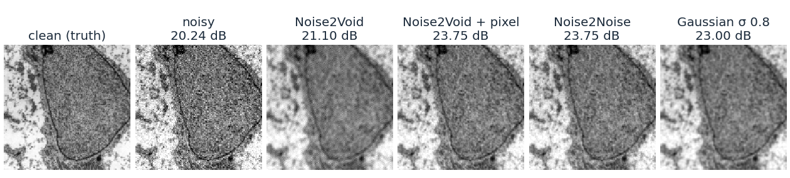
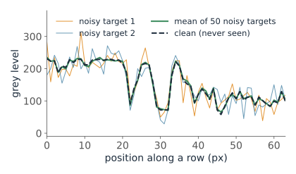
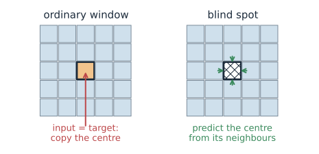
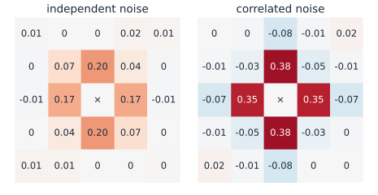
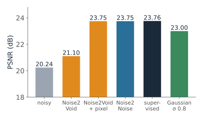
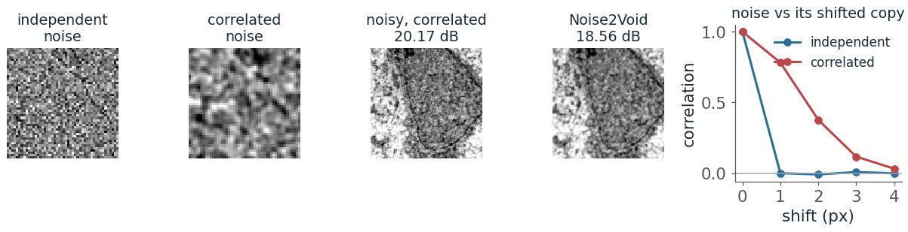
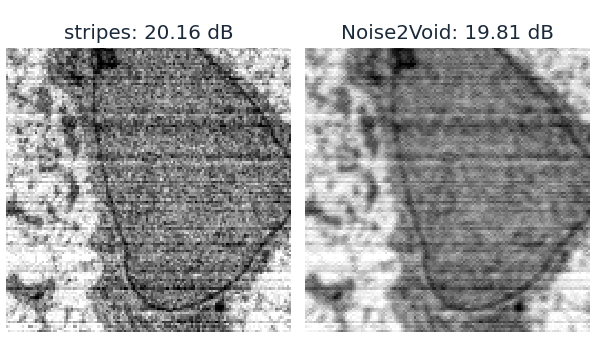

## About this lecture

*A network learns to denoise from pairs (noisy, clean). In a live-cell experiment there is no clean image. Can it learn from the noisy images alone?*

- **Noise2Noise**: two noisy images of the same thing are enough; the noise in the target averages out.
- **Noise2Void**: one noisy image is enough, with a **blind spot**: predict each pixel from its neighbours, never from itself.
- The price of the blind spot, and how to pay less; when it fails: **correlated noise** and structured artefacts.
- A linear blind-spot filter, trained on one image, as a small working model of the idea.

*Slides titled **The math** give the formulas and proofs; the ideas are complete without them.*

::: notes
Last unit of the day "Learning without labels". Builds on the classical denoisers of the deconvolution day (denoise unit), the camera noise unit (noise models, independence), and the masked prediction of the pretext unit: Noise2Void is masked image modelling with one-pixel masks. The demo (blindspot) trains a linear 5 × 5 filter by least squares, so that everything is exact and fast; the networks of the papers do the same with a U-Net (Lehtinen et al. 2018, Noise2Noise; Krull, Buchholz and Jug 2019, Noise2Void; Batson and Royer 2019, Noise2Self).
:::

## The problem: no clean images

- Supervised denoising (classical filters: the [denoising unit](../denoise/lec.qmd)): train a network on pairs (noisy image, clean image) with a squared error.
- Where do clean images come from? A **long exposure**: but cells move, fluorophores bleach, and phototoxicity is the reason we image with little light in the first place. For many experiments the clean image **does not exist**; what we have is **many noisy images**.

{fig-alt="A 128 × 128 crop of the electron micrograph: clean, noisy with σ = 25 grey levels (20.24 dB), Noise2Void with a 5 × 5 linear filter (21.10 dB, smooth), Noise2Void with the pixel put back (23.75 dB), Noise2Noise (23.75 dB) and a Gaussian blur σ 0.8 (23.00 dB)." width="100%"}

The demo's micrograph crop with noise of σ = 25 grey levels, and what the methods of this lecture make of it.

::: notes
The micrograph: transmission electron micrograph of a mesenchymal stem cell, Robert M. Hunt, CC BY 3.0, via Wikimedia Commons. Here the clean image exists, because the noise was added: that is how the PSNR values can be computed. In a real experiment only the noisy image exists.
:::

## Noise2Noise: noisy targets are enough

:::: {.columns}
::: {.column width="52%"}
Train with **pairs of noisy images** of the same scene: input one, target the other.

- The network cannot predict the target's noise: it is independent of the input.
- The best it can do is predict the **average** of all targets it could have seen: the clean image.
- Squared error: the noise only **adds a constant** to the loss. Same minimum, more noise in the training.
- Pairs: two quick exposures of a fixed sample, or two halves of the photons.
:::
::: {.column width="48%"}
{fig-alt="A row of 64 pixels of the micrograph: two noisy versions (orange, blue) scatter widely around the clean profile (dashed); the mean of 50 noisy versions (green) lies almost on top of the clean profile." width="100%"}
:::
::::

## The math: why noisy targets work {.math}

Target $y = s + n$ with clean value $s$ and noise $n$, $\mathbb E[n] = 0$, $\mathrm{Var}(n) = \sigma^2$, independent of the input $x$. For any prediction $f(x)$:

$$\mathbb E\big[(f(x) - y)^2\big] = \mathbb E\big[(f(x) - s)^2\big] - 2\,\mathbb E\big[(f(x) - s)\,n\big] + \mathbb E[n^2] = \mathbb E\big[(f(x) - s)^2\big] + \sigma^2,$$

because $\mathbb E[(f(x) - s)\,n] = \mathbb E[f(x) - s]\,\mathbb E[n] = 0$ (independence).

- The noisy-target loss is the clean-target loss **plus a constant**: the same minimiser.
- Needed: zero-mean noise, independent of the input. The squared error gives the **mean**; an absolute error gives the median (robust to outliers, also unbiased for symmetric noise).
- Finite data: the variance of the noisy targets slows learning, as noisy labels do.

## Noise2Void: one noisy image

:::: {.columns}
::: {.column width="48%"}
No second image. Use the noisy image as input **and** target?

- Then the best prediction of a pixel is **the pixel itself**: the network learns to copy, and nothing is denoised.
- **Blind spot**: predict each pixel from its **neighbours only**. Its own noise is now hidden from the input, and it is independent of the neighbours' noise.
- The neighbours carry the signal (images are smooth and repetitive); they carry nothing about this pixel's noise.
:::
::: {.column width="52%"}
{fig-alt="Two 5 × 5 windows. Left, an ordinary window whose centre pixel is part of the input: with the noisy image as target, the prediction just copies the centre. Right, a blind-spot window: the centre is crossed out and arrows from its four neighbours point to it: the centre is predicted from the neighbours." width="100%"}
:::
::::

Noise2Void is the [masked image modelling](../pretext/lec.qmd) of this day's first unit, with one-pixel masks.

## The math: the blind-spot loss {.math}

Pixel $i$, noisy value $y_i = s_i + n_i$; prediction $f(\mathbf y_{-i})$ from all other pixels. If $n_i$ has mean 0 and is **independent of** $\mathbf y_{-i}$:

$$\mathbb E\big[(f(\mathbf y_{-i}) - y_i)^2\big] = \mathbb E\big[(f(\mathbf y_{-i}) - s_i)^2\big] + \sigma_i^2 .$$

- Among blind-spot predictors, the noisy target picks the same one as a clean target would (the **best blind-spot predictor**). The demo shows this: 21.10 dB with the noisy target, 21.11 dB with the clean one.
- Without the blind spot, $f$ may use $y_i$ itself, the independence fails, and $f(\mathbf y) = y_i$ gives loss 0.
- Holds for any noise that is independent from pixel to pixel: Gaussian, Poisson (photon counts), mixed. **Correlated** noise breaks it.

## Try it: Noise2Void on one image

```{=html}
<link rel="stylesheet" href="../demos/dist/demo.css">
<div data-demo="blindspot" data-preset="n2v"></div>
<script src="../demos/dist/blindspot.js"></script>
```

::: notes
A 5 × 5 linear filter (25 weights + a bias) fitted by least squares over all 16,384 pixels of one noisy image. Tour: "Noise2Void": 20.24 → 21.10 dB; weights about 0.17–0.20 on the four direct neighbours, 0.04–0.08 diagonally, sum 1.00. "no blind spot": centre weight 1.00, all others 0: 20.24 dB, the noisy image unchanged. "Noise2Noise": 23.75 dB, centre weight 0.45. Supervised (clean target): 23.76 dB. "put the pixel back": 23.75 dB with c = 0.45. "against non-local means" (test image): the linear filters stop at 24.85 dB, non-local means 28.22 dB: a linear filter cannot keep edges. "correlated noise": 18.56 dB, below the noisy 20.17 dB. "stripes": 19.81 dB below 20.16.
:::

## What the filter learns

:::: {.columns}
::: {.column width="50%"}
The demo's filter is **linear**: 25 weights on a 5 × 5 window, fitted by least squares to one noisy image. Trained the Noise2Void way:

- weights 0.17–0.20 on the four direct neighbours, 0.04–0.08 on the diagonals, almost 0 further out; they add up to **1.00**: a weighted average of the neighbours, learned from the image.
- the noise drops, but the result is **smoother** than a Gaussian blur that may use the pixel: 21.10 dB against 23.00 dB.

Without the blind spot the fit is exact: centre weight **1.00**, all others 0.
:::
::: {.column width="50%"}
{fig-alt="The learned 5 × 5 Noise2Void weights. Independent noise: 0.17 to 0.20 on the four direct neighbours, 0.04 to 0.07 on the diagonals, near 0 elsewhere, the blind spot marked ×. Correlated noise: 0.35 to 0.38 on the four direct neighbours and negative weights around −0.07 further out: the filter has learnt to predict the noise." width="100%"}
:::
::::

## The price of the blind spot

:::: {.columns}
::: {.column width="56%"}
- The pixel's own value is the **best single piece of evidence** about it, and the blind spot throws it away: Noise2Void 21.10 dB, a filter of the same size that may use the pixel (clean target) 23.76 dB.
- **Put the pixel back**: the blind-spot prediction and the noisy pixel are two **independent** estimates of the same clean value. Mix them, trusting each by its reliability:

$$\text{out} = \text{pred} + c\,(\text{pixel} - \text{pred}),\quad c = 1 - \frac{\sigma^2}{\text{mean}\,(\text{pixel} - \text{pred})^2}$$

- Needs the noise level σ, from the [camera noise unit](../cameranoise/lec.qmd)'s calibration. Demo: $c = 0.45$, 23.75 dB, as good as Noise2Noise and the clean target.
:::
::: {.column width="44%"}
{fig-alt="Bar chart of the PSNR on the micrograph crop: noisy 20.24 dB, Noise2Void 21.10, Noise2Void with the pixel put back 23.75, Noise2Noise 23.75, supervised 23.76, Gaussian σ 0.8 23.00." width="100%"}
:::
::::

::: notes
The mean squared difference between pixel and prediction is (error of the prediction)² + σ²: the prediction's own error is what remains after subtracting σ². The mix is the inverse-variance weighting of the next math slide. Networks do this in a more refined way ("probabilistic" variants that predict a distribution per pixel); the principle is the same.
:::

## The math: two independent estimates {.math}

Clean value $s$; the prediction $\hat s = s + e$ with error variance $v = \mathbb E[e^2]$; the pixel $y = s + n$ with $\mathrm{Var}(n) = \sigma^2$; $e$ and $n$ independent (the blind spot).

- Any mix $\hat s + c(y - \hat s) = s + (1 - c)e + cn$ has error variance $(1 - c)^2 v + c^2\sigma^2$, smallest at $c = v/(v + \sigma^2)$, where it equals $v\sigma^2/(v + \sigma^2)$: smaller than both $v$ and $\sigma^2$.
- $v$ is unknown, but $\mathbb E[(y - \hat s)^2] = v + \sigma^2$ is measurable on the image: $c = 1 - \sigma^2/\mathbb E[(y - \hat s)^2]$.
- Demo: the prediction alone has 21.10 dB, an error sd of $255 \cdot 10^{-21.10/20} = 22.5$ grey levels; with $\sigma = 25$: $c = 22.5^2/(22.5^2 + 25^2) = 0.45$, and the mixed error sd is $22.5 \cdot 25/\sqrt{22.5^2 + 25^2} = 16.7$, i.e. 23.7 dB (the demo measures 23.75 dB).

## Noise2Void as pseudocode

```
repeat for every batch of noisy patches:
    pick a few random pixels in each patch            # e.g. 1 % of them
    masked = patch with each picked pixel replaced by a random neighbour's value
    prediction = network(masked)
    loss = mean over the picked pixels of (prediction − patch)²      # noisy targets
    update the network by backpropagation
denoised image = network(noisy image)                  # no masking at test time
```

- Replacing the pixel hides it: a blind spot for any network, without changing the architecture.
- The loss is computed **only at the picked pixels**, as in masked image modelling.

::: notes
The linear demo and the coding exercise use the exact form instead: every pixel is a training example and the centre weight is fixed at 0. A network with a built-in blind spot (shifted half-plane convolutions) avoids the masking and uses every pixel per step. The coding exercise (selfsup/src/self_denoise/ in the course code download) fits the linear blind-spot filter by least squares, compares it with Noise2Noise, the supervised filter and non-local means, and puts the pixel back.
:::

## When it fails: correlated noise

:::: {.columns}
::: {.column width="58%"}
The blind spot assumes that the neighbours know **nothing** about this pixel's noise. If the noise is **correlated** (blurred noise after demosaicing, resampling, a denoising step in the camera; row noise of a scientific camera; scan lines):

- the neighbours **predict the noise**, and the filter learns to reproduce it. Demo: weights 0.35–0.38 on the direct neighbours, and the result (18.56 dB) is **worse than the noisy image** (20.17 dB).
- **Stripes** (one offset per row): the filter averages along the row and keeps them (19.81 dB, noisy 20.16).
- Noise2Noise is unaffected (22.06 dB): its target's noise is independent of the input.
:::
::: {.column width="42%"}
{fig-alt="Left: independent and correlated noise (48 × 48 crops; the correlated noise forms blobs a few pixels wide). Middle: the micrograph with correlated noise (20.17 dB) and its Noise2Void result (18.56 dB), which keeps the blotchy noise. Right: correlation of the noise with a copy shifted by 0 to 4 pixels: independent noise drops to 0 at a shift of 1, correlated noise is 0.78 at 1, 0.38 at 2, 0.12 at 3." width="100%"}
:::
::::

## Check the noise first

:::: {.columns}
::: {.column width="58%"}
- Take a **background** region (no structure), subtract its mean, and correlate it with a copy shifted by one pixel, horizontally and vertically. Independent noise: about 0. The demo's correlated noise: 0.78.
- Look at the noise: blobs, stripes, a grid pattern from the camera's readout channels are all correlated noise.
- Use the **raw** data: no compression, no camera-side denoising, no resampling before denoising.
- Structured artefacts that are not noise (out-of-focus haze, autofluorescence) are **signal** for the blind spot: it keeps them.
- For row noise, hide a whole **line** instead of a pixel: the mask must hide everything that shares the pixel's noise.
:::
::: {.column width="42%"}
{fig-alt="The micrograph crop with stripe noise (one random offset per row plus independent noise, 20.16 dB) and its Noise2Void result (19.81 dB): the independent part is smoothed away, the stripes remain clearly visible." width="100%"}
:::
::::

## Networks, not linear filters

:::: {.columns}
::: {.column width="55%"}
- A linear filter is a weighted average: it cannot keep an edge sharp while smoothing beside it. On the demo's test image non-local means reaches 28.22 dB, every linear filter at most 24.85 dB.
- A [U-Net](../unet/lec.qmd) with the same blind-spot training learns **nonlinear**, content-dependent averaging over a large window, and beats the classical filters on real data.
- The same idea: the [diffusion models](../score-matching/lec.qmd)' denoiser is trained on noise added to clean images; Noise2Noise and Noise2Void train denoisers where no clean image exists.
:::
::: {.column width="45%"}
| method (test image, σ 25) | dB |
|---|---|
| noisy | 20.24 |
| Noise2Void, linear 5 × 5 | 23.10 |
| Noise2Void + pixel | 24.85 |
| supervised linear 5 × 5 | 24.87 |
| non-local means (h 25) | 28.22 |
:::
::::

## What you may measure

- A denoised image is an **estimate** ([what you may measure](../denoise/lec.qmd)): smoothing changes peaks, sizes and counts; a network can also **invent** plausible texture.
- Self-supervised training reduces one risk (no clean training set from another sample that may differ from yours) but not this one.
- Practice: **segment or detect** on the denoised image, **measure intensities** on the raw one; validate on a test sample with a known truth (beads, a long exposure of fixed cells).
- Report the method and keep the raw data. Never compare intensities between images denoised by differently trained networks.

## Summary

| Idea | In one line |
|---|---|
| Noise2Noise | a second noisy image is as good a target as a clean one: the noise adds only a constant to the loss |
| Noise2Void | one noisy image, a **blind spot**: predict each pixel from its neighbours only |
| Why it works | the pixel's noise is independent of its neighbours: the noisy-target loss is the clean loss + σ² |
| The price | the pixel's own value is lost; mix it back with the known noise level |
| Failure | correlated noise, stripes and artefacts: the neighbours predict them, the filter keeps them |
| Practice | check the noise is independent; raw data; measure on raw images |

Next: the [fine-tuning day](../transfer/lec.qmd) adapts pretrained networks to your images.
