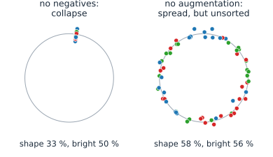
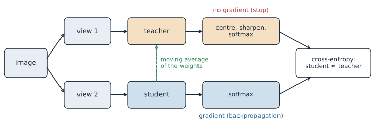
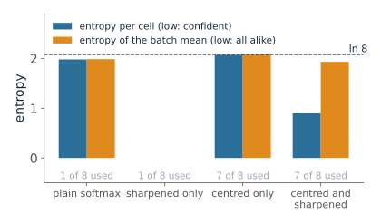
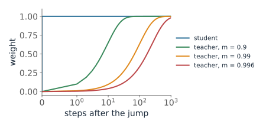
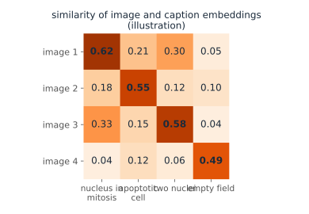
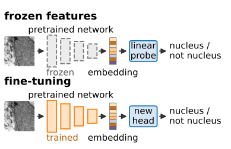

## About this lecture

*Contrastive learning needs negatives: big batches, and other cells of the same kind pushed away. Can a network learn from two views without them, and what do the large pretrained models built this way give a microscopist?*

- **Self-distillation**: a student matches a teacher whose weights are a **moving average** of the student's.
- Why it does not collapse: **centring** and **sharpening** of the teacher's output, and the slow teacher.
- **Foundation models**: very large networks pretrained like this; why their features transfer to microscopy, and when not. Image–text models in one slide.
- Using **frozen** features: nearest neighbours, clustering of phenotypes, linear probes; and **batch effects**.

*Slides titled **The math** give the formulas and proofs; the ideas are complete without them.*

::: notes
Self-distillation as in DINO (Caron et al. 2021) and BYOL (Grill et al. 2020); centring and sharpening are DINO's. Large self-supervised vision models are trained this way (with masked modelling added). The unit has no demo of its own: training a self-distillation model live is large and fragile; the figures come from the coding exercise, and the Explore section uses the attention unit's frozen-feature demo. A small live demo can come later.
:::

## Without negatives

:::: {.columns}
::: {.column width="52%"}
Contrastive learning ([last unit](../contrastive/lec.qmd)) pushes every other image away:

- it needs **many** negatives per step (big batches, or a queue);
- most negatives of a common phenotype are **false** negatives: cells of the same kind pushed apart;
- but without them, "pull the two views together" collapses to a constant.

Self-distillation keeps the pull, drops the push, and avoids collapse by making the two sides **unequal**.
:::
::: {.column width="48%"}
{fig-alt="From the contrastive unit: without negatives, all 64 cells end in one point on the circle (collapse); without augmentation they spread out but are not sorted by shape." width="100%"}
:::
::::

## Student and teacher

{fig-alt="Self-distillation: two views of an image; the teacher sees view 1, the student view 2. The teacher's output is centred, sharpened and turned into probabilities, without gradient; the student's output into probabilities with a softmax. The loss is the cross-entropy between them: the student must predict the teacher. The teacher's weights are a moving average of the student's (dashed arrow)." width="100%"}

- Both networks output scores over $K$ "prototypes" (a few thousand in practice), turned into probabilities. The student must match the teacher's probabilities on the **other** view.
- Only the student is trained by backpropagation; the teacher **follows** it slowly. Afterwards the teacher is usually the better network, and it is kept.

## Why it does not collapse

:::: {.columns}
::: {.column width="46%"}
Two ways to collapse: every image the **same** prototype, or every prototype **equally likely** (uniform). Two opposite fixes on the teacher's output:

- **Centring**: subtract a running mean of the teacher's scores: no prototype can win for every image. Alone it drifts to uniform.
- **Sharpening**: a low temperature (0.04): each image confidently picks a prototype. Alone it drifts to one prototype for all.
- Together: confident per image, different between images. The coding exercise's batch: entropy per cell 0.90, of the batch mean 1.93 (ln 8 = 2.08), 7 of 8 prototypes in use.
:::
::: {.column width="54%"}
{fig-alt="Entropies of a batch of teacher outputs (64 cells, 8 prototypes) under four treatments. Plain softmax: both entropies near ln 8, one prototype is everyone's top choice. Sharpened only: both 0, one prototype for all. Centred only: both ln 8, uniform. Centred and sharpened: entropy per cell 0.90, of the batch mean 1.93, seven prototypes used." width="100%"}
:::
::::

## The math: the self-distillation loss {.math}

Teacher scores $\mathbf g_t(x_1) \in \mathbb R^K$ on view $x_1$, student scores $\mathbf g_s(x_2)$ on view $x_2$, centre $\mathbf c$, temperatures $\tau_t < \tau_s$:

$$P_t = \mathrm{softmax}\big((\mathbf g_t(x_1) - \mathbf c)/\tau_t\big),\quad P_s = \mathrm{softmax}\big(\mathbf g_s(x_2)/\tau_s\big),\quad \mathcal L = -\sum_k P_{t,k}\ln P_{s,k},$$

summed over both orders of the views. Updates after each step:

$$\theta_s \leftarrow \theta_s - \eta\,\nabla_{\theta_s}\mathcal L,\qquad \theta_t \leftarrow m\,\theta_t + (1 - m)\,\theta_s,\qquad \mathbf c \leftarrow 0.9\,\mathbf c + 0.1\,\overline{\mathbf g_t}.$$

- $\partial\mathcal L/\partial\mathbf g_s = (P_s - P_t)/\tau_s$: the student is pulled towards the teacher's distribution; $P_t$ is a constant (stop-gradient).
- $\mathcal L = H(P_t) + \mathrm{KL}(P_t \,\|\, P_s)$. Collapse to one prototype makes $H(P_t) = 0$; the centring term keeps the batch-average of $P_t$ spread out. Why the dynamics avoid collapse is understood only in part; it is an empirical recipe.

## The moving-average teacher

:::: {.columns}
::: {.column width="52%"}
The teacher's weights move a fraction $1 - m$ towards the student's at every step.

- $m = 0.99$: after a sudden change of the student, the teacher has followed 1 % after one step, 10 % after 10, 63 % after 100 steps.
- $m = 0.996$ (typical): 33 % after 100 steps, 98 % after 1000.
- The teacher is an **average of recent students**: smoother, more stable, and a better feature extractor than any single one; the student chases a slowly moving target.
- With $m = 0$ (teacher = student) training becomes unstable and tends to collapse.
:::
::: {.column width="48%"}
{fig-alt="A student weight jumps from 0 to 1 at step 0. The teacher follows as 1 − m^n: with m = 0.9 it is there after about 30 steps, with m = 0.99 it reaches 0.63 after 100 steps, with m = 0.996 0.33 after 100 and 0.98 after 1000 steps (log-scaled step axis)." width="100%"}
:::
::::

## Views: global and local crops

- **Global crops**: two large crops (half of the image or more), seen by the teacher and the student.
- **Local crops**: several small crops (a few percent of the image), seen **only by the student**, which must predict the teacher's output for the whole image from a small piece.
- This "local-to-global" task forces the features to describe what a part says about the whole: for a cell, the nucleus texture tells the cell-cycle phase.
- The augmentations still decide what is ignored (the [contrastive unit](../contrastive/lec.qmd)'s table applies unchanged).
- Modern recipes add a masked-modelling term ([pretext unit](../pretext/lec.qmd)) to the same student and teacher.

## Self-distillation as pseudocode

```
teacher = copy of student;  centre = 0
repeat for every batch:
    for each image: global views g1, g2 and some local views
    t = softmax((teacher(g) − centre) / tau_t)   for g in g1, g2      # no gradient
    s = softmax(student(v) / tau_s)              for every view v
    loss = mean over pairs (teacher view, other student view) of −Σ t · ln s
    update the student by backpropagation
    teacher weights = m · teacher weights + (1 − m) · student weights
    centre = 0.9 · centre + 0.1 · mean of the teacher scores of this batch
keep the teacher (without its last layer) as the feature extractor
```

::: notes
The coding exercise (selfsup/src/self_distillation/ in the course code download) implements the pieces: the centred, sharpened softmax, the loss and its gradient, the moving average and the entropy, and shows what centring and sharpening do to a batch.
:::

## Foundation models

- Self-distillation and masked modelling scale: networks with hundreds of millions to billions of weights, trained on hundreds of millions of unlabelled images, mostly photographs.
- Their frozen features work surprisingly well on microscopy: edges, textures, blobs, repetitive patterns and part–whole relations are generic.
- They work less well where microscopy differs: **many channels** (a model for three-colour photographs sees one stain at a time), **scale** (a 1000 × 1000 field with 5-pixel nuclei is not a photograph), **texture as signal** (photographs teach that texture is surface, not chromatin state).
- Hence **microscopy foundation models**: the same recipes, trained on millions of microscopy images (cell painting screens, tissue sections, electron micrographs).
- Before trusting one: test it on **your** images with a probe and a few labels, against a classical baseline.

## Image–text models in one slide

:::: {.columns}
::: {.column width="52%"}
- Two encoders, one for images and one for captions, trained **contrastively** on millions of (image, caption) pairs: an image's embedding must be closest to its own caption's.
- Afterwards, **zero-shot** classification: embed the class names as text ("a nucleus in mitosis", "an apoptotic cell") and pick the closest to the image.
- Search by text, and labels without training data; but only for concepts the captions described, and with the biases of the captions.
- For microscopy: useful for retrieval in large image collections; quantitative phenotyping needs a probe trained on your labels.
:::
::: {.column width="48%"}
{fig-alt="An illustration of a similarity matrix between four images and four captions (nucleus in mitosis, apoptotic cell, two nuclei, empty field): the diagonal, each image with its own caption, has the highest similarity in each row." width="100%"}
:::
::::

## Using frozen features

:::: {.columns}
::: {.column width="55%"}
Run the pretrained network on your crops, keep the embeddings, train nothing (or very little):

- **k nearest neighbours**: a new cell gets the majority label of the $k$ most similar labelled cells. No training at all.
- **Clustering** (k-means, the [k-means unit](../kmeans/lec.qmd)) and a 2D map of the embeddings: groups of similar cells, candidate **phenotypes**, found without labels; then look at the cells in each cluster.
- **Linear probe**: logistic regression on the embeddings with a few labels ([attention unit](../attention/lec.qmd)).
- Too little? Fine-tune ([fine-tuning day](../transfer/lec.qmd)).
:::
::: {.column width="45%"}
{fig-alt="From the attention unit: frozen features (image, pretrained network not trained, embedding, linear probe, nucleus or not) versus fine-tuning (the network is trained further together with a new head)." width="100%"}
:::
::::

## Try it: frozen features and a probe

```{=html}
<link rel="stylesheet" href="../demos/dist/demo.css">
<div data-demo="embedprobe" data-preset="few"></div>
<script src="../demos/dist/embedprobe.js"></script>
```

::: notes
The attention unit's demo. The "learned" features come from a tiny encoder (7 k weights) trained without labels with a contrastive loss; not a foundation model, but the same use: frozen embeddings, a probe from five strokes (Dice 0.55 learned, 0.53 filter stack, 0.39 raw), a click as a prompt. "new microscope": the probe trained on the original image keeps working (0.58).
:::

## Batch effects: what else the features see

- The features describe **everything** that differs between images and survived the augmentations: also the plate, the day, the microscope, the stain batch.
- Check: colour the 2D map or the clusters by **plate** or **day**. If the cells sort by plate, the clusters are batch effects, not phenotypes.
- Simple correction: **centre** (and scale) the embeddings **per plate**, using control wells: the same trick as the teacher's centring, here against technical drift.
- Evaluate with plates held out ([leakage unit](../leakage/lec.qmd)): a probe trained and tested on cells from the same plates learns the plate.

## The math: k-NN, the probe, per-plate centring {.math}

Embeddings $\mathbf z_i \in \mathbb R^d$, labels $y_i$ for a few cells.

- **k-NN**: $\hat y(\mathbf z)$ is the majority label among the $k$ nearest $\mathbf z_i$ (cosine or Euclidean). Leave-one-out accuracy: classify each labelled cell by the others.
- **Linear probe**: $P(y = c \mid \mathbf z) = \mathrm{softmax}(W\mathbf z + \mathbf b)_c$, $W$ and $\mathbf b$ by minimising the cross-entropy: $(d + 1)C$ parameters, so a few dozen labels per class suffice for $d$ in the hundreds (with weight decay).
- **Per-plate centring**: $\tilde{\mathbf z}_i = \mathbf z_i - \boldsymbol\mu_{p(i)}$ with $\boldsymbol\mu_p$ the mean embedding of plate $p$'s control cells. It removes any additive plate offset; scaling by the plate's standard deviation removes a multiplicative one.

## Summary

| Idea | In one line |
|---|---|
| Self-distillation | a student matches a teacher on another view; no negatives |
| The teacher | a moving average of the student's weights; no gradient; kept at the end |
| Collapse | centring stops one prototype from winning, sharpening stops uniform outputs |
| Foundation models | huge networks pretrained this way; generic features that often transfer to microscopy |
| Image–text | contrastive between images and captions: zero-shot labels and search |
| Frozen features | k-NN, clustering, linear probes; check for batch effects, centre per plate |

Next: the same "no clean target" idea for denoising.
