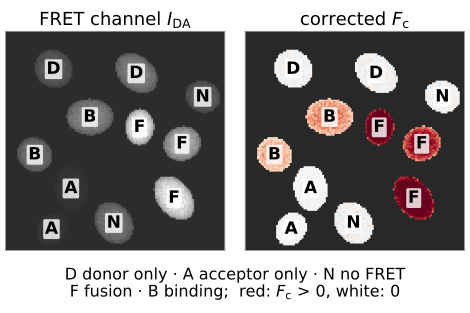
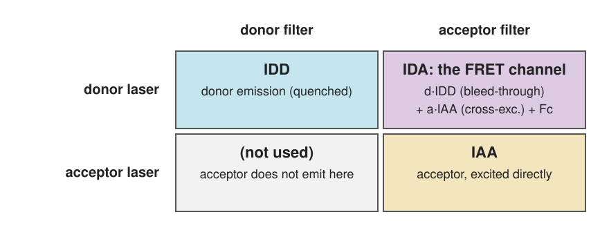
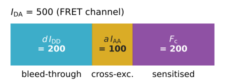
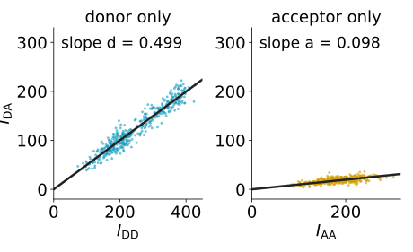
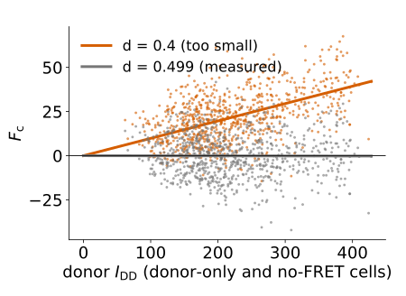
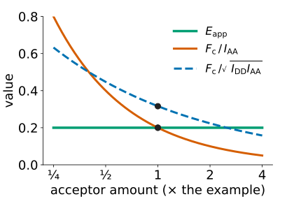
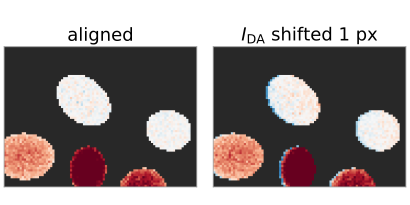

## About this lecture

FRET makes the acceptor glow under donor excitation (**sensitised emission**). To measure it we look through the acceptor filter while exciting the donor. But that "FRET channel" is bright even without any FRET.

- The **three images** of a sensitised-emission measurement.
- Two contaminations: **bleed-through** of the donor and **cross-excitation** of the acceptor.
- Two **controls** that measure them: donor only, acceptor only.
- The correction is **compensation** with a fixed, triangular structure.
- From the corrected signal $F_c$ to an **efficiency**; why other indices mislead.
- Subtracting large numbers: **noise**; and the practical pitfalls.

*Slides titled **The math** give the formulas and proofs; the ideas are complete without them.*

::: notes
Notation: IDD donor excitation / donor emission, IDA donor excitation / acceptor emission ("FRET channel"), IAA acceptor excitation / acceptor emission; d bleed-through, a cross-excitation, G instrument factor. The literature also writes α and β; the course reserves β, so we avoid it.
:::

## The FRET channel lights up everywhere

A field with four kinds of cells, imaged with **donor excitation** through the **acceptor filter**:

:::: {.columns}
::: {.column width="54%"}
| cell | FRET? | bright in the FRET channel? |
|---|---|---|
| donor only | no | **yes** |
| acceptor only | no | **yes** (dimmer) |
| donor + acceptor, not bound | no | **yes** |
| donor–acceptor fusion | yes | yes |
:::
::: {.column width="46%"}
{fig-alt="Left: the raw FRET channel of the demo's field of eleven cells; donor-only (D), acceptor-only (A), no-FRET (N), fusion (F) and binding (B) cells are all bright. Right: the corrected sensitised emission; the D, A and N cells are white (zero), only the F and B cells are red." width="100%"}
:::
::::

Two reasons for light in this channel, only one of them FRET. The rest of the lecture removes the other.

## Recall: bleed-through and controls

From the [crosstalk unit](../crosstalk/lec.qmd) (spectral unmixing day):

- A channel collects a **band**; a dye's emission tail reaches the neighbour's band: **bleed-through**.
- Signals **add**: a pixel is (mixing matrix) × (amounts).
- A **single-stained control** measures one column of the mixing matrix, as the **slope through the origin** of one channel against the other, after subtracting the background.
- Wrong coefficients: populations tilt (under- or over-compensated).

::: {.callout-note title="If you have not taken the unmixing day"}
A filter sees a band of wavelengths, and dye spectra are broad, so every dye shows up a little in the "wrong" channel. Image a sample with **one** dye only: the ratio of its signal in the wrong channel to its signal in its own channel, fitted over many pixels as a slope through zero, is the bleed-through coefficient.
:::

## Three images

{width="70%" fig-align="center"}

- $I_{DD}$: donor laser, donor filter: the (quenched) donor.
- $I_{AA}$: acceptor laser, acceptor filter: the acceptor, excited directly. Measures **how much acceptor** is there.
- $I_{DA}$: donor laser, acceptor filter: the **FRET channel**.

Same microscope, same settings for every image and every control.

## Two contaminations

What the FRET channel contains:

$$I_{DA} \;=\; \underbrace{d \cdot I_{DD}}_{\text{bleed-through}} \;+\; \underbrace{a \cdot I_{AA}}_{\text{cross-excitation}} \;+\; \underbrace{F_c}_{\text{sensitised emission}}$$

:::: {.columns}
::: {.column width="56%"}
- **Bleed-through** $d$: the donor's emission tail in the acceptor filter. Proportional to the donor image.
- **Cross-excitation** $a$: the donor laser also excites the acceptor a little, directly. Proportional to the acceptor image.
- What remains, $F_c = I_{DA} - d\,I_{DD} - a\,I_{AA}$, is the corrected **sensitised emission**.

Example: $I_{DD} = 400$, $I_{DA} = 500$, $I_{AA} = 1000$, $d = 0.5$, $a = 0.1$: $F_c = 500 - 200 - 100 = 200$.
:::
::: {.column width="44%"}
{fig-alt="One bar of length 500, the FRET channel of the example, split into bleed-through d times IDD = 200, cross-excitation a times IAA = 100 and sensitised emission Fc = 200." width="100%"}
:::
::::

## The math: the forward model {.math}

Donor amount $N_D$, acceptor amount $N_A$, a fraction $f$ of the donors paired with an acceptor at efficiency $E$, instrument constants $c_{DD}, c_{AA}$:

$$I_{DD} = c_{DD}\,N_D\,(1 - fE), \qquad I_{AA} = c_{AA}\,N_A, \qquad I_{DA} = d\,I_{DD} + a\,I_{AA} + F_c,$$

$$F_c = G\,c_{DD}\,N_D\,fE .$$

- $G$: how much sensitised acceptor signal one unit of **lost donor signal** produces (ratio of the acceptor's to the donor's quantum yield times detection efficiencies).
- The donor signal without FRET would be $c_{DD}N_D = I_{DD} + F_c/G$. Hence

$$E_\text{app} = \frac{F_c}{F_c + G\,I_{DD}} = fE .$$

## The controls

:::: {.columns}
::: {.column width="55%"}
- **Donor-only** sample: no acceptor, so $I_{DA} = d \cdot I_{DD}$. Plot $I_{DA}$ against $I_{DD}$ pixel by pixel: a line through the origin with slope $d$.
- **Acceptor-only** sample: no donor, so $I_{DA} = a \cdot I_{AA}$: slope $a$.
- Subtract the background first (an offset moves the line off the origin).

By hand, three donor-only pixels $(I_{DD}, I_{DA})$ = (200, 98), (400, 205), (800, 398):

$$d = \frac{\sum I_{DD}I_{DA}}{\sum I_{DD}^2} = \frac{420\,000}{840\,000} = 0.50 .$$
:::
::: {.column width="45%"}
{fig-alt="Two scatter plots of the demo's control cells after background subtraction. Donor-only pixels: IDA against IDD on a line through the origin with slope d = 0.499. Acceptor-only pixels: IDA against IAA, a flat line with slope a = 0.098." width="100%"}
:::
::::

The coefficients belong to the **microscope configuration** (filters, lasers, detector), not to the dye pair: change a filter, measure again.

## Compensation, with a structure

Write the three images as mixtures of three unknown signals: donor $u$, sensitised emission $F_c$, directly excited acceptor $v$:

$$\begin{pmatrix} I_{DD}\\ I_{DA}\\ I_{AA}\end{pmatrix} = \begin{pmatrix} 1 & 0 & 0\\ d & 1 & a\\ 0 & 0 & 1\end{pmatrix}\begin{pmatrix} u\\ F_c\\ v\end{pmatrix}$$

- The crosstalk unit's mixing matrix, with most entries **known to be zero**: only the FRET channel is mixed.
- Undoing it is trivial: $u = I_{DD}$, $v = I_{AA}$, $F_c = I_{DA} - d\,I_{DD} - a\,I_{AA}$.
- The check without ground truth: a **no-FRET control** (donor and acceptor expressed but not bound) must give $F_c \approx 0$ at every expression level.

## The math: the matrix and its inverse {.math}

$L = \begin{pmatrix} 1 & 0 & 0\\ d & 1 & a\\ 0 & 0 & 1\end{pmatrix}$ is lower-triangular after reordering (only one row is mixed), with $\det L = 1$. Its inverse is

$$L^{-1} = \begin{pmatrix} 1 & 0 & 0\\ -d & 1 & -a\\ 0 & 0 & 1\end{pmatrix},$$

which is forward substitution: read $u$ and $v$ off the first and last rows, then subtract. With a spectral detector the same separation is done by least squares on the emission spectrum ([lsunmix](../lsunmix/lec.qmd)).

## Try it: correct the FRET channel

```{=html}
<link rel="stylesheet" href="../demos/dist/demo.css">
<div data-demo="threecube" data-preset="raw" data-presets="raw bleed both measured dsmall" data-compact></div>
<script src="../demos/dist/threecube.js"></script>
```

::: notes
Eleven seeded cells: donor only (cells 1, 7), acceptor only (2, 8), free donor + acceptor (3, 9), fusion with E = 0.3 (4, 6, 10), binding with half the donors paired at E = 0.4 (5, 11). True d = 0.5, a = 0.1, G = 2, background 100, 300 photons. Numbers on the cells: the per-cell value (ratio of sums). Tour: "raw": d = a = 0, all cells bright in Fc (donor-only cells 157 and 88 per pixel). "Remove bleed-through only": donor-only cells drop to 0; acceptor-only and no-FRET cells still about 17–22. "Remove cross-excitation too": all controls ≈ 0; fusion cells 135–209 (they differ by expression). "Measured from the controls": d = 0.499, a = 0.098; E_app: fusion 0.303, binding 0.199 (true 0.20), no-FRET 0.001. "d too small" (0.4): false E_app of 0.047 in donor-only and no-FRET cells, fusion 0.326. Show the scatter: the line is below the cloud.
:::

## Wrong coefficients make false FRET

:::: {.columns}
::: {.column width="56%"}
- $d$ too small: part of the donor's bleed-through stays in $F_c$. The residual is **proportional to the donor**: bright donor cells show "FRET" even without an acceptor.
- $a$ too small: the same with the acceptor.
- Too large: negative $F_c$ in controls (over-compensation).

Example: the pixel above with $d = 0.4$ instead of 0.5: $F_c = 240$ instead of 200. A no-FRET pixel with $I_{DD} = 1000$ shows a false $F_c = 0.1 \cdot 1000 = 100$.
:::
::: {.column width="44%"}
{fig-alt="Corrected Fc against the donor signal for the pixels of donor-only and no-FRET cells in the demo. With the measured d = 0.499 the cloud is flat around zero; with d = 0.4 it tilts upwards with slope 0.1, so brighter donors show more false FRET." width="100%"}
:::
::::

Check: in the no-FRET cells, plot $F_c$ against $I_{DD}$. A **tilt** means a wrong $d$ (the crosstalk unit's under/over picture).

## From $F_c$ to a number we can compare

$F_c$ grows with how much donor is there. Three normalisations are in use:

:::: {.columns}
::: {.column width="60%"}
| index | formula | depends on |
|---|---|---|
| per acceptor | $F_c / I_{AA}$ | $E$, $f$, **and** donor:acceptor ratio |
| symmetric | $F_c / \sqrt{I_{DD} I_{AA}}$ | $E$, $f$, **and** $\sqrt{\text{donor:acceptor}}$ |
| efficiency | $E_\text{app} = F_c/(F_c + G\,I_{DD})$ | $E$, $f$ only |
:::
::: {.column width="40%"}
{fig-alt="The three numbers of the worked example as the acceptor amount is varied from a quarter to four times, with binding unchanged. E_app stays at 0.20; Fc over IAA falls from 0.8 to 0.05; the symmetric index falls from 0.63 to 0.16. At the example (1) they are 0.20, 0.20 and 0.32." width="100%"}
:::
::::

- Only $E_\text{app}$ is an efficiency. The indices change when the acceptor is expressed at a different level, **even if binding is the same**.
- Example: $F_c = 200$, $I_{DD} = 400$, $I_{AA} = 1000$, $G = 2$: $E_\text{app} = 200/1000 = 0.20$; $F_c/I_{AA} = 0.20$; $F_c/\sqrt{I_{DD}I_{AA}} = 0.32$.
- $G$ comes from constructs of known efficiency, or from acceptor bleaching on the same cells (unit 3).

## The math: why the indices depend on stoichiometry {.math}

From the forward model, with $F_c = G\,c_{DD}N_D\,fE$ and $I_{AA} = c_{AA}N_A$, $I_{DD} = c_{DD}N_D(1 - fE)$:

$$\frac{F_c}{I_{AA}} = \frac{G\,c_{DD}}{c_{AA}}\,fE\,\frac{N_D}{N_A}, \qquad \frac{F_c}{\sqrt{I_{DD}I_{AA}}} = G\sqrt{\frac{c_{DD}}{c_{AA}}}\,\frac{fE}{\sqrt{1 - fE}}\,\sqrt{\frac{N_D}{N_A}} .$$

Doubling the acceptor at fixed $f$ and $E$ halves the first and divides the second by $\sqrt2$; $E_\text{app} = fE$ does not change. (With more acceptor, more donors may find a partner: then $f$ itself changes, which is binding, not an artefact.)

## Subtracting large numbers: noise

$F_c$ is a small difference of bright images. Photon counts have variance equal to their mean ([camera noise](../cameranoise/lec.qmd)), and variances of independent images **add**:

- the pixel above: $\sigma_{F_c} = \sqrt{500 + 0.25\cdot400 + 0.01\cdot1000} = 24.7$, i.e. 12 % of $F_c = 200$;
- same brightness but low FRET ($I_{DA} = 320$, $F_c = 20$): $\sigma = 20.7$, about 100 %: one pixel says nothing.
- Large $d$ or $a$ (similar spectra) make it worse, as in [lsunmix](../lsunmix/lec.qmd): unmixing similar dyes amplifies noise.

Average over a cell (ratio of sums, unit 4) before turning $F_c$ into a number.

## The math: the variance of $F_c$ {.math}

For independent Poisson images ($\operatorname{Var} I = \operatorname{E} I$):

$$\operatorname{Var}(F_c) = \operatorname{Var}(I_{DA}) + d^2\operatorname{Var}(I_{DD}) + a^2\operatorname{Var}(I_{AA}) \approx I_{DA} + d^2 I_{DD} + a^2 I_{AA}.$$

An uncertain coefficient adds a **systematic** error: with $\hat d = d + \delta$, $\hat F_c = F_c - \delta\,I_{DD}$. Over many pixels this does not average out; over many experiments with independently estimated $d$ it contributes $\sigma_d^2 I_{DD}^2$. Example: $\sigma_d = 0.02$, $I_{DD} = 400$: $8^2 = 64$, total $\sigma = \sqrt{610 + 64} = 26.0$.

## Practical pitfalls

:::: {.columns}
::: {.column width="60%"}
- **Background first**: an offset is a fake component; it also biases the slopes of the controls.
- **Saturation** breaks the linear model: no pixel may clip in any of the three images.
- **Bleaching** between the three acquisitions changes $I_{AA}$ or $I_{DD}$; keep exposures short, check with repeated images.
- **Alignment**: the three images must overlap pixel for pixel. A chromatic shift of one pixel puts positive and negative edges into $F_c$ (align first: [FFT registration](../phasecorr/lec.qmd)).
- **Expression level**: at high concentrations unbound donors and acceptors come close by chance (**bystander FRET**): compare at similar expression.
:::
::: {.column width="40%"}
{fig-alt="Corrected Fc in part of the demo's field. Aligned: control cells are white, FRET cells uniformly red. With the FRET channel shifted by one pixel: every cell gets a red rim on one side and a blue rim on the other." width="100%"}
:::
::::

## Summary

- The FRET channel $I_{DA}$ contains donor **bleed-through** ($d\,I_{DD}$), acceptor **cross-excitation** ($a\,I_{AA}$) and the **sensitised emission** $F_c$.
- A **donor-only** and an **acceptor-only** control give $d$ and $a$ as slopes through the origin, for this microscope configuration.
- $F_c = I_{DA} - d\,I_{DD} - a\,I_{AA}$ is compensation with a triangular mixing matrix; the **no-FRET control** must give zero.
- Wrong coefficients give false FRET that follows the donor (or acceptor) brightness.
- $E_\text{app} = F_c/(F_c + G\,I_{DD}) = fE$ is an efficiency; $F_c/I_{AA}$ and $F_c/\sqrt{I_{DD}I_{AA}}$ also depend on the donor:acceptor ratio.
- $F_c$ is a difference of bright images: its relative noise is large when $E$ is small. Background, saturation, bleaching, alignment and expression level all matter.
