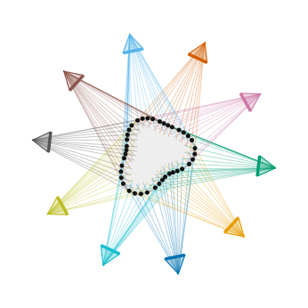
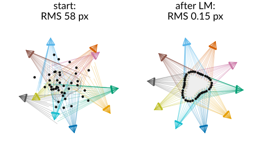
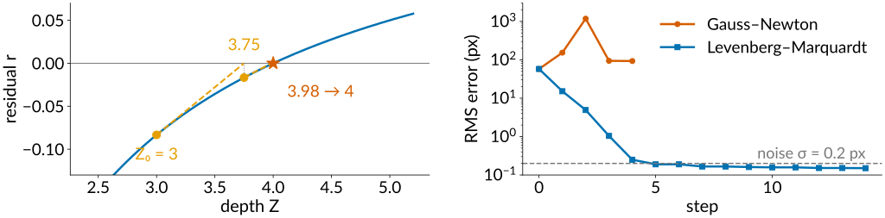
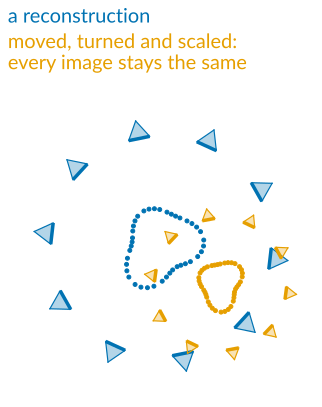
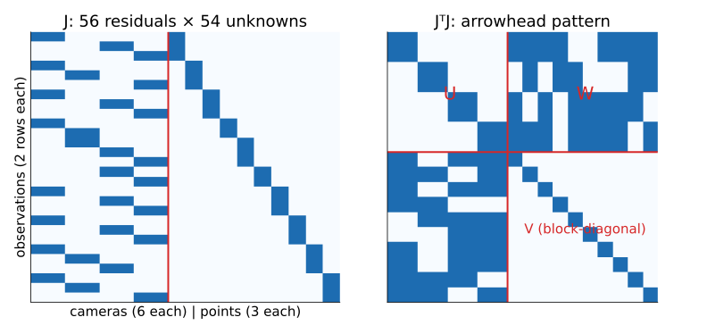
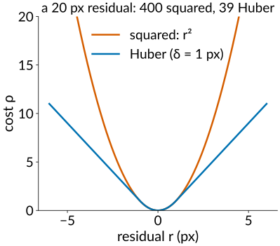
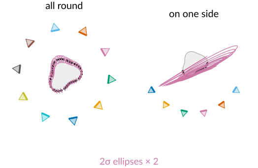
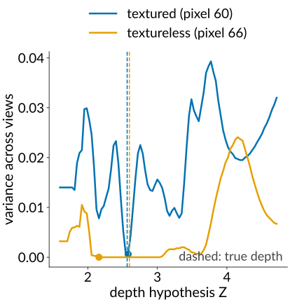

## About this lecture

A pile of photographs, no calibration object, no known camera positions. Find the cameras **and** the 3D points at the same time.

- **Structure from motion**: start from two views, add cameras one at a time, triangulate, repeat.
- **Bundle adjustment**: one least-squares problem over all cameras and all points.
- **Gauss–Newton** and **Levenberg–Marquardt**: how the solver walks downhill.
- **Gauge freedom** (the reconstruction can be moved, turned and scaled) and **sparsity** (why it scales to thousands of images).
- Outliers, drift, and how certain the points are.
- **Multi-view stereo**: once the cameras are known, match every pixel by sweeping planes.

*Slides titled **The math** give the formulas and proofs; the ideas are complete without them.*

::: notes
This unit owns structure from motion, bundle adjustment (with gauge freedom, Schur complement, robust losses) and multi-view stereo (plane sweep) for the course. Damping in Levenberg–Marquardt is μ (λ is the smoothness weight elsewhere in the course). The demos work in flatland: a 2D world with 1D cameras, so every camera, ray, point and residual fits in one picture; the 3D problem is the same with more unknowns.
:::

## The problem

:::: {.columns}
::: {.column width="60%"}
Photographs of an object from many unknown positions: find where each camera was **and** the 3D shape.

- **Photogrammetry**: objects, buildings, landscapes, archaeological finds; **plant phenotyping**: leaf areas and stem angles from a ring of photos.
- **Tilt-series alignment** in electron tomography: gold beads (fiducials) tracked through a series of tilted images; finding the tilt geometry and the bead positions together is the same problem with an affine camera.
- The camera poses behind every modern 3D capture, including the radiance fields and Gaussian splats of the optional last unit.

What we have from the previous units: matched interest points (unit 2), a way to get two cameras from $E$ (unit 2), triangulation (unit 2), and a camera from known 3D points by the DLT (unit 1).
:::
::: {.column width="40%"}
{fig-alt="Flatland: an object outline with 40 points on it and 10 cameras around it; every observation is a ray from a camera through a point. Unknown: all camera poses and all points." width="100%"}
:::
::::

## The incremental pipeline

1. **Match** interest points between all pairs of images (descriptors, ratio test, RANSAC on $F$).
2. Pick an **initial pair**: many matches **and** a real baseline (not a pure rotation).
3. Its essential matrix gives two cameras; **triangulate** the common points.
4. **Add a camera**: one that sees many already reconstructed points. Its pose from those points is a calibration with the reconstruction as the "known object": **resection** (the DLT of [the camera unit](../cameras/lec.qmd); for a calibrated camera, 3 points suffice, plus a fourth to pick among the few solutions).
5. **Triangulate** the new points it shares with the others.
6. **Bundle adjust** everything so far; go back to 4.

Small errors in each step add up, so step 6 is not optional. Global methods (all rotations first, then all positions) exist too.

## Bundle adjustment

:::: {.columns}
::: {.column width="50%"}
One least-squares problem: change **all** camera parameters and **all** points to minimise the **total reprojection error** (the pixel distance between each observed point and where the current cameras and points predict it).

- "Bundle": the bundle of rays from each point to the cameras that see it, adjusted until they hit the observations.
- It is the calibration refinement of unit 1, with the target's points now unknown too.
- It is the nonlinear big sibling of the global tile alignment in [stitching](../stitching/lec.qmd): there, pairwise shifts gave tile positions in one **linear** least-squares solve. Here the unknowns enter through rotations and a division by depth: **nonlinear**.

Typical sizes: 10 cameras, 1000 points seen 4 times each: 3060 unknowns, 8000 residuals.
:::
::: {.column width="50%"}
{fig-alt="The flatland bundle adjustment demo, large perturbation. Left, the start: cameras and points displaced, the rays miss the points, RMS 58 px. Right, after Levenberg–Marquardt: the rays pass through the points, RMS 0.15 px." width="100%"}
:::
::::

## The math: the bundle adjustment objective {.math}

Cameras $P_j$ (parameters: rotation as an axis–angle vector, translation, optionally $f$, $k_1$, $k_2$), points $\mathbf X_i$, observations $\mathbf x_{ij}$ for the pairs $(i, j) \in \mathcal O$ where camera $j$ sees point $i$:

$$\min_{\{P_j\},\{\mathbf X_i\}}\ \sum_{(i,j)\in\mathcal O}\rho\Big(\big\lVert\mathbf x_{ij} - \pi(P_j, \mathbf X_i)\big\rVert^2\Big).$$

- $\pi$ = rotate, translate, divide by depth, distort, apply $K$ (unit 1).
- $\rho(s) = s$: ordinary least squares; a **robust** $\rho$ (Huber) grows more slowly for large residuals.
- Counting: 10 cameras × 6 + 1000 points × 3 = 3060 unknowns; 4000 observations × 2 = 8000 residuals. Each residual depends on **one** camera and **one** point: 9 of the 3060 unknowns.

## Gauss–Newton and Levenberg–Marquardt

Nonlinear least squares, walking downhill:

- **Gauss–Newton**: replace each residual by its tangent (linearise), solve that **linear** least-squares problem exactly, step to its solution, repeat. Very fast near the answer; can overshoot wildly far from it.
- **Levenberg–Marquardt** adds a **damping** $\mu$: large $\mu$ = a small, careful step downhill; small $\mu$ = the full Gauss–Newton step. After a step that lowers the error, $\mu$ shrinks; after one that does not, the step is rejected and $\mu$ grows.

By hand, one unknown: a point at $X = 1$ seen at normalised $x = 0.25$, depth $Z$ unknown. Residual $r(Z) = 0.25 - 1/Z$, slope $1/Z^2$. From $Z_0 = 3$: $r = -0.083$, slope 0.111, step $+0.75$: $Z_1 = 3.75$; then $Z_2 = 3.98$. The truth is 4.

{fig-alt="Left: the residual r(Z) = 0.25 − 1/Z with two Gauss–Newton steps along its tangents, from Z = 3 to 3.75 to 3.98, close to the root at 4. Right: RMS error per step on a log scale for the large perturbation in the demo: Gauss–Newton goes from 58 to 154 to 1178 px and stalls near 94; Levenberg–Marquardt goes 58, 15, 4.9, 1.0, 0.25 and settles at 0.15 px, below the noise level 0.2 px." width="100%"}

## The math: Gauss–Newton and Levenberg–Marquardt {.math}

Residual vector $\mathbf r(\boldsymbol\theta)$, Jacobian $J = \partial\mathbf r/\partial\boldsymbol\theta$. Linearise: $\mathbf r(\boldsymbol\theta + \boldsymbol\delta) \approx \mathbf r + J\boldsymbol\delta$, and minimise $\lVert\mathbf r + J\boldsymbol\delta\rVert^2$:

$$J^\top J\,\boldsymbol\delta = -J^\top\mathbf r \quad(\text{Gauss–Newton}), \qquad (J^\top J + \mu D)\,\boldsymbol\delta = -J^\top\mathbf r \quad(\text{Levenberg–Marquardt}),$$

with $D = I$ or $D = \mathrm{diag}(J^\top J)$ (Marquardt's scaling).

- $\mu \to 0$: Gauss–Newton. $\mu \to \infty$: $\boldsymbol\delta \approx -\frac{1}{\mu}D^{-1}J^\top\mathbf r$, a short step along the (scaled) negative gradient of $\tfrac12\lVert\mathbf r\rVert^2$.
- Accept if $\lVert\mathbf r(\boldsymbol\theta + \boldsymbol\delta)\rVert^2 < \lVert\mathbf r(\boldsymbol\theta)\rVert^2$ and decrease $\mu$; else reject and increase $\mu$.
- Robust $\rho$: reweight each residual by $w_i = \rho'$ (iteratively reweighted least squares): $J^\top WJ\,\boldsymbol\delta = -J^\top W\mathbf r$.

## Try it: bundle adjustment in flatland

```{=html}
<link rel="stylesheet" href="../demos/dist/demo.css">
<div data-demo="bundleadjust" data-preset="large"></div>
<script src="../demos/dist/bundleadjust.js"></script>
```

::: notes
10 cameras (1D, 160 pixels, f = 130 px) around an outline with 40 points, each seen by at least 3 cameras: 169 observations with 0.2 px noise; 30 + 80 = 110 unknowns. The estimate starts at the truth plus a seeded perturbation. Thin lines: the ray of every observation from its estimated camera; when they pass through the estimated points, the bundle fits. Right: RMS error per step (log), the sparsity of J. Tour: "small perturbation": LM goes 3.42 → 0.19 → 0.15 px; GN 3.42 → 0.57 → 0.25 → 0.14. This preset, "large perturbation" (0.6): GN steps make it worse (58 → 154 → 1178 px …), LM goes 58 → 15 → 4.9 → 1.0 → 0.25 → 0.19 and converges. The final RMS 0.15 px is below the noise 0.2 px because 110 unknowns absorb part of the 169 measurements' noise.
:::

## Gauge freedom

:::: {.columns}
::: {.column width="62%"}
Move, turn or scale the **whole** reconstruction (all cameras and all points together): every image stays exactly the same.

- 3D: 3 (translation) + 3 (rotation) + 1 (scale) = **7** directions in which the error does not change at all. In the 2D flatland demo: 2 + 1 + 1 = **4**.
- The solution is a family, not a point; the solver may wander along it, and its linear systems are singular.
- **Fix the gauge**: hold the first camera still and fix one distance (or one coordinate of a second camera). Or add a known length, which also sets the true scale.
- The same thing happened in stitching: tile positions from pairwise shifts are determined only up to a common shift, so one tile is held fixed.
:::
::: {.column width="38%"}
{fig-alt="A flatland reconstruction (40 points, 10 cameras) and a copy of it moved, turned by 35 degrees and scaled by 0.6, cameras included: every camera sees exactly the same image in both." width="100%"}
:::
::::

## Sparsity: why it scales

{width="78%" fig-align="center"}

Each observation involves **one camera and one point**, so the Jacobian is almost empty, and $J^\top J$ has an **arrowhead** shape: cameras top left ($U$), points bottom right ($V$, block-diagonal: one small block per point), couplings in between ($W$).

- **Eliminate the points first**: each point block is $3 \times 3$ and inverted on its own. What remains is a small system over the **cameras** only (the **Schur complement**): $60 \times 60$ for 10 cameras instead of $3060 \times 3060$.
- Then each point is updated on its own. Thousands of cameras and millions of points become feasible.

## The math: the Schur complement {.math}

Order the unknowns as cameras $\boldsymbol\delta_c$, points $\boldsymbol\delta_p$:
$$\begin{bmatrix} U & W \\ W^\top & V \end{bmatrix}\begin{pmatrix}\boldsymbol\delta_c \\ \boldsymbol\delta_p\end{pmatrix} = \begin{pmatrix}\mathbf g_c \\ \mathbf g_p\end{pmatrix}, \qquad V = \mathrm{blockdiag}(V_1, \dots, V_n),\ V_i \in \mathbb R^{3 \times 3}.$$

- The second row gives $\boldsymbol\delta_p = V^{-1}(\mathbf g_p - W^\top\boldsymbol\delta_c)$; substituting into the first:
$$(U - WV^{-1}W^\top)\,\boldsymbol\delta_c = \mathbf g_c - WV^{-1}\mathbf g_p .$$
- Cost: $V^{-1}$ is $n$ tiny inversions ($O(n)$); the reduced system is $6m \times 6m$ for $m$ cameras ($O(m^3)$), instead of $O((6m + 3n)^3)$. For $m = 10$, $n = 1000$: $60^3$ against $3060^3$, a factor of about $10^5$.

## Robustness, drift and loop closure

:::: {.columns}
::: {.column width="62%"}
- A few **wrong matches** with residuals of 20 pixels dominate a sum of squares: the solver bends everything to reduce them. A **robust** loss (Huber: squared for small residuals, linear for large ones) lets them stay large. Combine with RANSAC upstream.
- **Drift**: in a long chain of cameras (walking down a corridor, a time-lapse, tiles of a mosaic) each new pose inherits the errors of the previous one, as in the chain of tiles in stitching.
- **Loop closure**: when the camera sees an old part of the scene again, the matches tie the end of the chain to its start, and bundle adjustment spreads the accumulated error around the loop.
:::
::: {.column width="38%"}
{fig-alt="Cost against residual: the squared loss r² and the Huber loss with δ = 1 px, which is quadratic up to 1 px and linear beyond. A 20 px residual costs 400 squared but 39 with Huber." width="100%"}
:::
::::

## How certain are the points?

:::: {.columns}
::: {.column width="50%"}
After bundle adjustment the solver knows how steep the error is in every direction: shallow directions are uncertain.

- With the gauge fixed, the **covariance** of the estimate is about $\sigma^2(J^\top J)^{-1}$ ($\sigma$ = pixel noise). Each point gets an **uncertainty ellipse** (ellipsoid in 3D).
- Points seen from many directions: small, round ellipses. Points seen only from one side, or far from all cameras: **long** ellipses (the wedges of unit 2).
- The ellipses also carry the uncertainty of the cameras: if the cameras' own positions are poorly fixed, all points share a long common direction.
:::
::: {.column width="50%"}
{fig-alt="2-sigma uncertainty ellipses of the points after bundle adjustment, magnified 2 times. Ten cameras all round: small, nearly round ellipses. Six cameras on one side: long ellipses pointing along the viewing direction, all sharing a common direction." width="100%"}
:::
::::

## The math: gauge and covariance {.math}

- A similarity $\mathbf X \to s\,Q\mathbf X + \mathbf a$ applied to all points, with each camera moved along ($R_j \to R_jQ^\top$, $\mathbf t_j \to s\,\mathbf t_j - R_jQ^\top\mathbf a$), leaves every $\pi(P_j, \mathbf X_i)$ unchanged: the residuals are invariant on a 7-parameter family (3D). Differentiating along it: $J\mathbf v = 0$ for 7 independent $\mathbf v$, so $J^\top J$ has (at least) 7 zero eigenvalues.
- Fixing the gauge removes those directions (hold some parameters); then $J^\top J$ is invertible near the solution.
- First-order covariance for Gaussian pixel noise $\sigma$: $\Sigma_{\boldsymbol\theta} \approx \sigma^2(J^\top J)^{-1}$ (gauge fixed), or $\sigma^2(J^\top J)^{+}$ (pseudo-inverse) for the minimum-norm gauge. Point $i$'s ellipse is its $3 \times 3$ (2D: $2 \times 2$) block.

## Try it: gauge, outliers, uncertainty

```{=html}
<link rel="stylesheet" href="../demos/dist/demo.css">
<div data-demo="bundleadjust" data-preset="huber"></div>
<script src="../demos/dist/bundleadjust.js"></script>
```

::: notes
"No gauge fixed": the four smallest eigenvalues of JᵀJ are about 1e-12 (translation x, y, rotation, scale), the next 0.44; the solver still converges, but to some member of the family (the point error is shown after aligning to the truth). "3 outliers, squared loss": three observations moved by 18–28 px; after running LM the RMS stays at 1.5 px, the inliers fit to 1.32 px and the outliers are hidden (residuals 1.7, −9.8, −1.2): everything bent towards them. This preset, "Huber": inliers 0.45 px, two outliers keep their full residuals (21.5 and −24.8 px), the third (−0.5) is absorbed by moving its point. "Cameras on one side": 6 cameras on a 115° arc; the 2σ ellipses (drawn at true scale) are long: standard deviations of about 0.5 along their long axis and 0.02 across. "Incremental reconstruction": "next camera" adds one camera at a time (resection from the points it sees, triangulation, BA), RMS 0.1–0.15 px after each step. The sparsity tab shows J and the arrowhead of JᵀJ.
:::

## Dense reconstruction: multi-view stereo

:::: {.columns}
::: {.column width="63%"}
Structure from motion gives the cameras and a **sparse** set of points. With the cameras known, **every pixel** can be matched:

- **Plane sweep** (Collins, 1996): for one reference image, try a series of depths. For each depth, imagine a plane at that depth, warp the other images onto the reference **through that plane** (a homography), and compare. Where the colours agree across all views (**photo-consistency**), the surface is at that depth.
- Per pixel, keep the most consistent depth: a **depth map** per image (stereo, generalised to many views and any camera arrangement).
- Fuse the depth maps into a point cloud or a volume, and extract a mesh with [marching cubes](../marchingcubes/lec.qmd).
- It fails where stereo fails: textureless and shiny surfaces, occlusions (a point hidden in some views); more views help, wide angles hurt.
:::
::: {.column width="37%"}
{fig-alt="Plane sweep in flatland with 3 views: photo-consistency (variance across views) against depth for one pixel. Textured pixel 60: a sharp minimum at 2.58, the true depth 2.57. Textureless pixel 66: a long flat valley of zero variance; the minimum at 2.16 is far from the true 2.60." width="100%"}
:::
::::

## The math: the plane-induced homography {.math}

For a plane $\mathbf n^\top\mathbf X = d$ (in camera 1's coordinates) and camera 2 with $\mathbf X_2 = R\mathbf X + \mathbf t$:

$$\mathbf x_2 \simeq K'\Big(R + \frac{\mathbf t\,\mathbf n^\top}{d}\Big)K^{-1}\mathbf x_1 .$$

- Proof: on the plane, $\mathbf n^\top\mathbf X/d = 1$, so $\mathbf t = \mathbf t\,\mathbf n^\top\mathbf X/d$ and $R\mathbf X + \mathbf t = (R + \mathbf t\mathbf n^\top/d)\mathbf X$; with $\mathbf X \propto K^{-1}\mathbf x_1$ the rest follows.
- Fronto-parallel sweep: $\mathbf n = (0, 0, 1)$, $d = Z$; each depth hypothesis is one homography per view.
- Photo-consistency of pixel $\mathbf p$ at depth $Z$: e.g. the variance of the sampled values across views, or the sum of NCC scores against the reference window.

## Try it: plane sweep in flatland

```{=html}
<link rel="stylesheet" href="../demos/dist/demo.css">
<div data-demo="flatland" data-mode="sweep" data-preset="textured"></div>
<script src="../demos/dist/flatland.js"></script>
```

::: notes
A 2D object seen by 3 (up to 5) 1D cameras; each camera's photograph is shown on its image line and as a strip below. For the chosen pixel of the reference camera (red), depth hypotheses along its ray are projected into the other cameras; the plot shows the variance of the sampled values against depth (window ±3 pixels), with the truth in green. Bottom plot: the best depth of every reference pixel against the truth. Textured object, 3 views: pixel 60 gets 2.58 (true 2.57); 13 of the 85 object pixels are off by more than 0.1, mostly near the corners where faces are seen at grazing angles. "A textureless face": pixel 66 gets 2.16 (true 2.60), 45 of 85 off. "Occluded in one view": a small block hides part of the object from camera 3; pixel 60 gets 3.00 (true 2.57), 55 of 89 off. Remove camera 3 (views = 2): pixel 60 is right again.
:::

## Summary

- **Structure from motion**: match → initial pair ($E$, triangulate) → add cameras by **resection** → triangulate → **bundle adjust** → repeat.
- **Bundle adjustment** minimises the total reprojection error over all cameras and points: nonlinear least squares by **Gauss–Newton** / **Levenberg–Marquardt** (damping $\mu$).
- **Gauge freedom**: 7 directions (move, turn, scale) change no image; fix them. The scale needs a known length.
- **Sparsity**: one camera and one point per residual; eliminate the points (**Schur complement**) and solve a small camera system.
- **Robust** losses against wrong matches; **loop closure** against drift; $\sigma^2(J^\top J)^{-1}$ for uncertainty ellipses.
- **Multi-view stereo**: with known cameras, sweep depth planes and keep the most **photo-consistent** depth per pixel.
