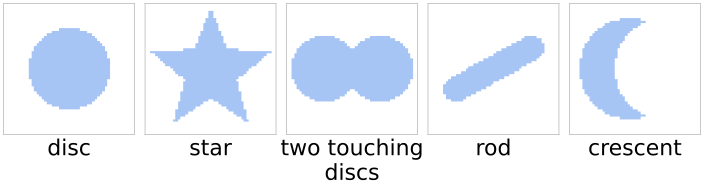
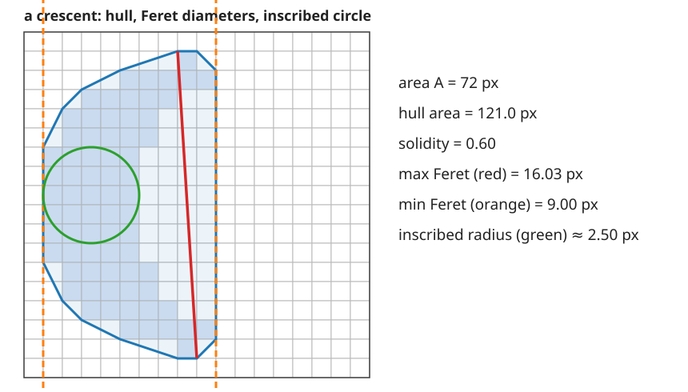
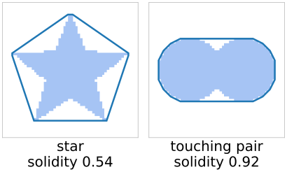
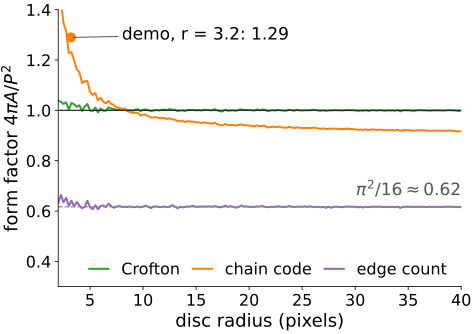
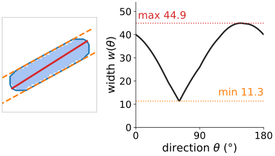
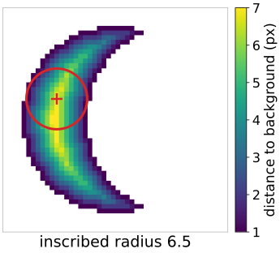
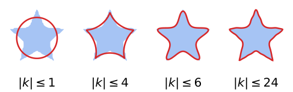

## About this lecture

A disc and a five-pointed star of the same area have the same area, and both have equal eigenvalues. Moments summarise the spread of the pixels; this unit measures the **outline**.

- **Convex hull** and **solidity**: how much is missing from a convex shape (and "should these two touching nuclei be split?").
- **Form factor** $4\pi A/P^2$, and why it inherits the perimeter bias of the last unit.
- **Feret diameters**: the width in every direction, found with **rotating calipers**.
- **Radii** from the distance transform, **Fourier descriptors** of the contour.
- Pitfalls: units, anisotropic pixels, border objects, resolution.

*Slides titled **The math** give the formulas and proofs; the ideas are complete without them.*

::: notes
Recalled, not re-taught: perimeter estimators and moments (last unit, regionprops/), the distance transform (morphology day), the Fourier series (fourier/, day 1). The measurements day (day 11) adds intensity, texture and relations and recalls these shape features as rows of its table.
:::

## Same size, different shape

Digitised on a 64 × 64 grid (numbers from the demo):

{width="62%" fig-alt="The five digitised shapes of the table: a disc, a five-pointed star of the same area, two touching discs, a tilted rod and a crescent."}

| | area | solidity | form factor | max / min Feret | inscribed radius |
|---|---|---|---|---|---|
| disc, $r = 16$ | 812 | 0.96 | 1.02 | 33.3 / 32.0 | 15.0 |
| star (same area) | 804 | 0.54 | 0.33 | 48.0 / 44.0 | 10.3 |
| two touching discs | 1040 | 0.92 | 0.76 | 48.7 / 26.0 | 12.0 |
| rod | 420 | 0.90 | 0.52 | 44.9 / 11.3 | 4.9 |
| crescent | 548 | 0.61 | 0.46 | 40.8 / 26.0 | 6.5 |

(Form factor with the Crofton perimeter.) Each column separates some shapes and not others: a feature table needs several.

## Size: what we already have

- Area $A$, perimeter $P$ (edge count is $4/\pi$ too long; use chain code or Crofton), bounding box and extent, axis lengths $4\sqrt{\lambda_{1,2}}$, eccentricity: last unit.
- **Equivalent diameter**: the diameter of the disc with the same area, $d = \sqrt{4A/\pi}$.
- In 3D the same name means the **sphere** with the same volume, $d = \sqrt[3]{6V/\pi}$. Same name, different formula: always say which.
- Every size feature is in pixels until it is multiplied by the pixel size (lengths) or its square (areas).

## The convex hull

{width="70%"}

The **convex hull** is the smallest convex set that contains the object: a rubber band around it.

- For pixels, take the hull of the pixel **corners** (blue). The hull of the pixel **centres** is half a pixel smaller all round: for a one-pixel-wide line it has area 0. The choice matters a lot for small objects.
- Only the leftmost and rightmost pixel of each row can be on the hull: few candidates.
- Algorithm (Andrew's monotone chain): sort the points by $x$; walk left to right keeping only right turns (upper hull), then right to left (lower hull). $O(n\log n)$.
- **Area** of the hull polygon: the **shoelace formula**.

## The math: the shoelace formula {.math}

For a polygon with vertices $(x_1, y_1), \dots, (x_k, y_k)$ in order (and $x_{k+1} = x_1$):

$$A = \frac12 \sum_{i=1}^{k} \big(x_i y_{i+1} - x_{i+1} y_i\big).$$

- Each term is twice the signed area of the triangle (origin, vertex $i$, vertex $i+1$); triangles outside the polygon cancel. The sign tells the orientation of the vertices.
- It is Green's theorem, $A = \frac12\oint (x\,dy - y\,dx)$, applied to straight edges. The same theorem turns the moments $\iint x^p y^q$ into sums over the edges of a polygon (moments elective; marching-cubes elective for surfaces).
- Example: the square $(0,0), (2,0), (2,2), (0,2)$: $\frac12(0 + 4 + 4 + 0) = 4$.

## Solidity

**Solidity** $= A / A_{\text{hull}}$: 1 for a convex object, lower the more is missing.

:::: {.columns}
::: {.column width="58%"}
- Disc 0.96, rod 0.90 (on pixels, convex shapes get a little less than 1: the staircase of the outline is not convex), star 0.54, crescent 0.61.
- **Two touching nuclei**: 0.92 against 0.96 for one nucleus. A low solidity for an object of nucleus size says "two objects merged here, consider splitting" (watershed day).
- Exact solidity from the outline: disc 1.00, star 0.52, crescent 0.61, touching pair 0.93.
- With the centre convention, small objects can get **solidity above 1** (pixel area larger than the hull of the centres).
:::
::: {.column width="42%"}
{width="100%" fig-alt="The digitised star with its convex hull, a pentagon, solidity 0.54; and two touching discs with their hull, which bridges the waist between them, solidity 0.92."}
:::
::::

## Form factor and its bias

**Form factor** (circularity) $4\pi A/P^2$: 1 for a disc, smaller for everything else (isoperimetric inequality).

:::: {.columns}
::: {.column width="56%"}
- It inherits the perimeter bias: with the **edge count** a digital disc gets $(\pi/4)^2 = \pi^2/16 \approx 0.62$, at every resolution.
- With a better perimeter it is close to 1 for large discs, but **small** discs come out **above 1**: a disc of radius 3.2 pixels gets 1.29 with the chain code (the polygon through the centres is too short).
- Rule: compare form factors only within one estimator and one resolution, and not for objects of a few pixels.

**Compactness** is a name with several meanings:

| | disc | square | 2:1 rectangle |
|---|---|---|---|
| $P^2/(4\pi A)$ | 1 | 1.27 | 1.43 |
| $2\pi\,\overline{r^2}/A$ (second moments) | 1 | 1.05 | 1.31 |

(and in 3D $S^3/(36\pi V^2)$, 1 for a sphere).
:::
::: {.column width="44%"}
{width="100%" fig-alt="Form factor of digital discs against the radius from 2 to 40 pixels for three perimeter estimators: the edge count stays at about 0.62 at every radius, the chain code starts above 1.3 for tiny discs and settles near 0.92, Crofton stays near 1. The demo's disc of radius 3.2 gets 1.29 with the chain code."}
:::
::::

## Feret diameters

The **Feret diameter** (caliper diameter) $w(\theta)$: the distance between two parallel lines that touch the object, measured in direction $\theta$.

:::: {.columns}
::: {.column width="55%"}
- **Max Feret** = the largest distance between two points of the object (red).
- **Min Feret** = the smallest width (orange calipers): what a sieve measures.
- Both are attained on the **convex hull**, so only hull vertices matter.
- **Rotating calipers**: turn the pair of lines around the hull; the opposite vertex moves forward as the edge advances: $O(h)$ for $h$ hull vertices. The min width always has one caliper **flush with a hull edge**.
:::
::: {.column width="45%"}
{width="100%" fig-alt="Left: a tilted digitised rod with its convex hull, the max Feret diameter along its length and the two orange calipers flush with its long sides. Right: the width w(θ) against the direction θ from 0 to 180 degrees, with a sharp minimum of 11.3 and a rounded maximum of 44.9."}
:::
::::

## The math: rotating calipers {.math}

$w(\theta) = \max_p \mathbf p\cdot\mathbf u_\theta - \min_p \mathbf p\cdot\mathbf u_\theta$ with $\mathbf u_\theta = (\cos\theta, \sin\theta)$ and $\mathbf p$ the hull vertices.

- Between two angles at which the extreme vertices change, $w(\theta) = |(\mathbf p_a - \mathbf p_b)\cdot\mathbf u_\theta| = c\,|\cos(\theta - \varphi)|$: a concave function of $\theta$. Its minimum over an interval is at an end, where a caliper becomes flush with an edge. So the **min width** = $\min$ over hull edges of the largest distance of a vertex from that edge's line.
- The **max** of each piece is $|\mathbf p_a - \mathbf p_b|$: the diameter is the largest distance over **antipodal pairs**.
- Walking the edges in order, the farthest vertex only moves forward: $O(h)$ in total (Toussaint, 1983).

## Radii from the distance transform

The distance transform (morphology day): $\mathrm{DT}(p)$ = distance from object pixel $p$ to the nearest background pixel.

:::: {.columns}
::: {.column width="60%"}
- **Maximum inscribed radius** $\approx \max \mathrm{DT} - \tfrac12$ (DT is measured between pixel centres): the largest disc that fits inside. A **thickness** that ignores protrusions.
- **Mean radius**: the mean of DT over the object.
- A rod of width $w$ has inscribed radius $\approx w/2$ whatever its length; its min Feret is $\approx w$ too. A crescent has min Feret 26 but inscribed radius only 6.5: it is thin but curved.
- The centre of the largest disc lies on the **medial axis** (skeleton elective). Also used: the **minimum enclosing circle** (Welzl's algorithm).
:::
::: {.column width="40%"}
{width="100%" fig-alt="The distance transform of the digitised crescent as a colour map, brightest along the middle of its thick part, with the largest inscribed circle of radius 6.5 drawn in red around the maximum."}
:::
::::

## Try it: shape features

```{=html}
<link rel="stylesheet" href="../demos/dist/demo.css">
<div data-demo="moments" data-mode="features" data-preset="star" data-presets="disc,small,star,pair,rod,aniso" data-shapectl="off"></div>
<script src="../demos/dist/moments.js"></script>
```

::: notes
The moments shell in "features" mode. Overlays: hull (blue), calipers at θ (orange) with the plot of w(θ), min/max Feret (red), inscribed circle (green), enclosing and equal-area circles, Fourier outline. Tour: "star vs disc": equal-area circle on; solidity 0.54. "two touching nuclei": 0.92. "disc": form factor 0.62 with the edge count, 0.99 with Crofton. "small disc" (radius 3.2): chain-code form factor 1.29. "rod": min Feret 11.3, inscribed radius 4.9. "anisotropic pixels": rows twice as far apart; in px the disc looks like an ellipse (eccentricity 0.87, Feret 20.4/10.0); switch to µm: Feret 10.8/10.0 µm, area 80 µm² (true 78.5). Move θ and watch the calipers trace w(θ).
:::

## Contour descriptors

Walk the boundary and write each point as a complex number $z(t) = x(t) + i\,y(t)$: a periodic signal. Its Fourier coefficients $c_k$ (recall the Fourier unit) describe the outline:

{width="58%" fig-alt="A digitised five-pointed star and its outline reconstructed from Fourier descriptors: with |k| at most 1 a circle, with 4 a rounded star, with 6 the points appear, with 24 the outline also follows the pixel staircase."}

- $c_0$ is the centroid of the contour; drop it for **translation** invariance.
- $c_{\pm1}$ is the best-fitting ellipse; divide by $|c_1|$ for **scale** invariance; use magnitudes $|c_k|$ for **rotation** and starting-point invariance.
- Keep only $|k| \le K$ and transform back: a **smoothed outline**. A 5-pointed star needs $|k|$ up to about 4–6 to show its points (an exactly 5-fold symmetric outline has only $|k| = 1, 4, 6, 9, 11, \dots$).
- Low $k$: overall shape; high $k$: detail and pixel noise.

## Pitfalls

- **Units**: areas scale with the square of the pixel size, lengths linearly, ratios (solidity, form factor) not at all. Report µm and µm².
- **Anisotropic pixels** (e.g. a stack with $\Delta z = 3\Delta x$, or a scanner with non-square pixels): compute in physical coordinates, or resample to square pixels first. In pixel units a sphere looks like an ellipsoid.
- **Border objects** are truncated: their area, Feret and form factor are wrong. Drop them, or count with a frame (next unit).
- **Resolution**: an object of 10 pixels has no meaningful form factor or Feret ratio.
- **Segmentation error**: one pixel of dilation adds about $P$ pixels of area, a relative change $P/A = 2/r$ for a disc: 9 % for $r = 22$, about 20 % for a rod of width 10.

## Summary

- **Equivalent diameter** $\sqrt{4A/\pi}$ (2D) or $\sqrt[3]{6V/\pi}$ (3D).
- **Convex hull** of the pixel corners; area by the **shoelace formula**; **solidity** $A/A_{\text{hull}}$ flags concave and merged objects.
- **Form factor** $4\pi A/P^2$: depends on the perimeter estimator ($0.62$ for a disc with the edge count); can exceed 1 for small objects.
- **Feret diameters**: max = diameter, min = width; rotating calipers on the hull in $O(h)$.
- **Inscribed radius** from the distance transform: thickness.
- **Fourier descriptors**: outline as a periodic signal.
- Always: units, pixel shape, border, resolution.
