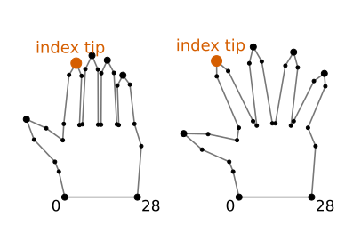
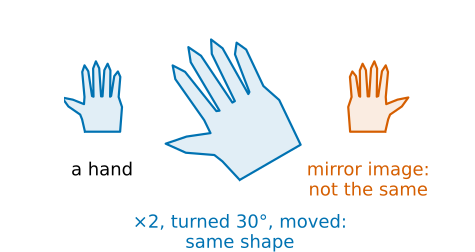
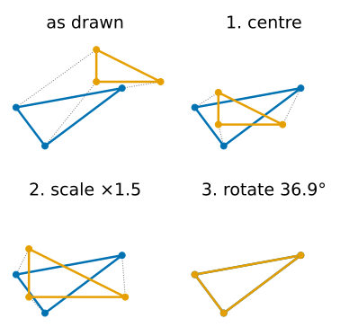
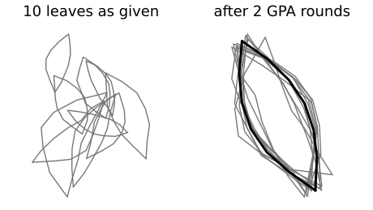
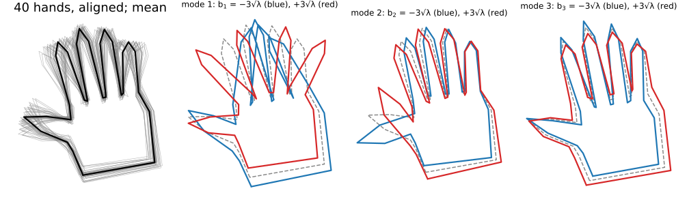
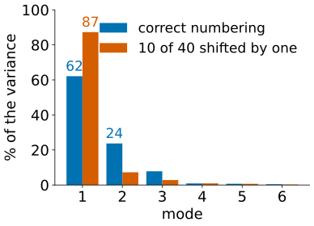

## About this lecture

A snake knows only "smooth". A hand, a leaf, a vertebra or a nucleus has a **characteristic shape**, and we can learn it from examples (Cootes & Taylor: "smart snakes").

- **Landmarks**: the same points marked on every example; a shape is a vector of $2n$ numbers.
- **Shape** is what is left after removing position, size and rotation: **Procrustes** alignment.
- **Generalised Procrustes**: align a whole training set to its mean.
- **PCA** of the aligned landmarks: the **modes of variation**, each one moving all landmarks together.
- A **point distribution model** $\mathbf x = \bar{\mathbf x} + \Phi\mathbf b$ generates plausible shapes; and what breaks it.

*Slides titled **The math** give the formulas and proofs; the ideas are complete without them.*

## Landmarks

:::: {.columns}
::: {.column width="58%"}
Mark $n$ **corresponding** points on every training shape: the tip of each finger, the base of a leaf, plus evenly spaced points in between.

- A shape is one vector: $\mathbf x = (x_1, y_1, x_2, y_2, \dots, x_n, y_n) \in \mathbb R^{2n}$. A hand with 29 landmarks is one point in 58 dimensions.
- **Correspondence** is the whole point: landmark 7 must be the tip of the index finger on every hand. Then averaging and comparing shapes landmark by landmark makes sense.
- It is also the hard part: done by hand in practice, or by methods that choose the points automatically (minimum description length), which we do not cover.

This lecture uses synthetic families (hands, nuclei, leaves) generated from a few hidden parameters, so the landmarks correspond by construction.
:::
::: {.column width="42%"}
{width="100%" fig-alt="Two synthetic hand outlines, one with closed and one with spread fingers, each with 29 landmarks numbered 0 at the left wrist to 28 at the right wrist. The tip of the index finger is the same landmark on both and is marked in red."}

Two of the synthetic hands: 29 landmarks each, larger dots at tips and wrist.
:::
::::

## What is "shape"?

:::: {.columns}
::: {.column width="52%"}
Two hands, one twice as large, turned by 30° and in another place in the image: they have the **same shape**.

- **Shape** = the geometry that remains after removing **translation, scale and rotation** (Kendall). Reflection is usually *not* removed: a left hand is not a right hand.
- To compare shapes, first bring them into the same position, size and orientation: **align** them.
- The best alignment of one landmark set onto another, in the least-squares sense, is **Procrustes analysis**.
:::
::: {.column width="48%"}
{width="100%" fig-alt="Three hand outlines. A small hand; a copy twice as large, turned by 30 degrees and moved, drawn in the same blue: the same shape. A mirror image of the hand in red: not the same shape."}
:::
::::

## Procrustes: three steps

:::: {.columns}
::: {.column width="61%"}
Align the orange set onto the blue one, minimising the sum of squared distances between corresponding landmarks:

1. **Centre**: move the orange set so its centroid lands on the blue centroid.
2. **Scale**: stretch it about its centroid.
3. **Rotate**: turn it about its centroid.

For a triangle $(0,0), (2,0), (0,1)$ and a copy turned by $36.9°$, made 1.5 times larger and moved, the three steps recover exactly that: scale $1.5$, angle $36.9°$, remaining error 0. With noise, or a wrong landmark, the best fit leaves an error.

In 2D the scale and the rotation together are one matrix $\begin{pmatrix} a & -b \\ b & a\end{pmatrix}$, with scale $\sqrt{a^2 + b^2}$ and angle $\operatorname{atan2}(b, a)$: the similarity matrices of *Images as arrays & geometric transforms*. The triangle: $a = 1.2$, $b = 0.9$.
:::
::: {.column width="39%"}
{width="100%" fig-alt="Four panels with a blue triangle and an orange triangle, dotted lines joining corresponding corners. As drawn: apart. After centring: the centroids coincide. After scaling by 1.5: the same size. After rotating by 36.9 degrees: the orange triangle lies exactly on the blue one."}
:::
::::

## The math: Procrustes in closed form {.math .smaller}

Centre both sets: $\mathbf p_i$ (orange), $\mathbf q_i$ (blue), $\sum\mathbf p_i = \sum\mathbf q_i = 0$. Minimise over $a, b$:

$$\sum_i \left|\begin{pmatrix} a & -b \\ b & a\end{pmatrix}\mathbf p_i - \mathbf q_i\right|^2.$$

This is **linear** least squares in $(a, b)$. Setting the two derivatives to zero:

$$a = \frac{\sum_i \mathbf p_i\cdot\mathbf q_i}{\sum_i|\mathbf p_i|^2}, \qquad b = \frac{\sum_i (p_{i,x}q_{i,y} - p_{i,y}q_{i,x})}{\sum_i|\mathbf p_i|^2}.$$

- The translation is the difference of the centroids (after applying the matrix). Triangle: $\sum|\mathbf p|^2 = 10/3$, $\sum\mathbf p\cdot\mathbf q = 4$, $\sum$ cross $= 3$: $a = 1.2$, $b = 0.9$.
- Rigid fit (no scaling): same angle, $(a, b)/\sqrt{a^2 + b^2}$.
- Any dimension (3D shapes): the rotation is $R = UV^\top$ from the SVD $U\Sigma V^\top$ of the cross-covariance $\sum_i\mathbf q_i\mathbf p_i^\top$, with the sign of the last column of $U$ flipped if $\det(UV^\top) < 0$, to forbid a reflection (Umeyama, 1991). In 2D this gives the same answer as the formula.

## Try it: Procrustes, step by step

```{=html}
<link rel="stylesheet" href="../demos/dist/demo.css">
<div data-demo="procrustes" data-preset="exact"></div>
<script src="../demos/dist/procrustes.js"></script>
```

::: notes
"pure rotation recovers exactly": the by-hand triangle. Readout a = 1.200, b = 0.900, scale 1.500, angle 36.9°, residual after the fit 0.000; residual as drawn 17.530. Press 1 centre, 2 scale, 3 rotate: the orange triangle lands on the blue one. "noise": a 12-point leaf, a = 0.743, b = −0.534 (scale 0.915, angle −35.7°): residual 0.130, not zero. "mirror image": an L and its mirror image: without reflection the best fit is poor (residual 6.28, scale 0.39: it shrinks the L to reduce the error); tick allow reflection: residual 0, mirror found. "one landmark mislabelled": landmark 4 placed where landmark 10 is: residual 0.418 instead of 0, and the error is spread over all landmarks (0.05–0.07 each, 0.62 at landmark 4). "rigid": no scaling: residual 0.833. "GPA on a set": next slide.
:::

## Aligning a whole training set

:::: {.columns}
::: {.column width="55%"}
**Generalised Procrustes analysis** (Gower, 1975):

1. Centre every shape and scale it to size 1.
2. Take one shape as the first guess of the **mean**.
3. Align every shape to the mean (Procrustes).
4. New mean = the average of the aligned shapes; scale it to size 1 and fix its orientation (align it to the first guess).
5. Repeat 3–4 until the mean stops changing: usually 2–3 rounds.

:::
::: {.column width="45%"}
{width="100%" fig-alt="Left: ten leaf outlines in random positions, sizes and orientations, a tangle. Right: the same ten leaves after two rounds of generalised Procrustes analysis, lying on top of each other, with their mean outline drawn thick in black."}
:::
::::

Ten leaves in random positions, sizes and orientations: the sum of squared distances to the mean drops from 4.86 to 0.163 in the first round, and to 0.161 in the second; after that the mean changes by less than $10^{-9}$.

## Recall: PCA (day 1)

From the [PCA unit](../pca/lec.qmd): a cloud of points, its mean, its **covariance matrix** $S$; the **eigenvectors** of $S$ are the principal axes, the **eigenvalues** (largest first) the variances along them. Keep the first few axes, and every point is the mean plus a few scores times the axes.

Here every point of the cloud is a **whole aligned shape**, in $\mathbb R^{2n}$ instead of $\mathbb R^2$. Nothing else changes.

## Modes of variation

- The **mean shape** $\bar{\mathbf x}$: the average of the aligned shapes, landmark by landmark.
- The eigenvectors $\boldsymbol\phi_1, \boldsymbol\phi_2, \dots$ of the $2n \times 2n$ covariance matrix: each is a **whole-shape deformation**, in which all landmarks move together (spread the fingers, bend the nucleus, widen the leaf).
- Its eigenvalue $\lambda_k$ is the variance of the training shapes along it: how much of the variation it explains.
- A **point distribution model** (PDM): $\mathbf x \approx \bar{\mathbf x} + b_1\boldsymbol\phi_1 + \dots + b_k\boldsymbol\phi_k = \bar{\mathbf x} + \Phi\mathbf b$, with a few numbers $\mathbf b$ per shape.
- **Plausible** shapes: each $|b_j| \le 3\sqrt{\lambda_j}$ (three standard deviations).

## Modes of a hand

{width="100%" fig-alt="Left: 40 aligned training hands in grey with their mean in black. Then the first three modes, each drawn at minus (blue) and plus (red) three standard deviations around the mean (dashed): mode 1 closes and spreads the fingers, mode 2 moves the thumb, mode 3 changes the finger length."}

40 synthetic hands, generated from 3 hidden parameters (finger spread, thumb angle, finger length) plus small landmark noise. After alignment, 3 modes carry 93.7 % of the variance (62.1, 23.7 and 7.8 %); every further mode under 1 %.

## The math: the point distribution model {.math .smaller}

Aligned training shapes $\mathbf x_1, \dots, \mathbf x_s \in \mathbb R^{2n}$, mean $\bar{\mathbf x}$, covariance (divided by $s$, as in the PCA unit)

$$S = \frac1s\sum_{j=1}^s(\mathbf x_j - \bar{\mathbf x})(\mathbf x_j - \bar{\mathbf x})^\top, \qquad S\boldsymbol\phi_k = \lambda_k\boldsymbol\phi_k,\ \lambda_1 \ge \lambda_2 \ge \dots$$

- Keep $k$ modes with $\sum_{j \le k}\lambda_j \ge 0.95\sum_j\lambda_j$ (or 0.98). $\Phi = (\boldsymbol\phi_1 \cdots \boldsymbol\phi_k)$ has orthonormal columns.
- **Generate**: $\mathbf x = \bar{\mathbf x} + \Phi\mathbf b$. **Project** (change of basis, as for the DFT): $\mathbf b = \Phi^\top(\mathbf x - \bar{\mathbf x})$; $\bar{\mathbf x} + \Phi\mathbf b$ is the closest model shape (least squares).
- Over the training set $b_j$ has mean 0 and variance $\lambda_j$: the bound $|b_j| \le 3\sqrt{\lambda_j}$, or a Mahalanobis bound $\sum_j b_j^2/\lambda_j \le D_\text{max}^2$.
- With $s < 2n$ shapes, at most $s - 1$ eigenvalues are non-zero. Then diagonalise the small $s \times s$ matrix $\frac1s Y^\top Y$ ($Y$ = centred shapes as columns): if $Y^\top Y\mathbf u = \mu\mathbf u$, then $Y\mathbf u$ is an eigenvector of $YY^\top$ with the same eigenvalue.

## Try it: a shape model of hands

```{=html}
<link rel="stylesheet" href="../demos/dist/demo.css">
<div data-demo="shapepca" data-preset="spread"></div>
<script src="../demos/dist/shapepca.js"></script>
```

::: notes
Left: the 40 aligned training hands with each landmark's scatter (coloured dots) and the mean; below, % variance per mode with the cumulative curve. Centre: the model shape with sliders b1..b5 in units of √λ. Tour: "first mode: finger spread" animates b1 between ±3: the fingers fan out and close; b2 (animate b2) is mostly the thumb, b3 the finger length. Shares 62.1, 23.7, 7.8 %; 95 % needs 5 modes. "without alignment": the raw shapes; the first two modes (49.6 and 41.4 %) are the position of the hand, then pose and shape mix. "3 training shapes": only 2 non-zero eigenvalues (89.2 and 10.8 %). "bad correspondence": 10 of the 40 hands numbered one landmark off (red in the left panel): mode 1 jumps to 87.3 % and is the renumbering, not a real deformation. "unlimited": b3 = 5: fingers too long. "drag a finger": project mode.
:::

## When the model misleads

:::: {.columns}
::: {.column width="60%"}
- **Bad correspondence**: if some shapes are numbered one landmark off, the "variation" between landmark 7 and its neighbour becomes the largest mode. In the hand demo, 10 misnumbered hands out of 40 push mode 1 from 62 % to 87 %.
- **No alignment**: position, size and orientation become the first modes, and the real shape variation is mixed into them.
- **Too few shapes**: $s$ shapes give at most $s - 1$ modes, and those are mostly the quirks of these few examples.
- **Curved motion**: a finger bending at a joint moves its tip along an arc; a linear model needs several modes for one bend, and $\pm3\sqrt\lambda$ can produce straightened or stretched fingers.
- **Unlimited $\mathbf b$**: far outside $\pm3\sqrt\lambda$ the model draws shapes no hand has.
:::
::: {.column width="40%"}
{width="100%" fig-alt="Bar chart of the percentage of variance per mode for the 40 training hands. Correct numbering: 62, 24 and 8 percent for modes 1 to 3. With 10 of the 40 hands numbered one landmark off: mode 1 jumps to 87 percent, mode 2 drops to 7."}

The hand model of the demo, with and without misnumbered shapes.
:::
::::

## Summary

- A shape: $n$ corresponding **landmarks**, a vector in $\mathbb R^{2n}$. Correspondence is the hard, manual part.
- **Procrustes** removes position, size and rotation: in 2D a linear least-squares fit of $\begin{pmatrix} a & -b \\ b & a\end{pmatrix}$ and a translation; in general an SVD.
- **GPA** aligns a set to its mean in a few rounds.
- **PCA** of the aligned shapes: mean shape plus **modes**, whole-shape deformations ordered by variance.
- **PDM**: $\mathbf x = \bar{\mathbf x} + \Phi\mathbf b$, $\mathbf b = \Phi^\top(\mathbf x - \bar{\mathbf x})$, plausible for $|b_j| \le 3\sqrt{\lambda_j}$.
- Check correspondence and alignment first; a linear model has trouble with bending.
