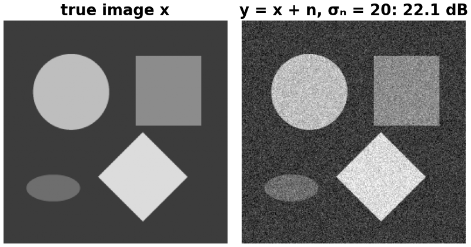
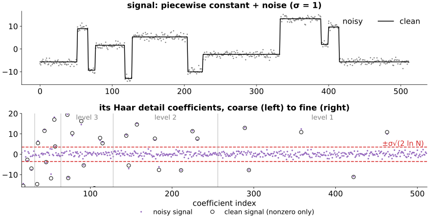
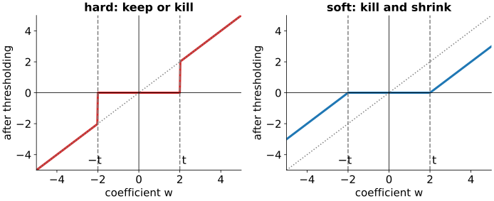
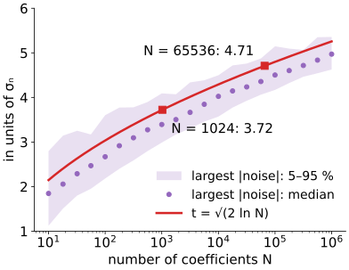
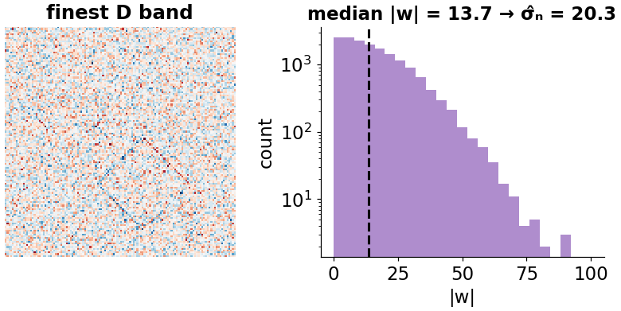
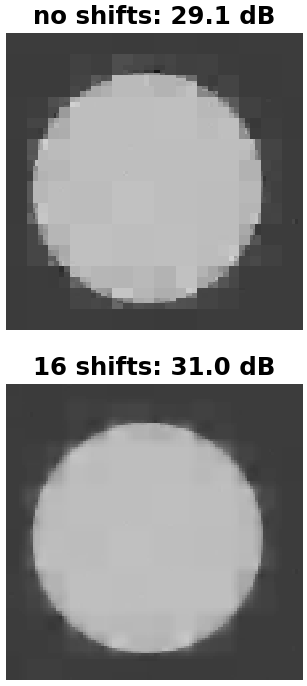
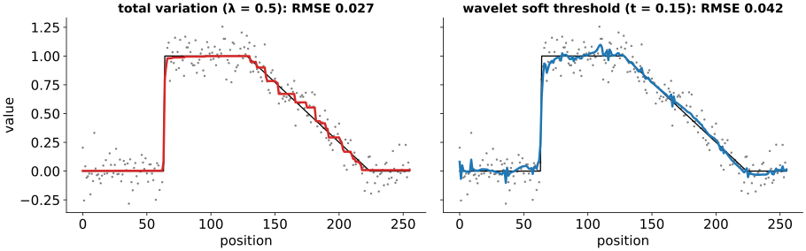

## About this lecture

Images are sparse in a wavelet basis: a few large coefficients carry the structure. Noise is not sparse in any basis. Today we use that difference to remove noise.

- In an orthonormal basis, white noise stays white noise with the **same** standard deviation in every coefficient.
- **Hard** and **soft** thresholding: keep or kill, kill and shrink.
- How large the threshold should be (the **universal threshold**), and how to estimate the noise level from the image itself.
- Artefacts tied to the grid, and **cycle spinning**.
- A third view of denoising: a **sparsity prior** in a basis.

*Slides titled **The math** give the formulas and proofs; the ideas are complete without them.*

::: notes
Fourth unit of the wavelets day. Needs the [2D DWT unit](../dwt2d/lec.qmd). The noise model and PSNR are recalled from the [camera noise unit](../cameranoise/lec.qmd); total variation from the Ising day ([gmrf](../gmrf/lec.qmd)); the first introduction of the other denoisers (median, bilateral, non-local means, learned) is [denoise](../denoise/lec.qmd) (deconvolution day), and their comparison is [all smoothers on one image](../smoothers/lec.qmd). General sparsity priors (lasso, ISTA, compressed sensing, dictionaries) belong to the [sparse representations day](../sparsity/lec.qmd); this unit is their first special case.
:::

## Recall: the noise model

:::: {.columns}
::: {.column width="45%"}
From [*Camera noise, SNR and PSNR*](../cameranoise/lec.qmd) (day 3): we model the observed image as
$$y = x + n,$$
the true image $x$ plus independent **Gaussian noise** of standard deviation $\sigma_n$ in every pixel, and measure quality by the **PSNR** in dB (higher is better).

Goal: estimate $x$ from $y$ alone.
:::
::: {.column width="55%"}
{fig-alt="The synthetic shapes image of the demo (a disc, a rectangle, a diamond and an ellipse on a grey background) and the same image with Gaussian noise of standard deviation 20 added, PSNR 22.1 dB." width="100%"}
:::
::::

::: notes
The test image and noise of the demo below (shapes, σn = 20, seeded noise).
:::

## Signal and noise in the wavelet basis

{width="78%"}

- The clean signal has **37** nonzero detail coefficients of 496, all large (circles).
- The noise puts a small value, of the **same size** $\sigma_n = 1$ everywhere (dots).
- So: **small coefficients are mostly noise, large ones mostly signal**. Keep the large, drop the small.

::: notes
Piecewise-constant test signal (Donoho–Johnstone "Blocks", 512 samples, scaled to standard deviation 7), noise σ = 1, Haar, 5 levels. The dashed lines are ±σ√(2 ln N) = ±3.53 (next slides). 36 noisy coefficients exceed it, all at positions where the clean signal is nonzero; none at a pure-noise position. The standard deviation of the noisy details where the clean signal is zero is 0.95, close to σ = 1.
:::

## The math: white noise stays white {.math}

Noise vector $n$ with independent $\mathcal N(0, \sigma_n^2)$ entries: $\;\mathbb E[n] = 0$, $\operatorname{Cov}(n) = \sigma_n^2 I$.

For an orthogonal transform $W$ ($WW^\top = I$), the coefficients $Wn$ are again Gaussian (linear combinations of Gaussians) with
$$\operatorname{Cov}(Wn) = W\,\sigma_n^2 I\,W^\top = \sigma_n^2\,WW^\top = \sigma_n^2 I.$$

- Same standard deviation $\sigma_n$ in **every** coefficient, and still independent.
- Geometrically: the noise is a round (isotropic) Gaussian cloud in $\mathbb R^N$, and a rotation leaves a round cloud round.
- The signal, by contrast, is concentrated on few coordinates. Thresholding works coordinate by coordinate.

## Hard and soft thresholding

{width="66%"}

- **Hard**: keep $w$ if $|w| > t$, else 0. Large coefficients are untouched (low bias), but a noise coefficient that just passes $t$ survives at full size: isolated **blips**.
- **Soft**: kill if $|w| \le t$, otherwise **shrink** towards 0 by $t$. Smoother results, no blips, but every kept coefficient is too small by $t$: edges lose **contrast**.
- Example, $t = 2$: $(5, -1.5, 0.4, -3, 2.1)$ → hard $(5, 0, 0, -3, 2.1)$, soft $(3, 0, 0, -1, 0.1)$.

## How large should $t$ be?

:::: {.columns}
::: {.column width="56%"}
Pure noise must be killed: $t$ should exceed (almost) every noise coefficient.

- The **largest** of $N$ independent Gaussian values of standard deviation $\sigma_n$ is about $\sigma_n\sqrt{2\ln N}$.
- **Universal threshold** (VisuShrink, Donoho & Johnstone 1994): $t = \sigma_n\sqrt{2\ln N}$. For $N = 256^2$: $\sqrt{2 \cdot 16 \cdot \ln 2} = 4.71$, so $t \approx 4.7\,\sigma_n$. For $N = 1024$: $3.72\,\sigma_n$.
- With $N = 256^2$, on average only 0.16 pure-noise coefficients exceed it.
- It kills noise reliably but tends to **over-smooth**: it also kills real coefficients below $4.7\sigma_n$. Level-dependent thresholds chosen from the data (SureShrink, BayesShrink) usually do better; the idea is the same.
:::
::: {.column width="44%"}
{fig-alt="The largest absolute value among N standard Gaussian numbers, simulated for N from 10 to a million: it grows slowly with N and stays just below the curve square root of 2 ln N, which is 3.72 at N = 1024 and 4.71 at N = 65536." width="100%"}
:::
::::

::: notes
Simulation with 200 draws per N (60 for the largest N): median and 5–95 % range of max |z|. The universal threshold sits at the upper edge of the range, so pure noise is almost always killed.
:::

## The math: the maximum of $N$ Gaussians {.math}

For $Z \sim \mathcal N(0, 1)$ and $u > 0$, the Gaussian tail bound $\;P(|Z| > u) \le \dfrac{2}{u\sqrt{2\pi}}e^{-u^2/2}$.

- With $u = \sqrt{2\ln N}$: $e^{-u^2/2} = 1/N$, so the expected number of the $N$ noise coefficients beyond $u\sigma_n$ is
$$N\,P(|Z| > u) \le \frac{2}{\sqrt{2\pi}\sqrt{2\ln N}} \to 0 \quad (N \to \infty).$$
- $N = 65\,536$: $u = 4.71$, $P(|Z| > u) = 2.5 \cdot 10^{-6}$, expected count $0.16$.
- Donoho & Johnstone showed that soft thresholding at this $t$ has a risk within a factor $\approx 2\ln N$ of an ideal "oracle" that knows which coefficients are signal.

## Estimating $\sigma_n$ from the image

:::: {.columns}
::: {.column width="52%"}
$\sigma_n$ is usually unknown. Use the **finest diagonal band** D (level 1): it is almost all noise, with a few large signal coefficients at edges.

$$\hat\sigma_n = \frac{\operatorname{median}(|w|)}{0.6745} \quad \text{over the level-1 D coefficients.}$$

- For pure Gaussian noise, the median of $|w|$ is $0.6745\,\sigma_n$.
- The **median** barely moves when a few values are huge; the standard deviation would be dragged up by the edges.
- Example: D coefficients $(0.8, -2.1, 0.3, 14, -1.2, 0.5, -0.9, 1.6, -25)$: median $|w| = 1.2$, $\hat\sigma_n = 1.78$; the standard deviation is 9.6.
- Caveat: fine **texture** also lives in D. On a textured image $\hat\sigma_n$ comes out too large.
:::
::: {.column width="48%"}
{fig-alt="The finest diagonal band of the noisy shapes image looks like pure noise with faint outlines of the shapes; the histogram of its absolute values has median 13.7, giving an estimate of 20.3 for a true noise level of 20." width="100%"}
:::
::::

::: notes
Noisy shapes image of the demo (σn = 20), db4: median |w| = 13.67, σ̂n = 20.26. The standard deviation of the same band is 20.5: the shapes' edges are few and weak in D here, so both are close; on the micrograph the texture pulls both up (demo preset "σ̂_n fooled by texture").
:::

## Leave the approximation alone

Threshold only the **detail** bands; keep LL as it is.

- LL is small (here $16 \times 16$ of $256 \times 256$) and holds almost all the energy: every LL coefficient is large compared with $\sigma_n$ and would survive anyway, but soft thresholding would shift the brightness.
- The noise in LL is averaged over $2^L \times 2^L$ pixels; it is the details that carry most of the noise.

## Try it: wavelet shrinkage

```{=html}
<link rel="stylesheet" href="../demos/dist/demo.css">
<div data-demo="wavedenoise" data-preset="universal"></div>
<script src="../demos/dist/wavedenoise.js"></script>
```

::: notes
Synthetic shapes, σn = 20, db4, 4 levels. "universal threshold, soft": t = 4.75 σ̂ (σ̂ = 20.26): 22.1 → 27.0 dB, 0.7 % of the details kept. The plot shows PSNR against t for hard and soft (computed in the background): soft is best near t = 1.75 σ̂ (30.5 dB), hard near 3.25 σ̂ (30.4 dB). The universal threshold over-smooths, especially with soft. "hard vs soft at the same t" (t = 3): hard 30.2, soft 28.8. "threshold too low" (hard, t = 1.5): 24.6 dB with noise blips. "too high" (soft, 6): 26.1 dB, blurred, edges lose contrast. "removed" panel: should look like pure noise; where it shows edges, signal was removed.
:::

## Artefacts and cycle spinning

:::: {.columns}
::: {.column width="64%"}
The decimated transform is **shift-variant** (previous unit), so the errors of thresholding are tied to the grid: Haar leaves **blocks**, Daubechies wavelets small **ringing** patterns next to edges.

**Cycle spinning** (Coifman & Donoho 1995):

1. shift the image by $(\Delta x, \Delta y)$,
2. denoise,
3. shift back,
4. average over many shifts.

The grid artefacts land in different places for each shift and average out. Shapes image, Haar, soft, $t = 3\hat\sigma_n$: 29.1 dB → 30.3 dB (4 shifts) → 31.0 dB (16 shifts). Averaging over all shifts equals the **undecimated** (translation-invariant) wavelet transform.

:::
::: {.column width="36%"}
{fig-alt="Crops of the shapes image (the disc), Haar soft thresholding without shifts (29.1 dB), with blocky staircase edges and square blotches; the same averaged over 16 shifts (31.0 dB), with smoother edges and no blocks." width="64%"}
:::
::::

## A third view: a prior on the coefficients

Other units denoise by minimising **data + λ · prior**:

- Ising/MRF day ([gmrf](../gmrf/lec.qmd)): a prior on **neighbouring pixels**; total variation (TV) penalises $\sum |x_{p+1} - x_p|$ (as a flow: [TV flow](../tv-flow/lec.qmd)).
- Wavelet shrinkage: a prior on **coefficients in a basis**: soft thresholding with $t = \lambda$ is the exact minimiser of
$$\tfrac12\|y - x\|^2 + \lambda\,\|Wx\|_1 \qquad (W \text{ orthonormal}),$$
"close to the data, few large coefficients". A **sparsity** prior. With a non-orthonormal $W$, a blur or missing data there is no one-line answer: the [sparse representations day](../sparsity/lec.qmd).

{width="82%"}

::: notes
Same noisy step-and-ramp profile (σ = 0.1, 256 samples), each method with the weight that minimises the error. TV keeps the step sharp and turns the ramp into a staircase (RMSE 0.027); wavelet soft thresholding (db4, 5 levels, 16 shifts) keeps the step with small ringing and follows the ramp (RMSE 0.042). On this profile TV has the lower error; on textured images the ranking can flip. Regularisation of inverse problems in general: the deconvolution day ([regularise](../regularise/lec.qmd)).
:::

## The math: soft thresholding minimises an $\ell^1$ energy {.math}

Since $W$ is orthonormal, $\|y - x\|^2 = \|Wy - Wx\|^2$. With $c = Wx$, $w = Wy$:
$$\tfrac12\|y - x\|^2 + \lambda\|Wx\|_1 = \sum_i \Big(\tfrac12(w_i - c_i)^2 + \lambda|c_i|\Big):$$
one independent scalar problem per coefficient.

- Minimise $f(c) = \tfrac12(w - c)^2 + \lambda|c|$. For $c > 0$: $f' = c - w + \lambda = 0 \Rightarrow c = w - \lambda$, valid if $w > \lambda$. For $c < 0$: $c = w + \lambda$ if $w < -\lambda$. Otherwise the minimum is at the kink $c = 0$ (subgradient $0 \in [-\lambda, \lambda] + (0 - w)$, i.e. $|w| \le \lambda$).
- Together: $c = \operatorname{sign}(w)\max(|w| - \lambda, 0)$, the soft threshold with $t = \lambda$.
- Hard thresholding minimises $\tfrac12(w - c)^2 + \tfrac{t^2}{2}[c \ne 0]$: an $\ell^0$ penalty (count of nonzeros).

## Summary

- An orthonormal transform maps white noise to white noise of the same $\sigma_n$; the signal is **sparse**. Small coefficients: noise; large ones: signal.
- **Hard** thresholding keeps or kills (blips); **soft** kills and shrinks (smooth, loses contrast).
- **Universal threshold** $t = \sigma_n\sqrt{2\ln N}$ ($4.7\sigma_n$ for $256^2$) kills pure noise but over-smooths.
- Estimate $\hat\sigma_n = \operatorname{median}|w|/0.6745$ on the finest D band; texture inflates it. Leave LL alone.
- **Cycle spinning** averages away grid artefacts.
- Soft thresholding = minimiser of data + $\lambda\|Wx\|_1$: a **sparsity prior**, beside TV and the MRF priors.
