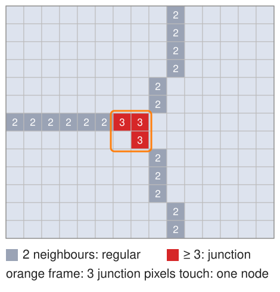
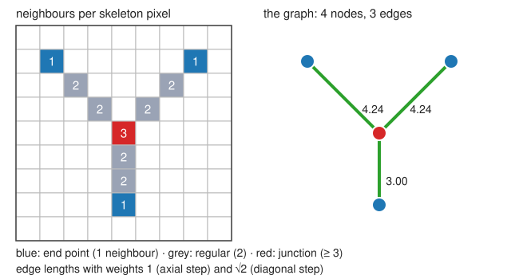
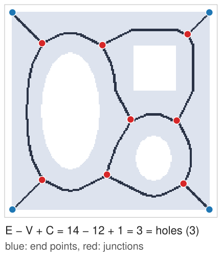
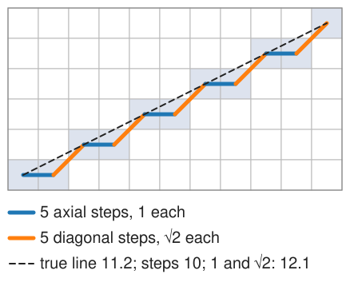
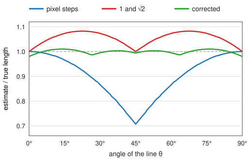
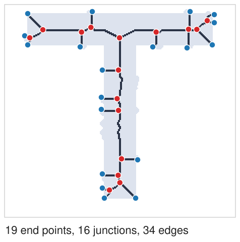
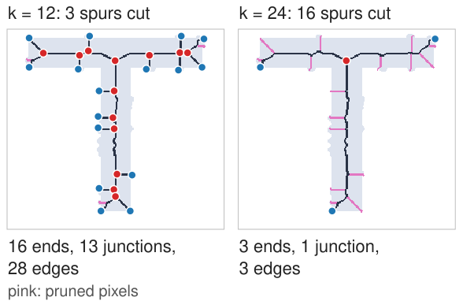

## About this lecture

A skeleton is still a set of pixels. To count branches and measure lengths we turn it into a **graph**: nodes where lines end or meet, edges for the lines between them.

- **Classify** skeleton pixels by their number of neighbours: end point, regular, junction.
- Build the **skeleton graph**: nodes, edges with their pixel paths and lengths; loops and the **cyclomatic number**.
- **Length**: counting pixels is wrong by up to 29 %; weights 1 and √2, and a corrected estimator.
- **Pruning**: remove the short spurs that boundary noise creates.

*Slides titled **The math** give the formulas and proofs; the ideas are complete without them.*

## Classify the skeleton pixels

:::: {.columns}
::: {.column width="55%"}
Count the skeleton neighbours of each skeleton pixel (8 neighbours):

- **1 neighbour**: an **end point** (a tip).
- **2 neighbours**: a **regular** pixel, inside a line.
- **3 or more**: a **junction** (a branch point).
- 0: an isolated pixel.

The same as the hit-or-miss templates of the thinning unit (end-point and junction templates with their rotations), but quicker: just count.

At a junction, two or three neighbouring pixels can all have 3 neighbours: they form a **junction cluster**, which counts as **one** node (connected components, from the labelling day).
:::
::: {.column width="45%"}
{width="100%" fig-alt="A zoom into a skeleton at a T-shaped junction: each skeleton pixel is labelled with its number of skeleton neighbours; regular line pixels have 2, and three touching pixels with 3 neighbours each form one junction cluster, framed in orange."}
:::
::::

## The skeleton graph

{width="62%" fig-align="center"}

- **Nodes**: the end points and the junction clusters.
- **Edges**: remove the node pixels; what is left falls into pieces of regular pixels (connected components). Each piece runs from one node to another: an edge, with its **pixel path**.
- Each edge gets attributes: **length**, **mean radius** ($\mathrm{DT}$ along the path), **tortuosity** (next unit).
- An edge may return to its own node (a **loop**), and two nodes may be joined by several edges.

## Cycles = holes

:::: {.columns}
::: {.column width="56%"}
A tree has no cycles. Every hole in the shape gives the skeleton one loop around it (thinning keeps holes).

- **Cyclomatic number**: $E - V + C$ (edges − nodes + connected pieces) = the number of independent cycles = the number of **holes**.
- Example: the Y above: $E = 3$, $V = 4$, $C = 1$: $3 - 4 + 1 = 0$, no hole.
- A figure eight (two loops through one junction): one node, two loop edges: $2 - 1 + 1 = 2$.
- A check on the graph: if $E - V + C$ disagrees with the holes of the mask, something went wrong (or a hole is a gap in the segmentation).
- In vessel networks the loops are **anastomoses**, a real measurement.
:::
::: {.column width="44%"}
{width="88%" fig-alt="The demo's square plate with three holes, thinned: the skeleton runs around each hole. Its graph has 14 edges, 12 nodes and 1 piece: 14 minus 12 plus 1 equals 3, the number of holes."}
:::
::::

## The math: adjacency matrix and Euler's formula {.math}

- **Adjacency matrix** $W$ ($V \times V$): $W_{ij}$ = number of edges between nodes $i$ and $j$ (a loop counts 2 on the diagonal). The **degree** of node $i$ is the row sum $\sum_j W_{ij}$; the sum of all degrees is $2E$.
- In a tree ($E = V - 1$) with only end points (degree 1) and junctions of degree 3: $\#\text{ends} = \#\text{junctions} + 2$.
- **Euler**: for a connected graph drawn in the plane, $V - E + F = 2$, with $F$ the number of faces including the outer one. The bounded faces are the holes: $E - V + 1 = F - 1$ = holes. Summed over $C$ pieces: $E - V + C$.
- This links to the **Euler number** of the mask from the labelling day: $\chi = C - \text{holes} = V - E$ for its skeleton graph.

## Try it: skeleton to graph

```{=html}
<link rel="stylesheet" href="../demos/dist/demo.css">
<div data-demo="skelgraph" data-preset="Y"></div>
<script src="../demos/dist/skelgraph.js"></script>
```

::: notes
The mask (grey) is thinned to a skeleton (black); nodes: blue = end, red = junction; edges coloured by length, with the length written on them. The table lists every edge: nodes, length by pixel steps, with weights 1 and √2, corrected, and the mean radius (DT along the edge). Tour: "a Y": 3 ends, 1 junction, 3 edges of 120.4, 121.4 and 92.4 (1/√2), radius about 5. "A loop: cycles = holes": a square plate with 3 holes: E = 14, V = 12, C = 1, E − V + C = 3 = holes; the 4 short edges to the corners are the corner forks of the medial-axis unit. "Draw your own": paint a shape with a hole, check E − V + C.
:::

## Length: pixel counting is biased

:::: {.columns}
::: {.column width="60%"}
How long is a skeleton edge? Counting its pixels (or steps) treats a diagonal step like a straight one.

- A diagonal line with 50 steps is $50\sqrt2 = 70.7$ long: counting gives 50, **29 % short**.
- **Weights**: 1 for a straight (axial) step, $\sqrt2$ for a diagonal step: exact at 0° and 45°.
- In between it **overshoots**: a line at 26.6° (slope ½) of true length 111.8 has 50 axial and 50 diagonal steps: $50 + 50\sqrt2 = 120.7$, **8 % too long**. A staircase is longer than the line it approximates.
- **Corrected** (Vossepoel & Smeulders 1982): $0.980\,n_e + 1.406\,n_o - 0.091\,n_c$ with $n_c$ the number of **corners** (changes of step direction): 110.3, 1.4 % short. Within about 2 % at all angles for long lines.
- The same story as the **perimeter** on the labelling day.
:::
::: {.column width="40%"}
{width="100%" fig-alt="A digital line of slope one half drawn as pixels: the path alternates 5 axial steps (blue) and 5 diagonal steps (orange) along the dashed true line of length 11.2; counting steps gives 10, weights 1 and root 2 give 12.1."}
:::
::::

## The math: why the weights {.math}

A straight line at angle $\theta$ ($0 \le \theta \le 45°$) of length $L$ is drawn with $n_e = L(\cos\theta - \sin\theta)$ axial and $n_o = L\sin\theta$ diagonal steps.

- Pixel count: $n_e + n_o = L\cos\theta$: ratio $\cos\theta$, worst at 45°: $1/\sqrt2 = 0.707$.
- Weights 1 and $\sqrt2$: $L(\cos\theta + (\sqrt2 - 1)\sin\theta)$: ratio 1 at 0° and 45°, maximum $\sqrt{1 + (\sqrt2 - 1)^2} = 1.082$ at $\tan\theta = \sqrt2 - 1$ ($\theta = 22.5°$).
- Choosing weights $a, b$ to minimise the error over all angles (and adding a corner term) gives the corrected estimator; the remaining error comes from how the line is digitised.
- Alternative: fit a smooth curve to the pixel path and measure the curve.

{width="44%" fig-align="center"}

## Try it: diagonal lines and the √2

```{=html}
<link rel="stylesheet" href="../demos/dist/demo.css">
<div data-demo="skelgraph" data-preset="line"></div>
<script src="../demos/dist/skelgraph.js"></script>
```

::: notes
A digital straight line of about 170 pixels at angle θ (slider); the plot shows estimate / true length for every angle, the vertical line marks θ. At 45°: true 169.7, pixel steps 120 (−29 %), 1/√2 169.7, corrected 168.7. At 26°: true 170.4, steps 153, 1/√2 184.1 (+8 %), corrected 168.2. At 0° the corrected estimator gives 166.6 (−2 %): it trades a small error on axis-aligned lines for small errors everywhere. The readout shows the step counts n_e, n_o and the corners n_c.
:::

## Spurs

:::: {.columns}
::: {.column width="55%"}
Boundary noise makes short side branches, **spurs** (medial-axis unit: one bump, one branch).

- A spur is a **terminal edge** (end point to junction) that is short.
- How short is "short"? Compared with the **local radius**: a spur from a bump on the wall of a vessel of radius $r$ is about $r$ long, because it has to reach the wall. A real side branch is much longer than the vessel is wide.
- Spurs inflate the branch count, the number of end points, and the total length.
:::
::: {.column width="45%"}
{width="92%" fig-alt="The demo's thick T with 26 random bumps on its boundary, thinned without pruning: short spurs run from the centre line out to the bumps; 19 end points (blue), 16 junctions (red), 34 edges."}
:::
::::

## Pruning

:::: {.columns}
::: {.column width="52%"}
Remove the terminal edges shorter than $k$ (or shorter than $k$ times $\mathrm{DT}$ at their junction):

1. Build the graph; find the terminal edges with length $< k$.
2. Delete their pixels (not the junction); a junction always keeps at least two edges.
3. A junction left with two edges is no longer a junction: its two edges **merge** into one.
4. Repeat once: removing a spur can turn a short side branch into a new terminal edge.

- Morphological version: remove end points $k$ times (shortening every line by $k$), then grow the remaining ends back along the original skeleton (reconstruction, morphology day).
- Too small $k$: spurs stay. Too large: real short branches go.
:::
::: {.column width="48%"}
{width="100%" fig-alt="The same noisy T pruned with k = 12: only 3 spurs removed, 16 ends, 13 junctions, 28 edges remain. With k = 24: 16 spurs removed (pink) and the graph is the T: 3 ends, 1 junction, 3 edges."}
:::
::::

## Try it: noise makes spurs, prune them

```{=html}
<link rel="stylesheet" href="../demos/dist/demo.css">
<div data-demo="skelgraph" data-preset="spurs"></div>
<script src="../demos/dist/skelgraph.js"></script>
```

::: notes
"Noise makes spurs": a thick T (half-width 16) with 26 random bumps: 19 end points, 16 junctions, 34 edges, total length 632.5 (1/√2). Pruning with k = 12 removes only 3 spurs: most spurs are longer than 12 because they must reach the wall, 16 pixels away. "Prune them" (k = 24): 16 spurs removed (pink), the graph is the T: 3 ends, 1 junction, 3 edges, length 393.7. Relative pruning: k = 1.5 × DT (tick the box, slider at 6) gives the same result, without having to know the width. "A thresholded vessel crop" (k = 8): 64 spurs pruned, 10 ends, 8 junctions, 17 edges; set k = 0: 74 ends, 142 edges.
:::

## Summary

- Skeleton pixels: **1** neighbour = end point, **2** = regular, **≥ 3** = junction; adjacent junction pixels form one node.
- **Graph**: nodes = end points and junction clusters; edges = the pieces in between, each with a pixel path, a length and a mean radius.
- **$E - V + C$** = number of independent cycles = holes.
- **Length**: pixel counting is up to 29 % short (diagonals); weights 1 and √2 up to 8 % long; the corrected estimator (0.980, 1.406, −0.091 per corner) is within about 2 %.
- **Pruning**: remove terminal edges shorter than $k$, preferably $k$ relative to the local radius; merge degree-2 nodes; repeat once.
