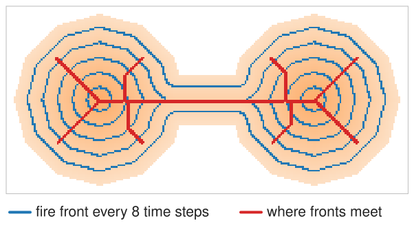
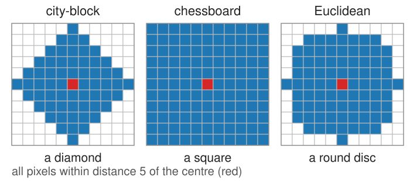
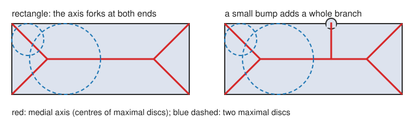
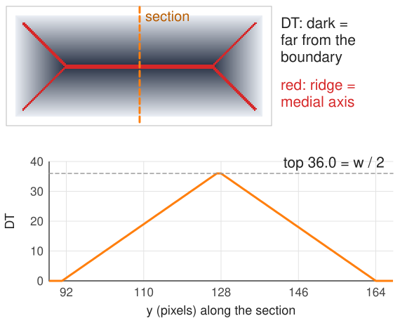
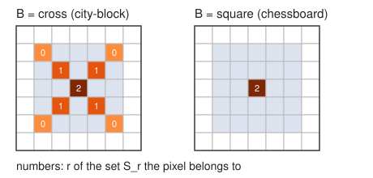
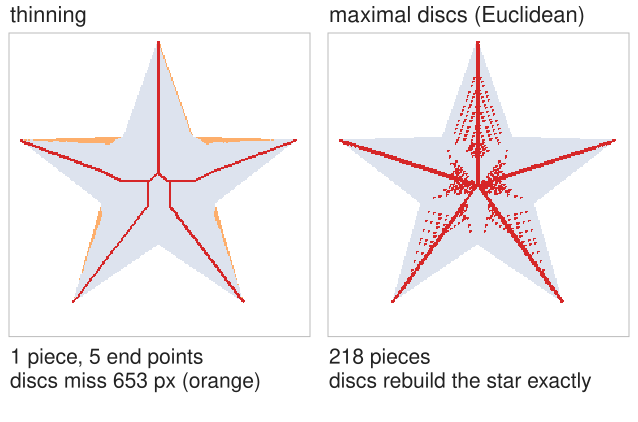
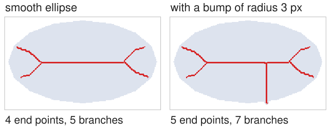

## About this lecture

Thinning gave a one-pixel line, but we never said what "the middle" of a shape is. Today: a geometric definition, and how to compute it.

- **Grassfire**: burn the shape from its boundary; the skeleton is where the fire fronts meet.
- **Medial axis**: the centres of the **maximal discs** inside the shape.
- It is the set of **ridges of the distance transform**; each axis point carries a **radius**.
- **Reconstruction**: axis + radii give back the shape exactly.
- **Lantuéjoul's formula**: the same skeleton from erosions and openings only.
- The weak point: **boundary noise** creates whole new branches.

*Slides titled **The math** give the formulas and proofs; the ideas are complete without them.*

## Grassfire

:::: {.columns}
::: {.column width="50%"}
Blum (1967): set fire to the whole boundary at once, and let the fire burn inwards at the same speed everywhere.

- At time $t$ the fire front is the set of points at distance $t$ from the boundary.
- Fronts coming from different parts of the boundary **meet** and quench each other.
- The **skeleton** is the set of meeting points; the time at which a point burns is its distance to the boundary.
- A long rectangle of width $w$: fronts from the two long sides meet on the midline at time $w/2$; near the ends, fronts from a long side and a short side meet on the diagonals.
:::
::: {.column width="50%"}
{width="100%" fig-alt="A dumbbell shape burning inwards: blue fire fronts every 8 time steps, nested inside each other; the red lines where fronts from different sides meet form the skeleton."}
:::
::::

## Recall: the distance transform

From the [morphology day](../morph-openclose/lec.qmd): the **distance transform** $\mathrm{DT}(p)$ of an object pixel is its distance to the nearest background pixel, computed in two raster passes (city-block or chessboard steps) or exactly (Euclidean).

- $\mathrm{DT}$ is the arrival time of the grassfire.
- Thresholding it, $\{\mathrm{DT} > r\}$, is the erosion by a disc of radius $r$.
- The metric decides what a "disc" is: a **diamond** (city-block), a **square** (chessboard), a **round disc** (Euclidean).

{width="52%" fig-align="center" fig-alt="The pixels within distance 5 of a centre pixel: 61 pixels forming a diamond for city-block, 121 forming a square for chessboard, 81 forming a roughly round disc for Euclidean distance."}

## Maximal discs

Draw a disc inside the shape, centred at $p$, as large as fits: its radius is $\mathrm{DT}(p)$.

- The disc is **maximal** if no other disc inside the shape contains it.
- In the middle of a band, the disc touches both sides: it cannot grow or move without leaving the shape: maximal.
- Next to one side only, the disc can slide inwards and grow: it lies inside a bigger disc: not maximal.
- The **medial axis** = the centres of all maximal discs.

{width="80%" fig-align="center"}

## Ridges of the distance transform

:::: {.columns}
::: {.column width="52%"}
Read $\mathrm{DT}$ as a landscape: 0 at the boundary, rising inwards.

- Across a band of width $w$, $\mathrm{DT}$ is a **tent**: it rises from both sides and peaks at $w/2$ in the middle.
- The medial axis is the **ridge line** (the crest) of this landscape: where $\mathrm{DT}$ stops rising across the shape.
- On the pixel grid: $p$ is on the axis if no neighbour $q$ has a disc that swallows $p$'s disc, i.e. no neighbour with $\mathrm{DT}(q) \ge \mathrm{DT}(p) + d(p, q)$. With city-block or chessboard distances this is a simple comparison with the 4 or 8 neighbours.
- Each axis pixel carries its **radius** $\mathrm{DT}(p)$: the local half-width of the shape. For a vessel, $2\,\mathrm{DT}$ on the axis is its **diameter**.
:::
::: {.column width="48%"}
{width="100%" fig-alt="Top: the distance transform of the demo's rectangle, dark in the middle, with the medial axis in red along its crest. Bottom: DT along a vertical section through the middle is a tent rising from 0 at both edges to 36, half the width 72."}
:::
::::

## The math: medial axis and reconstruction {.math}

For a shape $A$ and a metric $d$, the disc $D(p, r) = \{q : d(p, q) < r\}$, $\mathrm{DT}(p) = \min_{q \notin A} d(p, q)$.

- $D(p, \mathrm{DT}(p)) \subseteq A$ for every $p \in A$, and it is the largest such disc at $p$.
- **Medial axis** $S(A) = \{p : D(p, \mathrm{DT}(p)) \not\subset D(q, \mathrm{DT}(q)) \ \forall q \neq p\}$.
- **Reconstruction**: $A = \bigcup_{p \in S(A)} D(p, \mathrm{DT}(p))$. Every disc in $A$ lies in a maximal one, and every point of $A$ lies in its own disc.
- On the grid, for city-block and chessboard, it suffices to compare with the neighbours: $q$'s disc contains $p$'s iff $\mathrm{DT}(q) \ge \mathrm{DT}(p) + d(p, q)$.
- The continuous medial axis of a rectangle $a \times b$ ($a > b$): a midline segment of length $a - b$ and four diagonals to the corners.

## Try it: the medial axis

```{=html}
<link rel="stylesheet" href="../demos/dist/demo.css">
<div data-demo="medialaxis" data-preset="rect"></div>
<script src="../demos/dist/medialaxis.js"></script>
```

::: notes
Left: DT as colour (iso-lines every 8 steps), the axis in red; drag the white handles. Right: the union of the axis discs (grey), with missing pixels in red. Tour: "a rectangle forks at the ends": Euclidean maximal discs with λ = 8 (see the bump slide); the disc at (45, 97) near a corner has radius 6. The axis: a midline from x = 75 to 180 and four diagonals; 4 end points, 1 piece. Set λ to "off": the maximal-disc set breaks into 5 pieces (pixel effects along the diagonals) but reconstructs the rectangle exactly. Switch the metric: city-block gives the same X ends; chessboard (square discs) gives only the midline: a square fits into the corner. Move the grassfire slider: the front (orange) burns in; axis pixels turn red when the fire reaches them.
:::

## Lantuéjoul's formula: skeleton from erosions

Lantuéjoul (1978) builds the same skeleton with the operations of the [morphology day](../morph-openclose/lec.qmd) only:

- Erode the shape $r$ times by a small element $B$ (3 × 3 cross or square): what is left are the centres of discs of radius $r$ that fit.
- Open that result by $B$: the opening keeps every pixel that lies in a slightly bigger disc.
- What the opening **removes** are the centres of discs of radius $r$ that are **maximal**: the set $S_r$.
- The skeleton is the union of all $S_r$; and $S_r$ dilated $r$ times gives back its part of the shape.

{width="52%" fig-align="center"}

## The math: Lantuéjoul's formula {.math}

With $rB = B \oplus \dots \oplus B$ ($r$ times; $0B$ = the origin):

$$S_r = (A \ominus rB) \setminus \big((A \ominus rB) \circ B\big), \qquad S(A) = \bigcup_{r \ge 0} S_r, \qquad A = \bigcup_{r \ge 0} S_r \oplus rB.$$

- $p \in A \ominus rB$: the disc $p + rB$ fits. $p$ is removed by the opening: no disc $q + (r+1)B$ that fits contains $p + rB$. So $p + rB$ is maximal.
- On the grid with $B$ = cross (city-block): $S_r$ = the pixels with $\mathrm{DT} = r + 1$ that have no 4-neighbour with $\mathrm{DT} = r + 2$: exactly the maximal-disc test.
- A 5 × 5 square: with $B$ = square, $S_0 = S_1 = \emptyset$, $S_2$ = the centre; with $B$ = cross, $S_0$ = the 4 corners, $S_1$ = 4 diagonal pixels, $S_2$ = the centre.
- Only erosions, openings, set differences and unions: exact reconstruction, but the skeleton is in general **not connected**.

## Thinning vs medial axis {.smaller}

| | thinning | medial axis (maximal discs) |
|---|---|---|
| connected | yes (topology kept) | often not, on the pixel grid |
| one pixel wide | yes | not always |
| centred | approximately | exactly (by definition) |
| reconstructs the shape | no | yes, with the radii |

:::: {.columns}
::: {.column width="50%"}
- Practical tools combine both: **thin** for a connected line, then read $\mathrm{DT}$ along it for the **radius**.
- Both share the same weakness, next slide.
:::
::: {.column width="50%"}
{width="100%" fig-alt="The demo's star. Thinning gives one connected piece with 5 end points, but its discs miss 653 pixels near the tips. The Euclidean maximal-disc axis breaks into 218 pieces but its discs rebuild the star exactly."}
:::
::::

## Sensitivity to the boundary

:::: {.columns}
::: {.column width="52%"}
The medial axis is not continuous in the shape: a tiny change of the boundary can change it a lot.

- A **bump** of one or two pixels on the boundary gets its own maximal discs: a whole new **branch** runs from the axis out to the bump.
- A rectangle's axis **forks** at each end: four branches to the corners, even though the shape "is" a line.
- On real masks every pixel step on the boundary is a potential bump: raw skeletons are full of short **spurs**.
- Remedies: smooth or **open** the mask first; **prune** short spurs ([next unit](../skel-graph/lec.qmd)); or keep only axis points whose two nearest boundary points are far apart, at least λ (the "λ-medial axis").
:::
::: {.column width="48%"}
{width="100%" fig-alt="The thinned skeleton of the demo's ellipse: 4 end points and 5 branches; with a bump of radius 3 pixels on the lower boundary, a new branch runs down to the bump: 5 end points and 7 branches."}
:::
::::

## Try it: one bump, one branch

```{=html}
<link rel="stylesheet" href="../demos/dist/demo.css">
<div data-demo="medialaxis" data-preset="bump"></div>
<script src="../demos/dist/medialaxis.js"></script>
```

::: notes
"One bump, one branch": ellipse, thinning, a bump of radius 3 on the lower boundary, right of the middle (position 0.20 along the outline). Without the bump (size 0): 4 end points, 5 branches. With it: 5 end points and 7 branches: one new spur, which also splits the edge it leaves from. Drag the bump position along the boundary: the branch follows. Bump sizes 1 to 3 give one new end point, from 4 on the bump's own end forks (6 end points). Switch to "maximal discs" with λ off: the Euclidean maximal discs of a curved boundary are a scatter of pieces (every boundary pixel step makes a disc); raise λ to 16: a clean axis, but the reconstruction now misses pixels near the boundary. "The ring keeps its loop" (thinning): one loop. "Reconstruct the star": Lantuéjoul with the square: exact, but 124 separate pieces.
:::

## Summary

- **Grassfire**: burn from the boundary; the skeleton is where the fronts meet; the arrival time is the **distance transform**.
- **Medial axis** = centres of **maximal discs** = **ridges** of $\mathrm{DT}$; each axis point has a radius $\mathrm{DT}$.
- **Reconstruction**: the union of the maximal discs is the shape: axis + radii is a lossless shape code.
- **Lantuéjoul**: $S_r$ = (erosion by $rB$) minus its opening; the union of the $S_r$ is the skeleton, the union of $S_r \oplus rB$ the shape.
- Thinning is connected but only approximately centred; the discrete medial axis is centred but often broken. Use thinning for the line and $\mathrm{DT}$ for the radius.
- A small bump makes a whole branch: smooth, prune, or use λ.
