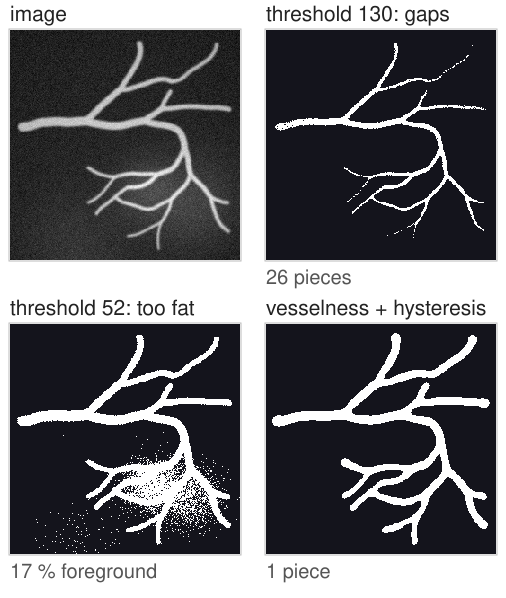
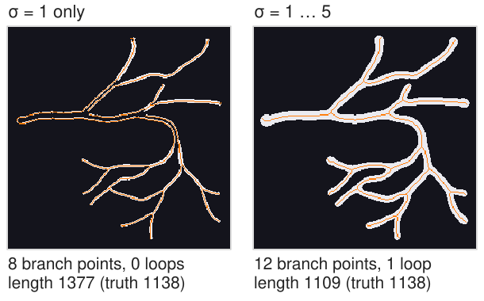
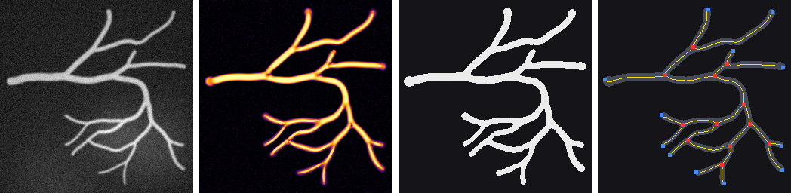
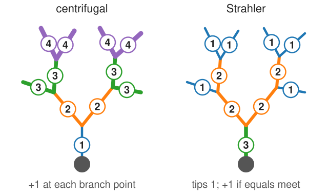
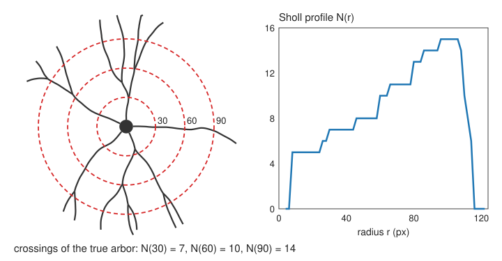
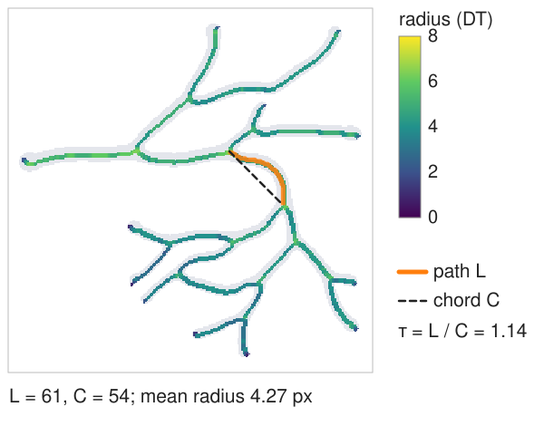
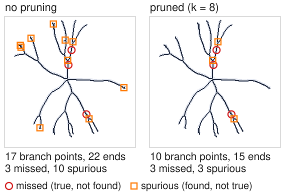
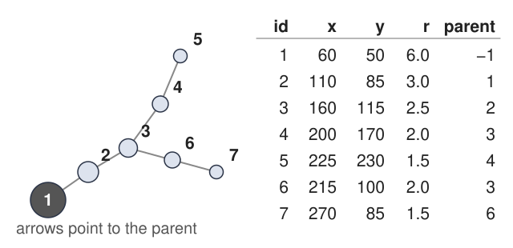

## About this lecture

Skeletons and graphs, put to work on the two classic branching structures of biology: **neurons** and **blood vessel networks**.

- Getting a good mask of thin, faint, branching tubes: the **vesselness** filter as the first step.
- The **pipeline**: vesselness → threshold → clean → skeleton → prune → graph → measurements.
- **Neurons**: total length, branch points, branch order, **Sholl analysis**.
- **Vessels**: length and branching density, **radius**, **tortuosity**, loops.
- **How good is the graph?** Comparing with a known truth.

*Slides titled **The math** give the formulas and proofs; the ideas are complete without them.*

## Thresholding thin tubes fails

:::: {.columns}
::: {.column width="55%"}
A fluorescence image of a neuron or a vessel network: thin, faint branches next to thick bright ones, on an uneven background.

- A **global threshold** high enough to suppress the background cuts the faint branches into pieces: **gaps**.
- Every gap splits an edge, adds two false end points, and loses length.
- A threshold low enough to keep the faint branches makes the thick ones fat, merges neighbours, and lets background through.
- What we want: a filter that responds to **tubes** of any width, and to nothing else.
:::
::: {.column width="45%"}
{width="86%" fig-alt="The demo's synthetic vessel image and three masks. A global threshold of 130 cuts the thin branches into 26 pieces; a threshold of 52 makes the vessels fat and lets the bright background patch through (17 percent foreground); vesselness with hysteresis gives one clean connected network."}
:::
::::

## Recall: the Hessian and vesselness

From the edges day (the **Hessian** unit): the Hessian of the image smoothed at scale $\sigma$, normalised by $\sigma^2$, has two eigenvalues ordered by size, $|\lambda_1| \le |\lambda_2|$.

- **Tube** (bright line): $\lambda_2$ strongly negative, $\lambda_1 \approx 0$. **Blob**: both large. **Background**: both small.
- **Frangi vesselness**: large when $\lambda_2$ is strong (above a contrast $c$) and $|\lambda_1/\lambda_2|$ is small (blob penalty $\beta$); taken as the maximum over several $\sigma$.
- The best scale grows with the width of the tube.

Here we use it as a tool; how it works is the edges day's.

## Vesselness as the first step of a measurement

:::: {.columns}
::: {.column width="55%"}
- **Choose the scales from the expected radii**: from the thinnest branch (σ about its radius) to the thickest vessel. Too few large scales: thick vessels look hollow (two parallel ridges).
- **Threshold the vesselness**, not the image: the uneven background is gone, faint and bright tubes score alike. Use **hysteresis** (strong seeds, weak connections; the idea from the thresholding day, the implementation from labelling).
- Its failure modes reappear **downstream**, in the graph:
  - **junctions fade** (two crossing tubes look like a blob): gaps at branch points, lost junctions, extra end points;
  - **touching parallel vessels** merge: one edge instead of two;
  - **bright blobs** on a vessel: spurious short branches.
:::
::: {.column width="45%"}
{width="100%" fig-alt="Vessel masks and skeletons (orange) of the demo's vessel tree. With vesselness at sigma = 1 only, the thick vessels become hollow pairs of lines: 8 branch points, no loop, length 1377 against a true 1138. With sigma from 1 to 5: 12 branch points, 1 loop, length 1109."}
:::
::::

## The pipeline

{width="100%"}

image → **vesselness** (σ = 1 … 5) → **hysteresis threshold** + clean (remove specks below 30 pixels, fill holes up to 20 pixels) → **skeleton** (thinning) → **prune** spurs → **graph** (blue: end points, red: branch points) → measurements.

## Try it: a vessel network

```{=html}
<link rel="stylesheet" href="../demos/dist/demo.css">
<div data-demo="arbor" data-preset="vessel"></div>
<script src="../demos/dist/arbor.js"></script>
```

::: notes
A synthetic vessel tree (radii by Murray's law, one loop), with its ground-truth graph. Tabs: image, vesselness, mask, skeleton, graph. The table compares measurements with the truth. Preset "vessels": σ 1–5, hysteresis 0.5 / 0.15, k = 8: length (corrected) 1109 vs 1138, 12 end points and 12 branch points as in the truth (1 missed and 1 spurious after matching within 8 pixels), 1 loop, mean tortuosity 1.039 vs 1.024. Mean radius from DT 4.27 against a true 2.66: the vesselness mask is wider than the tube (blur and the low threshold). Raise "threshold low" to 0.5: the radius drops to 3.18. Overlay "radius": the skeleton coloured by DT, thick near the root. Then "one scale misses the thick vessels" (σ = 1 only): the thick vessels become hollow pairs of lines: length +21 %, 4 branch points lost, the loop lost.
:::

## Neurons: what is measured

:::: {.columns}
::: {.column width="52%"}
From the skeleton graph of a neuron's dendrites (the soma is one big node):

- **Total dendritic length**: sum of the edge lengths (with a corrected estimator).
- **Primary branches**: edges leaving the soma.
- **Branch points** and **terminal points** (end points).
- **Branch order**: **centrifugal** (1 for branches leaving the soma, +1 at every branch point outwards) or **Strahler** (from the tips inwards: tips have order 1; where two branches of equal order meet, the order goes up by one; otherwise the larger order continues).
- Each is one number per cell, compared between conditions (e.g. treated vs control neurons).
:::
::: {.column width="48%"}
{width="100%" fig-alt="The same small dendritic tree labelled twice. Centrifugal order: 1 at the soma, rising by one at each branch point to 4 at the outer tips. Strahler order: 1 at every tip, 2 where two order-1 branches meet, 3 for the trunk; a side twig does not raise the order."}
:::
::::

## The math: Strahler order {.math}

For a rooted tree, the Strahler order of an edge is computed from its children:

$$S(e) = \begin{cases} 1 & e \text{ ends at a tip,} \\ \max_c S(c) & \text{if the maximum is reached by one child only,} \\ \max_c S(c) + 1 & \text{if two or more children reach the maximum.} \end{cases}$$

- A balanced binary tree with $2^k$ tips has order $k + 1$ at the root; adding side twigs to a long branch does not raise its order.
- **Horton's ratios**: in many natural trees (rivers, vessels, dendrites), the number of branches drops by a roughly constant factor from one order to the next.
- Centrifugal order counts from the root instead: it grows with every branch point passed, so long chains of side branches get high orders.

## Sholl analysis

Sholl (1953): draw circles of radius $r$ around the soma and count how many times the arbor **crosses** each circle.

{width="62%" fig-align="center"}

- The **Sholl profile** $N(r)$: one curve summarising how complex the arbor is at each distance.
- Read off: the **maximum** number of crossings, the **critical radius** where it occurs, the largest radius reached.
- On the skeleton graph: a crossing is an **edge** passing the circle; count sign changes of (distance − r) along each edge path.

## Try it: neuron and Sholl profile

```{=html}
<link rel="stylesheet" href="../demos/dist/demo.css">
<div data-demo="arbor" data-preset="neuron"></div>
<script src="../demos/dist/arbor.js"></script>
```

::: notes
Synthetic neuron (seed 7): soma and 5 primary dendrites. Graph tab, Sholl overlay at r = 50: 8 crossings, the same as for the true tree. The profile (plot, solid = measured, dashed = truth) rises to a maximum of 15 crossings at r ≈ 96–100 and falls to 0 beyond the tips. Measured length 1062 vs 1076, 15 end points and 10 branch points as in the truth, 5 primary branches. After matching, 3 measured branch points are more than 8 pixels from the true ones: in narrow forks the skeleton's junction sits further along the trunk. Drag the Sholl radius and watch the crossing count in the table.
:::

## Vessel networks: what is measured

:::: {.columns}
::: {.column width="52%"}
- **Length density**: total length per image area (mm/mm²), and **branching density**: branch points per area.
- **Radius** along the centreline: $\mathrm{DT}$ on the skeleton (diameter $2\,\mathrm{DT}$); compare with the best vesselness scale, which also grows with the radius.
- **Tortuosity** per edge: path length / chord (straight-line distance between its ends). 1 = straight; raised in tumour vessels and in some retinal diseases.
- **Loops** (anastomoses): the cycles $E - V + C$ of the graph.
- **Vessel area fraction**: mask area / image area.
- Retinal photographs are the standard 2D test images for vessel segmentation; micro-CT and light-sheet stacks for 3D vessel trees.
:::
::: {.column width="48%"}
{width="100%" fig-alt="The demo's vessel skeleton coloured by radius from the distance transform, mean 4.27 pixels. One curved edge is highlighted: path length 61 (orange) against chord 54 (dashed): tortuosity 1.14."}
:::
::::

## The math: tortuosity and Murray's law {.math}

- **Tortuosity** $\tau = L / C$: path length over chord. A circular arc of opening angle $\varphi$: $L = R\varphi$, $C = 2R\sin(\varphi/2)$, so $\tau = \dfrac{\varphi/2}{\sin(\varphi/2)}$: 1.11 for a quarter circle, $\pi/2 = 1.57$ for a half circle.
- Other tortuosity measures: total curvature along the edge, or the number of inflection points; the ratio $L/C$ cannot tell one large bend from many small wiggles.
- **Murray's law** (1926): at a bifurcation, $r_0^3 = r_1^3 + r_2^3$ (minimal work of pumping blood plus maintaining its volume). A symmetric split gives $r_1 = r_2 = 2^{-1/3} r_0 = 0.794\,r_0$. The synthetic trees in the demo follow it; measured radii can be checked against it.

## How good is the graph?

:::: {.columns}
::: {.column width="52%"}
With synthetic trees the true graph is known, so each measurement can be checked.

- **Total length**: relative error (estimator, gaps, spurs).
- **Branch points**: match measured to true ones within a distance (here 8 pixels): **missed** (true, unmatched) and **spurious** (measured, unmatched).
- How they move with the conditions:
  - more **noise** → more spurs → spurious branch points and end points (pruning repairs most of it);
  - a **high threshold** → junctions fade → missed branch points, extra end points, lost length;
  - **one scale** only → thick vessels hollow → double lines, missed junctions, too much length.
- Matching objects and scoring detections in general (F1, average precision) is the subject of the **evaluation day**.
:::
::: {.column width="48%"}
{width="100%" fig-alt="The demo's noisy neuron (noise 14). Without pruning: 17 branch points and 22 ends against a true 10 and 15; 3 true branch points missed (red circles) and 10 spurious (orange squares). Pruned with k = 8: 10 branch points, 15 ends, 3 missed and 3 spurious, the displaced forks."}
:::
::::

## Try it: noise and fading junctions

```{=html}
<link rel="stylesheet" href="../demos/dist/demo.css">
<div data-demo="arbor" data-preset="noise"></div>
<script src="../demos/dist/arbor.js"></script>
```

::: notes
"Noise: spurs inflate the branch count": the neuron with noise 14 and no pruning: 22 end points and 17 branch points against 15 and 10; truth overlay: 10 spurious (orange squares), 3 missed (red circles). Set prune k = 8: back to 15 and 10 (3 missed, 3 spurious: the displaced forks). "Junctions fade": vessels, threshold 0.85 / 0.85: the vesselness tab shows dark gaps at the junctions; the graph has 30 end points and only 2 branch points (10 of 12 missed), length 989 vs 1138. Lower "threshold low" to 0.5: all 12 branch points come back. "Pixel counting": the same vessel with the pixel-step estimator: 989 vs 1138 (−13 %); 1/√2: 1161 (+2 %); corrected: 1109 (−2.5 %). "Tortuous vessels": mean tortuosity 1.299 vs 1.341; tortuous vessels touch themselves: 3 loops measured, 2 true.
:::

## Tracing: what neuroscientists use

:::: {.columns}
::: {.column width="50%"}
- Besides automatic skeletons, neurons are often **traced**: by hand or semi-automatically, clicking along each dendrite while software follows the ridge (for example by minimal paths, see the dynamic programming elective).
- The result is stored as a **tree file**: a list of points, each with a position, a radius and the index of its parent point (the root has none). Graph, lengths, branch orders and Sholl profiles are computed from it.
- The synthetic trees of the demo are stored exactly like that, which is how their ground truth is known.
- Large public archives hold such tracings of tens of thousands of neurons; images are rarer.
:::
::: {.column width="50%"}
{width="100%" fig-alt="A traced tree of 7 points, each with an arrow to its parent, and the same tree as a table with columns id, x, y, radius and parent; the root, point 1, has parent minus 1."}
:::
::::

## In 3D

- 3D vessel trees (micro-CT, light-sheet microscopy) and whole neurons are imaged as **stacks**.
- The same pipeline: a 3 × 3 Hessian per voxel (three eigenvalues: a tube has two large, one small), 3D thinning (simple points with 26/6 connectivity), 3D graph.
- **Anisotropic voxels** ($\Delta z$ often 2–5 × $\Delta x$): distances and lengths must use the real spacing (marching-cubes elective, volumes unit).
- Centreline + radius is a compact model of a vessel tree: render it as tubes instead of a surface mesh.

## Summary

- Thin, faint tubes need a **tube filter** before thresholding: multi-scale **vesselness** (edges day), scales chosen from the expected radii, then **hysteresis**.
- **Pipeline**: vesselness → threshold → clean → skeleton → prune → graph → measurements.
- **Neurons**: total length, primary branches, branch and terminal points, branch order (centrifugal, **Strahler**), **Sholl profile** $N(r)$.
- **Vessels**: length and branching density, **radius** ($\mathrm{DT}$ on the skeleton), **tortuosity** $L/C$, loops $E - V + C$.
- Check against a known truth: **missed** and **spurious** branch points, length error; they reveal the filter's failure modes (fading junctions, merged vessels, spurs).
