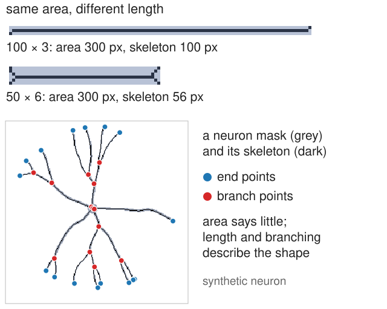
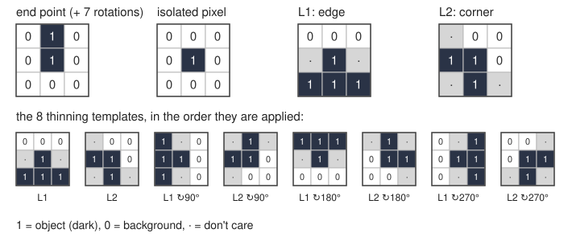
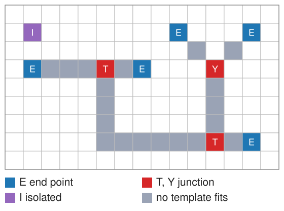
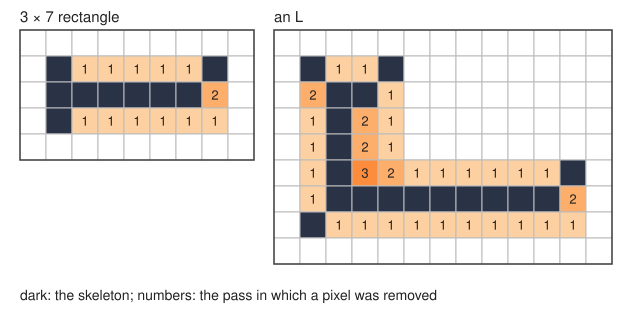
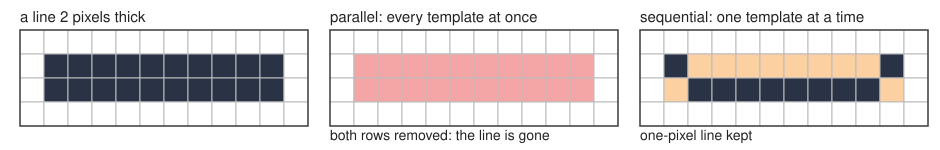
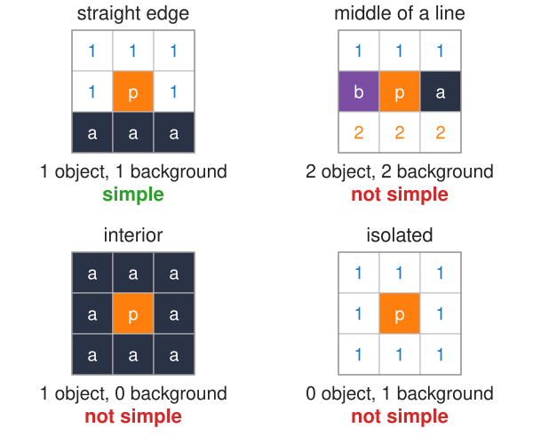
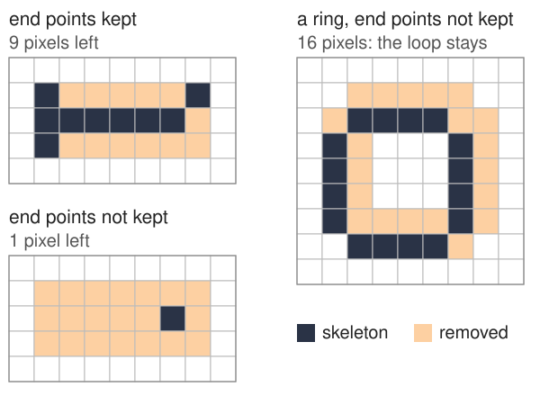
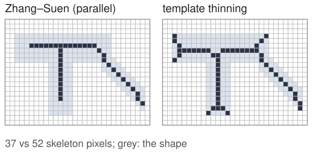

## About this lecture

A thresholded neuron or blood vessel network is a mask. The questions biologists ask about it are **how long** and **how branched**, not how much area. For that we want a **skeleton**: a line one pixel wide, running along the middle of the shape, with the same connections and holes.

- **Hit-or-miss**: a 3 × 3 template that must fit the object *and* the background at once. Finds end points, isolated pixels, junctions.
- **Thinning**: peel the shape layer by layer with templates, one template at a time.
- **Simple points**: which pixels can go without cutting the shape or opening a hole.
- Why **end points** must be kept.

*Slides titled **The math** give the formulas and proofs; the ideas are complete without them.*

## Why a skeleton?

:::: {.columns}
::: {.column width="52%"}
- A dendrite 1000 µm long and 2 µm wide, and one 500 µm long and 4 µm wide, have the **same area**. Area cannot tell them apart; length can.
- A skeleton keeps what we want to count: **length** (pixels along the line), **branch points**, **end points**, **loops**.
- Two requirements: **thin** (one pixel wide) and **topology-preserving** (the same number of pieces and holes as the shape).
- Today: how to get it by local rules on a 3 × 3 neighbourhood. Next units: the skeleton as the middle of the shape (medial axis), then as a graph we can measure.
:::
::: {.column width="48%"}
{width="100%" fig-alt="Two bars of the same area (300 pixels) whose skeletons have 100 and 56 pixels, and a synthetic neuron mask with its one-pixel skeleton, end points in blue and branch points in red."}
:::
::::

## Recall: erosion asks "does it fit?"

From the morphology day: the erosion $A \ominus B$ keeps the pixels where the structuring element $B$, placed there, **fits inside** the object $A$.

- Erosion only looks at object pixels: "are these all 1?"
- It cannot ask "are these 0?". An end point of a line and a pixel in the middle of the line both fit a 1 × 1 element; to tell them apart we must also look at where the **background** is.

## Hit-or-miss: fit the object and the background

A **template** on a 3 × 3 grid with three states:

- **1**: this cell must be object,
- **0**: this cell must be background,
- **·** ("don't care"): either.

The hit-or-miss transform marks every pixel where the template, centred there, fits completely: all its 1-cells on object, all its 0-cells on background.

{width="78%" fig-align="center"}

## The math: hit-or-miss {.math}

With $B_1$ = the 1-cells and $B_2$ = the 0-cells of the template ($B_1 \cap B_2 = \emptyset$):

$$A \circledast (B_1, B_2) = (A \ominus B_1) \cap (A^c \ominus B_2).$$

- Two erosions: $B_1$ must fit in the object, $B_2$ must fit in the background $A^c$.
- If $B_1 \cap B_2 \ne \emptyset$, a cell would have to be 1 and 0 at once: the result is empty.
- Equivalently $(A \ominus B_1) \setminus (A \oplus \check B_2)$: fits the object, and no background cell hits it.
- Pixels outside the image count as background.

## Templates for skeleton pixels

:::: {.columns}
::: {.column width="55%"}
On a one-pixel-wide line, the 8 neighbours of a pixel say what it is:

- **Isolated pixel**: centre 1, all 8 neighbours 0.
- **End point**: exactly one neighbour. One template with a 1 above the centre, and its **8 rotations** by 45°, find all of them.
- **Junction**: three or more neighbours: T-shaped (left, right, below) and Y-shaped (two diagonals and one straight) templates, with their rotations.
- **Corner** of a blob, **edge** pixel: templates with a row of 0s on one side and 1s on the other.

The union of the hit-or-miss transforms of all rotations finds every such pixel.
:::
::: {.column width="45%"}
{width="100%" fig-alt="A small skeleton on a pixel grid: the end-point template marks five tips (E), the T- and Y-junction templates mark three branch pixels, the isolated-pixel template one lone pixel; the other line pixels match no template."}
:::
::::

## Try it: hit-or-miss

```{=html}
<link rel="stylesheet" href="../demos/dist/demo.css">
<div data-demo="morphgrid" data-mode="hitmiss" data-preset="ends"></div>
<script src="../demos/dist/morphgrid.js"></script>
```

::: notes
Left: the template editor (click a cell: 1 → 0 → ·) and template presets. Middle: the image (click to edit). Right: the result. Step through: at each object pixel the template is placed, matched cells green, failing cells red. Tour: "find the end points": end-point template with all 8 rotations: the result is (2, 1) (rotation 3: neighbour to the right) and (3, 5) (rotation 8: neighbour up-left); the isolated pixel at (5, 1) is not an end point. Untick "all 8 rotations": the single template (neighbour above) finds nothing. Choose the "isolated" template: only (5, 1). "Isolated pixels" preset: the specks are found, the 3 × 3 block is not.
:::

## Thinning: peel with templates

Thinning removes, again and again, pixels where an **edge** or **corner** template fits, until nothing changes:

$$A \leftarrow A \setminus (A \circledast T)$$

- Two templates (Golay's L): **L1** an edge pixel (background on one side, object on the other), **L2** a corner pixel; each in 4 rotations: **8 templates**.
- Apply them **one at a time**: L1, L2, L1 turned 90°, ... Each removes its matches before the next one looks.
- No template matches a pixel with only one neighbour: **end points survive**, so lines keep their length.

{width="62%" fig-align="center"}

## One template at a time

Why not test all 8 templates on the same image and remove everything at once?

{width="85%" fig-align="center"}

- A line **two pixels thick**: the top row matches "background above", the bottom row matches "background below".
- Removed **in parallel**, both rows go and the line is cut away. Each pixel was removable on its own, but not both together.
- **Sequentially**, the top row goes first; then the bottom row has object above it and is kept.

## Try it: thinning step by step

```{=html}
<link rel="stylesheet" href="../demos/dist/demo.css">
<div data-demo="morphgrid" data-mode="hitmiss" data-preset="rect"></div>
<script src="../demos/dist/morphgrid.js"></script>
```

::: notes
"Thin a rectangle" (3 × 7, the exercise): step through the template applications. Pass 1: L1 removes the top row except its corners (5 pixels), L2 turned 90° removes the bottom-right corner, L1 turned 180° the bottom row except the left corner; pass 2: L2 turned 90° removes (2, 7); pass 3 removes nothing. The skeleton has 9 pixels: a line with a short fork at the left end and one corner pixel kept at the right. The second grid numbers each pixel by the pass that removed it. "Thin an L": 3 passes (a fourth finds nothing), a skeleton of 18 pixels with short forks at the corners. "Parallel removal cuts the line": the 2-pixel line disappears in one parallel pass; untick "parallel" and it survives as a line.
:::

## Simple points

:::: {.columns}
::: {.column width="52%"}
A pixel is **simple** if removing it changes neither the number of objects nor the number of holes. Decide it from the 8 neighbours alone:

- count the **object parts** among the 8 neighbours (8-connected),
- count the **background parts** that touch the pixel's 4 neighbours (4-connected).
- **Simple** exactly when there is **one** of each.

Examples (right): a pixel on a straight edge: 1 object part, 1 background part: simple. The middle of a line one pixel thick: 2 object parts (left and right): removing it cuts the line. An interior pixel: no background part: removing it makes a hole. An isolated pixel: no object part: removing it deletes an object.
:::
::: {.column width="48%"}
{width="100%" fig-alt="Four 3 by 3 neighbourhoods around a centre pixel p: object parts lettered a, b; background parts touching p numbered 1, 2. Only the straight edge, with one of each, is simple."}
:::
::::

## The math: simple points and the Euler number {.math}

- Object: 8-connected; background: 4-connected (the pairing that avoids the paradoxes of digital topology, Kong & Rosenfeld 1989).
- $p$ is simple iff $C_8(N_8(p) \cap A) = 1$ and $C_4^{p}(N_8(p) \cap A^c) = 1$, the second counting only the background parts 4-adjacent to $p$.
- A closed form: **Yokoi's connectivity number** $\displaystyle N_8(p) = \sum_{k \in \{0, 2, 4, 6\}} \big(\bar x_k - \bar x_k \bar x_{k+1} \bar x_{k+2}\big)$, $\bar x = 1 - x$, neighbours numbered around $p$ starting with a 4-neighbour; a border pixel is simple iff $N_8(p) = 1$.
- Removing a simple point keeps the **Euler number** $\chi = (\text{objects}) - (\text{holes})$, and more: it keeps every object and hole. Thinning that removes only simple points is **topology-preserving**.

## End points: simple, but kept

:::: {.columns}
::: {.column width="50%"}
An end point has one neighbour: one object part, one background part. It is **simple**: removing it changes no topology.

- Remove simple points until none is left, and a line shortens from both ends; every tree-shaped object shrinks to a **single pixel**. Only loops survive, because their pixels have two object parts.
- So thinning keeps end points on purpose. The L templates do this automatically: none of them fits a pixel with only one neighbour.
- Thinning also depends on the order of removal: different (all valid) algorithms give slightly different skeletons.
:::
::: {.column width="50%"}
{width="100%" fig-alt="The 3 by 7 rectangle thinned with end points kept leaves 9 pixels; without keeping end points only 1 pixel is left. A ring thinned without keeping end points keeps a closed loop of 16 pixels."}
:::
::::

## Try it: simple or not?

```{=html}
<link rel="stylesheet" href="../demos/dist/demo.css">
<div data-demo="morphgrid" data-mode="hitmiss" data-preset="simple"></div>
<script src="../demos/dist/morphgrid.js"></script>
```

::: notes
"Simple or not?": five 3 × 3 neighbourhoods (the exercise), centres at columns 2, 7, 12, 17, 22 of row 2. Step to each centre: object parts are filled and lettered a, b, ...; background parts touching the pixel are outlined and numbered. Verdicts: vertical line: 2 object parts, not simple; 2 × 2 block corner: simple; interior: not simple; the bent-line corner (neighbours left and above): simple; two diagonal neighbours: 2 parts, not simple. Then "a ring keeps its hole" (simple-point thinning without end points): the ring shrinks to a one-pixel loop and stops. "No end points: a line shrinks": the 3 × 7 rectangle ends as a single pixel.
:::

## Zhang–Suen: a fast parallel variant

:::: {.columns}
::: {.column width="55%"}
The most widely used thinning (Zhang & Suen 1984) removes pixels **in parallel**, safely, by splitting each pass into two sub-passes:

- remove a pixel if it has 2 to 6 object neighbours, exactly one 0 → 1 change around it, and (first sub-pass) its east or south side or north-west corner is background; (second sub-pass) the mirrored conditions.
- Each sub-pass only removes from two sides, so a two-pixel line cannot vanish.
- Typical artefacts of all thinning methods: lines **two pixels thick** on some diagonals, small **loops or clusters** at junctions, **corners** cut off, and short **forks** at the ends of wide shapes.
:::
::: {.column width="45%"}
{width="100%" fig-alt="The same T-shaped object with a diagonal arm, thinned by Zhang–Suen (37 pixels: shortened ends, cut corners) and by the template thinning of this unit (52 pixels: short forks at the wide ends)."}

Same shape, two algorithms: Zhang–Suen cuts the ends short; templates leave forks.
:::
::::

## Summary

- **Hit-or-miss**: a three-state template (1, 0, don't care) must fit object and background at once; it finds isolated pixels, end points (8 rotations), junctions, corners.
- **Thinning**: remove the matches of edge and corner templates, **one template at a time**, until nothing changes. In parallel, a two-pixel line would be cut.
- **Simple point**: one object part and one background part among the 8 neighbours. Removing simple points keeps the number of objects and holes (the **topology**).
- **End points** are simple but kept; otherwise every line shrinks to a point.
- The result: a one-pixel-wide, connected skeleton, with known artefacts at ends and junctions. Next: where exactly is "the middle" of a shape?
