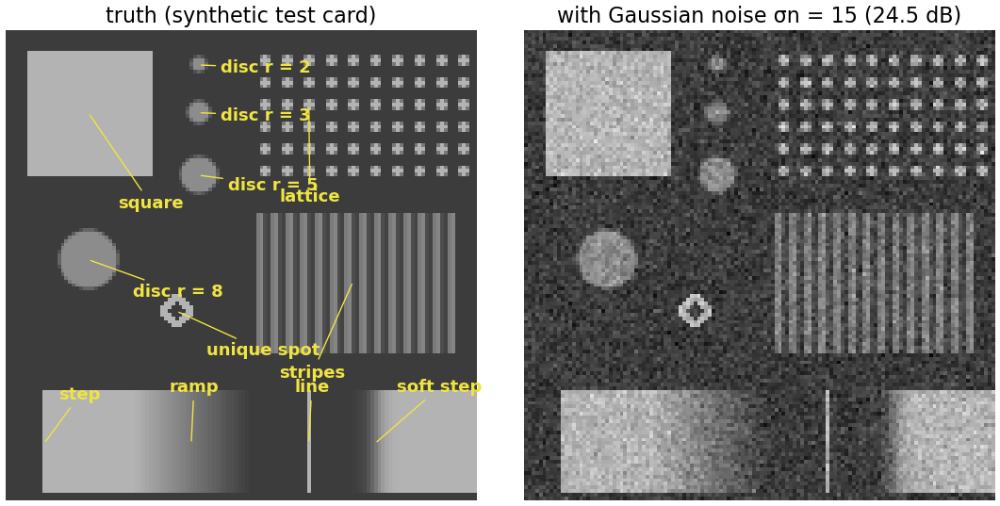
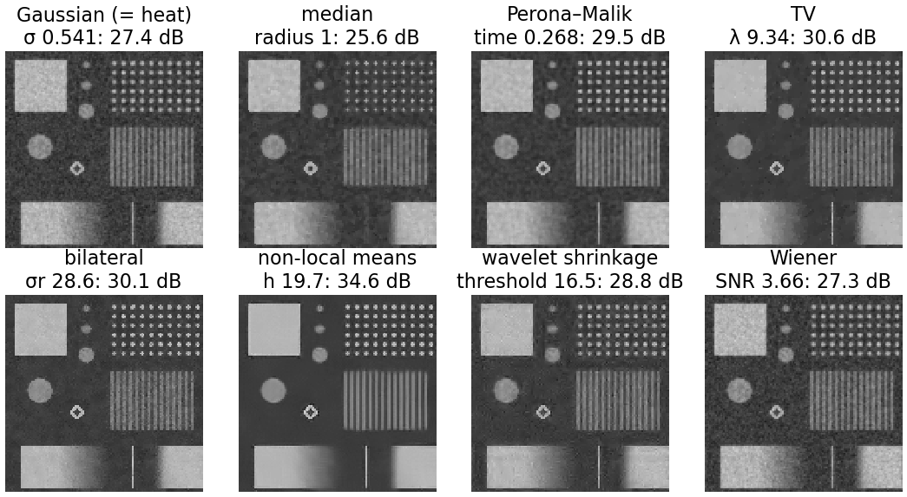
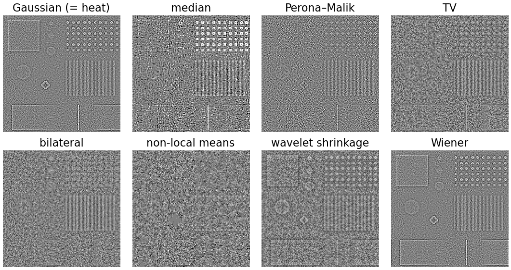
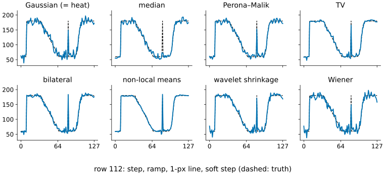
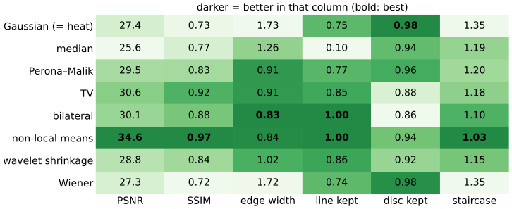
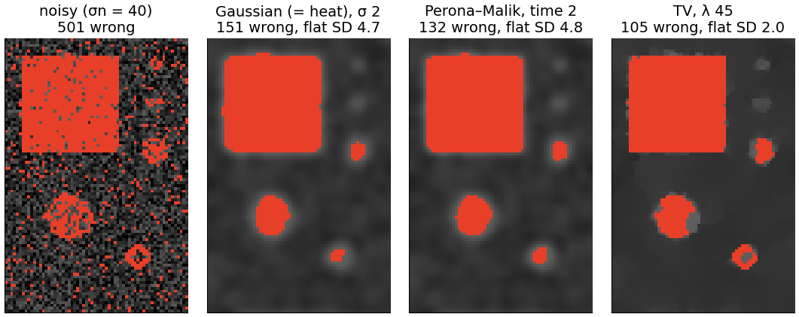

## About this lecture

A closing comparison. Eight smoothers from this day and earlier ones, on **one** test card with known truth and the same noise:

- Gaussian (= heat), median, Perona–Malik, TV, bilateral, non-local means, wavelet shrinkage, Wiener.
- **Every smoother is a belief** about what images look like; it wins where the belief is true.
- **Scores disagree**: PSNR, SSIM, method noise and feature scores rank the methods differently.
- Smoothing **before segmentation**, and what is still measured on the raw image.

Slides titled **The math** give the formulas and proofs; the ideas are complete without them.

::: notes
The methods come from: [heat-equation](../heat-equation/lec.qmd), [perona-malik](../perona-malik/lec.qmd), [tv-flow](../tv-flow/lec.qmd), [bilateral-nlm](../bilateral-nlm/lec.qmd) (this day); [denoise](../denoise/lec.qmd) (median, Wiener, first introduction of bilateral and NLM; deconvolution day); [shrinkage](../shrinkage/lec.qmd) (wavelets day, one line only). Each method is run at the setting with the best PSNR for this noise, found by a grid search with the same code as the demo.
:::

## One test card

:::: {.columns}
::: {.column width="40%"}
A synthetic image with known truth, so that every result can be scored:

- a **square** (steps, corners), **discs** of radius 2 to 8,
- a **dot lattice** (repeats) and one **unique spot** (a ring),
- fine **stripes** (period 4),
- along row 112: a **step**, a **ramp**, a **1-pixel line**, a **soft step**.

Gaussian noise σn = 15 (24.5 dB). Each method is set to its **best PSNR** for this noise.
:::
::: {.column width="60%"}
{width="100%" fig-alt="The synthetic test card with its labelled features (square, discs of radius 2, 3, 5 and 8, a dot lattice, a unique ring, stripes, and a bottom band with a step, a ramp, a 1-pixel line and a soft step), and the same card with Gaussian noise of 15 (24.5 dB)."}
:::
::::

## Eight results

{width="88%" fig-align="center" fig-alt="The eight smoothed test cards with their best-PSNR settings: Gaussian sigma 0.54 (27.4 dB), median radius 1 (25.6), Perona–Malik time 0.27 (29.5), TV lambda 9.3 (30.6), bilateral sigma_r 28.6 (30.1), non-local means h 19.7 (34.6), wavelet shrinkage threshold 16.5 (28.8), Wiener SNR 3.7 (27.3)."}

Non-local means wins this card by a wide margin (34.6 dB): the card is full of **repeats** (lattice, stripes, long straight edges). On an image without repeats it has no advantage.

## Every smoother is a belief

| method | believes | fails when |
|---|---|---|
| Gaussian (heat) | the image is **smooth** | there are edges and fine detail |
| median | outliers are rare; structures are **wider than the window** | lines and dots are thinner than the window |
| Perona–Malik | **piecewise smooth**, edges higher than $K$ | edges are as weak as the noise; ramps (staircases) |
| TV | **piecewise constant**, short total edge length | smooth gradients, texture, small low-contrast objects |
| bilateral | **nearby similar values** belong together | the noise is as large as the edges |
| non-local means | the image **repeats** itself | unique details (only the pixel itself matches) |
| wavelet shrinkage | **few large** wavelet coefficients | textures with many medium coefficients |
| Wiener | a known **power spectrum** (here $1/f^2$) | the image is not "average" (sharp, sparse structures) |

The method wins where its belief is true of the image, and fails where it is not.

## Method noise: what each one removed

:::: {.columns}
::: {.column width="40%"}
**Method noise** = noisy − result ([recall](../denoise/lec.qmd)). Ideally it is pure noise, with no structure.

- Gaussian and Wiener: the outlines of **every** edge, the line, the lattice: they blur all structure a little.
- Median: the **lattice and the line** stand out: structures thinner than the window are removed.
- TV: the stripes and the ring: fine texture is flattened.
- Non-local means: almost pure noise, faint edges only.
:::
::: {.column width="60%"}
{width="100%" fig-alt="Method noise (noisy minus result, grey = 0) of the eight smoothers. Gaussian and Wiener show the outlines of all edges; the median shows the lattice and the 1-pixel line; TV and wavelet shrinkage show the stripes; non-local means looks almost like pure noise."}
:::
::::

## Profiles: steps, ramps, lines

{width="92%" fig-align="center" fig-alt="Row 112 of each result against the truth: step, ramp, 1-pixel line and soft step. The median removes the 1-pixel line; Gaussian and Wiener keep it at three quarters; bilateral and non-local means keep it fully; TV and Perona–Malik keep sharp steps; the noise left along the ramp differs between methods."}

The 1-pixel line: kept fully by bilateral and NLM, at 74–87 % by Gaussian, Wiener, Perona–Malik, TV and wavelets, and **removed** (10 %) by the median.

## Scores disagree

:::: {.columns}
::: {.column width="38%"}
- **PSNR** and **SSIM** reward low error on average.
- **Edge width** (10–90 % rise of the step): sharpest for bilateral, NLM, TV, PM.
- **Line kept**: contrast of the 1-px line; **disc kept**: contrast of the radius-3 disc.
- **Staircase**: 1 for a smooth ramp, larger when the ramp turns into steps.

No method wins every column. The Gaussian keeps the small disc best (it blurs very little at its best PSNR setting); the median loses the line; NLM wins the global scores.
:::
::: {.column width="62%"}
{width="100%" fig-alt="A table of scores for the eight methods, each column shaded from worst (light) to best (dark): NLM is best in PSNR (34.6), SSIM (0.97) and staircase (1.03); bilateral in edge width (0.83) and line kept (1.00); the Gaussian in disc kept (0.98)."}
:::
::::

## Try it: all smoothers

```{=html}
<link rel="stylesheet" href="../demos/dist/demo.css">
<div data-demo="smoothercompare" data-preset="g15"></div>
<script src="../demos/dist/smoothercompare.js"></script>
```

::: notes
The test card with σn = 15, the eight methods at their best-PSNR settings (they compute one after the other; NLM and TV take a few hundred ms). Click a result to select it; its parameter slider is in the panel. Tabs: method noise, profiles (row 112), scores (best per column in green). Tour: "salt and pepper" (5 %): the median wins PSNR (26.3 dB) and removes the line completely. "Poisson, few photons": NLM 26.8, TV 25.9. "strong noise" (σn 40): everyone fails differently; NLM 24.6, TV 24.1. "texture: NLM" with the zoom on the lattice; "piecewise constant: TV" zoomed on the square. "best PSNR vs best look": the micrograph with stronger settings chosen by eye; PSNR falls, the image looks cleaner. "smoothing before thresholding": red = above 120.
:::

## Best PSNR, wrong look

- The best-PSNR settings here smooth **very little** (Gaussian σ = 0.54): every structure the card contains costs PSNR when blurred. The results still look noisy.
- Settings chosen **by eye** usually smooth more: cleaner flat regions, cleaner masks, but lost detail and a lower PSNR.
- Which one is right depends on the **question**: counting small spots needs the disc and line scores; outlining large cells needs clean flat regions and sharp edges; measuring intensity needs neither (measure on the raw image).
- This is the "best PSNR, wrong look" lesson of the [deconvolution day](../denoise/lec.qmd), now across eight methods.

## Smoothing before segmentation

:::: {.columns}
::: {.column width="40%"}
Threshold at 120 after smoothing a very noisy card (σn = 40), left part (square and discs):

- noisy: 501 wrong pixels (speckle everywhere);
- Gaussian σ = 2: 151 wrong, rounded corners, the small discs lost or shrunk;
- Perona–Malik: 132;
- TV (λ = 45): **105**, and the cleanest flat regions (noise SD 2.0 left).

Edge-preserving smoothing gives cleaner masks than a Gaussian that leaves the same or more noise. The **intensities** are still measured on the **raw** image inside those masks.
:::
::: {.column width="60%"}
{width="100%" fig-alt="The left part of the noisy card (sigma 40) thresholded at 120 (red), without smoothing (501 wrong pixels, speckle), after a Gaussian with sigma 2 (151 wrong, rounded corners, the smallest disc lost), after Perona–Malik (132) and after TV with lambda 45 (105, crisp square and discs)."}
:::
::::

## 3D and anisotropic voxels

- All eight methods extend to **stacks**: 6 neighbours instead of 4 for the PDEs (explicit limit $\Delta t \le 1/6$), 3D windows and patches for bilateral and NLM.
- Use **physical distances**: with a z-step 3 times the pixel size, the spatial weights and the PDE's $z$ differences must use the real spacing (a 3D Gaussian in µm, not in voxels).
- Cost grows with the window **volume**: a 15 × 15 × 15 NLM search is 15 times the 2D one per voxel. This is where fast approximations and GPUs earn their keep.

## The math: what each minimises {.math}

| method | energy or rule | linear? | convex? | local? |
|---|---|---|---|---|
| Gaussian / heat | $\tfrac12\|u - y\|^2 + \lambda\sum|\nabla u|^2$ (one implicit step), or $G_\sigma * y$ | yes | yes | yes |
| median | $\arg\min_m\sum_{q \in W}|I_q - m|$ per window | no | yes | yes |
| Perona–Malik | descent on $\sum\tfrac{K^2}2\ln(1 + |\nabla u|^2/K^2)$, stopped | no | **no** | yes |
| TV | $\tfrac12\|u - y\|^2 + \lambda\sum|\nabla u|$ | no | yes | yes |
| bilateral | one reweighting step of $\sum_q w^s_{pq}\rho(I_q - m)$, flattening ρ | no | no | yes |
| NLM | one heat step on the patch graph | no | (no energy) | **no** |
| wavelet shrinkage | $\tfrac12\|c - Wy\|^2 + \lambda\|c\|_1$ (soft threshold), $W$ orthogonal | no | yes | in scale |
| Wiener | $\min \mathbb E\|u - x\|^2$ over linear filters, known spectra | yes | yes | no (global) |

## Summary

- On one test card with known truth, eight smoothers give eight different results; each **encodes a belief** about images and wins where it holds.
- **Scores disagree**: PSNR, SSIM, method noise, edge width, line/disc contrast and staircasing rank differently. Choose the score that matches the question.
- Best-PSNR settings smooth less than settings chosen by eye.
- Edge-preserving smoothing before a threshold gives cleaner masks; intensities are measured on the raw image.
- In 3D, use physical spacing; costs grow with the window volume.
